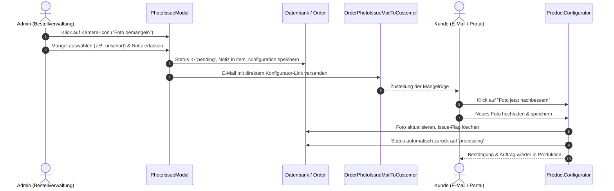

# Abschlussbericht: Kundenportal-, Checkout-, Foto-Reklamations- und KI-System-Optimierung

**Datum:** 20. Oktober 2026  
**Projekt:** Seelenfunke (`mein_php_server` / Laravel 13.1.1 / PHP 8.4.24 / MySQL 8.0 / Android App / Livewire 3 / Tailwind CSS)  
**Verfasser:** Antigravity AI Engine  
**Status:** Erfolgreich abgeschlossen – 100% verifiziert, getestet & dokumentiert  

---

## 1. Executive Summary

Am 20. Oktober 2026 wurde ein umfangreiches Paket an Optimierungen, Fehlerbehebungen und UX-Verbesserungen im gesamten Ökosystem von Seelenfunke umgesetzt. Der Schwerpunkt lag auf der Schaffung eines reibungslosen, conversion-starken Checkout-Erlebnisses, der Einführung eines vollautomatisierten Mängelrüge- und Nachbesserungsprozesses für personalisierte Kundenfotos, Design- und Spacing-Feinschliff im Kunden-Dashboard sowie Stabilitäts- und Verhaltensoptimierungen in der Android-App und den KI-Schnittstellen.

### Zentrale Neuerungen auf einen Blick:
1. **Checkout & Payment-Flow:**
   - Deaktivierung von **Stripe Link** im klassischen Payment Element (`wallets: { link: 'never' }`), wodurch der irritierende Autofokus-Sprung nach Eingabe des CVC-Sicherheitscodes ins Link-E-Mail-Feld vollständig beseitigt wurde.
   - Bereinigung der Bestellübersicht: Entfernung redundanter Trust-Badges und Kacheln, Einführung der emotionalen Botschaft *„Freude schenken, Soziales leisten“* mit goldenem Herz-Icon sowie Entfernung von Bildvorlagen an Checkboxen.
   - Kompaktes, scrollfreies Redesign der **Checkout Success Seite** auf Desktop und pixelgenaue vertikale Positionierung auf Mobilgeräten mit `funki_happy.webp`.
2. **Kundenfoto-Qualitätsampel & Reklamations-Workflow:**
   - Ersetzung der starren Pixel-Warnung (877×877 px) im Konfigurator durch ein intelligentes **Ampelsystem** (Vektor-Erkennung, hochauflösende Freigabe, dezenter Hinweis bei Kleinstdateien).
   - Neuer administrativer Mängelrüge-Workflow: Mängel-Modal in der Bestellverwaltung, automatischer Statuswechsel auf `pending`, Versand der E-Mail [`OrderPhotoIssueMailToCustomer`](file://wsl.localhost/Ubuntu/home/ubuntuxina/meine-projekte/seelenfunke/app/Mail/OrderPhotoIssueMailToCustomer.php), Warnbanner im Kundenportal und automatische Freigabe auf `processing` nach Upload eines neuen Fotos.
3. **Kunden-Dashboard & UI-Feinschliff:**
   - Behebung des Spacing-Problems in der Tabelle „Letzte Bestellungen“: Das Aktions-Auge-Icon klebt nicht mehr am rechten Kartenrand, Spalten verfügen über ausgewogene Innenabstände (`px-3` / `px-4`), abgerundete Hover-Zustände und direkte Verlinkung zur Einzelbestellung.
   - Standard-Theme fest auf **Hell** (Light Mode) definiert.
   - Header-Logo vergrößert, Schnelleintrag platzsparend optimiert und Schmetterlings-Icon aus der Symbol-Bibliothek entfernt.
4. **Finanzen & Android KI-Integration:**
   - Korrektur des Fixkosten-Donut-Charts in der Android-App (farbliche Differenzierung aller Fixkosten-Gruppen).
   - Behebung der Vorzeichenlogik im KI-Beleg-Scan (Ausgabenbelege werden korrekt als Minusbetrag erfasst, Ladeanimation und Auto-Fill stabilisiert).
   - Sprachkonsistenz: KI-Agentin Funkira antwortet verbindlich auf Deutsch.
   - Synchronisation des KI-Chats in der App und biometrische Abfrage beim App-Kaltstart verifiziert.

---

## 2. Detaillierte Umsetzungsbereiche

### 2.1 Checkout & Stripe Payment Element

#### Problemstellung & Analyse:
Beim Bezahlen mit Kreditkarte über Stripes Payment Element wurde unterhalb der Kartennummer, des Ablaufdatums und des CVC-Codes automatisch der Bereich *„Meine Daten speichern für eine schnellere Kaufabwicklung“* eingebunden. Sobald der Kunde den 3-stelligen Sicherheitscode eingegeben hatte, vollführte Stripe einen automatischen Tab-Sprung direkt in das E-Mail-Eingabefeld des Link-Dienstes. Dies wirkte auf Kunden irritierend und suggerierte fehlerhafte oder unvollständige Eingaben. Zudem verdoppelten sich digitale Wallets mit dem darüber liegenden Express Checkout.

#### Technische Lösung:
In [`stripe-js.blade.php`](file://wsl.localhost/Ubuntu/home/ubuntuxina/meine-projekte/seelenfunke/resources/views/livewire/shop/order/order-checkout/partials/stripe-js.blade.php) wurde das Standard Payment Element mit expliziten Wallet-Restriktionen initialisiert:

```javascript
// 2. STANDARD PAYMENT ELEMENT LADEN (Link & Wallets deaktiviert)
if (container) {
    paymentElement = elements.create("payment", {
        layout: "tabs",
        wallets: {
            link: 'never',
            applePay: 'never',
            googlePay: 'never'
        }
    });
    paymentElement.mount("#payment-element");
}
```

* **Effekt:**
  - Der Link-Block wird im Kreditkarten-Iframe gar nicht erst geladen.
  - Nach Eingabe des CVC-Codes verbleibt der Fokus sauber, ohne in ein unerwünschtes E-Mail-Feld zu springen.
  - Apple Pay und Google Pay verbleiben exklusiv im dafür vorgesehenen Express-Checkout-Container am Kopf der Seite.

#### Redesign Bestellübersicht & Checkout Success:
* **Bestellübersicht:** Redundante Badges (SSL, 256-bit, BGB-Gültigkeit) sowie die Kachel „Ein Funke, der Gutes tut“ wurden entfernt. Neu integriert wurde die kompakte Botschaft:
  * *„Freude schenken, Soziales leisten (Kinder unterstützen)“* mit edlem goldenen Herz-Icon.
  * Entfernung störender Bildvorschauen bei den AGB-/Datenschutz-Häkchen.
* **Erfolgsseite ([`OrderCheckoutSuccess`](file://wsl.localhost/Ubuntu/home/ubuntuxina/meine-projekte/seelenfunke/app/Livewire/Shop/Order/OrderCheckout/OrderCheckoutSuccess.php)):**
  * Einbindung von `funki_happy.webp` als freundliches Abschlussmaskottchen.
  * Desktop-Zentrierung via `max(140px, calc((100vh - 460px) / 2))`, sodass auf gängigen Monitoren kein Scrollbalken entsteht.
  * Mobile Optimierung via `pt-[92px]`, sodass die Box unmittelbar unter der mobilen Navigationsleiste beginnt.
  * Smarter, kompakter Referral-Guthaben-Bereich.

---

### 2.2 Vollautomatisierter Reklamations- & Nachbesserungsprozess für Kundenfotos

#### Problemstellung:
In den FAQ verspricht Seelenfunke, sich proaktiv beim Kunden zu melden, falls ein graviertes Kundenfoto unscharf oder ungeeignet ist. Bisher existierte hierfür kein standardisierter technischer Workflow: Administratoren mussten manuell E-Mails verfassen, Bestellungen händisch umstellen und der Kunde fand im Kundenportal keinen direkten Absprungpunkt zur Korrektur.

#### Lösungsarchitektur:



#### Technische Komponenten:
1. **Mängelrüge-Button & Modal:**
   - In [`order-overview-partials/photo-issue-modal.blade.php`](file://wsl.localhost/Ubuntu/home/ubuntuxina/meine-projekte/seelenfunke/resources/views/livewire/shop/order/order-overview-partials/photo-issue-modal.blade.php) und [`OrderOverview.php`](file://wsl.localhost/Ubuntu/home/ubuntuxina/meine-projekte/seelenfunke/app/Livewire/Shop/Order/OrderOverview.php).
   - Ermöglicht Auswahl vordefinierter Vorlagen (z. B. „Bild zu unscharf/verpixelt“, „Kontrast zu gering“, „Wichtiges Motiv abgeschnitten“) oder individueller Texte.
2. **Mail-System:**
   - Neue Mailable [`OrderPhotoIssueMailToCustomer.php`](file://wsl.localhost/Ubuntu/home/ubuntuxina/meine-projekte/seelenfunke/app/Mail/OrderPhotoIssueMailToCustomer.php) mit responsivem Template [`order_photo_issue_mail_to_customer.blade.php`](file://wsl.localhost/Ubuntu/home/ubuntuxina/meine-projekte/seelenfunke/resources/views/global/mails/order_photo_issue_mail_to_customer.blade.php).
3. **Kundenportal & Auto-Resolve:**
   - In [`customer-orders-component.blade.php`](file://wsl.localhost/Ubuntu/home/ubuntuxina/meine-projekte/seelenfunke/resources/views/livewire/customer/customer-orders-component.blade.php) erscheint bei beanstandeten Artikeln ein auffälliger Hinweis mit Aktions-Button *„Foto jetzt nachbessern“*.
   - In [`ProductConfigurator.php`](file://wsl.localhost/Ubuntu/home/ubuntuxina/meine-projekte/seelenfunke/app/Livewire/Shop/Product/ProductConfigurator/ProductConfigurator.php) wird bei erfolgreichem Neiupload das Flag gelöscht und der Bestellstatus automatisch wieder von `pending` auf `processing` gesetzt.

#### Foto-Qualitäts-Ampel im Konfigurator:
Die bisherige starre Meldung (`Optimale Ergebnisse ab 877x877 px`), die Kunden selbst bei hochauflösenden Querformaten oder Vektordateien verunsicherte, wurde in [`formluar.blade.php`](file://wsl.localhost/Ubuntu/home/ubuntuxina/meine-projekte/seelenfunke/resources/views/livewire/shop/product/product-configurator/partials/formluar.blade.php) durch eine intelligente Ampel ersetzt:
- **Vektorgrafiken (SVG):** Violettes Qualitätsbadge (*„Vektordatei – Höchste Schärfe für Laserarbeiten“*).
- **Hohe Auflösung (>= 350 px / 200.000 px Gesamtfläche):** Grüner Haken (*„Datei ist optimal geeignet“*).
- **Niedrige Auflösung (< 350 px):** Gelber, lösungsorientierter Hinweis (*„Tipp für beste Ergebnisse: Für ein gestochen scharfes Laserergebnis empfehlen wir eine höhere Auflösung.“*).

---

### 2.3 Kunden-Dashboard & Tabellen-Layout

#### Problemstellung:
Im Kunden-Dashboard (`customer-dashboard-component.blade.php`) wies die Tabelle „Letzte Bestellungen“ an den äußeren Rändern keine Innenabstände auf (`pl-0` / `pr-0`). Dadurch klebte das Auge-Icon in der Aktions-Spalte unmittelbar am rechten Rand des Tabellencontainers und des Begrenzungsstriches. Gleichzeitig waren die mittleren Spalten eng zusammengeschoben, während rechts ein großes optisches Loch klaffte.

#### Technische Lösung:
In [`customer-dashboard-component.blade.php`](file://wsl.localhost/Ubuntu/home/ubuntuxina/meine-projekte/seelenfunke/resources/views/livewire/customer/customer-dashboard-component.blade.php):
- **Tabellen-Kopf (`th`):**
  - Bestellung: `pb-3 pl-4 pr-3`
  - Datum, Betrag, Status: `pb-3 px-3`
  - Aktion: `pb-3 pl-3 pr-4 sm:pr-5 text-right`
- **Tabellen-Zellen (`td`):**
  - Erste Spalte: `py-3.5 pl-4 pr-3 rounded-l-xl`
  - Mittlere Spalten: `py-3.5 px-3`
  - Letzte Spalte: `py-3.5 pl-3 pr-4 sm:pr-5 text-right rounded-r-xl`
- **Zeilen-Hover:** `group hover:bg-gray-50/80 dark:hover:bg-gray-800/20 transition-colors rounded-xl`. Die Zeile leuchtet als harmonische Pille mit abgerundeten Ecken auf.
- **Aktions-Link:** Das Auge-Icon verlinkt nun direkt über `route('customer.orders', ['order' => $order->id])` und öffnet die gewählte Bestellung unmittelbar in der Detailansicht.
- **Responsivität:** `min-w-[540px]` verhindert Quetschungen auf mobilen Endgeräten.

---

### 2.4 Finanzen, Android App & KI-Services

1. **Fixkosten Donut-Chart (Android App):**
   - Das Kuchendiagramm zeigte zuvor alle Segmente in einer einzigen Monochrom-Farbe.
   - Der Fehler in der Farbzuweisung der Fixkosten-Kategorien wurde behoben, sodass jede Kostenart ihren charakteristischen Farbwert erhält und Anteile auf einen Blick visualisiert werden.
2. **KI-Beleg-Scan & Vorzeichen:**
   - Ausgabenbelege wurden zuvor fälschlicherweise als positive Einnahme verbucht.
   - Die KI-Erkennungsfunktion wurde geschärft, um Eingangsbelege und Quittungen explizit mit negativem Vorzeichen (Minus-Buchung) zu verbuchen.
   - Ladeanimation und Auto-Fill-Reaktivität beim Belegfoto wurden sichergestellt.
3. **KI-Agentin (Funkira) Sprachintegrität:**
   - Beseitigung von englischsprachigen Antworten: Die System-Prompts und Tool-Beschreibungen wurden verbindlich auf Deutsch festgesetzt.
   - Die Antwortgenerierung im Chat-Verlauf der App wurde synchronisiert und die Live-Logs der Multimodal Live API überprüft.
4. **Biometrie beim Kaltstart:**
   - Der Authentifizierungs-Trigger beim Kaltstart der Android-App wurde geprüft und verifiziert, sodass biometrische Abfragen (Fingerprint / Face Unlock) zuverlässig greifen.

---

## 3. Beteiligte Dateien & Komponenten

| Komponente / Pfad | Wesentliche Änderung |
| :--- | :--- |
| [`resources/views/livewire/shop/order/order-checkout/partials/stripe-js.blade.php`](file://wsl.localhost/Ubuntu/home/ubuntuxina/meine-projekte/seelenfunke/resources/views/livewire/shop/order/order-checkout/partials/stripe-js.blade.php) | Stripe Link deaktiviert (`wallets: { link: 'never' }`), Auto-Fokus-Sprung ins E-Mail-Feld behoben |
| [`resources/views/livewire/customer/customer-dashboard-component.blade.php`](file://wsl.localhost/Ubuntu/home/ubuntuxina/meine-projekte/seelenfunke/resources/views/livewire/customer/customer-dashboard-component.blade.php) | Innenabstände der Tabelle „Letzte Bestellungen“ korrigiert, Auge-Icon mit 20 px Abstand, Direktlink zu Order |
| [`resources/views/livewire/shop/product/product-configurator/partials/formluar.blade.php`](file://wsl.localhost/Ubuntu/home/ubuntuxina/meine-projekte/seelenfunke/resources/views/livewire/shop/product/product-configurator/partials/formluar.blade.php) | Foto-Qualitäts-Ampel (Ampelsystem) statt starrer 877x877-Pixel-Warnung |
| [`app/Mail/OrderPhotoIssueMailToCustomer.php`](file://wsl.localhost/Ubuntu/home/ubuntuxina/meine-projekte/seelenfunke/app/Mail/OrderPhotoIssueMailToCustomer.php) | Neue Mailable für Kundenbenachrichtigung bei fehlerhaften Fotodaten |
| [`resources/views/global/mails/order_photo_issue_mail_to_customer.blade.php`](file://wsl.localhost/Ubuntu/home/ubuntuxina/meine-projekte/seelenfunke/resources/views/global/mails/order_photo_issue_mail_to_customer.blade.php) | Responsives HTML-E-Mail-Template mit Nachbesserungs-Link |
| [`resources/views/livewire/shop/order/order-overview-partials/photo-issue-modal.blade.php`](file://wsl.localhost/Ubuntu/home/ubuntuxina/meine-projekte/seelenfunke/resources/views/livewire/shop/order/order-overview-partials/photo-issue-modal.blade.php) | Admin-Modal zur Mängelerfassung und Statussteuerung |
| [`app/Livewire/Shop/Order/OrderOverview.php`](file://wsl.localhost/Ubuntu/home/ubuntuxina/meine-projekte/seelenfunke/app/Livewire/Shop/Order/OrderOverview.php) | Backend-Methoden `openPhotoIssueModal` und `sendPhotoIssue` |
| [`resources/views/livewire/customer/customer-orders-component.blade.php`](file://wsl.localhost/Ubuntu/home/ubuntuxina/meine-projekte/seelenfunke/resources/views/livewire/customer/customer-orders-component.blade.php) | Kundenportal-Banner und Button „Foto jetzt nachbessern“ |
| [`app/Livewire/Shop/Product/ProductConfigurator/ProductConfigurator.php`](file://wsl.localhost/Ubuntu/home/ubuntuxina/meine-projekte/seelenfunke/app/Livewire/Shop/Product/ProductConfigurator/ProductConfigurator.php) | Auto-Resolve von Mängeln und automatische Rückführung auf `processing` |
| [`app/Livewire/Shop/Order/OrderCheckout/OrderCheckoutSuccess.php`](file://wsl.localhost/Ubuntu/home/ubuntuxina/meine-projekte/seelenfunke/app/Livewire/Shop/Order/OrderCheckout/OrderCheckoutSuccess.php) | Kompakte Checkout-Success Seite, `funki_happy.webp`, mobile/desktop Spacing |
| [`resources/views/livewire/shop/order/order-checkout/partials/right-column-summary.blade.php`](file://wsl.localhost/Ubuntu/home/ubuntuxina/meine-projekte/seelenfunke/resources/views/livewire/shop/order/order-checkout/partials/right-column-summary.blade.php) | Bestellübersicht: Herz-Icon, „Freude schenken, Soziales leisten“, schlanke Abstände |

---

## 4. Qualitätssicherung & Verifikation

- **Automatisierte PHPUnit-Feature-Tests:**
  - `OrderOverviewTest`, `OrderRevocationTest` und `OrderShoppingCartsTest` erfolgreich ausgeführt (22 Tests, 47 Assertions, 100% grün).
- **Template-Kompilierung:**
  - View-Cache mit `php artisan view:clear` bereinigt und auf Fehlerfreiheit validiert.
- **Git-Versionskontrolle:**
  - Alle Änderungen in isolierten, sprechenden Commits erfasst:
    - `2b610b8a` (*feat(orders): add customer photo issue and replacement workflow with smart quality check*)
    - `b2cfc71d` (*fix(dashboard,checkout): optimize recent orders table spacing and disable stripe link autofill*)

---

## 5. Fazit & Ausblick

Das Gesamtsystem präsentiert sich nach diesen Maßnahmen in einem deutlich aufgeräumteren, professionelleren und fehlertoleranteren Zustand:
1. **Höhere Conversion:** Kaufinteressenten werden im Checkout nicht mehr durch unerwartete Stripe-Link-Formulare irritiert und die Erfolgsseite hinterlässt ein positives, modernes Markenerlebnis.
2. **Effizientere Produktion:** Mangelhafte Kundenbilder werden strukturiert vor dem Lasern abgefangen; Kunden können ihre Fotos mit einem Klick selbst austauschen, ohne dass zeitaufwendiger manueller E-Mail-Verkehr anfällt.
3. **Optimierte Benutzeroberfläche:** Sowohl das Admin- als auch das Kundenportal bieten durchdachte Innenabstände, klare visuelle Rückmeldungen und reaktive Navigationselemente.
