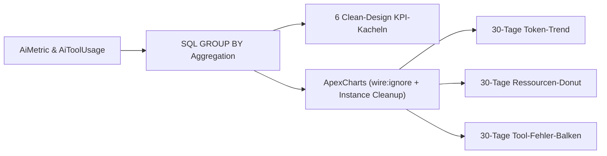

# Agenten-Analyse (`AiAnalytics`)

> **Stand:** 20.11.2026 | **Route:** `/admin/ai/analytics` (`admin.ai.analytics`) | **Abteilung:** `Agenten` (`#6366f1`)

Die Agenten-Analyse liefert die zentrale Telemetrie-, Latenz-, Fehler- und Kostenkontrolle für alle Google Cloud Vertex AI und Gemini Inferenzaufrufe im Seelenfunke-Ökosystem.

---

## 1. Beteiligte Klassen & Datenquellen

- **Livewire-Komponente:** [AiAnalytics.php](file://wsl.localhost/Ubuntu/home/ubuntuxina/meine-projekte/seelenfunke/app/Livewire/Shop/Ai/AiAnalytics.php)
- **Blade-View:** [ai-analytics.blade.php](file://wsl.localhost/Ubuntu/home/ubuntuxina/meine-projekte/seelenfunke/resources/views/livewire/shop/ai/ai-analytics.blade.php)
- **Modelle:**
  - [AiMetric.php](file://wsl.localhost/Ubuntu/home/ubuntuxina/meine-projekte/seelenfunke/app/Models/Ai/AiMetric.php): Speichert `input_tokens`, `output_tokens`, `total_time_ms` und `is_success` je Inferenz.
  - [AiToolUsage.php](file://wsl.localhost/Ubuntu/home/ubuntuxina/meine-projekte/seelenfunke/app/Models/Ai/AiToolUsage.php): Protokolliert jeden Funktionsaufruf (`tool_name`, `used_at`, `is_error`).
  - [AiChatMemory.php](file://wsl.localhost/Ubuntu/home/ubuntuxina/meine-projekte/seelenfunke/app/Models/Ai/AiChatMemory.php) & [SupportCustomerChatMessage.php](file://wsl.localhost/Ubuntu/home/ubuntuxina/meine-projekte/seelenfunke/app/Models/Support/SupportCustomerChatMessage.php): Ermitteln das 30-Tage-Dialogvolumen aus Admin-Workspace und Kunden-Support.
  - [SystemAiHostingPlan.php](file://wsl.localhost/Ubuntu/home/ubuntuxina/meine-projekte/seelenfunke/app/Models/System/SystemAiHostingPlan.php): Optionale Paketlimits (Fallback: **Vertex AI Postpay** mit `50,00 €` Monatsbudget).

---

## 2. Präzise Gemini 3.x / Vertex AI Kostenlogik (SQL-Aggregation)

Statt sämtliche `AiMetric`-Einzelzeilen in den PHP-Arbeitsspeicher zu laden, aggregiert [AiAnalytics.php](file://wsl.localhost/Ubuntu/home/ubuntuxina/meine-projekte/seelenfunke/app/Livewire/Shop/Ai/AiAnalytics.php) die monatlichen Input- und Output-Tokens direkt per `GROUP BY ai_agent_id` in MySQL und wendet das exakte Modell-Tiering an:

| Modell-Klasse | Erkennung (`strtolower($model)`) | Input je 1 Mio. Tokens | Output je 1 Mio. Tokens | Kontext-Fenster |
| :--- | :--- | :--- | :--- | :--- |
| **Pro-Klasse** (`gemini-3.1-pro-preview`, `gemini-2.5-pro`, `gemini-1.5-pro`) | `str_contains($model, '-pro')` | `\$1.25` | `\$5.00` | `2 Mio.` Tokens |
| **Flash-Lite-Klasse** (`gemini-3.5-flash-lite`, `gemini-2.5-flash-lite`) | `str_contains($model, 'flash-lite')` | `\$0.075` | `\$0.30` | `1 Mio.` Tokens |
| **Standard-Flash-Klasse** (`gemini-3.5-flash`, `gemini-2.5-flash`, `gemini-3.1-flash-live-preview`) | Standard-Fallback | `\$0.15` | `\$0.60` | `1 Mio.` Tokens |

> [!IMPORTANT]
> Durch die explizite Prüfung auf `-pro` statt pauschal `gemini-3` werden `gemini-3.5-flash`-Agenten exakt mit dem Flash-Tarif statt versehentlich mit dem Pro-Tarif berechnet. Ohne aktiven Festpreis-Tarif zeigt die Budget-Kachel direkt **Vertex AI Postpay** inklusive Fortschrittsbalken gegen das `50,00 €` Monatsbudget sowie die exakte Input-/Output-Token-Aufteilung im `!`-Tooltip.

---

## 3. KPIs, Charts & UI-Stabilität

1. **6 KPI-Kacheln ohne Subtext-Overload**:
   - **Tokens heute** (mit Heroicon-Trendpfeil im Vergleich zu gestern).
   - **Vertex AI Postpay / Tarif** (geschätzte Monatskosten gegen `50,00 €` Budget bzw. aktives Token-Limit; Input/Output-Aufschlüsselung im `!`-Tooltip).
   - **Ø Latenz (30 Tage)** in `ms` inkl. Gesamtzahl der Inferenz-Aufrufe.
   - **Erfolgsquote (30 Tage)** in Prozent mit Fortschrittsbalken.
   - **KI-Chats (30 Tage)** kombiniert aus internem Workspace und Shop-Support.
   - **Top KI-Tools (30 Tage)** mit den 5 meistgenutzten Funktionsschnittstellen.
2. **Kontext-Auslastung (Heute)**: Zeigt den höchsten heutigen Input-Kontext pro Agent relativ zum echten `1 Mio.`- bzw. `2 Mio.`-Limit mit sauber normalisierten Tailwind-Farbpunkten (`bg_class`).
3. **Livewire-sichere ApexCharts**: Alle 3 Diagramm-Container besitzen `wire:ignore` und zerstören bestehende Chart-Instanzen in `init()`/`destroy()`, sodass Livewire-Updates keine doppelten SVGs erzeugen.
