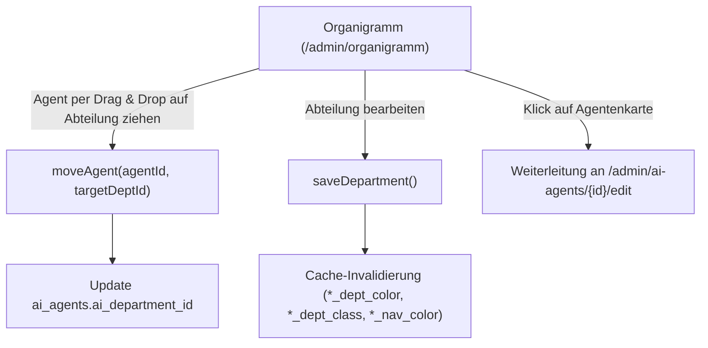

# Agenten-Organigramm (`AiCompanyStructure`)

> **Stand:** 20.11.2026 | **Route:** `/admin/organigramm` (`admin.organigramm`) | **Abteilung:** `Agenten` (`#6366f1`)

Das Agenten-Organigramm bildet die hierarchische Zuordnung aller KI-Agenten zu den 8 Fachabteilungen von `Mein-Seelenfunke` interaktiv im Clean-Design (Light- und Dark-Mode) ab.

---

## 1. Beteiligte Klassen, Views & Seeder

- **Livewire-Komponente:** [AiCompanyStructure.php](file://wsl.localhost/Ubuntu/home/ubuntuxina/meine-projekte/seelenfunke/app/Livewire/Shop/Ai/AiCompanyStructure.php)
- **Blade-View:** [ai-company-structure.blade.php](file://wsl.localhost/Ubuntu/home/ubuntuxina/meine-projekte/seelenfunke/resources/views/livewire/shop/ai/ai-company-structure.blade.php)
- **Struktur-Seeder:** [AiCompanyStructureSeeder.php](file://wsl.localhost/Ubuntu/home/ubuntuxina/meine-projekte/seelenfunke/database/seeders/AiCompanyStructureSeeder.php)
- **Agenten-Seeder:** [AiAgentSeeder.php](file://wsl.localhost/Ubuntu/home/ubuntuxina/meine-projekte/seelenfunke/database/seeders/AiAgentSeeder.php)
- **Modelle:** [AiDepartment.php](file://wsl.localhost/Ubuntu/home/ubuntuxina/meine-projekte/seelenfunke/app/Models/Ai/AiDepartment.php), [AiAgent.php](file://wsl.localhost/Ubuntu/home/ubuntuxina/meine-projekte/seelenfunke/app/Models/Ai/AiAgent.php), [AiRole.php](file://wsl.localhost/Ubuntu/home/ubuntuxina/meine-projekte/seelenfunke/app/Models/Ai/AiRole.php), [AiTool.php](file://wsl.localhost/Ubuntu/home/ubuntuxina/meine-projekte/seelenfunke/app/Models/Ai/AiTool.php)

---

## 2. Verbindliche Abteilungs- & Agenten-Struktur

Die 8 Abteilungen besitzen feste UUIDs in [AiCompanyStructureSeeder.php](file://wsl.localhost/Ubuntu/home/ubuntuxina/meine-projekte/seelenfunke/database/seeders/AiCompanyStructureSeeder.php), damit Farbthemen (`WithDepartmentTheming`) und Referenzen stabil bleiben:

| Index | Abteilung | Feste UUID | Farbe | Zugeordnete Agenten | Status im Live-System |
| :--- | :--- | :--- | :--- | :--- | :--- |
| **1** | **Leitung** | `019d0000-0000-0000-0000-000000000000` | `primary` | `Falcone`, `Funkira` | **Aktiv** (Führungsduo: `Falcone` Live-Call/3D-Stadt, `Funkira` Workspace/Skill-Pools) |
| **2** | **Support** | `019d6666-6666-6666-6666-666666666666` | `cyan-500` | `Funki` | **Aktiv** (Air-Gapped Shop-Frontend-Support) |
| **3** | **Produkte** | `019d1111-1111-1111-1111-111111111111` | `blue-500` | `Produkti` | Ehren-Ruhestand (Skills in `Funkira` vereint) |
| **4** | **Marketing** | `019d2222-2222-2222-2222-222222222222` | `purple-500` | `Marketi` | Ehren-Ruhestand (Skills in `Funkira` vereint) |
| **5** | **Bestellungen** | `019d3333-3333-3333-3333-333333333333` | `amber-500` | `Bestelli` | Ehren-Ruhestand (Skills in `Funkira` vereint) |
| **6** | **Buchhaltung** | `019d4444-4444-4444-4444-444444444444` | `emerald-500` | `Buchi`, `Einkaufi` | Ehren-Ruhestand (Skills in `Funkira` vereint) |
| **7** | **Agenten** | `019daaaa-aaaa-aaaa-aaaa-aaaaaaaaaaaa` | `indigo-500` | `Agenti`, `Dr. Funki`, `Globi` | Ehren-Ruhestand (`Globi` bewusst aus `Leitung` in `Agenten` verschoben) |
| **8** | **System** | `019d5555-5555-5555-5555-555555555555` | `red-500` | `Systemi` | Ehren-Ruhestand (Skills in `Funkira` vereint) |

---

## 3. Interaktions-, Farb- & Sicherheitslogik

1. **Drag-and-Drop (`moveAgent`)**: Zieht ein Administrator eine Agentenkarte auf eine Abteilungskarte oder deren Spalte, prüft `moveAgent` die Admin-Berechtigung (`assertAdminAccess`), validiert die Ziel-Abteilung und aktualisiert `ai_department_id` live.
2. **Clean-Design & Farbpalette**:
   - Abteilungsbeschreibungen überladen nicht mehr die Hauptkarten, sondern liegen kompakt hinter einem `!`-Tooltip.
   - Alle 14 Akzentfarben (`indigo-500`, `orange-500`, `teal-500`, `yellow-500`, `emerald-500`, `amber-500`, `blue-500`, `purple-500`, `pink-500`, `green-500`, `red-500`, `rose-500`, `cyan-500`, `sky-500`, `primary`) werden sowohl im Light- als auch im Dark-Mode kontraststark dargestellt.
3. **Rollen- & Zugriffs-Schutz**:
   - Lesezugriff nur für authentifizierte Admins und berechtigte interne Mitarbeiter (`AiCompanyStructureSecurityTest`).
   - Schreibzugriffe (`createDepartment`, `editDepartment`, `saveDepartment`, `deleteDepartment`, `moveAgent`, `updateDepartmentOrder`, `editAgent`) sind strikt Administratoren vorbehalten (`#[Locked] public $editingId`).
