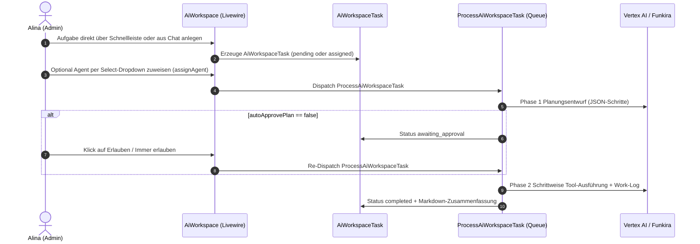

# Agenten-Zentrale (`AiWorkspace`)

> **Stand:** 20.11.2026 | **Route:** `/admin/ai/workspace` (`admin.ai.workspace`) | **Abteilung:** `Agenten` (`#6366f1`)

Die Agenten-Zentrale ist das zentrale Admin-Cockpit für asynchrone Hintergrundaufgaben, interaktiven KI-Chat, Dateitrichter (`storage/app/agenten/workspace`), Gesundheitsdaten, aktive KI-Workflows (SOPs), Server-Cronjobs, Wissensdatenbank und Tarif-Einstellungen.

---

## 1. Architektur & Beteiligte Komponenten

### Livewire-Komponenten & Traits
- **Hauptkomponente:** [AiWorkspace.php](file://wsl.localhost/Ubuntu/home/ubuntuxina/meine-projekte/seelenfunke/app/Livewire/Shop/Ai/AiWorkspace.php) (`boot()` & `mount()` strikt via `AiAuthHelper::isAdmin()` geschützt)
- **Chat & Hintergrund-Tasks:** [ManagesAiChat.php](file://wsl.localhost/Ubuntu/home/ubuntuxina/meine-projekte/seelenfunke/app/Livewire/Shop/Ai/Traits/ManagesAiChat.php)
- **Dateimanager & Dateitrichter:** [ManagesAiWorkspaceFiles.php](file://wsl.localhost/Ubuntu/home/ubuntuxina/meine-projekte/seelenfunke/app/Livewire/Shop/Ai/Traits/ManagesAiWorkspaceFiles.php) & [DateitrichterService.php](file://wsl.localhost/Ubuntu/home/ubuntuxina/meine-projekte/seelenfunke/app/Services/AI/Workspace/DateitrichterService.php)
- **Gesundheits- & Medikationsdaten:** [ManagesHealthData.php](file://wsl.localhost/Ubuntu/home/ubuntuxina/meine-projekte/seelenfunke/app/Livewire/Shop/Ai/Traits/ManagesHealthData.php)
- **Cronjob-Steuerung:** [TabCronjobs.php](file://wsl.localhost/Ubuntu/home/ubuntuxina/meine-projekte/seelenfunke/app/Livewire/Shop/Ai/PartialsAiWorkspace/TabCronjobs.php)
- **Eingebettete Wissensdatenbank:** [AiKnowledgeBase.php](file://wsl.localhost/Ubuntu/home/ubuntuxina/meine-projekte/seelenfunke/app/Livewire/Shop/Ai/AiKnowledgeBase.php)

### Views (`resources/views/livewire/shop/ai/`)
- **Haupt-Container:** [ai-workspace.blade.php](file://wsl.localhost/Ubuntu/home/ubuntuxina/meine-projekte/seelenfunke/resources/views/livewire/shop/ai/ai-workspace.blade.php) (inkl. HTTP-Clipboard-Fallback für `http://127.0.0.1`)
- **Globale Tab- & Schnellzugriffsleiste:** [navigation-tabs.blade.php](file://wsl.localhost/Ubuntu/home/ubuntuxina/meine-projekte/seelenfunke/resources/views/livewire/shop/ai/partials-ai-workspace/navigation-tabs.blade.php)
- **6 Fach-Tabs & 2 Vollansichten:**
  1. `workspace` ([tab-workspace.blade.php](file://wsl.localhost/Ubuntu/home/ubuntuxina/meine-projekte/seelenfunke/resources/views/livewire/shop/ai/partials-ai-workspace/tab-workspace.blade.php) + [task-details.blade.php](file://wsl.localhost/Ubuntu/home/ubuntuxina/meine-projekte/seelenfunke/resources/views/livewire/shop/ai/blocks/task-details.blade.php))
  2. `chat` ([tab-chat.blade.php](file://wsl.localhost/Ubuntu/home/ubuntuxina/meine-projekte/seelenfunke/resources/views/livewire/shop/ai/partials-ai-workspace/tab-chat.blade.php))
  3. `files` ([tab-files.blade.php](file://wsl.localhost/Ubuntu/home/ubuntuxina/meine-projekte/seelenfunke/resources/views/livewire/shop/ai/partials-ai-workspace/tab-files.blade.php))
  4. `health` ([tab-health.blade.php](file://wsl.localhost/Ubuntu/home/ubuntuxina/meine-projekte/seelenfunke/resources/views/livewire/shop/ai/partials-ai-workspace/tab-health.blade.php))
  5. `workflows` ([tab-workflows.blade.php](file://wsl.localhost/Ubuntu/home/ubuntuxina/meine-projekte/seelenfunke/resources/views/livewire/shop/ai/partials-ai-workspace/tab-workflows.blade.php))
  6. `cronjobs` ([tab-cronjobs.blade.php](file://wsl.localhost/Ubuntu/home/ubuntuxina/meine-projekte/seelenfunke/resources/views/livewire/shop/ai/partials-ai-workspace/tab-cronjobs.blade.php))
  7. Vollansicht `knowledge-base` ([view-knowledge-base.blade.php](file://wsl.localhost/Ubuntu/home/ubuntuxina/meine-projekte/seelenfunke/resources/views/livewire/shop/ai/partials-ai-workspace/view-knowledge-base.blade.php)) & Vollansicht `settings` ([view-settings.blade.php](file://wsl.localhost/Ubuntu/home/ubuntuxina/meine-projekte/seelenfunke/resources/views/livewire/shop/ai/partials-ai-workspace/view-settings.blade.php))

---

## 2. Funktionsumfang der 6 Tabs & Schnellzugriffe

### Globale Navigation & Schnellzugriffe
Über [navigation-tabs.blade.php](file://wsl.localhost/Ubuntu/home/ubuntuxina/meine-projekte/seelenfunke/resources/views/livewire/shop/ai/partials-ai-workspace/navigation-tabs.blade.php) sind von jedem Tab aus direkt erreichbar:
- **Wissen**: Öffnet die interne Wissensdatenbank (`AiKnowledgeBase`) mit Admin-Only-Kategorieschutz und HTML-Sanitizer.
- **Agenten**: Öffnet das Modal [modal-internal-agents.blade.php](file://wsl.localhost/Ubuntu/home/ubuntuxina/meine-projekte/seelenfunke/resources/views/livewire/shop/ai/partials-ai-workspace/modal-internal-agents.blade.php) zur Auswahl aktiver Workspace-Agenten sowie für parallele LLM-/TTS-Latenz-Pings (`syncAll` / `pingTest` gegen `VertexAiService` inkl. SSRF-Schutz in `sanitizeExternalTtsUrl`).
- **Einstellungen**: Steuert die automatische Freigabe von Ausführungsplänen (`autoApprovePlan`) sowie `SystemAiHostingPlan`-Tarife (`#[Locked] public ?int $editingPlanId`).

### Tab 1: Workspace (Asynchrone Hintergrundaufgaben & EKG-Monitor)

- **Schnell-Anlage (`createWorkspaceTask`)**: Neue Hintergrundaufgaben lassen sich direkt oberhalb der Task-Tabelle eingeben und optional sofort einem aktiven Agenten (`Funkira`) zuweisen.
- **Desktop- & Mobile-Zuweisung**: Wartende Aufgaben (`pending`) besitzen sowohl mobil als auch in der Desktop-Tabelle ein direkt bedienbares `<select>`-Dropdown (`assignAgent`).
- **EKG-Herzschlag-Canvas**: Nutzt `ctx.setTransform(dpr, 0, 0, dpr, 0, 0)` ohne Skalierungs-Drift, pausiert bei ausgeblendetem Tab (`offsetParent === null`) und zeigt bei stehendem Queue-Worker sofort eine rote Warnlinie samt Diagnose-Popover.

### Tab 2: Chat (`Funkira` mit dynamischen Skill-Pools)
- Standardmäßig wird ausschließlich `Funkira` als interner Workspace-Agent geladen (`Falcone` und `Funki` sind sauber separiert).
- Unterstützt Multi-Session-Historie (`AiChatSession`), `@`-Projektdatei-Referenzen (mit strikter Pfad-Allowlist in `isAllowedProjectAttachmentPath`), sichere Bilduploads (`resolveSafeChatUploadSpec`), Zwischenablage-Einfügen und Markdown-Rendering.

### Tab 3: Dateien (`storage/app/agenten/workspace`)
- Arbeitet physisch auf der privaten `workspace`-Disk (`storage/app/agenten/workspace`), ausgeliefert ausschließlich über die Admin-geschützte Route `/admin/ai/workspace/file` (mit Traversal-Schutz gegen `..`).
- Unterstützt Auto-Einsortierung via `DateitrichterService`, Kachel-/Tabellenansicht, Lightbox-Vorschau (Markdown & RAW im Light-/Dark-Mode), Umbenennen, Verschieben, Archivieren und ZIP-Download.

### Tab 4: Gesundheit (`ManagesHealthData`)
- Verwaltet aktive Medikamente (`AiHealthMedication` mit UUIDs) und verknüpft Ärzte/Praxen aus `ManagementContact`.
- Editier- und Lösch-Aktionen übergeben quotierte UUID-Strings (`editMedication('...')`) und sichern die Ziel-ID serverseitig über `#[Locked] public ?string $editingMedicationId`.

### Tab 5 & 6: Aktive Workflows (SOPs) & Server-Cronjobs
- **Workflows**: Dokumentiert kompakt die 4 realen produktiven KI-Abläufe (`Dynamischer Skill-Pool`, `Mail- & Beleg-Trichter`, `Air-Gapped Kundenchat`, `Standort- & Reiseplanung` mit `Globi`).
- **Cronjobs**: Verwaltet `SystemCronjob`-Intervalle (strikte Regex- & CronExpression-Validierung), Pausieren/Aktivieren und synchrones Test-Ausführen (`runNow` mit Blocklist gegen Daemon-/Destruktiv-Befehle) inkl. sauberem Timer-Cleanup (`clearInterval` in `destroy()`).
