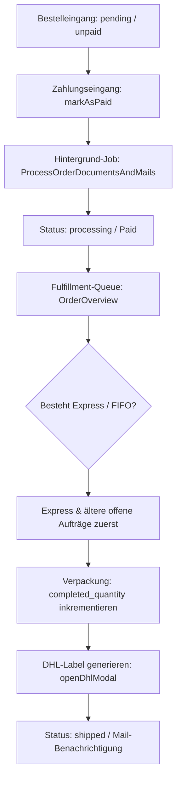

# Bestellungen - Bestellungen

Dieses Dokument beschreibt die technische Struktur und den Abwicklungs-Workflow des Bestellungs-Management-Moduls im Laravel-Backend. Das Modul steuert den Status von Bestellungen, verwaltet den Verpackungsprozess, korrigiert Lagerbestände, bucht Zahlungen und steuert die DHL-Versandschnittstelle inklusive Etikettendruck und PDF-Merging.

## Zielsetzung
Das Bestellungs-Management ist die zentrale Schnittstelle zur physischen Bestellabwicklung (Fulfillment). Es implementiert eine Prioritäts-Sortierung nach dem FIFO-Prinzip (First-In, First-Out) bei gleichzeitiger Bevorzugung von Expresssendungen und integriert Logistikprozesse direkt in die Admin-Oberfläche.

---

## Beteiligte Komponenten & Modelle

### Backend-Livewire-Controller
* [OrderOverview](file://wsl.localhost/Ubuntu/home/ubuntuxina/meine-projekte/seelenfunke/app/Livewire/Shop/Order/OrderOverview.php)
  * Die primäre administrative Schaltzentrale für Bestellungs-CRUD, Verpackungsfortschritte und Versandlabel-Erstellung.

### Dienste & Jobs
* [DhlService](file://wsl.localhost/Ubuntu/home/ubuntuxina/meine-projekte/seelenfunke/app/Services/DhlService.php)
  * Kommuniziert mit den APIs von DHL zur Erzeugung von Tracking-IDs und Paketaufklebern.
* [ProcessOrderDocumentsAndMails](file://wsl.localhost/Ubuntu/home/ubuntuxina/meine-projekte/seelenfunke/app/Jobs/ProcessOrderDocumentsAndMails.php)
  * Hintergrund-Job zur asynchronen PDF-Rechnungserstellung und E-Mail-Zustellung.
* [FileDownloadService](file://wsl.localhost/Ubuntu/home/ubuntuxina/meine-projekte/seelenfunke/app/Services/Export/FileDownloadService.php)
  * Exportiert Laserdateien (SVGs) für 3D-Gravuren.

### Modelle
* [OrderOrder](file://wsl.localhost/Ubuntu/home/ubuntuxina/meine-projekte/seelenfunke/app/Models/Order/OrderOrder.php)
  * Speichert Bestell-Header: `order_number`, `status` (`pending`, `processing`, `shipped`, `completed`, `cancelled`, `refunded`, `failed`), `payment_status` (`paid`, `unpaid`), Liefer- und Rechnungsadresse, Express-Status (`is_express`) und Notizen.
* [OrderOrderItem](file://wsl.localhost/Ubuntu/home/ubuntuxina/meine-projekte/seelenfunke/app/Models/Order/OrderOrderItem.php)
  * Die einzelnen Positionen. Speichert `quantity`, `completed_quantity` (wichtig für die Verpackungsstation) und `is_completed`.
* [OrderShipment](file://wsl.localhost/Ubuntu/home/ubuntuxina/meine-projekte/seelenfunke/app/Models/Order/OrderShipment.php)
  * Referenziert erzeugte Sendungsdaten und den Pfad zum DHL-PDF-Label.
* [SystemLog](file://wsl.localhost/Ubuntu/home/ubuntuxina/meine-projekte/seelenfunke/app/Models/System/SystemLog.php)
  * Protokolliert Laufzeitfehler bei Statusänderungen oder API-Fehlern.

---

## Logistischer Workflow (Fulfillment-Schritte)

### 1. Intelligente Priorisierung (Fulfillment-Queue)
Die Listenansicht sortiert standardmäßig nach dem `default_workflow`:
1. Offene Bestellungen (`pending`, `processing`) stehen ganz oben, erledigte/stornierte unten.
2. Express-Bestellungen (`is_express` = `true`) werden vorrangig platziert.
3. Innerhalb dieser Gruppen gilt FIFO: Älteste Bestellungen (`created_at` ASC) werden zuerst abgearbeitet.
* **Lagerbestandsprüfung**: Das System prüft vorab, ob physischer Lagerbestand gesichert ist. Fehlen Artikel eines Express-Auftrags, wird ein kritischer Warnhinweis im Header angezeigt.

### 2. Statusänderungen und Transaktionssicherheit
* **Stornierung (`cancelled`)**: Falls eine unbezahlte Bestellung storniert wird, führt das System automatisch ein Rollback durch und bucht reservierte Artikel-Stückzahlen über `Product::restoreStock` zurück ins Lager.
* **Rechnungserstellung**: Wird eine Bestellung auf `paid` gesetzt, triggert das System im Hintergrund den Dokumenten-Job, um PDF-Rechnungen zu erzeugen und dem Kunden zuzusenden.
* **Verpackungs-Detailkontrolle**: Mitarbeiter können pro Artikelposition die verpackte Menge (`completed_quantity`) steuern. Erst wenn diese mit der bestellten Menge übereinstimmt, gilt das Item als `is_completed`.

### 3. Integrierte DHL-Label-Generierung
Aus der Detailansicht heraus lässt sich ein DHL-Versandaufkleber generieren:
1. **Automatische Gewichtsberechnung (`calculateDhlWeight`)**:
   * Ermittelt das Gesamtgewicht der Produkte (Fallback: 100g pro Artikel).
   * Schlägt ein Verpackungsgewicht (Tara) auf (Standard: 350g oder produktspezifische Kartonage).
   * Teilt das Gewicht durch die Anzahl geplanter Pakete (`dhlPackageCount`).
   * Ergibt das exakte, gerundete Einzelgewicht pro Paket (mind. 0,1 kg bis max. 31,5 kg).
2. **API-Anbindung (`generateDhlLabels`)**: Der `DhlService` übermittelt Empfängerdaten und Gewichte an DHL, empfängt Trackingnummern sowie PDF-Labels und legt sie in `OrderShipment` ab. Der Bestellstatus wird auf `shipped` gesetzt.

### 4. PDF-Sammeldruck (Label-Merging)
Mitarbeiter können über `downloadMergedLabels()` alle Labels der aktuellen Filterliste gebündelt als ein einziges PDF herunterladen:
* Es werden alle Pfade zu den verknüpften PDF-Dateien aus dem Speicher geladen.
* Mittels der FPDI-Bibliothek (`setasign\Fpdi\Fpdi`) werden alle Einzelseiten dynamisch importiert, das Format (Hoch- oder Querformat) ausgelesen und zu einer PDF-Datei zusammengefügt.
* Dies spart erhebliche Zeit beim Ausdrucken an der Packstation.

### 5. Reklamations- & Nachbesserungsprozess für Kundendateien (Foto bemängeln)
Wenn bei der Arbeitsvorbereitung (z. B. vor dem Laserauftrag) auffällt, dass ein vom Kunden hochgeladenes Foto unscharf, verpixelt, kontrastarm oder ungünstig beschnitten ist:
1. **Admin-Mängelrüge (`openPhotoIssueModal`)**:
   - In der Bestellungsdetailansicht befindet sich neben jedem Kunden-Upload unter „Dateien & Downloads“ ein Kamera-Mängel-Button.
   - Ein Klick öffnet das [`photo-issue-modal.blade.php`](file://wsl.localhost/Ubuntu/home/ubuntuxina/meine-projekte/seelenfunke/resources/views/livewire/shop/order/order-overview-partials/photo-issue-modal.blade.php).
   - Der Administrator wählt die Fehlerursache aus vordefinierten Textbausteinen (z.B. „Bild ist zu unscharf/verpixelt“, „Kontrast zu schwach“, „Bildinhalt abgeschnitten“) und kann eine persönliche Hilfestellung ergänzen.
2. **Automatischer Produktionsstopp**:
   - Der Bestellstatus wechselt auf `pending` (Wartend), um eine versehentliche Produktion der mangelhaften Vorlage zu verhindern.
   - Der Mangel und die Notiz werden im Datenfeld `item_configuration['photo_issue']` der Position hinterlegt.
3. **Kundenbenachrichtigung & Portal-Führung**:
   - Das System versendet die Mailable [`OrderPhotoIssueMailToCustomer`](file://wsl.localhost/Ubuntu/home/ubuntuxina/meine-projekte/seelenfunke/app/Mail/OrderPhotoIssueMailToCustomer.php) mit Vorlage [`order_photo_issue_mail_to_customer.blade.php`](file://wsl.localhost/Ubuntu/home/ubuntuxina/meine-projekte/seelenfunke/resources/views/global/mails/order_photo_issue_mail_to_customer.blade.php).
   - In der E-Mail sowie im Kundenportal ([`customer-orders-component.blade.php`](file://wsl.localhost/Ubuntu/home/ubuntuxina/meine-projekte/seelenfunke/resources/views/livewire/customer/customer-orders-component.blade.php)) leuchtet ein auffälliger Hinweis mit dem Direktlink *„Foto jetzt nachbessern“* auf.
4. **Automatischer Wiederanlauf (Auto-Resolve)**:
   - Der Kunde gelangt direkt in den Produktkonfigurator, lädt ein optimiertes Bild hoch und speichert.
   - [`ProductConfigurator.php`](file://wsl.localhost/Ubuntu/home/ubuntuxina/meine-projekte/seelenfunke/app/Livewire/Shop/Product/ProductConfigurator/ProductConfigurator.php) erkennt die Nachbesserung, entfernt die Mängelnotiz und setzt den Auftragsstatus automatisch wieder auf `processing` (In Bearbeitung).

### 6. Schnell-Personalisierung (`custom_fields_data`), „Laser-Steckbrief“ (1-Klick-Copy) & xTool-Schriftarten-Export (03.11.2026)
Für Bestellpositionen, die über die **Schnell-Personalisierung (`personalization_mode = 'custom_fields'`)** bestellt wurden:
1. **Laser-Steckbrief mit 1-Klick-Copy ([`custom_fields_form.blade.php`](file://wsl.localhost/Ubuntu/home/ubuntuxina/meine-projekte/seelenfunke/resources/views/livewire/shop/product/product-configurator/partials/custom_fields_form.blade.php) & [`details-pane.blade.php`](file://wsl.localhost/Ubuntu/home/ubuntuxina/meine-projekte/seelenfunke/resources/views/livewire/shop/order/order-overview-partials/details-pane.blade.php))**:
   - In der rechten Vorschau-Spalte von `/admin/orders` wird aus dem gespeicherten Bestell-Snapshot (`configuration['custom_fields_data']`) der **Laser-Steckbrief** gerendert – ohne unnötige Initialisierung der 3D-Three.js-Engine.
   - Jedes ausgefüllte Kundenfeld (z. B. *Wunschname*, *Datum*, *Symbol*) besitzt einen eigenen **„Kopieren“**-Button sowie oben rechts den Sammel-Button **„📋 Alle Werte kopieren“** für die sofortige Übernahme in xTool Creative Space (XCS).
   - Hat der Kunde über ein Feld vom Typ **`font` („Schriftart-Auswahl“)** eine der 22 Konfigurator-Schriftarten gewählt, wird diese im Laser-Steckbrief sowohl im echten `@font-face`-Schriftbild als auch mit ihrem technischen Namen dargestellt.
2. **Maßstabsgetreuer xTool-Laser-SVG-Export ([`FileDownloadService::downloadLaserSvg()`](file://wsl.localhost/Ubuntu/home/ubuntuxina/meine-projekte/seelenfunke/app/Services/Export/FileDownloadService.php))**:
   - Beim Klick auf **„XTOOL LASER-DATEI LADEN“** werden die eingegebenen Texte und die gewählte Konfigurator-Schriftart (`type === 'font'`) automatisch aus `custom_fields_data` / `texts` übernommen, die `.woff2`-Schrift als Base64-`@font-face` in die SVG eingebettet und maßstabsgetreu ausgegeben.
3. **Deduplizierte Bestelldetailansicht**:
   - „Besondere Kundenwünsche“ (`notes`), „Gebuchte Verpackung & Extras“ (`addons_summary`) und der „Laser-Steckbrief“ werden in [`details-pane.blade.php`](file://wsl.localhost/Ubuntu/home/ubuntuxina/meine-projekte/seelenfunke/resources/views/livewire/shop/order/order-overview-partials/details-pane.blade.php) und [`footer.blade.php`](file://wsl.localhost/Ubuntu/home/ubuntuxina/meine-projekte/seelenfunke/resources/views/livewire/shop/product/product-configurator/partials/footer.blade.php) jeweils nur an einer einzigen, eindeutigen Stelle gerendert.

### 7. Digitale Begleitdokumente (Echtheitszertifikate & Pflegehinweise) in Bestellansicht & E-Mails (06.11.2026)
- Physische Produkte können optionale digitale Begleitdokumente (`configurator_settings['digital_documents']`) mitführen, die beim Kauf in `order_order_items.configuration['digital_documents']` gesichert und über `OrderOrderItem::resolveDigitalDocuments()` aufgelöst werden.
- Im Kundenportal (`/orders`) werden diese Dateien im Bereich **Dokumente** nach Zahlungseingang (`payment_status === 'paid'`) über [`DigitalProductDownloadController.php`](file://wsl.localhost/Ubuntu/home/ubuntuxina/meine-projekte/seelenfunke/app/Http/Controllers/Customer/DigitalProductDownloadController.php) zum Download bereitgestellt; alle Bestell-E-Mails weisen den Kunden automatisch darauf hin. Siehe [`Produkte_Digitale_Begleitdokumente.md`](file://wsl.localhost/Ubuntu/home/ubuntuxina/meine-projekte/seelenfunke/Abschlussberichte/Produkte/Produkte_Digitale_Begleitdokumente.md).

### 8. GoBD-konforme Löschlogik („Bestellung unwiderruflich löschen“) & Automatische Datei-Bereinigung (13.11.2026)
- **Zentrale Prüfmethode [`OrderOrder::canBePermanentlyDeleted()`](file://wsl.localhost/Ubuntu/home/ubuntuxina/meine-projekte/seelenfunke/app/Models/Order/OrderOrder.php#L1008-L1035):**
  - Eine Bestellung darf gemäß GoBD / § 147 AO ausschließlich dann gelöscht werden, wenn es sich um einen **unbezahlten Kaufabbruch, Zahlungsfehlversuch oder Testauftrag** handelt:
    1. `payment_status` liegt in `['unpaid', 'failed', 'open', 'pending']` (niemals `paid` oder `refunded`).
    2. `status` liegt in `['pending', 'failed', 'cancelled']` (niemals `processing`, `shipped` oder `completed`).
    3. Es existiert **keine** Rechnung oder Gutschrift (`invoices`) und **kein** Versandlabel (`shipments`).
  - Sobald Geld geflossen ist, eine Rechnung existiert oder versendet wurde, ist das Löschen im Backend hart gesperrt; der Vorgang darf dann ausschließlich über **Stornieren (`cancelled`)** bzw. **Erstatten (`refunded`)** rückabgewickelt werden ([`handleCancellation()`](file://wsl.localhost/Ubuntu/home/ubuntuxina/meine-projekte/seelenfunke/app/Models/Order/OrderOrder.php#L835-L900)).
- **Clean-UI-Sichtbarkeit ([`left.blade.php`](file://wsl.localhost/Ubuntu/home/ubuntuxina/meine-projekte/seelenfunke/resources/views/livewire/shop/order/order-offer-detail-partials/left.blade.php#L737-L744)):**
  - Der rote Button **„Bestellung unwiderruflich löschen“** wird im Bestell-Detail-Drawer ausschließlich für Administratoren (`auth('admin')->check()`) und nur dann gerendert, wenn `$model->canBePermanentlyDeleted()` erfüllt ist. Bei GoBD-geschützten Bestellungen ist der Button komplett ausgeblendet.
- **Rückstandsloses `forceDelete()` inkl. Storage-Bereinigung ([`OrderOrder::permanentlyDeleteUnpaidOrder()`](file://wsl.localhost/Ubuntu/home/ubuntuxina/meine-projekte/seelenfunke/app/Models/Order/OrderOrder.php#L1042-L1055) & [`CartFileCleanupService::cleanupOrderFilesAfterDeletion()`](file://wsl.localhost/Ubuntu/home/ubuntuxina/meine-projekte/seelenfunke/app/Services/CartFileCleanupService.php#L315-L348)):**
  - Statt eines bloßen `SoftDelete` auf `order_orders` (bei dem früher die `order_order_items` und deren Dateien dauerhaft als Dateileichen erhalten blieben), werden zunächst alle `order_order_items` gelöscht, der Auftrag per `forceDelete()` endgültig entfernt und anschließend alle nicht mehr anderweitig referenzierten Kunden-Uploads (`bestellungen/cart-uploads`) und 3D-Snapshots (`system/snapshots`) physisch von `Storage::disk('public')` bereinigt.
  - Jeder Löschvorgang wird revisionssicher mit Bestellnummer und Anzahl bereinigter Dateien in [`SystemLog`](file://wsl.localhost/Ubuntu/home/ubuntuxina/meine-projekte/seelenfunke/app/Models/System/SystemLog.php) (`action_id = 'admin_order_force_delete'`) protokolliert.

