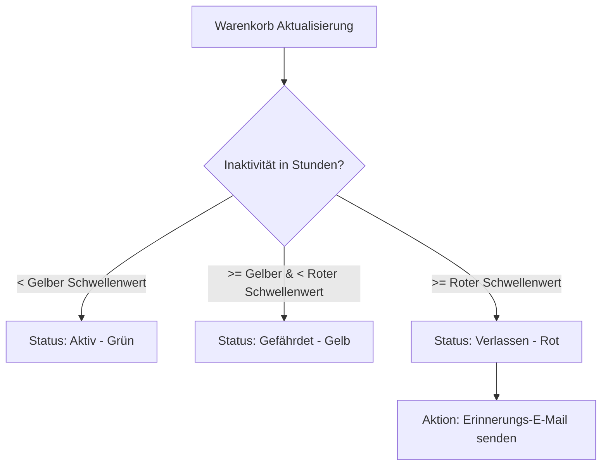

# Bestellungen - Warenkörbe

Dieses Dokument beschreibt das technische System zur Erfassung, Verwaltung und Nachverfolgung aktiver sowie verlassener Warenkörbe (Abandoned Carts) im Laravel-Projekt. Es erläutert das administrative Kontrollzentrum im Backend sowie den automatisierten Mahnprozess für Kunden mit gefüllten, aber nicht abgeschlossenen Warenkörben.

## Zielsetzung
Das Warenkorb-Tracking dient der Senkung der Kaufabbruchquote. Über eine optische Klassifizierung und manuelle oder automatische E-Mail-Erinnerungen können Kunden dazu bewegt werden, ihren Einkauf zu vollenden.

---

## Beteiligte Komponenten & Modelle

### Backend-Livewire-Controller
* [OrderShoppingCarts](file://wsl.localhost/Ubuntu/home/ubuntuxina/meine-projekte/seelenfunke/app/Livewire/Shop/Order/OrderShoppingCarts.php)
  * Stellt die Benutzeroberfläche zur Administration aller existierenden Warenkörbe bereit.
  * Verwaltet die Ampel-Grenzwerte und steuert den E-Mail-Mahnprozess.

### Frontend-Komponenten & Services
* [Cart](file://wsl.localhost/Ubuntu/home/ubuntuxina/meine-projekte/seelenfunke/app/Livewire/Shop/Cart/Cart.php)
  * Die Frontend-Livewire-Komponente zur Darstellung des aktuellen Kunden-Warenkorbs.
* [CartService](file://wsl.localhost/Ubuntu/home/ubuntuxina/meine-projekte/seelenfunke/app/Services/CartService.php)
  * Kapselt die Berechnungslogik (Zwischensummen, Steuern, Mengenstaffelrabatte und Versandkosten je nach Zielland).
* [AbandonedCartReminder](file://wsl.localhost/Ubuntu/home/ubuntuxina/meine-projekte/seelenfunke/app/Mail/AbandonedCartReminder.php)
  * Die Mailable-Klasse für die Erinnerungs-E-Mail.

### Modelle
* [Cart](file://wsl.localhost/Ubuntu/home/ubuntuxina/meine-projekte/seelenfunke/app/Models/Cart/Cart.php)
  * Speichert den Warenkorb-Header: `session_id`, `customer_id` (falls angemeldet), `reminder_email_sent_at` und Zeitstempel.
* [CartItem](file://wsl.localhost/Ubuntu/home/ubuntuxina/meine-projekte/seelenfunke/app/Models/Cart/CartItem.php)
  * Einzelpositionen mit Produkt-ID und `quantity`.

---

## Technischer Datenfluss & Ampel-Grenzwerte

Im Backend wird jeder Warenkorb nach der Inaktivitätsdauer klassifiziert. Die Schwellenwerte können in der Administration konfiguriert werden und werden in der Tabelle `system_settings` persistiert:
1. **Gelbe Zone (`cart_abandoned_yellow_hours`, Standard: 3 Std.)**:
   * Der Warenkorb wurde seit mehr als X Stunden nicht mehr aktualisiert, aber das Limit für die rote Zone ist noch nicht erreicht. Signalisiert einen potenziellen Abbruch.
2. **Rote Zone (`cart_abandoned_red_hours`, Standard: 24 Std.)**:
   * Der Warenkorb liegt seit über Y Stunden unberührt im System. Signalisiert einen definitiven Abbruch.

---

## Administrative Eingriffsmöglichkeiten

Der Administrator hat vollen Zugriff auf den Inhalt fremder Warenkörbe und kann helfend eingreifen, um z. B. telefonische Kundenbestellungen manuell zu begleiten:
* **Mengenänderung**: Über `increment()`, `decrement()` oder manuelle Eingabe (`updateQuantity()`) wird die Stückzahl angepasst. Hierbei berechnet der `CartService` im Hintergrund automatisch Staffelpreise (`tierPrices`) und Steuersätze neu.
* **Artikel entfernen (`removeItem`)**: Einzelne Posten können gelöscht werden. Sinkt die Artikelanzahl im Warenkorb auf 0, wird der gesamte Cart-Eintrag aus der Datenbank entfernt.
* **Warenkorb löschen (`deleteCart`)**: Entfernt verwaiste Carts restlos aus der Datenbank.

---

## Freundliche Warenkorb-Erinnerungen (`SendAbandonedCartReminders` & `sendReminderEmail`)

Befindet sich ein registrierter Kunde im Warenkorb (aktive E-Mail vorhanden):
1. **Rechtssicherheit & freiwillige Checkbox bei Registrierung / Profil (§ 7 Abs. 2 UWG & Art. 6 / Art. 7 / Art. 21 DSGVO):**
   - Bei der Registrierung auf `/register` ([`AuthRegister`](file://wsl.localhost/Ubuntu/home/ubuntuxina/meine-projekte/seelenfunke/app/Livewire/Auth/AuthRegister.php) / [`auth-register.blade.php`](file://wsl.localhost/Ubuntu/home/ubuntuxina/meine-projekte/seelenfunke/resources/views/livewire/auth/auth-register.blade.php)) kann der Kunde optional die nicht vorangehakte Checkbox *„Warenkorb-Erinnerungen & Manufaktur-Neuigkeiten erhalten“* wählen. Das Opt-In bleibt bis zum Klick auf den E-Mail-Bestätigungslink ([`CustomerVerificationController::verify()`](file://wsl.localhost/Ubuntu/home/ubuntuxina/meine-projekte/seelenfunke/app/Http/Controllers/Customer/CustomerVerificationController.php)) auf `is_verified = false` und wird erst dadurch als echtes **Double-Opt-In** aktiviert.
   - Im Kundenprofil ([`AuthProfileDropdown`](file://wsl.localhost/Ubuntu/home/ubuntuxina/meine-projekte/seelenfunke/app/Livewire/Auth/AuthProfileDropdown.php) / [`tab_profile.blade.php`](file://wsl.localhost/Ubuntu/home/ubuntuxina/meine-projekte/seelenfunke/resources/views/livewire/auth/partials/tab_profile.blade.php)) lässt sich die Einwilligung über [`Customer::updateMarketingConsent()`](file://wsl.localhost/Ubuntu/home/ubuntuxina/meine-projekte/seelenfunke/app/Models/Customer/Customer.php) jederzeit mit einem Klick aktivieren oder widerrufen (inkl. DSGVO-Nachweis im `SystemLog` und erneutem Double-Opt-In bei E-Mail-Änderung).
   - Sowohl der manuelle Versand in [`OrderShoppingCarts::sendReminderEmail()`](file://wsl.localhost/Ubuntu/home/ubuntuxina/meine-projekte/seelenfunke/app/Livewire/Shop/Order/OrderShoppingCarts.php), der Cronjob [`SendAbandonedCartReminders`](file://wsl.localhost/Ubuntu/home/ubuntuxina/meine-projekte/seelenfunke/app/Console/Commands/SendAbandonedCartReminders.php) (`shop:send-abandoned-cart-reminders`, alle 5 Minuten inkl. ausfallsicherem Fallback in [`console.php`](file://wsl.localhost/Ubuntu/home/ubuntuxina/meine-projekte/seelenfunke/routes/console.php)) als auch die Dashboard-Prüfung in [`AnalyticsService::checkAbandonedCarts()`](file://wsl.localhost/Ubuntu/home/ubuntuxina/meine-projekte/seelenfunke/app/Services/AnalyticsService.php) prüfen über `$customer->allowsCartReminders()`, ob ein aktives Konto (nicht gelöscht), ein verifiziertes Werbe-Opt-In (Case-Insensitive Abgleich) und kein Widerspruch (`cart_reminder_unsubscribed_at`) vorliegen.
2. **Nahtlose Gast-zu-Kunde-Übernahme:** Über [`CartService::mergeGuestCartIntoCustomer()`](file://wsl.localhost/Ubuntu/home/ubuntuxina/meine-projekte/seelenfunke/app/Services/CartService.php) werden Artikel und Gravur-Konfigurationen aus Gast-Sitzungen beim Login ([`AuthLogin`](file://wsl.localhost/Ubuntu/home/ubuntuxina/meine-projekte/seelenfunke/app/Livewire/Auth/AuthLogin.php), 2FA, [`GoogleAuthController`](file://wsl.localhost/Ubuntu/home/ubuntuxina/meine-projekte/seelenfunke/app/Http/Controllers/GoogleAuthController.php), [`OrderCheckout`](file://wsl.localhost/Ubuntu/home/ubuntuxina/meine-projekte/seelenfunke/app/Livewire/Shop/Order/OrderCheckout/OrderCheckout.php)) sowie bei der Registrierung ([`AuthRegister`](file://wsl.localhost/Ubuntu/home/ubuntuxina/meine-projekte/seelenfunke/app/Livewire/Auth/AuthRegister.php)) verlustfrei in den Kunden-Warenkorb überführt.
3. **Mehrfach-Zyklen & echte Zeitstempel:** Nach Kaufabschluss bzw. Leeren des Warenkorbs (`emptyCart()`) oder beim Start eines neuen Einkaufs wird `reminder_email_sent_at` automatisch auf `null` zurückgesetzt, damit zukünftige Einkäufe erneut erinnert werden können. Bloße Seitenaufrufe oder der reine Mailversand überschreiben `updated_at` nicht künstlich.
4. **Nahtloser Rückkehr-Link nach Sitzungsablauf:** Da die 2-Stunden-Sitzung nach 24 Stunden abgelaufen ist, verweist der Button in [`AbandonedCartReminder`](file://wsl.localhost/Ubuntu/home/ubuntuxina/meine-projekte/seelenfunke/app/Mail/AbandonedCartReminder.php) auf den kryptografisch gesicherten Endpunkt [`CartReminderUnsubscribeController::resume()`](file://wsl.localhost/Ubuntu/home/ubuntuxina/meine-projekte/seelenfunke/app/Http/Controllers/CartReminderUnsubscribeController.php) (`/warenkorb/erinnerung/oeffnen/{id}/{hash}`). Ist die Sitzung abgelaufen, wird die E-Mail im Login vorbefüllt und der Kunde nach der Anmeldung direkt in seinen gespeicherten `/warenkorb` geleitet.
5. **Wertschätzende, druckfreie Tonalität:** Das E-Mail-Template [`order_shopping_cart_reminder_to_customer.blade.php`](file://wsl.localhost/Ubuntu/home/ubuntuxina/meine-projekte/seelenfunke/resources/views/global/mails/order_shopping_cart_reminder_to_customer.blade.php) erinnert herzlich, unverbindlich und ohne Kaufdruck im hellen Manufaktur-Stil (`#C5A059` Matt-Gold), listet ausschließlich aktive Artikel inkl. Hinweis auf gespeicherte Wunschgravuren auf und enthält einen One-Click-Abmeldelink (`List-Unsubscribe`).
6. **Kein Geister-To-Do bei fehlendem Opt-In:** Warenkörbe von Gästen ohne E-Mail, Kunden ohne Werbe-Opt-In oder Körbe außerhalb des 7-Tage-Fensters lösen im Operativen Status (`/admin/dashboard`) keinen Warn-Eintrag aus.
7. **Bereinigung leerer Warenkorb-Hüllen:** Leere Warenkörbe (`0 Artikel`) werden in `OrderShoppingCarts` ausgeblendet (`whereHas('items')`) und nach über 1 Stunde Inaktivität automatisch bereinigt.
