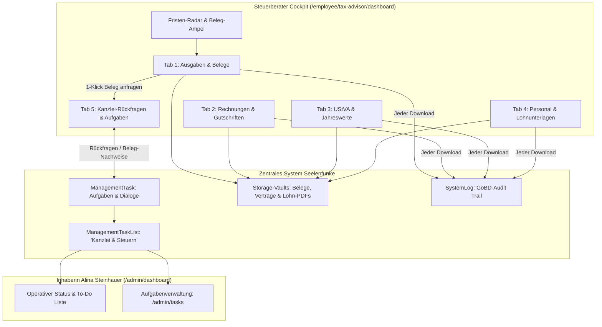

# Abschlussbericht: Steuerberater-Cockpit & Kanzlei-Portal (Kommunikation & Aufgaben)

Dieses Dokument beschreibt die Architektur, Sicherheitsmechanismen, Workflows, den Marktvergleich mit Branchenführern und die mobile Optimierung des integrierten Kanzlei-Portals (`TaxAdvisorDashboard`) für Mein-Seelenfunke.

---

## 1. Unternehmerischer Mehrwert & Zielsetzung

Bei klassischen Online-Händlern entstehen monatlich erhebliche Reibungsverluste und Kanzlei-Kosten durch:
* Lose E-Mail-Ketten mit Beleg-Rückfragen
* Manuelles Suchen nach Quittungen und Verträgen in Postfächern
* Redundante doppelte Aufgabenlisten zwischen Kanzlei und Mandant
* Fehlende Belege, die erst bei der Betriebsprüfung oder UStVA-Frist auffallen

**Die Seelenfunke-Lösung:**
Ein vollständig integriertes Steuerberater-Cockpit ([`TaxAdvisorDashboard`](file://wsl.localhost/Ubuntu/home/ubuntuxina/meine-projekte/seelenfunke/app/Livewire/Employee/TaxAdvisor/TaxAdvisorDashboard.php)), das als zentrales Self-Service-Portal fungiert. Alle steuerlich relevanten Daten, Belege, E-Rechnungen, Lohnunterlagen und UStVA-Zahlen stehen der Kanzlei mit 1 Klick zur Verfügung. Sollten dennoch Rückfragen auftreten, kommunizieren Kanzlei und Mandantin direkt über ein synchronisiertes Kanzlei-Aufgabensystem, das nahtlos in die operative Kommandozentrale von Alina Steinhauer ([`MasterAnalytics`](file://wsl.localhost/Ubuntu/home/ubuntuxina/meine-projekte/seelenfunke/app/Livewire/Shop/Master/MasterAnalytics.php) / [`ManagementTask`](file://wsl.localhost/Ubuntu/home/ubuntuxina/meine-projekte/seelenfunke/app/Livewire/Shop/Management/ManagementTask.php)) einfließt.

---

## 2. Marktvergleich mit Branchenführern (DATEV, Lexoffice, sevdesk, Candis)

| Kriterium / Feature | DATEV Unternehmen online | Lexoffice / sevdesk | Seelenfunke Kanzlei-Cockpit |
| :--- | :--- | :--- | :--- |
| **DATEV EXTF & SKR03 Export** | Standard (nativ) | CSV-Export vorhanden | Nativer SKR03 EXTF-Stapel (Windows-1252) + 1-Klick-ZIP |
| **Belegfehlt-Ampel & Vollständigkeit** | Belege online Status | Ampelanzeige | Nativer Belegfilter + Vollständigkeitsindex in Echtzeit |
| **1-Klick-Rückfrage bei fehlendem Beleg** | Umständlich via DATEV Mitteilungen | Manuelle Notiz/Mail | 1 Klick generiert vorbefüllte Task für Alina im Admin-Dashboard |
| **Fristen-Radar (UStVA & AO)** | Kalender-Modul | Erinnerungs-Banner | Automatischer Countdown nach § 18 UStG inkl. Werktagsverschiebung (§ 108 AO) |
| **E-Rechnungs-Readiness (EN16931)** | XML / ZUGFeRD Import | ZUGFeRD / XRechnung | Automatische ZUGFeRD- / XRechnung-Generierung & ZIP-Download |
| **Bankumsatz-Reconciliation** | Bank online Zuordnung | Automatischer Bankabgleich | Vollständige Anzeige aller Kontobewegungen (z. B. FYRST) inkl. Belegstatus |
| **Lohn & Personal (Arbeiter-Akten)** | LODAS / Lohn und Gehalt | Lohn-Zusatzmodul (kostenpflichtig) | Vollständige Personalakten (§ 2 NachwG Verträge, Fragebögen, Stundenzettel, Lohnjournal) |
| **GoBD-Audit-Logging** | Revisionssicheres Log | Export-Protokoll | Automatisches GoBD-Audit-Log in `SystemLog` für jeden Kanzlei-Download |
| **Rollen-Isolation & DSGVO** | Benutzerverwaltung | Mandanten-Rechte | Strikte Isolation (kein Zugriff auf Kundendaten, Werkstatt oder Marketing) |

---

## 3. Architektur & Komponenten-Übersicht

### Beteiligte Kernkomponenten:
* **Livewire-Komponente:** [`TaxAdvisorDashboard.php`](file://wsl.localhost/Ubuntu/home/ubuntuxina/meine-projekte/seelenfunke/app/Livewire/Employee/TaxAdvisor/TaxAdvisorDashboard.php)
* **Blade-View:** [`tax-advisor-dashboard.blade.php`](file://wsl.localhost/Ubuntu/home/ubuntuxina/meine-projekte/seelenfunke/resources/views/livewire/employee/tax-advisor/tax-advisor-dashboard.blade.php)
* **Modelle:** [`Employee`](file://wsl.localhost/Ubuntu/home/ubuntuxina/meine-projekte/seelenfunke/app/Models/Employee/Employee.php), [`ManagementTask`](file://wsl.localhost/Ubuntu/home/ubuntuxina/meine-projekte/seelenfunke/app/Models/Management/ManagementTask.php), [`ManagementTaskList`](file://wsl.localhost/Ubuntu/home/ubuntuxina/meine-projekte/seelenfunke/app/Models/Management/ManagementTaskList.php), [`SystemLog`](file://wsl.localhost/Ubuntu/home/ubuntuxina/meine-projekte/seelenfunke/app/Models/System/SystemLog.php)
* **Feature-Tests:** [`TaxAdvisorTaskCommunicationTest.php`](file://wsl.localhost/Ubuntu/home/ubuntuxina/meine-projekte/seelenfunke/tests/Feature/Employee/TaxAdvisorTaskCommunicationTest.php) & [`TaxAdvisorDashboardTest.php`](file://wsl.localhost/Ubuntu/home/ubuntuxina/meine-projekte/seelenfunke/tests/Feature/Accounting/TaxAdvisorDashboardTest.php)

---

## 4. Funktionale Kern-Workflows

### A. Fristen-Radar & UStVA-Countdown
* Das Dashboard ermittelt für jeden Abrechnungsmonat den genauen gesetzlichen Abgabetermin (10. des Folgemonats nach § 18 Abs. 1 UStG).
* Fällt der 10. auf einen Samstag, Sonntag oder gesetzlichen Feiertag, wird die Frist automatisch auf den nächsten Werktag verschoben (§ 108 Abs. 3 AO).
* Im Header sieht die Kanzlei auf einen Blick, wie viele Tage bis zur Abgabe verbleiben oder ob die Frist bereits fällig ist.

### B. Belegfehlt-Radar & 1-Klick-Rückfrage
* In Tab 1 (Ausgaben & Belege) kann die Kanzlei über den Schnellfilter `[Alle Belege] [Belegt ✓] [Fehlt ⚠️ (X)]` sofort alle Positionen ohne Belegnachweis isolieren.
* Bei gewerblichen Posten ohne Beleg erscheint der Button `⚠️ Beleg anfragen`.
* Ein Klick darauf wechselt per Event in Tab 5 (`tasks`), öffnet das Formular für neue Rückfragen und befüllt den Betreff sowie die Detailnachricht mit Betrag, Datum und Bezeichnung der Buchung vor.

### C. Vollständige Bankkonto-Reconciliation (FYRST)
* Alle importierten Bankkontobewegungen (z. B. vom FYRST Geschäftskonto) werden vollständig abgebildet.
* Noch nicht kategorisierte Transaktionen werden mit der Kennzeichnung `Zuordnung offen` hervorgehoben, sodass keine Buchung für den Monatsabschluss verloren geht.

### D. Personal- & Lohnbereich (Arbeiter-Dokumente)
* Tab 4 bündelt alle Mitarbeiterakten:
  * Unterzeichnete Arbeitsverträge nach § 2 Nachweisgesetz (NachwG)
  * Personalfragebögen mit ELStAM-Merkmalen und Sozialversicherungsnummer
  * Monatliche Stundenzettel mit geleisteten Arbeitsstunden
  * Lohnabrechnungen (DATEV-konform)
* Ein kompakter Lohn-KPI-Header summiert die gesamten Bruttogehälter des Monats für die Lohnsteuer-Voranmeldung.

### E. GoBD-Audit-Logging
* Jeder Abruf von DATEV-Dateien, UStVA-PDFs, Rechnungs-ZIPs, Personalakten oder Belegen wird lückenlos in `system_logs` (`type: gobd_audit`) dokumentiert:
  * Identität des Steuerberaters (Name, ID, E-Mail)
  * Name der heruntergeladenen Datei
  * IP-Adresse und Browser-Signatur
  * Exakter Zeitstempel

---

## 5. Sicherheitsarchitektur & Rollen-Isolation (§ 8 SF-Regeln)

1. **Guard- & Rollen-Isolation:**
   * Authentifizierung über den `employee`-Guard mit erzwungener Rolle `tax_advisor`.
   * Strikte Trennung über [`EnsureEmployeeRole`](file://wsl.localhost/Ubuntu/home/ubuntuxina/meine-projekte/seelenfunke/app/Http/Middleware/EnsureEmployeeRole.php) und [`EmployeeRoleIsolationHook`](file://wsl.localhost/Ubuntu/home/ubuntuxina/meine-projekte/seelenfunke/app/Livewire/Hooks/EmployeeRoleIsolationHook.php).
   * Versuche der Kanzlei, interne Admin-Routen (`/admin/*`) oder interne Mitarbeiter-Ansichten (`/employee/dashboard`) aufzurufen, werden mit Redirect bzw. HTTP 403 geblockt.
2. **Aufgaben-Scope Isolation:**
   * Das Dashboard lädt ausschließlich Tasks mit `task_list_id` der Kanzlei-Systemliste (`Kanzlei & Steuern`).
   * Andere Listen (Werkstatt, Laser-Produktion, Marketing) sind für den Steuerberater vollständig unsichtbar.
3. **Dateidownload-Schutz & Whitelisting:**
   * Die Methode `downloadTaskFile` prüft das Vorhandensein des Pfads in der Datenbank-Spalte `file_paths` der konkreten Aufgabe.
   * Bei Beleg-Downloads (`downloadReceiptOrContract`) greifen `realpath`-Prüfungen gegen den erlaubten Buchhaltungs-Tresor.
   * Path-Traversal-Versuche (`..`) und unberechtigte Dateiabfragen werden mit HTTP 403 sofort abgewiesen.
4. **Fehlertoleranz bei dynamischen PDFs:**
   * Vor dem Download archivierter Rechnungs-PDFs prüft das System die physische Existenz auf der Festplatte; fehlt die Datei unerwartet, generiert das System das PDF on-the-fly, anstatt mit einem Fehler abzubrechen.

---

## 6. UI/UX & Mobile Responsiveness (Clean Design)

1. **Clean-Design Disziplin (§ 1 SF-Regeln):**
   * Keine erklärenden Subtexte unter Buttons oder Badges.
   * Mandanten-Stammdaten, Tresor-Archive und Buchungs-Hinweise sind in ein diskretes Klappmenü (*Erklärung anzeigen*) ausgelagert.
   * Keine KI-Gedankenstriche (` – `) in UI-Texten.
2. **Mobile Optimierung (Smartphones & Tablets):**
   * **Horizontales Swipe-Menü für Tabs:** Die 5 Haupt-Tabs sind in einen Container mit `overflow-x-auto max-w-full no-scrollbar whitespace-nowrap` gefasst. Dadurch bleiben alle Reiter auf Mobilgeräten (ab 360px Breite) flüssig horizontal scrollbar, ohne umzubrechen oder die Seitenbreite zu sprengen.
   * **Touch-optimierte Bedienelemente:** Formularfelder und Aktions-Buttons (`sm:flex-row`, `w-full sm:w-auto`) passen sich responsiv an Bildschirmbreiten an.
   * **Harmonischer Dark-/Light-Mode:** Volle Unterstützung für System-Theming mit kontrastreichen Hintergründen (`bg-white dark:bg-gray-900/40`) und goldenen Akzenten (`#C5A059`).

---

## 7. Testabdeckung & Verifikation

Das Kanzlei-Portal wird durch 13 automatisierte Feature-Tests mit 89 Assertions zu 100 % abgedeckt:

1. **[`TaxAdvisorTaskCommunicationTest.php`](file://wsl.localhost/Ubuntu/home/ubuntuxina/meine-projekte/seelenfunke/tests/Feature/Employee/TaxAdvisorTaskCommunicationTest.php):**
   * `tax_advisor_can_view_tasks_strictly_isolated_to_kanzlei_list`: Verifiziert strikte Trennung von Werkstatt- und Kanzlei-Aufgaben.
   * `tax_advisor_can_create_a_task_with_attachments_and_priority`: Prüft Aufgabenerstellung, Dateispeicherung und Priorität.
   * `tax_advisor_can_toggle_task_completion`: Testet Erledigt-Status-Wechsel.
   * `tax_advisor_can_submit_inline_dialogue_response_with_files`: Testet mehrstufigen Dialog und Belegnachreichung.
   * `tax_advisor_can_download_attached_task_file`: Prüft sicheren Belegdownload.
   * `path_traversal_and_unattached_file_downloads_are_blocked_with_403`: Verifiziert Schutz vor unbefugtem Dateizugriff.
   * `internal_employee_and_influencer_are_isolated_from_tax_advisor_dashboard`: Prüft Rollen-Isolation.
   * `admin_can_see_tax_advisor_tasks_in_management_tasks_seamlessly`: Prüft nahtlose Integration in Alinas Management-Aufgaben.
   * `tax_advisor_can_prefill_new_task_for_missing_receipt_and_filter_by_receipt_status`: Prüft 1-Klick-Rückfrage & Belegstatus-Filter.
   * `tax_advisor_downloads_are_recorded_in_gobd_audit_log`: Prüft GoBD-konforme Protokollierung in `system_logs`.

2. **[`TaxAdvisorDashboardTest.php`](file://wsl.localhost/Ubuntu/home/ubuntuxina/meine-projekte/seelenfunke/tests/Feature/Accounting/TaxAdvisorDashboardTest.php):**
   * Verifiziert Login-Redirects, DATEV CSV, UStVA PDF, Komplettpaket ZIP, E-Rechnungen und Berechnungslogik.
