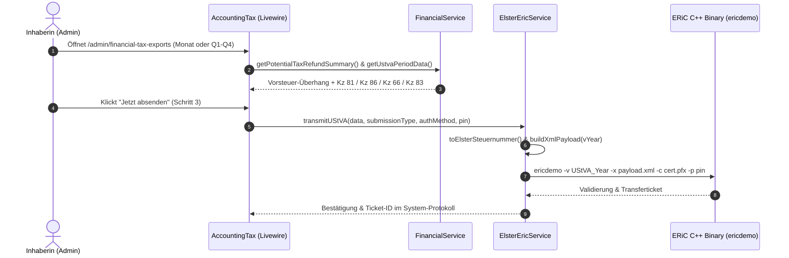

# Dokumentation: Buchhaltung & Umsatzsteuer-Zentrale (ELSTER, ERiC & Vorsteuer-Cockpit)

Die **Umsatzsteuer-Zentrale** (`/admin/financial-tax-exports`, [AccountingTax.php](file://wsl.localhost/Ubuntu/home/ubuntuxina/meine-projekte/seelenfunke/app/Livewire/Shop/Accounting/AccountingTax.php)) berechnet die monatliche oder vierteljährliche Umsatzsteuer-Voranmeldung (UStVA) sowie den laufenden Vorsteuer-Erstattungsanspruch in Echtzeit. Sie verbindet die interne Finanzbuchhaltung ([FinancialService.php](file://wsl.localhost/Ubuntu/home/ubuntuxina/meine-projekte/seelenfunke/app/Services/FinancialService.php)), das Kanzlei-Portal ([TaxAdvisorDashboard.php](file://wsl.localhost/Ubuntu/home/ubuntuxina/meine-projekte/seelenfunke/app/Livewire/Employee/TaxAdvisor/TaxAdvisorDashboard.php)) und die native C++-Schnittstelle der Finanzverwaltung ([ElsterEricService.php](file://wsl.localhost/Ubuntu/home/ubuntuxina/meine-projekte/seelenfunke/app/Services/ElsterEricService.php)).

## 1. Prominente Karte: „Potenzielle Steuerrückgabe“ (`getPotentialTaxRefundSummary`)

Ganz oben in [accounting-tax.blade.php](file://wsl.localhost/Ubuntu/home/ubuntuxina/meine-projekte/seelenfunke/resources/views/livewire/shop/accounting/accounting-tax.blade.php) zeigt die Umsatzsteuer-Zentrale den aktuellen Vorsteuer-Überhang (bzw. bei negativem Erstattungssaldo automatisch den Titel **„Voraussichtliche USt-Zahllast“**):

*   **Drei Echtzeit-Sichten per Tab-Umschalter:**
    1.  **`Gesamt Bisher` (`total_all`, Standard-Ansicht):** Alle bisherigen gewerblichen Sonderausgaben (`AccountingSpecialIssue`, inkl. Vorgründungsausgaben `12/2025` und `2026`) plus alle bis zum heutigen Stichtag fälligen gewerblichen Fixkosten (`AccountingCostItem`, ohne zukünftige unbezahlte Monate) abzüglich der Ausgangs-Umsatzsteuer bezahlter Bestellungen/Rechnungen.
    2.  **`Ab Gründung 11/26` (`since_launch`):** Alle gewerblichen Ausgaben und Umsätze ab dem offiziellen Gewerbestart `01.11.2026` bis heute.
    3.  **`Gewählter Zeitraum` (`selected_period`):** Exakter Saldo des unten gewählten Monats oder Quartals.
*   **Transparente Formel-Aufschlüsselung:** Zeigt nebeneinander `Vorsteuer Sonderausgaben` + `Vorsteuer Fixkosten` abzüglich `Umsatzsteuer Verkäufe`.
*   **Belegsicherheits-Prüfung im `!`-Hover-Tooltip (Clean-Design nach Baustein 1):** Ohne erklärende Subtexte im Hauptlayout schlüsselt das `!`-Icon beim Überfahren `Belegsicher (7 % / 19 %)` gegenüber `Vorläufige Belege (Rechnung nachladen)` inkl. Postenanzahl auf (erkennt fehlende Dateien, Amazon-Bestellübersichten, Nicht-USt-Kaufbelege und PayPal-Transaktionsbelege ohne verknüpfte Originalrechnung).

---

## 2. Zeitraum-Steuerung (`Monat` & `Quartal Q1-Q4`) und Kennzahlen (`Kz 81`, `Kz 86`, `Kz 66`, `Kz 83`)

Über `FinancialService::getUstvaPeriodData(int $year, int $monthOrQuarter, string $mode)` unterstützt die Zentrale sowohl Monatszahler als auch Quartalszahler nach § 18 Abs. 2 UStG:

*   **Monats-Modus (`month`):** Voranmeldungszeiträume `01` bis `12`.
*   **Quartals-Modus (`quarter`, `Q1-Q4`):** Aggregiert alle 3 Quartalsmonate (`Q1 = Jan-Mär`, `Q2 = Apr-Jun`, `Q3 = Jul-Sep`, `Q4 = Okt-Dez`), rundet die quartalsweise Netto-Bemessungsgrundlage nach ELSTER-Vorschrift auf volle Euro ab und übergibt die amtlichen ELSTER-Zeiträume `41` bis `44` (DATEV-ZIP-Archivierung als `TaxExport_YYYY_Q1..Q4.zip`).
*   **Steuerpflichtige Umsätze `19 %` (`Kz 81`) & `7 %` (`Kz 86`):** Bezahlte Bestellungen (`OrderOrder`), manuelle Rechnungen (`AccountingInvoice`) und Gutschriften/Stornos werden positionsgenau auf `19 %` (`Kz 81`) und `7 %` (`Kz 86`) aufgeteilt (auch in [ustva_report.blade.php](file://wsl.localhost/Ubuntu/home/ubuntuxina/meine-projekte/seelenfunke/resources/views/global/pdf/ustva_report.blade.php) und in der amtlichen XML-Formularvorschau).
*   **Strikter deutscher Vorsteuer-Filter (`Kz 66`):** Über `FinancialService::isEligibleGermanInputVatRate()` fließen ausschließlich echte deutsche Vorsteuersätze (`7 %` und `19 %`) in `Kz 66` ein. Ausländische EU-Umsatzsteuer (z. B. `25 %` dänische MOMS bei Westpack) sowie `0 %` Versicherungssteuer (z. B. Hiscox Betriebshaftpflicht nach § 4 Nr. 10 UStG) oder `NULL`-Werte auf Fixkosten werden niemals fälschlich als Vorsteuer abgezogen, mindern aber mit ihrem vollen Bruttobetrag den Gewinn in der EÜR.
*   **Direkte Seeder-Pflege ([AccountingSeeder.php](file://wsl.localhost/Ubuntu/home/ubuntuxina/meine-projekte/seelenfunke/database/seeders/AccountingSeeder.php)):** Alle gewerblichen Fixkosten (`AccountingCostItem`) und Sonderausgaben (`AccountingSpecialIssue`) speichern ihren expliziten deutschen Vorsteuersatz (`0`, `7` oder `19`).

---

## 3. Native ELSTER/ERiC C++-Integration & 13-stellige Bundeseinheitliche Steuernummer

Die Übertragung an die Clearingstelle `datenannahme.elster.de` erfolgt über [ElsterEricService.php](file://wsl.localhost/Ubuntu/home/ubuntuxina/meine-projekte/seelenfunke/app/Services/ElsterEricService.php):

1.  **Automatische 13-stellige ELSTER-Steuernummer (`toElsterSteuernummer`):** Regionale Finanzamts-Steuernummern werden für das `<Steuernummer>`-Element automatisch in das 13-stellige Bundeseinheitliche ELSTER-Schema überführt (z. B. Niedersachsen / Finanzamt Gifhorn `2319`: `'19/143/11624'` wird zu `'2319014311624'`, `<Empfaenger id="F">2319</Empfaenger>`).
2.  **Dynamisches Jahres-Schema (`v{$year}` / `UStVA_{$year}`):** Im Live-Betrieb (`ERIC_TEST_MODE=false`) erzeugt der Service dynamisch den passenden Finkonsens-Namespace `http://finkonsens.de/elster/elsteranmeldung/ustva/v2026` (`version="2026"`) inkl. `<Kz81>`, `<Kz86>`, `<Kz66>` und `<Kz83>` und übergibt die passende Datenart (`-v UStVA_2026`) an das kompilierte C++-Binary `ericdemo`.
3.  **Abgesicherter Sandbox-Modus (`ERIC_TEST_MODE=true`):** Solange der Testmodus aktiv ist, nutzt das System automatisch `<Testmerker>700000004</Testmerker>` sowie die offizielle ELSTER-Sandbox-Kennung (`9111081508152` / FA `9111`), sodass Testläufe garantiert straffrei im ELSTER-Testsystem verbleiben.
4.  **Pre-Flight-Checkliste:** Prüft vor jeder Freigabe lückenlose Belegdateien aller gewerblichen Posten im Zeitraum (inkl. Inline-Upload), hinterlegte Steuernummer, Inhabernamen sowie das `.pfx`-Zertifikat im Tresor (`storage/app/buchhaltung/erictresor`).

---

## 4. Kanzlei-Portal & Automatisierte Qualitätssicherung

*   **Steuerberater-Cockpit ([TaxAdvisorDashboard.php](file://wsl.localhost/Ubuntu/home/ubuntuxina/meine-projekte/seelenfunke/app/Livewire/Employee/TaxAdvisor/TaxAdvisorDashboard.php)):** Streng rollenisoliert (`tax_advisor`), wendet denselben deutschen Vorsteuer-Filter (`7 %` / `19 %`) an, protokolliert jeden Dateiabruf GoBD-konform (`gobd_audit`) und koppelt Beleg-Rückfragen direkt an die Aufgabenliste `Kanzlei & Steuern` auf `/admin/dashboard`.
*   **Feature-Test-Abdeckung:** Abgesichert durch [AccountingTaxCentralTest.php](file://wsl.localhost/Ubuntu/home/ubuntuxina/meine-projekte/seelenfunke/tests/Feature/Accounting/AccountingTaxCentralTest.php), [AccountingTaxTest.php](file://wsl.localhost/Ubuntu/home/ubuntuxina/meine-projekte/seelenfunke/tests/Feature/Livewire/Shop/Accounting/AccountingTaxTest.php), [AccountingTaxReceiptSecurityTest.php](file://wsl.localhost/Ubuntu/home/ubuntuxina/meine-projekte/seelenfunke/tests/Feature/Accounting/AccountingTaxReceiptSecurityTest.php) und [TaxAdvisorDashboardTest.php](file://wsl.localhost/Ubuntu/home/ubuntuxina/meine-projekte/seelenfunke/tests/Feature/Accounting/TaxAdvisorDashboardTest.php).
