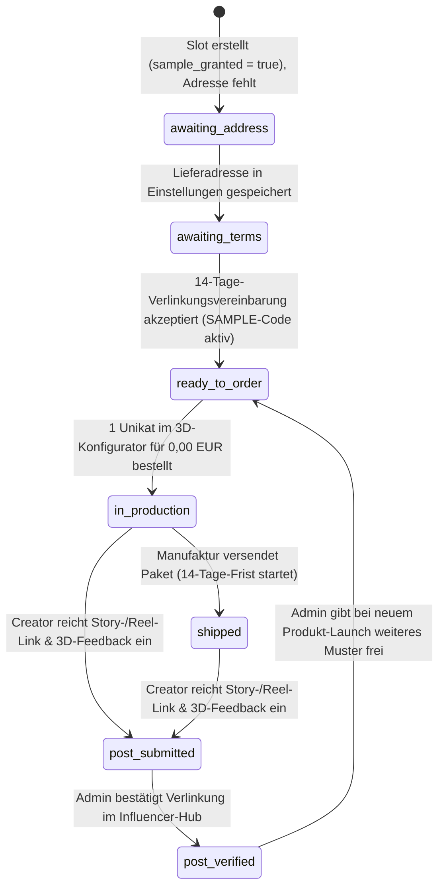

# System-Dokumentation: Influencer- & Creator-Dashboard (`InfluencerDashboard`)

Dieses Dokument beschreibt die vollständige technische Architektur, Geschäftslogik, UI/UX-Struktur, Sicherheits-Isolation sowie den End-to-End-Workflow des **Seelenfunke Creator Cockpits** (`/employee/influencer/dashboard`).

---

## 1. Übersicht & Strategische Zielsetzung

Das Influencer-Dashboard ([`InfluencerDashboard.php`](file://wsl.localhost/Ubuntu/home/ubuntuxina/meine-projekte/seelenfunke/app/Livewire/Employee/Influencer/InfluencerDashboard.php) & [`influencer-dashboard.blade.php`](file://wsl.localhost/Ubuntu/home/ubuntuxina/meine-projekte/seelenfunke/resources/views/livewire/employee/influencer/influencer-dashboard.blade.php)) ist das eigenständige Self-Service-Portal für ausgewählte Kooperationspartner, Content Creator und Affiliates von **Mein-Seelenfunke**.

Es vereint sechs zentrale Säulen in einer einzigen, aufgeräumten Single-Page-Oberfläche:
1. **Echtzeit-Performance & Attribution (Dual-Tracking):** Live-Überblick über Link-Klicks (Gesamt & Unique), vermittelte Verkäufe, Conversion-Rate sowie offene, freigegebene und bereits ausgezahlte Provisionen.
2. **Creator-Tools (Kurzlinks, Community-Code & QR-Code):** Sofort kopierbarer Haupt-Kurzlink (`/t/{slug}`), persönlicher Follower-Rabattcode, Deep-Link-Generator für einzelne Produkte/Reels sowie ein druck- und storyfähiger SVG-QR-Code.
3. **Automatisiertes Gutschriftsverfahren (§ 14 Abs. 2 S. 2 UStG):** Steuerkonforme Selbstabrechnung ab `10,00 €` Mindestauszahlungsbetrag wahlweise per **SEPA-Banküberweisung**, **PayPal** oder als **Seelenfunke Shop-Wertgutschein (+20 % Bonus)**.
4. **Steuer- & Bankdaten-Tresor (AES-256 verschlüsselt):** Verwaltung der Rechnungs-/Lieferanschrift, Steuernummer/USt-IdNr., Besteuerungsart (`small_business`, `standard_tax`, `reverse_charge`) und Bankverbindung inkl. B2B-Bestätigung (§ 14 BGB).
5. **100 % Gratis-Muster (PR-Sample) & 3D-Konfigurator-Test:** Vollintegrierter Workflow für ein kostenloses physisches Manufaktur-Unikat (`0,00 €` inkl. Standardversand) gegen 14-tägige Verlinkungspflicht, Live-Fertigungsstatus, 3D-Konfigurator-Bewertung und Beitrags-Nachweis.
6. **Dynamische Sortiments- & Bewerbbarkeits-Matrix:** Automatisch gefilterte Produkttabelle aller lagernden, bewerbbaren Manufaktur-Artikel mit 1-Klick-Code-Copy, 1-Klick-Deep-Link-Erstellung und direktem Einstieg in den 3D-Konfigurator (`Muster gestalten`).

---

## 2. Technische System-Architektur & Beteiligte Dateien

### 2.1 Kernklassen & Views
| Komponente | Pfad | Verantwortung |
| :--- | :--- | :--- |
| **Livewire-Komponente** | [`app/Livewire/Employee/Influencer/InfluencerDashboard.php`](file://wsl.localhost/Ubuntu/home/ubuntuxina/meine-projekte/seelenfunke/app/Livewire/Employee/Influencer/InfluencerDashboard.php) | State-Management, Validierung, PR-Sample-Freischaltung, Deep-Link-Generator, Auszahlungs-Trigger und Steuerprofil-Speicherung. |
| **Blade-View** | [`resources/views/livewire/employee/influencer/influencer-dashboard.blade.php`](file://wsl.localhost/Ubuntu/home/ubuntuxina/meine-projekte/seelenfunke/resources/views/livewire/employee/influencer/influencer-dashboard.blade.php) | Responsive 2-Ebenen- & 3-Kachel-Oberfläche im Clean-Design (Light- & Darkmode-kompatibel). |
| **Onboarding-Komponente** | [`app/Livewire/Frontend/Marketing/InfluencerInvitationAccept.php`](file://wsl.localhost/Ubuntu/home/ubuntuxina/meine-projekte/seelenfunke/app/Livewire/Frontend/Marketing/InfluencerInvitationAccept.php) | Einmal-Einladungslink + 6-stelliger Sicherheitscode zur passwortgeschützten Selbst-Registrierung durch den Creator. |
| **Admin-Gegenstück** | [`app/Livewire/Shop/Marketing/MarketingInfluencer.php`](file://wsl.localhost/Ubuntu/home/ubuntuxina/meine-projekte/seelenfunke/app/Livewire/Shop/Marketing/MarketingInfluencer.php) | Admin-Verwaltung (`/admin/marketing-influencers`) für Einladungs-Slots, Provisionssätze, Auszahlungsfreigabe und PR-Sample-Verifikation. |
| **Business-Service** | [`app/Services/Marketing/InfluencerService.php`](file://wsl.localhost/Ubuntu/home/ubuntuxina/meine-projekte/seelenfunke/app/Services/Marketing/InfluencerService.php) | Dual-Attribution, Provisionsberechnung, PDF-Gutschriftserstellung, QR-Code-Generierung und PR-Sample-Lebenszyklus. |
| **Warenkorb-Service** | [`app/Services/CartService.php`](file://wsl.localhost/Ubuntu/home/ubuntuxina/meine-projekte/seelenfunke/app/Services/CartService.php) | Selbstkauf-Sperre bei regulären Community-Codes + 100 %-Rabattierung (`1 Stück + Standardversand = 0,00 €`) bei `SAMPLE-...`-Codes. |
| **Routen-Definition** | [`routes/partials/employee_routes.php`](file://wsl.localhost/Ubuntu/home/ubuntuxina/meine-projekte/seelenfunke/routes/partials/employee_routes.php) | Geschützte Routen unter `auth:employee` und `employee_role:influencer`. |
| **Rollen-Isolation** | [`app/Http/Middleware/EnsureEmployeeRole.php`](file://wsl.localhost/Ubuntu/home/ubuntuxina/meine-projekte/seelenfunke/app/Http/Middleware/EnsureEmployeeRole.php) & [`app/Livewire/Hooks/EmployeeRoleIsolationHook.php`](file://wsl.localhost/Ubuntu/home/ubuntuxina/meine-projekte/seelenfunke/app/Livewire/Hooks/EmployeeRoleIsolationHook.php) | Verhindert jeden Querzugriff auf Admin-Bereiche, interne Mitarbeiter-Dashboards oder das Steuerberater-Portal. |

### 2.2 Datenbank-Modelle & Tabellen (`2026_03_28_000000_create_marketing_tables.php`)
* **[`MarketingInfluencer`](file://wsl.localhost/Ubuntu/home/ubuntuxina/meine-projekte/seelenfunke/app/Models/Marketing/MarketingInfluencer.php) (`marketing_influencers`):**
  * **Identität & Kanal:** `employee_id` (UUID), `handle` (z. B. `@lena.style`), `slug` (für `/t/{slug}`), `primary_channel` (`instagram`, `tiktok`, `youtube`, `pinterest`, `blog`, `other`), `profile_url`, `follower_count`.
  * **Konditionen:** `commission_type` (`percent` oder `fixed_cents`), `commission_value` (z. B. `15` %), `follower_discount_percent` (z. B. `10` %), `cookie_days` (Standard `30` Tage).
  * **Steuer & Auszahlung (verschlüsselte Casts `encrypted`):** `tax_status` (`small_business`, `standard_tax`, `reverse_charge`), `tax_number`, `self_employed_confirmed`, `self_employed_confirmed_at`, `payout_method` (`bank_transfer`, `paypal`, `shop_voucher`), `account_holder`, `iban`, `bic`, `paypal_email`.
  * **100 % Gratis-Muster (PR-Sample):** `sample_granted` (bool), `sample_voucher_id`, `sample_order_id`, `sample_terms_accepted_at`, `sample_post_url`, `sample_posted_at`, `sample_post_verified_at`, `sample_configurator_rating` (1 bis 5), `sample_configurator_feedback`.
* **[`MarketingTrackingLink`](file://wsl.localhost/Ubuntu/home/ubuntuxina/meine-projekte/seelenfunke/app/Models/Marketing/MarketingTrackingLink.php) (`marketing_tracking_links`) & [`MarketingTrackingLinkHit`](file://wsl.localhost/Ubuntu/home/ubuntuxina/meine-projekte/seelenfunke/app/Models/Marketing/MarketingTrackingLinkHit.php):**
  * Speichert den Haupt-Kurzlink (`default_tracking_link_id`) sowie beliebig viele produktbezogene Deep-Links (`/t/{slug}`) inkl. `clicks_count` und `unique_clicks_count` (DSGVO-konformer SHA-256 Visitor-Hash).
* **[`MarketingVoucher`](file://wsl.localhost/Ubuntu/home/ubuntuxina/meine-projekte/seelenfunke/app/Models/Marketing/MarketingVoucher.php) (`marketing_vouchers`):**
  * Speichert sowohl den dauerhaften **Community-Rabattcode** (`default_voucher_id`) als auch den einmaligen **PR-Sample-Code** (`sample_voucher_id`, `trigger_event = 'influencer_sample'`, Präfix `SAMPLE-`).
* **[`MarketingInfluencerCommission`](file://wsl.localhost/Ubuntu/home/ubuntuxina/meine-projekte/seelenfunke/app/Models/Marketing/MarketingInfluencerCommission.php) (`marketing_influencer_commissions`):**
  * Jede vermittelte Bestellung mit `order_id`, `order_number`, `attribution_source` (`coupon`, `tracking_link`, `both`), `order_net_amount_cents`, `commission_amount_cents` und `status` (`pending`, `approved`, `paid`, `cancelled`).
* **[`MarketingInfluencerPayout`](file://wsl.localhost/Ubuntu/home/ubuntuxina/meine-projekte/seelenfunke/app/Models/Marketing/MarketingInfluencerPayout.php) (`marketing_influencer_payouts`):**
  * Revisionssichere Gutschrifts-Abrechnung mit fortlaufender Belegnummer (`GS-YYYY-XXXX`), `net_amount_cents`, `tax_rate_percent`, `tax_amount_cents`, `gross_amount_cents`, `payout_method`, `gift_voucher_id`, `recipient_snapshot` (JSON) und `pdf_path`.

---

## 3. Aufbau & Sektionen der Benutzeroberfläche

Die Oberfläche in [`influencer-dashboard.blade.php`](file://wsl.localhost/Ubuntu/home/ubuntuxina/meine-projekte/seelenfunke/resources/views/livewire/employee/influencer/influencer-dashboard.blade.php) orientiert sich am Clean-Design des Kunden-Dashboards und ist in fünf logische Ebenen gegliedert:

### 3.1 Profil-Vollständigkeits-Wächter & Begrüßungs-Header
* **Unvollständigkeits-Hinweis:** Solange Steuernummer, Anschrift oder Bankdaten noch fehlen (`!$influencer->isReadyForPayout()`), erscheint oben ein kompakter Hinweis-Banner mit Direktbutton `Daten vervollständigen`, der das Einstellungs-Formular (`showSettingsModal = true`) aufklappt.
* **Welcome & Quick-Stats Header:**
  * Zeigt Avatar (bzw. Initiale), Creator-Handle (`@handle`), individuellen Provisionssatz (`%` oder `€`) und Community-Vorteil (`% Rabatt`).
  * Rechts daneben 4 kompakte KPI-Boxen:
    1. **Link-Klicks:** Gesamt-Klicks + Unique-Besucher.
    2. **Verkäufe:** Anzahl vermittelter Bestellungen + berechnete Conversion-Rate (`Verkäufe / Unique Klicks`).
    3. **In Prüfung:** Vorgemerkte Provisionen (`status = 'pending'`, solange die Kundenbestellung noch nicht versendet/abgeschlossen ist).
    4. **Auszahlbar:** Freigegebene Provisionen (`status = 'approved'`) + Summe bereits ausgezahlter Beträge (`Bezahlt: X,XX €`).

### 3.2 Goldener Creator-Banner: Kurzlink, Community-Code & Sofort-Auszahlung
* **Haupt-Kurzlink (`/t/{slug}`):** Mit 1-Klick-Kopierbutton (`Kopieren` -> `Kopiert ✓`) und Anzeige der Cookie-Laufzeit (z. B. `30 Tage Cookie-Tracking`).
* **Community-Rabattcode:** Zeigt den persönlichen Follower-Rabattcode inkl. Rabattprozentsatz und Kopierbutton.
* **Dynamische Auszahlungs-Leiste (`$approvedCents > 0`):**
  * **Unterhalb der Mindestgrenze (`< 10,00 €`):** Zeigt den aktuellen Stand, den fehlenden Differenzbetrag bis `10,00 €` (`InfluencerService::MIN_PAYOUT_CENTS = 1000`) sowie einen visuellen Fortschrittsbalken.
  * **Ab Erreichen der Mindestgrenze (`>= 10,00 €`):** Schaltet zwei 1-Klick-Auszahlungsbuttons frei:
    1. `Per SEPA-Bankkonto / PayPal auszahlen (X,XX €)` (`wire:click="requestPayoutNow(...)"`)
    2. `🎁 Als Shop-Gutschein (+20 % = Y,YY €)` (`wire:click="requestPayoutNow('shop_voucher')"`), womit der Creator sofort einen um 20 % aufgewerteten Seelenfunke-Wertgutschein erhält.

### 3.3 Obere Hauptzeile (Grid 2/3 + 1/3)
* **Links (2/3) – Vermittelte Bestellungen & Provisions-Gutschriften (Umschaltbar per Sub-Tab):**
  * **Sub-Tab `Bestellungen`:** Zeigt die vermittelten Bestellungen in Echtzeit. Aus Datenschutzgründen (DSGVO) werden Bestellnummern teilmaskiert (`SF-2026-1•••01`) und keinerlei Kundennamen oder Kundenadressen an den Influencer übermittelt. Angezeigt werden Datum, Zuordnung (`Kurzlink`, `Code ...` oder `Link & Code`), Netto-Warenwert, Status-Badge (`In Prüfung`, `Freigegeben`, `Ausgezahlt`, `Storniert`) und der Provisionsbetrag.
  * **Sub-Tab `Gutschriften`:** Listet alle generierten Gutschriften (`GS-YYYY-XXXX`) mit Status (`In Bearbeitung` / `Ausgezahlt`), Brutto-Auszahlungsbetrag, ggf. generiertem Shop-Gutscheincode und direktem PDF-Download-Button (`route('employee.influencer.payout.pdf', $payout->id)`).
* **Rechts (1/3) – Steuer- & Bankdaten-Übersicht + Aufklapp-Formular:**
  * Kompakte Zusammenfassung von Steuer-Status (`Regelbesteuert`, `EU Reverse-Charge`, `Kleinunternehmer § 19 UStG`), Steuernummer/USt-IdNr., Gutschrifts-Anschrift und Auszahlungsweg (mit maskierter IBAN `DE89 •••• 3000`).
  * Über `Steuer- & Bankdaten bearbeiten` klappt das vollständige Formular (`savePayoutAndTaxSettings`) auf.
  * **Steuerliche Plausibilitätsprüfung:** Das System verhindert fehlerhafte Kombinationen automatisch (z. B. ist `reverse_charge` nach § 13b UStG nur bei Sitz außerhalb Deutschlands wählbar; `standard_tax` mit 19 % deutscher USt. nur bei Sitz in `DE`).

### 3.4 Mittlere Zeile: 3-Kachel-Werkzeugleiste (`grid-cols-1 md:grid-cols-3`)
1. **Kachel 1 (`Deine Kurzlinks`):** Scrollbare Liste aller aktiven Tracking-Links des Creators inkl. Einzel-Klickzähler (`Klicks` / `Unique`) und 1-Klick-Copy.
2. **Kachel 2 (`Produkt-Link erstellen`):** Deep-Link-Generator (`createProductTrackingLink`), mit dem der Creator für eine bestimmte Story, ein Reel oder eine Kampagne (z. B. *„Instagram Reel Kristall“*) einen eigenen Kurzlink auf den gesamten Shop oder ein konkretes Produkt generieren kann.
3. **Kachel 3 (`QR-Code & Rechtliches`):** Dynamisch generierter SVG-QR-Code für Unboxing-Stories oder Print-Karten, kombiniert mit dem gesetzlichen Kennzeichnungshinweis nach **§ 5a Abs. 4 UWG** (*„Werbung“ / „Anzeige“*) sowie Direktlinks zu **§ 10 AGB Partnerprogramm** und dem **B2B-Widerrufshinweis**.

### 3.5 Sektion: „Dein 100 % Gratis-Muster (PR-Sample)“ & 3D-Konfigurator-Test
Diese Kachel steuert den gesamten Lebenszyklus des physischen Musterausgleichs anhand des berechneten Attributs `$influencer->sample_status`:

* **Stufe 1 (`awaiting_address`):** Fordert den Creator auf, zunächst seine Lieferadresse zu hinterlegen.
* **Stufe 2 (`awaiting_terms`):** Zeigt die **Verlinkungs- & Kooperationsvereinbarung** (Verpflichtung zu Story/Reel/Beitrag innerhalb von 14 Tagen nach Erhalt inkl. Verlinkung & UWG-Kennzeichnung). Mit Klick auf `100 % Gratis-Muster jetzt freischalten` (`unlockSampleVoucher`) wird der persönliche Einmal-Code (`SAMPLE-...`) generiert und direkt in der Session sowie im aktiven Warenkorb hinterlegt.
* **Stufe 3 (`ready_to_order`):** Zeigt den persönlichen Muster-Code zum Kopieren und leitet den Creator an, unten in der Produkttabelle bei seinem Wunschprodukt auf `Muster gestalten` zu klicken.
* **Stufe 4 (`in_production` / `shipped` / `post_submitted` / `post_verified`):**
  * Zeigt Bestellnummer, gewähltes Produkt, Bestelldatum, DHL-Sendungsnummer (sobald versendet) sowie die 14-Tage-Frist im Header-Badge.
  * **Linkes Feld (`3D-Konfigurator-Test & Feedback`):** 1 bis 5 Sterne-Bewertung + Freitextfeld + Status-Badge `Gespeichert (X/5 ★) ✓`.
  * **Rechtes Feld (`Verlinkungs-Nachweis`):** Eingabefeld für den Story-/Reel-/Beitrags-Link + Status-Badge (`Noch offen`, `Eingereicht ✓`, `Bestätigt ✓`) + `Speichern`-Button mit `wire:loading`-Indikator (`Speichert...`).
  * **Direktes Inline-Feedback (`$sampleInlineSuccess` / `$sampleInlineError`):** Jede Aktion gibt unmittelbar innerhalb der PR-Sample-Kachel sowie direkt unter den Eingabefeldern klare Rückmeldung (z. B. wenn der Link fehlt, eine ungültige URL eingegeben wurde oder nur das Konfigurator-Feedback gespeichert wurde, während der Beitrags-Link noch aussteht).

### 3.6 Untere Vollbreiten-Kachel: „Aktuelle Produkte bewerben“
* Listet alle über `InfluencerService::getPromotableProductsForInfluencer()` ermittelten Produkte auf.
* **Automatischer Bestands- & Typ-Filter (`Product::isPromotableByInfluencer()`):**
  * Geschenkgutscheine (`slug === 'geschenkgutschein'`) sowie nicht-aktive oder ausverkaufte Produkte (`track_quantity = true`, `quantity <= 0`, `continue_selling_when_out_of_stock = false`) werden vollautomatisch ausgeblendet.
* **Transparente Rabatt-Kompatibilität:**
  * **Spalte `Kann beworben werden mit: Code`:** Zeigt `Ja` (+ 1-Klick-Copy des Rabattcodes), wenn das Produkt keinen aktiven Streichpreis (`compare_at_price`) hat. Hat das Produkt bereits einen Aktions-/Feiertags-Streichpreis, steht dort `Nein` (da Rabattcodes im Shop nicht mit Streichpreisen kombinierbar sind).
  * **Spalte `Kann beworben werden mit: Kurzlink`:** Zeigt immer `Ja` (+ 1-Klick-Erstellen `+` bzw. Copy-Button des Produkt-Deep-Links), da über das Cookie-Tracking auch bei reduzierten Aktionsprodukten die volle Creator-Provision gutgeschrieben wird.
  * **Spalte `100 % Gratis-Muster`:** Sobald `$influencer->canOrderSample()` aktiv ist, erscheint bei jedem physischen Produkt der Button `Muster gestalten` (`startSampleConfigurator`), der den `SAMPLE-...`-Code automatisch in den Warenkorb legt und den Creator direkt in den 3D-Konfigurator des Produkts weiterleitet.
* **Clean-Design Klappmenü (`Erklärung anzeigen`):** Erläutert auf Abruf die Unterschiede zwischen Code- und Kurzlink-Bewerbung sowie die geschätzte Provision pro Stück in Euro.

---

## 4. Warenkorb-, Checkout- & Bestell-Logik für Influencer

1. **Warenkorb-Berechnung bei `SAMPLE-...`-Codes ([`CartService.php`](file://wsl.localhost/Ubuntu/home/ubuntuxina/meine-projekte/seelenfunke/app/Services/CartService.php)):**
   * Prüft über `isValidInfluencerSampleRedemption()`, ob der eingelöste Gutschein ein aktiver PR-Sample-Code (`isInfluencerSample()`) ist und das zugehörige Creator-Konto berechtigt ist (`canOrderSample()`).
   * Rabattiert exakt **1 physische Produkteinheit (100 %)** sowie den **Standardversand (100 %)** auf **`0,00 €`**.
   * Legt der Creator ein zweites Produkt in den Warenkorb oder wählt optionale kostenpflichtige Extras wie Express-Fertigung, wird ausschließlich die Differenz berechnet.
2. **Selbstkauf-Sperre für reguläre Community-Codes:**
   * Versucht ein Influencer, seinen eigenen Community-Rabattcode für eine eigene Bestellung einzulösen (`isInfluencerSelfRedemption()`), blockiert `CartService` dies, um Provisions-Eigenkäufe auszuschließen; für den dedizierten `SAMPLE-...`-Code ist die Einlösung hingegen explizit freigegeben.
3. **Automatische Adress-Vorausfüllung im Checkout ([`OrderCheckout.php`](file://wsl.localhost/Ubuntu/home/ubuntuxina/meine-projekte/seelenfunke/app/Livewire/Shop/Order/OrderCheckout/OrderCheckout.php)):**
   * Ist ein Influencer im `employee`-Guard eingeloggt, werden Vorname, Nachname, E-Mail und Lieferadresse aus seinem Creator-Profil im Checkout automatisch vorausgefüllt.
4. **Abschluss & Admin-Kennzeichnung ([`OrderOrder.php`](file://wsl.localhost/Ubuntu/home/ubuntuxina/meine-projekte/seelenfunke/app/Models/Order/OrderOrder.php) & [`table.blade.php`](file://wsl.localhost/Ubuntu/home/ubuntuxina/meine-projekte/seelenfunke/resources/views/livewire/shop/order/order-overview-partials/table.blade.php)):**
   * Beim Abschluss (`completePayment()`) einer `0,00 €`-Musterbestellung wird der `SAMPLE-...`-Code deaktiviert, `sample_order_id` am Influencer-Profil gespeichert und keine Eigenprovision (`0,00 €`) erzeugt.
   * Wird eine Musterbestellung storniert (`restoreVouchersOnCancellation()`), wird der `SAMPLE-...`-Code automatisch wieder reaktiviert und `sample_order_id` zurückgesetzt.
   * In der Admin-Bestellübersicht (`/admin/orders`) erscheint neben dem Kundennamen automatisch das kompakte Badge **`Influencer`** in der Abteilungs-Themenfarbe (`var(--theme-color)`).
   * Im Admin-Dashboard (`/admin/dashboard` -> Operativer Status) informiert ein Hinweis-Banner, sobald ein Creator einen neuen Verlinkungs-Nachweis zur Prüfung eingereicht hat oder die 14-Tage-Frist nach Versand überschritten wurde.

---

## 5. Sicherheits-Architektur & Rollen-Isolation (§ 8 SF-Regeln)

* **Dreifache Guard- & Hook-Absicherung:**
  1. **Route-Middleware (`EnsureEmployeeRole`):** Erlaubt der Rolle `influencer` ausschließlich `/employee/influencer/*`. Jeder Aufruf von `/employee/dashboard`, `/employee/tax-advisor/dashboard` oder `/admin/*` wird abgefangen und auf `/employee/influencer/dashboard` umgeleitet bzw. mit `HTTP 403` blockiert.
  2. **Livewire-Lifecycle-Hook (`EmployeeRoleIsolationHook`):** Prüft bei jedem Livewire-Request (`boot()`), dass ein eingeloggter Influencer nur `App\Livewire\Employee\Influencer\*` sowie explizit freigegebene öffentliche Shop-Komponenten (`PUBLIC_SHOP_COMPONENTS`, z. B. `ProductConfigurator`, `Cart`, `OrderCheckout`) ausführen darf.
  3. **Komponenten-Guard (`InfluencerDashboard::boot()`):** Verifiziert bei jedem Aufruf `!$employee || !$employee->isInfluencer() || !$employee->isAccountActive()` und bricht bei pausierten oder fremden Konten sofort mit `HTTP 403` ab.
* **PII- & DSGVO-Isolation:**
  * Creator sehen in ihrer Bestellübersicht niemals Klarnamen, E-Mail-Adressen oder Anschriften der Endkunden.
  * Sensible Steuer- und Auszahlungsdaten (`iban`, `bic`, `account_holder`, `paypal_email`, `tax_number`) werden in `MarketingInfluencer` über Laravels `encrypted`-Cast AES-256-CBC-verschlüsselt in der Datenbank abgelegt.
  * Der Download einer Gutschrifts-PDF (`/employee/influencer/payout/{payout}/pdf`) prüft zwingend `(string) $payout->influencer_id === (string) $influencer->id` sowie Symlink- und Path-Traversal-Freiheit (`..`, `\0`).

---

## 6. Automatisierte Testabdeckung

* **[`tests/Feature/Marketing/InfluencerSampleWorkflowTest.php`](file://wsl.localhost/Ubuntu/home/ubuntuxina/meine-projekte/seelenfunke/tests/Feature/Marketing/InfluencerSampleWorkflowTest.php):**
  * Prüft den gesamten End-to-End-Durchlauf (42 Assertions): Slot-Erstellung -> Creator-Selbstregistrierung -> Freischaltung der 14-Tage-Verlinkungsvereinbarung -> `SAMPLE-...`-Code im Warenkorb (`1 Stück + Standardversand = 0,00 €`, Mengen-Deckelung bei 2 Stück) -> Bestellabschluss & `is_influencer_order`-Badge -> Inline-Validierung bei fehlendem/ungültigem Link -> Speicherung von 3D-Konfigurator-Bewertung & Beitrags-Link -> Admin-Verifikation & Neu-Freigabe.
* **[`tests/Feature/Marketing/InfluencerPortalWorkflowTest.php`](file://wsl.localhost/Ubuntu/home/ubuntuxina/meine-projekte/seelenfunke/tests/Feature/Marketing/InfluencerPortalWorkflowTest.php):**
  * Verifiziert Dual-Attribution (Kurzlink + Gutscheincode), Provisionsberechnung, Selbstkauf-Sperre, Gutschriftserstellung (§ 14 Abs. 2 S. 2 UStG), +20 %-Shop-Gutschein-Auszahlung und strikte Rollen-Isolation.
