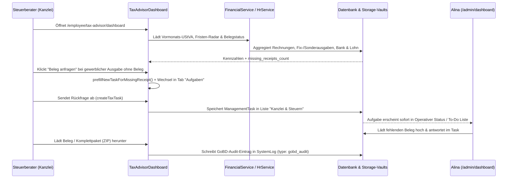

# System-Dokumentation: Steuerberater- & Kanzlei-Dashboard (`TaxAdvisorDashboard`)

Dieses Dokument beschreibt die vollständige technische Architektur, die steuerlichen Berechnungs- und Export-Pipelines, die 5-Tab-Benutzeroberfläche, die Sicherheits- & GoBD-Mechanismen sowie das integrierte Kanzlei-Rückfragesystem des **Seelenfunke Steuerberater Cockpits** (`/employee/tax-advisor/dashboard`).

---

## 1. Übersicht & Strategische Zielsetzung

Das Steuerberater-Dashboard ([`TaxAdvisorDashboard.php`](file://wsl.localhost/Ubuntu/home/ubuntuxina/meine-projekte/seelenfunke/app/Livewire/Employee/TaxAdvisor/TaxAdvisorDashboard.php) & [`tax-advisor-dashboard.blade.php`](file://wsl.localhost/Ubuntu/home/ubuntuxina/meine-projekte/seelenfunke/resources/views/livewire/employee/tax-advisor/tax-advisor-dashboard.blade.php)) dient der betreuenden Steuerkanzlei von **Mein-Seelenfunke (Inhaberin: Alina Steinhauer)** als zentrales, papierloses Self-Service- und Prüfportal.

Es ersetzt unstrukturierte E-Mail-Rückfragen, manuelle Belegsammlungen und externe Cloud-Ordner durch sechs direkt im ERP-System verankerte Kernfunktionen:
1. **Echtzeit-UStVA- & Fristen-Radar (§ 18 UStG / § 108 AO):** Sofortiger Überblick über Shop-Umsatz, gewerbliche Kosten, abziehbare Vorsteuer (Kz 66), verbleibende UStVA-Zahllast (Kz 83), gesetzlichen Abgabetermin und Beleg-Vollständigkeitsquote.
2. **1-Klick-Kanzlei-Exporte (DATEV EXTF, UStVA, ZUGFeRD/XRechnung & Lohn):** Direkter Abruf des SKR03-vorkontierten DATEV-Buchungsstapels (`Windows-1252`), des UStVA-Prüfprotokolls sowie gebündelter Monats-/Jahres-ZIP-Pakete.
3. **Lückenlose Beleg- & Bankumsatz-Prüfung (Gewerblich vs. Privat):** Gemeinsame Sicht auf alle Fixverträge, Sonderausgaben und importierten Banktransaktionen (FYRST Geschäftskonto) inkl. Beleg-Statusfilter (`Alle Belege`, `Belegt ✓`, `Fehlt ⚠️`).
4. **Ausgangsrechnungen, Stornos, E-Rechnungen & Creator-Gutschriften:** Vollständiger Zugriff auf alle Shop-Rechnungen (PDF + EN16931 XML) sowie alle nach § 14 Abs. 2 S. 2 UStG ausgestellten Influencer-Provisionsgutschriften.
5. **Personal- & Lohnjournal (§ 2 NachwG / § 17 MiLoG / § 108 GewO):** Direkter Abruf aller unterzeichneten Arbeitsverträge, ELStAM-Personalfragebögen, monatlichen Stundenzettel und Lohnabrechnungen.
6. **Synchronisiertes Kanzlei-Aufgaben- & Rückfragesystem:** 1-Klick-Beleganforderung (`Beleg anfragen`) und bidirektionaler Nachrichten-/Dokumenten-Thread, der in Echtzeit mit der Liste `Kanzlei & Steuern` im Admin-Dashboard (`/admin/dashboard` & `/admin/tasks`) von Alina Steinhauer synchronisiert ist.

---

## 2. Technische System-Architektur & Beteiligte Dateien

### 2.1 Kernklassen, Services & Views
| Komponente | Pfad | Verantwortung |
| :--- | :--- | :--- |
| **Livewire-Komponente** | [`app/Livewire/Employee/TaxAdvisor/TaxAdvisorDashboard.php`](file://wsl.localhost/Ubuntu/home/ubuntuxina/meine-projekte/seelenfunke/app/Livewire/Employee/TaxAdvisor/TaxAdvisorDashboard.php) | Zeitraum-Steuerung (Monat/Jahr), Filterung, 9 Export-/Download-Endpunkte, GoBD-Audit-Logging und Kanzlei-Task-Management. |
| **Blade-View** | [`resources/views/livewire/employee/tax-advisor/tax-advisor-dashboard.blade.php`](file://wsl.localhost/Ubuntu/home/ubuntuxina/meine-projekte/seelenfunke/resources/views/livewire/employee/tax-advisor/tax-advisor-dashboard.blade.php) | Schlanke 3-Zonen-Oberfläche (KPI-Header, Goldene Export-Leiste, 5-Tab-Hauptkachel) im Clean-Design. |
| **Finanz-Service** | [`app/Services/FinancialService.php`](file://wsl.localhost/Ubuntu/home/ubuntuxina/meine-projekte/seelenfunke/app/Services/FinancialService.php) | Berechnung von `getUstvaMonthData()`, `getMonthlyStats()`, `getYearlyMatrix()`, `buildDatevCsv()` (SKR03), `generateUstvaPdf()` und `generateDatevExportZip()`. |
| **Rechnungs- & XML-Services** | [`app/Services/InvoiceService.php`](file://wsl.localhost/Ubuntu/home/ubuntuxina/meine-projekte/seelenfunke/app/Services/InvoiceService.php) & [`app/Services/AccountingXmlInvoiceService.php`](file://wsl.localhost/Ubuntu/home/ubuntuxina/meine-projekte/seelenfunke/app/Services/AccountingXmlInvoiceService.php) | Archivierter PDF-Abruf inkl. On-the-Fly-Fallback sowie Generierung von ZUGFeRD-/XRechnung-XML-Dateien. |
| **Personal-Service** | [`app/Services/Employee/EmployeeHrService.php`](file://wsl.localhost/Ubuntu/home/ubuntuxina/meine-projekte/seelenfunke/app/Services/Employee/EmployeeHrService.php) | Monatsstunden-Auswertung und PDF-Generierung für Arbeitsverträge, Personalfragebögen, Stundenzettel und Lohnabrechnungen. |
| **Steuer-Regelwerk** | [`app/Services/Tax/TaxSettingService.php`](file://wsl.localhost/Ubuntu/home/ubuntuxina/meine-projekte/seelenfunke/app/Services/Tax/TaxSettingService.php) | Jahresbezogene Prüfung auf Kleinunternehmerregelung (§ 19 UStG) vs. Regelbesteuerung (`19 %`). |
| **Routen & Isolation** | [`routes/partials/employee_routes.php`](file://wsl.localhost/Ubuntu/home/ubuntuxina/meine-projekte/seelenfunke/routes/partials/employee_routes.php), [`EnsureEmployeeRole.php`](file://wsl.localhost/Ubuntu/home/ubuntuxina/meine-projekte/seelenfunke/app/Http/Middleware/EnsureEmployeeRole.php) & [`EmployeeRoleIsolationHook.php`](file://wsl.localhost/Ubuntu/home/ubuntuxina/meine-projekte/seelenfunke/app/Livewire/Hooks/EmployeeRoleIsolationHook.php) | Strikte Beschränkung der Rolle `tax_advisor` auf `/employee/tax-advisor/*`. |

### 2.2 Datenbank-Modelle & Datenquellen
* **Ausgaben & Bank:**
  * [`AccountingGroup`](file://wsl.localhost/Ubuntu/home/ubuntuxina/meine-projekte/seelenfunke/app/Models/Accounting/AccountingGroup.php) & [`AccountingCostItem`](file://wsl.localhost/Ubuntu/home/ubuntuxina/meine-projekte/seelenfunke/app/Models/Accounting/AccountingCostItem.php): Wiederkehrende Fixkosten und Fix-Einnahmen (`is_business`, `interval_months`, `tax_rate`, `contract_file_path`).
  * [`AccountingSpecialIssue`](file://wsl.localhost/Ubuntu/home/ubuntuxina/meine-projekte/seelenfunke/app/Models/Accounting/AccountingSpecialIssue.php): Variable Betriebsausgaben und Sonderausgaben (`execution_date`, `is_business`, `tax_rate`, `invoice_number`, `file_paths`).
  * [`AccountingBankTransaction`](file://wsl.localhost/Ubuntu/home/ubuntuxina/meine-projekte/seelenfunke/app/Models/Accounting/AccountingBankTransaction.php) & [`AccountingBankAccount`](file://wsl.localhost/Ubuntu/home/ubuntuxina/meine-projekte/seelenfunke/app/Models/Accounting/AccountingBankAccount.php): Importierte Bankumsätze inkl. Kategorisierungs- und Belegstatus.
* **Erlöse, Rechnungen & Gutschriften:**
  * [`AccountingInvoice`](file://wsl.localhost/Ubuntu/home/ubuntuxina/meine-projekte/seelenfunke/app/Models/Accounting/AccountingInvoice.php): Ausgangsrechnungen (`type = 'invoice'`), Stornorechnungen (`cancellation`) und Gutschriften (`credit_note`).
  * [`MarketingInfluencerPayout`](file://wsl.localhost/Ubuntu/home/ubuntuxina/meine-projekte/seelenfunke/app/Models/Marketing/MarketingInfluencerPayout.php): Creator-Provisionsgutschriften nach § 14 Abs. 2 S. 2 UStG (`credit_note_number`, `recipient_snapshot`, `pdf_path`).
  * [`OrderOrder`](file://wsl.localhost/Ubuntu/home/ubuntuxina/meine-projekte/seelenfunke/app/Models/Order/OrderOrder.php): Bezahlte Bestellungen zur Auswertung gewährter Rabatte und vereinnahmter Versandkosten.
* **Personal & Lohn:**
  * [`EmployeeContract`](file://wsl.localhost/Ubuntu/home/ubuntuxina/meine-projekte/seelenfunke/app/Models/Employee/EmployeeContract.php), [`EmployeePayslip`](file://wsl.localhost/Ubuntu/home/ubuntuxina/meine-projekte/seelenfunke/app/Models/Employee/EmployeePayslip.php) & [`EmployeeTimeEntry`](file://wsl.localhost/Ubuntu/home/ubuntuxina/meine-projekte/seelenfunke/app/Models/Employee/EmployeeTimeEntry.php).
* **Kanzlei-Kommunikation & GoBD-Protokollierung:**
  * [`ManagementTaskList`](file://wsl.localhost/Ubuntu/home/ubuntuxina/meine-projekte/seelenfunke/app/Models/Management/ManagementTaskList.php) (`name = 'Kanzlei & Steuern'`) & [`ManagementTask`](file://wsl.localhost/Ubuntu/home/ubuntuxina/meine-projekte/seelenfunke/app/Models/Management/ManagementTask.php).
  * [`SystemLog`](file://wsl.localhost/Ubuntu/home/ubuntuxina/meine-projekte/seelenfunke/app/Models/System/SystemLog.php) (`type = 'gobd_audit'`).

---

## 3. Aufbau & Sektionen der Benutzeroberfläche

Die Oberfläche in [`tax-advisor-dashboard.blade.php`](file://wsl.localhost/Ubuntu/home/ubuntuxina/meine-projekte/seelenfunke/resources/views/livewire/employee/tax-advisor/tax-advisor-dashboard.blade.php) folgt strikt dem Seelenfunke Clean-Design (Baustein 1 & 2) und gliedert sich in drei horizontale Bereiche:

### 3.1 Bereich 1: Begrüßungs-Header, Fristen-Radar, Beleg-Ampel & 4 Kern-KPIs
* **Vorauswahl des Abrechnungsmonats (`mount()`):** Beim Öffnen wählt das Dashboard automatisch den **abgeschlossenen Vormonat** vor (im Januar automatisch Dezember des Vorjahres), da dieser in der Kanzlei unmittelbar für die anstehende UStVA bearbeitet wird.
* **Mandanten-Kennung:** Zeigt Mandantenname (`Mein-Seelenfunke`), Steuernummer sowie die für das gewählte Jahr aktive Besteuerungsform (`Regelbesteuert (19 %)` vs. `§ 19 UStG`).
* **Fristen-Radar Badge (`$deadlineStatus`):**
  * Berechnet den gesetzlichen UStVA-Abgabetermin zum **10. des Folgemonats** (§ 18 Abs. 1 UStG).
  * Fällt der 10. auf einen Samstag oder Sonntag, verschiebt die Logik die Frist automatisch auf den darauffolgenden Montag (§ 108 Abs. 3 AO).
  * Farbcode: Grau (`> 5 Tage verbleibend`), Amber (`<= 5 Tage` oder `Heute`), Rose (`Fällig`).
* **Interaktive Beleg-Vollständigkeits-Ampel:**
  * Sind alle gewerblichen Buchungen des Monats mit PDF-/Bildbelegen versehen (`missing_receipts_count === 0`), leuchtet das grüne Badge `Belege 100 % vollständig`.
  * Fehlen Belege, erscheint der klickbare gelbe Button `X Belege fehlen (Filtern)`, der mit 1 Klick `setReceiptStatusFilter('missing_receipt')` aktiviert und sofort alle betroffenen Buchungen isoliert.
* **4 ruhige KPI-Boxen:**
  1. **Shop-Umsatz:** Brutto- und Netto-Erlöse des gewählten Monats.
  2. **Gewerbe-Kosten:** Summe der gewerblichen Fix- und Sonderausgaben (Brutto & Netto).
  3. **Vorsteuer (Kz 66):** Abziehbare Vorsteuer + vereinnahmte Umsatzsteuer.
  4. **Zahllast (Kz 83):** Verbleibende UStVA-Zahllast bzw. Erstattungsanspruch für `Monat/Jahr`.

### 3.2 Bereich 2: Goldene Zeitraum- & 1-Klick-Export-Leiste
Links wählt der Steuerberater den **Monat (`Januar` bis `Dezember`)**, das **Jahr (`2023` bis `aktuelles Jahr + 1`)** sowie den **Zeitraum-Modus (`Monat` vs. `Ganzes Jahr`)**. Rechts stehen 6 direkte Export-Buttons nebeneinander bereit:

| Button | Methode in `TaxAdvisorDashboard` | Inhalt & Format |
| :--- | :--- | :--- |
| **`Komplettpaket (ZIP)`** | `downloadDatevPackageZip()` | Erzeugt über `FinancialService::generateDatevExportZip()` ein Komplett-Archiv mit DATEV EXTF-CSV, UStVA-Prüfprotokoll (PDF) sowie allen geordneten Einnahmen- und Ausgabenbelegen des Monats. |
| **`DATEV CSV`** | `downloadDatevCsv()` | Einzelner SKR03-vorkontierter `EXTF_Buchungsstapel_MM_YYYY.csv` im originalen `Windows-1252`-Encoding für den direkten Import in DATEV Rechnungswesen. |
| **`UStVA PDF`** | `downloadUstvaPdf()` | Druckfertiges `UStVA_Auswertung_MM_YYYY.pdf` mit allen ELSTER-Kennzahlen (Kz 81, Kz 89/46, Kz 66, Kz 83). |
| **`Finanzbericht ZIP`** | `downloadFinancialReportZip()` | `Finanzbericht_YYYY_MM.zip` inkl. Liquiditätsübersicht, Transaktions-CSV und Bank-/Sonderbelegen. |
| **`Rechnungen ZIP`** | `downloadMonthlyInvoicesZip()` | `Rechnungen_und_Gutschriften_{Zeitraum}.zip` (für Monat oder Gesamtjahr) mit 3 Unterordnern: `Ausgangsrechnungen_PDF/`, `E-Rechnungen_XML/` (ZUGFeRD/XRechnung) und `Creator_Gutschriften_PDF/`. |
| **`Personal & Lohn ZIP`** | `downloadMonthlyHrPackageZip()` | `Personal_und_Lohn_{Zeitraum}.zip` (für Monat oder Gesamtjahr) gegliedert nach `Personalakten/{VertragsNr}_{Name}/` mit Arbeitsvertrag, Personalbogen, Stundenzetteln und Lohnabrechnungen. |

### 3.3 Bereich 3: Haupt-Kachel mit 5 Fach-Tabs & Kontext-Filtern

Die 5 Reiter sind auf Mobilgeräten über `overflow-x-auto no-scrollbar whitespace-nowrap` wischbar und passen die rechte Filterleiste dynamisch an den aktiven Tab an:

#### Tab 1: `Ausgaben & Belege` (`mainTab === 'expenses'`)
* **Kontext-Filter:**
  * Zuordnungs-Filter: `Alle` | `Gewerblich` | `Privat` (`setScopeFilter`).
  * Beleg-Statusfilter: `Alle Belege` | `Belegt ✓` | `Fehlt ⚠️ (X)` (`setReceiptStatusFilter`).
* **Inhalt:** Vereint alle **Fixkosten-Verträge** (`$fixedItemsDetailed`, inkl. Intervall-Angabe und Kennzeichnung, falls ein mehrjähriger/quartalsweiser Vertrag im gewählten Monat ruht) sowie alle **Sonderausgaben & Bankumsätze** (`$variableItemsDetailed`).
* **Aktionen pro Zeile:**
  * Liegt ein Vertrag oder Beleg vor: direkter Download-Button `Vertrag` bzw. `Beleg 1, 2...` (`downloadReceiptOrContract`).
  * Fehlt bei einer **gewerblichen** Position der Beleg: gelber Aktions-Button `⚠️ Beleg anfragen` (`prefillNewTaskForMissingReceipt`), der sofort in Tab 5 (`Aufgaben`) springt und das Rückfrage-Formular mit Bezeichnung, Bruttobetrag und Buchungsdatum vorbefüllt.
  * Noch nicht zugeordnete Banktransaktionen tragen das Badge `Zuordnung offen`.

#### Tab 2: `Rechnungen & Gutschriften` (`mainTab === 'invoices'`)
* **Kontext-Filter:** Dropdown `Alle Belegarten` | `Ausgangsrechnungen` | `Stornos & Gutschriften` | `Creator-Gutschriften (§ 14 UStG)`.
* **Inhalt:**
  * Alle abgeschlossenen Shop-Rechnungen, Stornos und Gutschriften (`status != 'draft'`) mit Belegnummer, Datum, Belegart-Badge, Rechnungsempfänger, vorzeichenbehaftetem Bruttobetrag sowie zwei Direktbuttons: **`PDF`** (`downloadInvoicePdf`) und **`XML`** (`downloadInvoiceXml` für EN16931 E-Rechnungen).
  * Alle Creator-Gutschriften (`MarketingInfluencerPayout`) inkl. Besteuerungsart des Creators (`19 % Regelbesteuert`, `§ 13b UStG Reverse-Charge`, `§ 19 UStG Kleinunternehmer`), Auszahlungsweg (`SEPA`, `PayPal`, `Shop-Gutschein`), Steuernummer aus dem unveränderlichen `recipient_snapshot` und **`PDF`**-Download (`route('employee.tax-advisor.payout.pdf')`).

#### Tab 3: `UStVA & Jahreswerte` (`mainTab === 'ustva'`)
* **Links (`ELSTER UStVA`):** Strukturierte 5-Zeilen-Übersicht des gewählten Monats:
  1. Steuerpflichtige Umsätze 19 % (**Kz 81 Netto**)
  2. Umsatzsteuer zu Kz 81
  3. Innergemeinschaftlicher Erwerb / § 13b UStG (**Kz 89 / Kz 46**)
  4. Abziehbare Vorsteuer (**Kz 66**)
  5. Verbleibende Zahllast (**Kz 83**)
* **Rechts (`Jahressummen`):** Kompakte Jahresmatrix aller Einnahmen- und Ausgabenkategorien für das gewählte Jahr, per 1-Klick umschaltbar zwischen **Brutto** und **Netto** (`wire:click="$toggle('isNet')"`).

#### Tab 4: `Personal` (`mainTab === 'hr'`)
* **Lohn-KPI-Banner:** Zeigt die Summe aller Bruttolöhne des gewählten Monats (`$monthlyGrossSalariesCents`) sowie die Anzahl registrierter Personalakten.
* **Mitarbeiter-Liste:** Zeigt für jeden unterzeichneten Mitarbeitervertrag (`invitation_accepted_at !== null`) Name, Beschäftigungsart (z. B. Minijob, Teilzeit, Vollzeit), Status (`Aktiv`, `Pausiert`, `Archiviert / Ausgeschieden`), Vergütungsmodell (Stundenlohn vs. Festgehalt), im gewählten Monat geleistete Stunden, Bruttolohn und Auszahlungsstatus.
* **4 Direkt-PDF-Buttons pro Mitarbeiter:**
  1. `Vertrag PDF` (§ 2 NachwG Arbeitsvertrag)
  2. `Personalbogen PDF` (ELStAM- & Sozialversicherungs-Fragebogen)
  3. `Stundenzettel PDF` (Monats-Arbeitszeitnachweis nach § 17 MiLoG für `selectedYear`/`selectedMonth`)
  4. `Lohnabrechnung PDF` (bzw. `Lohnabrechnung PDF (DATEV)`, sofern eine externe DATEV-Abrechnung hinterlegt wurde)

#### Tab 5: `Aufgaben` (`mainTab === 'tasks'`)
* **Kontext-Filter:** `Offen (X)` | `Erledigt (Y)` | `Alle` + pulsierender goldener Indikator im Tab-Reiter, sobald offene Rückfragen vorliegen.
* **Neue Rückfrage stellen (`createTaxTask`):**
  * Erstellt eine Aufgabe direkt in der Systemliste `Kanzlei & Steuern` (`ManagementTaskList`), inklusive Betreff, optionalem Fälligkeitsdatum (`relevant_from`), Priorität (`Normal` / `Dringend`), ausführlicher Nachricht und Mehrfach-Dateiupload (`pdf, jpg, jpeg, png, webp, txt, csv, xlsx, zip` bis 20 MB).
  * Jede neue Rückfrage erscheint ohne Zeitverzögerung in Alinas zentraler To-Do-Liste auf `/admin/dashboard` sowie in `/admin/tasks`.
* **Asynchroner Dialog-Verlauf (`submitTaskResponse`):**
  * Zu jeder bestehenden Aufgabe können Steuerberater und Mandantin über `Antworten` Nachrichten mit Zeitstempel (`[dd.mm.yyyy HH:ii - Kanzlei (Name)]: ...`) sowie nachgereichte Belege anhängen und Aufgaben per Checkbox als erledigt markieren (`toggleTaskComplete`).

#### Clean-Design Fußbereich: `Erklärung anzeigen`
* Standardmäßig eingeklapptes Informationspanel am unteren Kartenrand mit vollständiger Mandanten-Anschrift, Steuernummer, USt-IdNr., SKR03-Vorkontierungshinweisen (`1200` an `8400` / `4900` an `1200`) sowie direktem Zugriff auf alle im Tresor archivierten historischen Steuer-Exporte (`buchhaltung/tax_exports/`).

---

## 4. Datenfluss & Synchronisations-Architektur

---

## 5. Sicherheits-Architektur, Path-Containment & GoBD-Compliance (§ 8 SF-Regeln)

1. **Strikte Rollen- & Komponenten-Isolation:**
   * Authentifizierung zwingend über den Guard `employee` mit `role === 'tax_advisor'`.
   * [`EnsureEmployeeRole`](file://wsl.localhost/Ubuntu/home/ubuntuxina/meine-projekte/seelenfunke/app/Http/Middleware/EnsureEmployeeRole.php) und [`EmployeeRoleIsolationHook`](file://wsl.localhost/Ubuntu/home/ubuntuxina/meine-projekte/seelenfunke/app/Livewire/Hooks/EmployeeRoleIsolationHook.php) blockieren jeden Zugriff des Steuerberaters auf Admin-Seiten (`/admin/*`), das interne Mitarbeiter-Cockpit (`/employee/dashboard`), das Influencer-Portal (`/employee/influencer/dashboard`), die Laser-Fertigung oder das Marketing.
2. **Aufgaben-Listen-Isolation (`#[Locked] public ?string $taxAdvisorListId`):**
   * Die Eigenschaft `$taxAdvisorListId` ist mit `#[Locked]` gegen Client-Manipulation geschützt.
   * Alle Datenbankabfragen für Aufgaben (`toggleTaskComplete`, `submitTaskResponse`, `downloadTaskFile`) filtern hart auf `where('task_list_id', $list->id)` der Liste `Kanzlei & Steuern`. Interne Werkstatt-, Laser- oder Privat-Aufgaben sind technisch unerreichbar.
3. **Mehrstufiges Path-Containment & Symlink-Abwehr bei Datei-Downloads:**
   * `downloadReceiptOrContract()` erlaubt ausschließlich definierte Whitelist-Präfixe (`buchhaltung/receipts/`, `buchhaltung/contracts/`, `buchhaltung/invoices/`, `buchhaltung/tax_exports/`, `buchhaltung/incoming_einvoices/`), blockiert `..` sowie Null-Bytes (`\0`), verweigert Symlinks (`is_link()`) und prüft über `realpath()`, dass die Zieldatei physisch innerhalb von `storage/app/buchhaltung` liegt.
   * `downloadTaskFile()` prüft zusätzlich, ob der angeforderte Dateipfad exakt im JSON-Array `file_paths` der jeweiligen Kanzlei-Aufgabe hinterlegt ist.
   * Entwurfsrechnungen (`status === 'draft'`) sind in `downloadInvoicePdf()` und `downloadInvoiceXml()` mit `HTTP 403` gesperrt.
4. **Revisionssicheres GoBD-Audit-Logging (`logTaxAdvisorAccess`):**
   * Jeder einzelne Download (DATEV-ZIP, DATEV-CSV, UStVA-PDF, Finanzbericht, Rechnungs-ZIP, Personal-ZIP, Einzelrechnung, XML, Beleg oder Aufgaben-Anhang) erzeugt automatisch einen unveränderlichen Eintrag in `system_logs` (`type = 'gobd_audit'`) mit Mitarbeiter-ID, E-Mail, Dateiname, Abrechnungsperiode, IP-Adresse, User-Agent und Zeitstempel.

---

## 6. Automatisierte Testabdeckung

* **[`tests/Feature/Accounting/TaxAdvisorDashboardTest.php`](file://wsl.localhost/Ubuntu/home/ubuntuxina/meine-projekte/seelenfunke/tests/Feature/Accounting/TaxAdvisorDashboardTest.php):**
  * Prüft Login-Weiterleitung, Zugriffsschutz, UStVA-Berechnung, DATEV-CSV-Generierung (`Windows-1252`), UStVA-PDF, Komplettpaket-ZIP, Rechnungs-PDF/XML-Downloads und Entwurfssperre.
* **[`tests/Feature/Employee/TaxAdvisorTaskCommunicationTest.php`](file://wsl.localhost/Ubuntu/home/ubuntuxina/meine-projekte/seelenfunke/tests/Feature/Employee/TaxAdvisorTaskCommunicationTest.php):**
  * Prüft die strikte Isolation der Aufgabenliste `Kanzlei & Steuern`, Erstellung von Rückfragen inkl. Datei-Anhänge, Dialog-Antworten, 1-Klick-Vorbelegung bei fehlenden Belegen (`prefillNewTaskForMissingReceipt`), Path-Traversal-Abwehr (`HTTP 403`) sowie das GoBD-Audit-Logging in `system_logs`.
