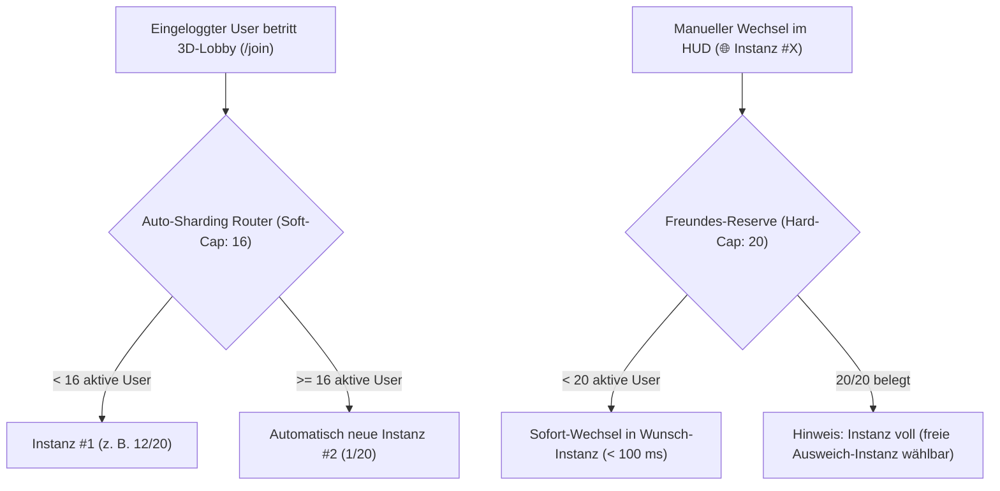

# Architektur & Umsetzung: Begehbare Multi-Instanz 3D-User-Lobby mit Produkt-Eingang & Goldener „Halle der Helden“

**Datum:** 16.11.2026  
**Status:** ✅ 100 % Grün umgesetzt & live auf Stage (`stage.mein-seelenfunke.de`) + Mini-PC (`192.168.188.151`) ausgerollt (`25/25` Portal-Tests + `49/49` Mini-PC-Selbsttests Grün)  
**Systeme:** Kundenportal (`/mein-konto` & `/shop`), `seelenfunke-louvre-showroom-3d.js`, `LobbyInstanceService`, `FunkenwerkHeroesController` & `FunkenwerkOS.Linux` (`192.168.188.151`)  
**Verfasser:** Falcone (Technischer Mitgründer & Chef-Architekt)

---

## 1. Strategische Architektur-Trennung: Interne Firmenstadt vs. Kunden-Lobby

1. **Interne 3D-Wasserstadt `Funkenwerk` (exklusiv auf deinem Manufaktur Mini-PC `192.168.188.151`):**
   * Die `Halle der Helden` wird vollständig aus der internen `Funkenwerk`-Stadt herausgelöst.
   * `Funkenwerk` bleibt damit deine private, souveräne Firmen-Metropole (Orbital-Anflug, 7 anklickbare Abteilungs-Piers und dein Penthouse-Thronsaal).
2. **Neue vereinte 3D-User-Lobby im Portal (für eingeloggte Kunden):**
   * Statt getrennter 3D-Fenster erleben deine Kunden eine **zusammenhängende, zu Fuß begehbare 60-FPS-Welt** aus zwei nahtlos miteinander verbundenen Bereichen:
     * **Bereich 1 (Eingangshalle):** Die helle Louvre-Produktgalerie mit allen Seelenfunke-Unikaten, 3D-Podest-Schildern und schwebenden Light-Mode-Raumtafeln (`0` Popups).
     * **Goldener Ehren-Durchgang:** An der Stirnseite der Eingangshalle öffnet sich ein monumentales 24K-Gold-Ehrenportal direkt auf die Ehrenpromenade.
     * **Bereich 2 (`🏛️ Halle der Helden`, 1:1 Übernahme + goldene Veredelung):** Exakte geometrische Übernahme des bestehenden Pantheon-Layouts (`_buildHallOfHeroes` mit Carrara-Saphir-Marmorboden `#ECEAE4`/`#133B5C`, Kolonnadenkranz, unverdeckter Inschrift `HALLE DER HELDEN` und versetzter 24K-Gold-Kuppel) als fest integrierter Ehrenbereich der User-Lobby.

---

## 2. Goldene „Halle der Helden“: Top-5-Podeste, Level-Animationen & Schwebende Stats

1. **Individuelle Funki-Animationen auf den Top-5-Rangpodesten (`Level 1` bis `Level 10`):**
   * Auf den 5 gestuften Ehrenpodesten im Zentrum stehen die echten komprimierten `.glb`-Funki-Modelle (`funki_lvl_1_rags.glb` bis `funki_lvl_10_god_of_soul.glb`), jeweils mit einer **eigenen, stufenspezifischen 60-FPS-Animation**:
     * **Stufe 1 bis 2 (`Ursprung` / `Lehrling`):** Neugieriges Wippen & vorsichtiges Umschauen.
     * **Stufe 3 bis 4 (`Helfer` / `Kristall-Novize`):** Fröhlicher Feder-Impuls mit sanfter Drehung & einzelnen Goldfunken.
     * **Stufe 5 bis 6 (`Funken-Geselle` / `Gravur-Handwerker`):** Stolze Handwerks-Präsenz mit kräftiger Atmung & Goldstaub.
     * **Stufe 7 bis 8 (`Kunsthandwerker` / `Meister`):** Erhabenes Schweben über einem rotierenden 24K-Goldring am Podest.
     * **Stufe 9 (`Lichtbringer`):** Majestätische Levitation mit goldenem Lichtkranz & aufsteigenden Himmelsfunken.
     * **Stufe 10 (`Gott des Seelenfunkens`):** Epische göttliche Schwebepose über gegenläufig rotierenden 24K-Gold-Sternringen auf Podest `#1` mit goldener Funken-Korona.
2. **Anklickbare Top-5-Kunden mit schwebenden Raum-Stats (`0` Popups, Gamification Clean-Design):**
   * Klickt ein Besucher einen der Top-5-Helden an (oder tritt direkt vor das Podest), schwebt **direkt im 3D-Raum am Helden-Podest** eine edle Light-Mode-Tafel (`#FAF8F5`, `#C5A059` Goldrahmen, DSGVO-konform nur bei `ranking_opt_in = true`):
     * Rang (`#1` bis `#5`) + Spielername (bzw. `Freier Ehrenplatz`)
     * `Stufe X · <Stufen-Titel>`
     * `✨ <Funken>`
     * `<KLASSE C/B/A/S>` & `🏆 <Erfolge>`

---

## 3. Skalierbares Instanzen-Modell & Manueller Instanzen-Wechsel (Freunde treffen)

1. **Optimales Instanz-Limit (`16` Soft-Cap / `20` Hard-Cap):**
   * **Automatische Skalierung ab `16` Spielern (`SOFT_CAP = 16`):** Melden sich viele Kunden gleichzeitig an, schaltet `LobbyInstanceService` ab dem 17. Spieler vollautomatisch `Instanz #2` (dann `#3`, `#4`, ...) frei. So bleibt jede Halle übersichtlich, die Sicht auf Produkte und Top-5-Helden frei und die Bildrate konstant bei **60 FPS**.
   * **`+4` Freundes-Puffer (`HARD_CAP = 20`):** Durch die Reserve zwischen `16` und `20` können Freunde selbst in eine bereits gut gefüllte Instanz (`16/20` bis `19/20`) noch manuell nachkommen!
2. **Manueller Instanzen-Wechsel im HUD (`🌐 Instanz #1 · X/20 ▾`):**
   * Eingeloggte User sehen oben im Lobby-HUD ihre aktuelle Instanz inkl. Spielerzahl, alle aktiven Parallel-Instanzen (immer inkl. mindestens einer freien ruhigen Instanz wie `Instanz #2 · 0/20`) sowie ein Direktwahl-Feld (`Instanz #1..50`), um sich gezielt mit Bekannten zu verabreden.
   * Alle Mitspieler derselben Instanz werden live mit unserem **voll artikulierten 3D-Gelenk-Rig** (echte Arm-, Hand-, Knie- und Fuß-Animationen) und striktem **DSGVO-Zero-PII-Schutz** dargestellt.
