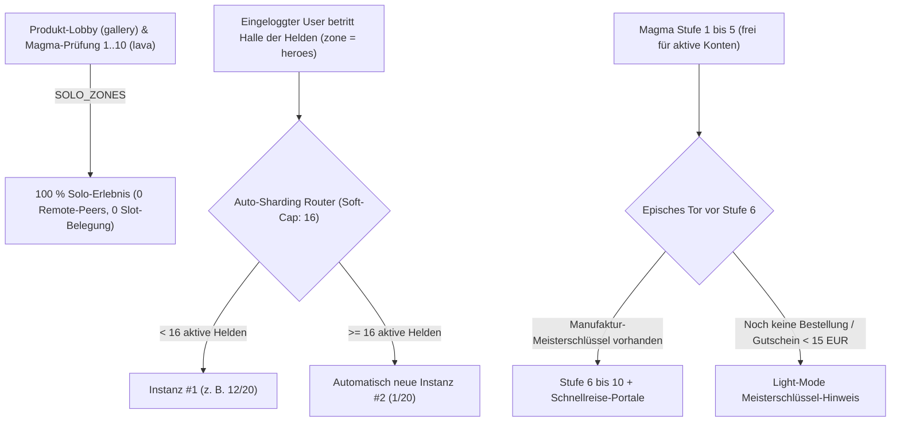

# Architektur & Umsetzung: Begehbare Multi-Instanz 3D-User-Lobby, Goldene „Halle der Helden“ & 10-Stufen-Magma-Prüfung

**Datum:** 18.11.2026  
**Status:** ✅ 100 % Grün umgesetzt (inkl. 10-Stufen-Magma-Parkour, NPC-Händler & Heiltrank-Inventar, 60-FPS-Instanz-Multiplayer, `5 %` Audio-Startwert sowie Jahreszeiten-Engine)  
**Systeme:** Kundenportal (`/mein-konto` & `/shop`), `/admin/users`, [seelenfunke-louvre-showroom-3d.js](file://wsl.localhost/Ubuntu/home/ubuntuxina/meine-projekte/seelenfunke/public/js/seelenfunke-louvre-showroom-3d.js), [seelenfunke-lobby-audio.js](file://wsl.localhost/Ubuntu/home/ubuntuxina/meine-projekte/seelenfunke/public/js/seelenfunke-lobby-audio.js), [funkenwerk-heroes-3d.js](file://wsl.localhost/Ubuntu/home/ubuntuxina/meine-projekte/seelenfunke/public/js/funkenwerk-heroes-3d.js), [LobbyInstanceService.php](file://wsl.localhost/Ubuntu/home/ubuntuxina/meine-projekte/seelenfunke/app/Services/Gamification/LobbyInstanceService.php), [LavaParkourService.php](file://wsl.localhost/Ubuntu/home/ubuntuxina/meine-projekte/seelenfunke/app/Services/Gamification/LavaParkourService.php) & `FunkenwerkOS.Linux` (`192.168.188.151`)  
**Verfasser:** Falcone (Technischer Mitgründer & Chef-Architekt)

---

## 1. Strategische Architektur-Trennung: Interne Firmenstadt vs. Kunden-Lobby

1. **Interne 3D-Wasserstadt `Funkenwerk` (exklusiv auf dem Manufaktur Mini-PC `192.168.188.151`):**
   * Die `Halle der Helden` ist vollständig aus der internen `Funkenwerk`-Stadt herausgelöst.
   * `Funkenwerk` bleibt die souveräne interne Firmen-Metropole (Orbital-Anflug, 7 anklickbare Abteilungs-Piers und Penthouse-Thronsaal).
2. **Vereinte 3D-User-Lobby im Portal (`/shop` & `/mein-konto`):**
   * Statt getrennter 3D-Fenster erleben Besucher eine **zusammenhängende, zu Fuß begehbare 60-FPS-Welt**:
     * **Bereich 1 (Eingangshalle):** Helle Louvre-Produktgalerie mit allen Seelenfunke-Unikaten, 3D-Podest-Schildern und schwebenden Light-Mode-Raumtafeln (`0` Popups), kompakt integrierter Exponat-Navigation unterhalb des Buttons *„Jetzt gestalten“* und verschlossenem West-Portal (**„Tor zur Außenwelt · Bald geöffnet“** an `X = -11.92, Z = 0.0`).
     * **Bereich 2 (`🏛️ Halle der Helden`):** Monumentales 24K-Gold-Ehrenportal in die Pantheon-Rotunde (`#ECEAE4`/`#133B5C` Marmorboden, Kolonnadenkranz, flackerfreie Inschrift `HALLE DER HELDEN` und 24K-Gold-Kuppel).
     * **Bereich 3 (`🔥 10-Stufen-Magma-Prüfung`):** Ostflügel-Portal mit Schnellreise-Portal-Hub (`unlocked_portals`), 10 aufeinanderfolgenden Magma-Prüfungsräumen (`Stufe 1` bis `Stufe 10`), kostenlosen Stufen `1..5`, epischem Meisterschlüssel-Tor vor `Stufe 6` und wackelnder Belohnungstruhe samt 3D-Bodenfunken.

---

## 2. Goldene „Halle der Helden“ & Einheitliche Ranglisten-Formel

1. **Einheitliche Sortierformel (2D-Cockpit & 3D-Halle 100 % synchron):**
   * Sowohl [CustomerFunkiComponent.php](file://wsl.localhost/Ubuntu/home/ubuntuxina/meine-projekte/seelenfunke/app/Livewire/Customer/CustomerFunkiComponent.php) als auch [FunkenwerkHeroesController.php](file://wsl.localhost/Ubuntu/home/ubuntuxina/meine-projekte/seelenfunke/app/Http/Controllers/Api/FunkenwerkHeroesController.php) sortieren identisch nach:
     `funken_total_earned DESC -> level DESC -> updated_at ASC`.
2. **Level-basierte 3D-Charaktere (`Stufe 1` bis `Stufe 10`):**
   * Nahtloser Einstieg über die *„Magie aktivieren“*-Übergangsanimation erst nach vollständig geladenem `.glb`, bereinigter Bodenplatte (`0 mm` Sohlen-Offset), aktivierten Hand-/Finger-Bones, `0.22s` Crossfading, federnder Umhang-Physik und schattenlosem 3-Punkt-Character-Follow-Light.
   * Auf den Top-5-Podesten schwebt im 3D-Raum eine Light-Mode-Tafel (`#FAF8F5`, `#C5A059` Goldrahmen, DSGVO-konform nur bei `ranking_opt_in = true`).

---

## 3. Zonen-Isoliertes Instanzen-Modell & 10-Stufen-Magma-Ökonomie

1. **10-Stufen-Magma-Prüfung & Manufaktur-Meisterschlüssel:**
   * **Erstabschluss-Belohnungen (`first_clear_reward`):** Stufen `1..5` liefern einmalig `5 / 8 / 10 / 12 / 15` Funken (`50` gesamt); Stufen `6..10` liefern einmalig `20 / 25 / 30 / 35 / 50` Funken (`160` gesamt).
   * **Tägliche Wiederholungs-Truhe (`daily_reward`):** `2..6` Funken pro Raum (1x je Raum und Kalendertag, gedeckelt auf `15` Funken/Tag für Stufe `1..5` bzw. `30` Funken/Tag mit Meisterschlüssel).
   * **Manufaktur-Meisterschlüssel (`hasMasterKey`):** Freischaltung der Stufen `6..10` automatisch ab mindestens einer bezahlten, nicht stornierten und nicht widerrufenen Shop-Bestellung (reguläres Manufaktur-Produkt oder Geschenkgutschein ab `15,00 €`). Bei vollständigem Widerruf fällt der Zugang sauber auf Stufe `1..5` zurück.
2. **Ausbalancierte Gutschein-Ökonomie & Rechtssicherheit:**
   * Einlöse-Stufen in [GameConfig.php](file://wsl.localhost/Ubuntu/home/ubuntuxina/meine-projekte/seelenfunke/app/Services/Gamification/GameConfig.php): **`250` Funken (`5 %`)**, **`600` Funken (`10 %`)**, **`1.200` Funken (`15 %`)** inklusive direktem Dashboard-Button *„Funken in der 3D-Lobby sammeln“*.
   * Vollständig rechtssicher verankert in [agb.blade.php](file://wsl.localhost/Ubuntu/home/ubuntuxina/meine-projekte/seelenfunke/resources/views/frontend/pages/legal/agb.blade.php), [widerruf.blade.php](file://wsl.localhost/Ubuntu/home/ubuntuxina/meine-projekte/seelenfunke/resources/views/frontend/pages/legal/widerruf.blade.php) und [datenschutz.blade.php](file://wsl.localhost/Ubuntu/home/ubuntuxina/meine-projekte/seelenfunke/resources/views/frontend/pages/legal/datenschutz.blade.php).

---

## 4. Visuelle Spielestandards, Jahreszeiten-Engine, RPG-HUD & Rückbauten

1. **60-FPS Grafik- & Map-Qualität:**
   * `lavaGroup.visible = (currentZone === 'lava')` verhindert jede Sichtbarkeit der Magma-Außenhülle über dem Louvre-Glasdach; `ACESFilmicToneMapping`, anisotrope Mipmaps, abgerundete Sockelleisten und `polygonOffset`-geschützte Beschilderung eliminieren Flackern und harte Kanten.
2. **Dynamische Jahreszeiten & Feiertage (`0` Schnee im Innenraum):**
   * Wetterpartikel (Schneeflocken, Blüten, Herbstlaub) bewegen sich strikt oberhalb/außerhalb des Glasdachs (`y >= 14.85`); im Innenraum erscheinen dezente, matte Schwarz-Gold-Akzente (`#C5A059`).
3. **Aufgeräumtes RPG-HUD & Matte Soundkulisse:**
   * Oben links Charakter-Unit-Frame (Porträt, Name, Stufe, Herzen, Mana), oben rechts runde `232x232`-Gold-Minimap ohne störende Top-Right-Buttons (mit Sticky-Uhrzeit `HH:MM` und Jahreszeiten-Hover-Tooltip), unten mittig die hochauflösende Retina-`.webp`-Fähigkeiten-Leiste samt braunem Leder-`Rucksack`-Button sowie `ESC`-Einstellungsmenü (`Vollbild`-Umschalter, `0..100 %` Lautstärke in 1er-Schritten, Tastenbelegung, Grafik-Stufe, sauberer WebGL-/Audio-Dispose).
4. **Chirurgischer Rückbau verworfener Altmodule:**
   * Die verworfene Subdomain-Logik (inkl. Mittwald-Ingress & DNS-Subzone), die 5 `NXC-BP-*` Blueprint-Entwürfe sowie das Mini-Labyrinth wurden rückstandsfrei entfernt; `MSF-GUTSCHEIN-001` (`geschenkgutschein`) und physische Produkt-Begleitzertifikate (`?doc=`) bleiben zu 100 % erhalten.

---

## 5. Update 18.11.2026: NPC-Händler, Heiltrank-Inventar, Freie Magie & Unified Multiplayer

1. **Kostenfreie Magie-Aktivierung & Epische Erweckung (`Stufe 1..5` frei):**
   * Jedes eingeloggte Kundenkonto kann in der 3D-Lobby und im Dashboard (`/mein-konto`) kostenfrei *„Magie aktivieren“* (inkl. 1.45s 3D-Doppelhelix-Erweckung) sowie jederzeit dezent *„Magie deaktivieren“* (0.65s Versiegelungs-Animation ohne Fortschrittsverlust). Erst vor Raum 6 greift der **Manufaktur-Meisterschlüssel**.
   * Ein Inline-Login in der 3D-Lobby aktualisiert via `auth-status-changed` sofort die Hauptnavigation (`AuthLoginDropdown`, `CartIcon`, `WishlistIcon`) ohne Seiten-Reload.
2. **NPC `Händler`, Heiltrank (`8` Funken = `+2` Herzen) & `Inventar` (`I`, `Q`, `R`):**
   * In der `Halle der Helden` steht rechts neben der Rotunde der 3D-NPC **`Händler`** und verkauft **Heiltränke** für **`8` Seelenfunken** (Abzug ausschließlich von `funken_balance`, niemals von `funken_total_earned`).
   * Taste **`I`** öffnet das Clean-Design **`Inventar`** mit Charaktervorschau und **`Rucksack`** (`6` Taschenplätze à max. `5` Stück = `30` Tränke); in der Fähigkeitenleiste liegen rechts zwei anpassbare Item-Schnellplätze (**`Q`** & **`R`**) inklusive 0.70s 3D-Trinkanimation und sequenzieller Herz-Regeneration.
3. **1:1 Website-Seelenfunken, Bogenportale, geschlossener Lavarand & `5 %` Audio-Standard:**
   * Truhen-Belohnungsfunken erscheinen als echte 4-strahlige Website-Seelenfunken mit gegenläufigen Gold-Orbitringen und Celesta-Glockenklang; alle Magma-Portale nutzen abgerundete `ShapeGeometry`-Innenschleier, das Lavabecken besitzt an allen vier Seiten einen geschlossenen Leuchtrand und die Standard-Musiklautstärke startet bei schonenden **`5 %`**.
4. **Dauerhafter Raum-Floor (`0x HTTP 422`), Unified Multiplayer & `/admin/users`-Steuerung:**
   * Bereits gemeisterte Magma-Räume (`lava_cleared_levels`) bilden eine unverlierbare Untergrenze (`maxSequentialCleared + 1`), begleitet von sauberem `keepalive` `/lava-parkour/leave`.
   * Bewegung, 3D-Sprechblasen, Emotes (`wave`, `dance`, `cheer`, `bow`, `spark`, `sit`, `clap`) und 2-Strike-Shadow-Mute laufen vereint auf [LobbyInstanceService.php](file://wsl.localhost/Ubuntu/home/ubuntuxina/meine-projekte/seelenfunke/app/Services/Gamification/LobbyInstanceService.php) (`Instanz #1..50`, geschwindigkeits-extrapolierte 60-FPS-Glättung, per-Instanz-Locks).
   * Unter `/admin/users` ([SystemUserManagement.php](file://wsl.localhost/Ubuntu/home/ubuntuxina/meine-projekte/seelenfunke/app/Livewire/Shop/System/SystemUserManagement.php)) lassen sich `magma_unlocked_level` (`1..10`), `magma_hearts` (`1..6`), `healing_potions` (`0..30`) und ein 3D-Chat-Unmute revisionssicher (`SystemLog`) verwalten.
5. **Retina-`.webp`-RPG-Icons, `232x232`-Minimap, Z-Fighting-freier Samtläufer & 2-Spur-Lobby-Musik:**
   * **7 handgefertigte Retina-`.webp`-Icons (`/images/lobby/icons/*.webp`):** [ability_1_funken_hieb.webp](file://wsl.localhost/Ubuntu/home/ubuntuxina/meine-projekte/seelenfunke/public/images/lobby/icons/ability_1_funken_hieb.webp), [ability_2_licht_sprint.webp](file://wsl.localhost/Ubuntu/home/ubuntuxina/meine-projekte/seelenfunke/public/images/lobby/icons/ability_2_licht_sprint.webp), [ability_3_aufwind_impuls.webp](file://wsl.localhost/Ubuntu/home/ubuntuxina/meine-projekte/seelenfunke/public/images/lobby/icons/ability_3_aufwind_impuls.webp), [ability_4_aegis_schild.webp](file://wsl.localhost/Ubuntu/home/ubuntuxina/meine-projekte/seelenfunke/public/images/lobby/icons/ability_4_aegis_schild.webp), [ability_5_seelen_nova.webp](file://wsl.localhost/Ubuntu/home/ubuntuxina/meine-projekte/seelenfunke/public/images/lobby/icons/ability_5_seelen_nova.webp), [item_heiltrank.webp](file://wsl.localhost/Ubuntu/home/ubuntuxina/meine-projekte/seelenfunke/public/images/lobby/icons/item_heiltrank.webp) sowie der epische braune Leder-Rucksack [icon_epic_backpack.webp](file://wsl.localhost/Ubuntu/home/ubuntuxina/meine-projekte/seelenfunke/public/images/lobby/icons/icon_epic_backpack.webp) in der Action-Bar (`I`).
   * **Vergrößerte `232x232`-Minimap & `Vollbild` im `ESC`-Menü:** Die runde Minimap oben rechts misst `232x232 px` ohne Top-Right-Buttons; die `Vollbild`-Steuerung sitzt aufgeräumt direkt im `ESC`-Menü.
   * **Erhabener, flackerfreier Samtläufer (`y = 0.036`):** Der rote Ehren-Samtläufer in [seelenfunke-louvre-showroom-3d.js](file://wsl.localhost/Ubuntu/home/ubuntuxina/meine-projekte/seelenfunke/public/js/seelenfunke-louvre-showroom-3d.js) liegt als erhabene 3D-Geometrie auf `y = 0.036` (`polygonOffset`, komplett Z-Fighting-frei).
   * **Strikt auf die 3D-Lobby gekapselte 2-Spur-Musik (`0` Musik im normalen Shop):** `SfFunkiBgm` und das globale Musik-Icon sind im regulären Shop- & Kundenportal vollständig entfernt; [seelenfunke-lobby-audio.js](file://wsl.localhost/Ubuntu/home/ubuntuxina/meine-projekte/seelenfunke/public/js/seelenfunke-lobby-audio.js) spielt ausschließlich innerhalb der geöffneten 3D-Lobby [bgm_funki_game.mp3](file://wsl.localhost/Ubuntu/home/ubuntuxina/meine-projekte/seelenfunke/public/shop/gamification/audio/bgm_funki_game.mp3) (`gallery` / `heroes`) und blendet beim Betreten der Magma-Prüfung (`lava`) per weichem `700 ms`-Crossfade auf [bgm_funki_magma_action.mp3](file://wsl.localhost/Ubuntu/home/ubuntuxina/meine-projekte/seelenfunke/public/shop/gamification/audio/bgm_funki_magma_action.mp3) über.

---

## 6. Update 18.11.2026: Ninja-Movement, Wall-Backflip, 30-Hz E-Sport-WebSocket-Sync & Minimap-Ping

*(Hinweis zur Architektur-Trennung vom 18.11.2026: Die Rollenspiel-Module wie 10-Stufen-Magma-Prüfung, NPC-Händler, Heiltränke und Kampf-Skills wurden verlustfrei nach `https://game.mein-seelenfunke.de` ausgelagert; siehe [Konzept_Funkenreich_Eigenes_Projekt_und_Shop_Trennung.md](file://wsl.localhost/Ubuntu/home/ubuntuxina/meine-projekte/seelenfunke/Abschlussberichte/Konzepte/Konzept_Funkenreich_Eigenes_Projekt_und_Shop_Trennung.md). Im Shop-Atelier und der goldenen Halle der Helden laufen nun die hochpräzise Ninja-Movement-Physik und der `30 Hz` Echtzeit-WebSocket-Sync.)*

1. **Kostenlose Inline-Magie-Aktivierung ohne Bestell-Zwang:**
   * Über [ShopShowroomController.php](file://wsl.localhost/Ubuntu/home/ubuntuxina/meine-projekte/seelenfunke/app/Http/Controllers/Frontend/ShopShowroomController.php) (`activateMagic`) und [LobbyInstanceService.php](file://wsl.localhost/Ubuntu/home/ubuntuxina/meine-projekte/seelenfunke/app/Services/Gamification/LobbyInstanceService.php) (`evaluateSanctumAccess`) schaltet jeder E-Mail-verifizierte, eingeloggte Kunde die goldene `Halle der Helden` direkt per 1-Klick frei, komplett ohne vorherigen Bestell-Zwang.
2. **Ninja-Movement & Physik-Präzision (zugleich Referenz-Basis für `game.mein-seelenfunke.de`):**
   * **`Shift`-Sprint (`8.8 m/s` statt `5.2 m/s`):** Sicher unterhalb der Anti-Cheat-Obergrenze `MAX_SPEED = 9.5`, abgesichert durch einen Anti-Hängenbleib-Schutz via `e.shiftKey`, athletische Ninja-Oberkörpervorlage, sanften `+3,2°` Kamera-FOV-Glide und proportionale `skinnedRig`-Lauf-TimeScale.
   * **100 % Beseitigung des Diagonal-Zuckens (`W+A` / `W+D`):** Vollständige Entkopplung von `_onPointerMove` und Bewegungs-Yaw (`_hasActiveMovementKeys`), mathematisch vorzeichenfeste Winkel-Normalisierung (`normalizeAngleSigned` / `shortestAngleDiff` ohne `±π`-Sprung), analoge `24 Hz` Input-Glättung, abgestimmte Trägheits-Physik (`accel = 22`, `decel = 18`) sowie automatische Ausblendung des Vitrinen-Kopfblicks während des Laufs.
   * **Wandnähe, `1,0 s` Ninja-Wall-Cling & 360°-Wall-Backflip:** Realistische Annäherung an die Hallenwände (`0,38 m .. 0,44 m` bei korrigiertem `hallHalfW = 12.0`, präzisen Pilaster-Kreiskollidern und `0,24 m` Kamera-Wandschutz). Springt der Charakter an eine Wand, hält er sich für **`1,0 s` im Ninja-Wall-Cling** (Blick zur Wand gerichtet, beide Hände schulterhoch an der Wand, angewinkelte Beine) und stößt sich per erneutem Sprung mit einem **echten 360°-Rückwärtssalto von der Wand ab (`Wall-Backflip`, `somersaultDir = -1`, `vy = 6.75`, `wallNormal * 6.5`, goldener `_spawnWallKickBurst`)**.
3. **Ultra-Low-Latency `30 Hz` (`33 ms`) In-Memory WebSocket-Architektur (`/lobby-ws`):**
   * **Kryptografisches WS-Ticket:** `LobbyInstanceService::buildWsRelayPayload` stellt beim Instanz-Beitritt ein HMAC-SHA256-signiertes Ticket (`ws_relay`, `tick_ms: 33`) für `wss://api-live-bridge.mein-seelenfunke.de/lobby-ws` ([server-twilio.js](file://wsl.localhost/Ubuntu/home/ubuntuxina/meine-projekte/seelenfunke/server-twilio.js), lokal `ws://127.0.0.1:8089/lobby-ws`) aus.
   * **Zero-Nagle & Zero-DB Relay in `server-twilio.js`:** Aktiviert `TCP_NODELAY` (`socket.setNoDelay(true)`) und `perMessageDeflate: false` (beseitigt `200 ms` Linux-Nagle-Stalls sowie zlib-Kompressions-Overhead; lokaler Socket-Median **`0,86 ms`**, echter Stage-Wire-Ping **`~19 ms`**), geschützt durch einen `95 Msg/s` Rate-Guard, monotone `srv_ms` & `pkt_seq` sowie Sofort-Push (`peer_state`, `peer_left`, `pong`, `chat_poke`) zu 100 % im Node.js-RAM ohne PHP-, MySQL- oder NFS-Last.
   * **Inline-`WebWorker`-Taktgeber (`30 Hz` / `33 ms`):** Hält den Netzwerk-Takt auch in unfokussierten Zweitfenstern konstant auf `33 ms` und umgeht Chromes `1.000 ms` Hintergrund-Timer-Drosselung beim parallelen Mehrspieler-Test (`0 %` Idle-Last durch sauberes `worker.terminate()` beim Schließen).
   * **`45 ms` Snapshot-Interpolations-Ringpuffer (`INTERP_DELAY = 0.045`, `8` Slots):** Sorgt für butterweiche 2-Punkt-Interpolation gegen WLAN-Jitter inklusive vollständiger 60-FPS 3D-Mitspieler-Replikation von `wall_cling`, `somersault_seq`, `somersault_dir = -1/+1`, `vy`-Sprungparabel und goldenem Wand-Abstoßring (`upsertPeer`, `removePeer`, echtes `peerSomersaultTuck` & `wallClingBlend` auf `_syncSkinnedFunkiBones`).
4. **Sticky Ping-Punkt oben mittig an der Minimap (`lobby-minimap-ping-dot` & `lobby-minimap-ping-tooltip`):**
   * Dezenter Clean-Design Farb-Indikator direkt am oberen Scheitelpunkt der runden Gold-Minimap (`<= 95 ms` Grün `Optimal`, `96..195 ms` Gold `Gut`, `> 195 ms` Rot `Verzögert`) mit ruhigem Median-of-5 Filter (strikt entkoppelt von schweren DB-`join`-Requests).
   * Beim Hover zeigt `lobby-minimap-ping-tooltip` kompakt `Ping`, `Jitter`, `Echtzeit-WS (30 Hz)` und die aktive `Instanz`.
   * Im Solo-Atelier antwortet der ultraleichte Zero-Laravel-Endpunkt [public/lobby-ping.php](file://wsl.localhost/Ubuntu/home/ubuntuxina/meine-projekte/seelenfunke/public/lobby-ping.php) in **`< 0,2 ms`**, flankiert von einem lokalen `/tmp` Redis-Circuit-Breaker in [AppServiceProvider.php](file://wsl.localhost/Ubuntu/home/ubuntuxina/meine-projekte/seelenfunke/app/Providers/AppServiceProvider.php) und früher PHP-Session-Freigabe in [CustomerLobbyController.php](file://wsl.localhost/Ubuntu/home/ubuntuxina/meine-projekte/seelenfunke/app/Http/Controllers/Api/CustomerLobbyController.php).

