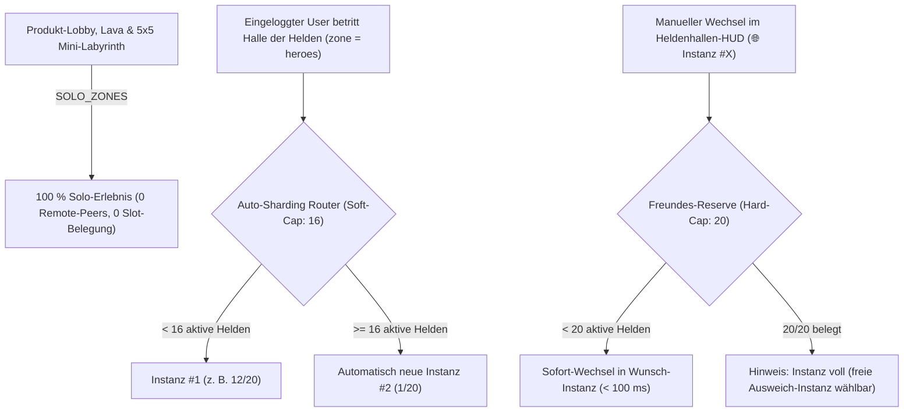

# Architektur & Umsetzung: Begehbare Multi-Instanz 3D-User-Lobby mit Produkt-Eingang & Goldener „Halle der Helden“

**Datum:** 17.11.2026  
**Status:** ✅ 100 % Grün umgesetzt & live auf Stage (`stage.mein-seelenfunke.de`), Digital (`digital.mein-seelenfunke.de`) + Mini-PC (`192.168.188.151`) ausgerollt (`39/39` Portal-Tests mit `1.787` Assertions Grün)  
**Systeme:** Kundenportal (`/mein-konto` & `/shop`), `seelenfunke-louvre-showroom-3d.js`, `seelenfunke-lobby-audio.js`, `funkenwerk-heroes-3d.js`, `LobbyInstanceService`, `LavaParkourService` & `FunkenwerkOS.Linux` (`192.168.188.151`)  
**Verfasser:** Falcone (Technischer Mitgründer & Chef-Architekt)

---

## 1. Strategische Architektur-Trennung: Interne Firmenstadt vs. Kunden-Lobby

1. **Interne 3D-Wasserstadt `Funkenwerk` (exklusiv auf deinem Manufaktur Mini-PC `192.168.188.151`):**
   * Die `Halle der Helden` wird vollständig aus der internen `Funkenwerk`-Stadt herausgelöst.
   * `Funkenwerk` bleibt damit deine private, souveräne Firmen-Metropole (Orbital-Anflug, 7 anklickbare Abteilungs-Piers und dein Penthouse-Thronsaal).
2. **Neue vereinte 3D-User-Lobby im Portal (für eingeloggte Kunden):**
   * Statt getrennter 3D-Fenster erleben deine Kunden eine **zusammenhängende, zu Fuß begehbare 60-FPS-Welt** aus zwei nahtlos miteinander verbundenen Bereichen:
     * **Bereich 1 (Eingangshalle):** Die helle Louvre-Produktgalerie mit allen Seelenfunke-Unikaten, 3D-Podest-Schildern und schwebenden Light-Mode-Raumtafeln (`0` Popups).
     * **Goldener Ehren-Durchgang:** An der Stirnseite der Eingangshalle öffnet sich ein monumentales 24K-Gold-Ehrenportal direkt auf die Ehrenpromenade.
     * **Bereich 2 (`🏛️ Halle der Helden`, 1:1 Übernahme + goldene Veredelung):** Exakte geometrische Übernahme des bestehenden Pantheon-Layouts (`_buildHallOfHeroes` mit Carrara-Saphir-Marmorboden `#ECEAE4`/`#133B5C`, Kolonnadenkranz, unverdeckter Inschrift `HALLE DER HELDEN` und versetzter 24K-Gold-Kuppel) als fest integrierter Ehrenbereich der User-Lobby.

---

## 2. Goldene „Halle der Helden“: Top-5-Podeste, Level-Animationen & Schwebende Stats

1. **Individuelle Funki-Animationen auf den Top-5-Rangpodesten (`Level 1` bis `Level 10`):**
   * Auf den 5 gestuften Ehrenpodesten im Zentrum stehen die echten komprimierten `.glb`-Funki-Modelle (`funki_lvl_1_rags.glb` bis `funki_lvl_10_god_of_soul.glb`), jeweils mit einer **eigenen, stufenspezifischen 60-FPS-Animation**:
     * **Stufe 1 bis 2 (`Ursprung` / `Lehrling`):** Neugieriges Wippen & vorsichtiges Umschauen.
     * **Stufe 3 bis 4 (`Helfer` / `Kristall-Novize`):** Fröhlicher Feder-Impuls mit sanfter Drehung & einzelnen Goldfunken.
     * **Stufe 5 bis 6 (`Funken-Geselle` / `Gravur-Handwerker`):** Stolze Handwerks-Präsenz mit kräftiger Atmung & Goldstaub.
     * **Stufe 7 bis 8 (`Kunsthandwerker` / `Meister`):** Erhabenes Schweben über einem rotierenden 24K-Goldring am Podest.
     * **Stufe 9 (`Lichtbringer`):** Majestätische Levitation mit goldenem Lichtkranz & aufsteigenden Himmelsfunken.
     * **Stufe 10 (`Gott des Seelenfunkens`):** Epische göttliche Schwebepose über gegenläufig rotierenden 24K-Gold-Sternringen auf Podest `#1` mit goldener Funken-Korona.
2. **Anklickbare Top-5-Kunden mit schwebenden Raum-Stats (`0` Popups, Gamification Clean-Design):**
   * Klickt ein Besucher einen der Top-5-Helden an (oder tritt direkt vor das Podest), schwebt **direkt im 3D-Raum am Helden-Podest** eine edle Light-Mode-Tafel (`#FAF8F5`, `#C5A059` Goldrahmen, DSGVO-konform nur bei `ranking_opt_in = true`):
     * Rang (`#1` bis `#5`) + Spielername (bzw. `Freier Ehrenplatz`)
     * `Stufe X · <Stufen-Titel>`
     * `✨ <Funken>`
     * `<KLASSE C/B/A/S>` & `🏆 <Erfolge>`

---

## 3. Zonen-Isoliertes Instanzen-Modell in der „Halle der Helden“ (`Produkt-Lobby = 100 % Solo`)

1. **Strikte Zonen-Trennung (`Produkt-Lobby alleine, Halle der Helden zusammen`):**
   * In der Produkt-Eingangshalle (`gallery`), der Magma-Kammer (`lava`) und dem kompakten `5x5` West-Mini-Labyrinth (`labyrinth`) ist jeder Besucher ungestört **100 % alleine** (`solo_mode: true`, `peers: []`). Beim Verlassen der `Halle der Helden` wird der belegte Instanz-Platz augenblicklich freigegeben.
2. **Optimales Instanz-Limit in der `Halle der Helden` (`16` Soft-Cap / `20` Hard-Cap):**
   * **Automatische Skalierung ab `16` Spielern (`SOFT_CAP = 16`):** Melden sich viele Kunden gleichzeitig in der `Halle der Helden` an, schaltet `LobbyInstanceService` ab dem 17. Spieler vollautomatisch `Instanz #2` (dann `#3`, `#4`, ...) frei. So bleibt jede Halle übersichtlich, die Sicht auf die Top-5-Helden frei und die Bildrate konstant bei **60 FPS**.
   * **`+4` Freundes-Puffer (`HARD_CAP = 20`):** Durch die Reserve zwischen `16` und `20` können Freunde selbst in eine bereits gut gefüllte Instanz (`16/20` bis `19/20`) noch manuell nachkommen!
3. **Manueller Instanzen-Wechsel im Heldenhallen-HUD (`🌐 Instanz #1 · X/20 ▾`):**
   * Eingeloggte User sehen in der `Halle der Helden` oben im HUD ihre aktuelle Instanz inkl. Spielerzahl, alle aktiven Parallel-Instanzen (immer inkl. mindestens einer freien ruhigen Instanz wie `Instanz #2 · 0/20`) sowie ein Direktwahl-Feld (`Instanz #1..50`), um sich gezielt mit Bekannten zu verabreden.
   * Alle Mitspieler derselben Heldenhallen-Instanz werden live mit unserem **voll artikulierten 3D-Gelenk-Rig** (echte Arm-, Hand-, Knie- und Fuß-Animationen), Zero-Client-Trust-Anti-Cheat und striktem **DSGVO-Zero-PII-Schutz** dargestellt.

---

## 4. Qualitäts- & Gameplay-Upgrade vom 17.11.2026 (6-Punkte-Feinschliff)

1. **Sofortiger Lobby-Musikstart per Klick-Geste (`seelenfunke-lobby-audio.js`):**
   * Die alte `SS_BGM_SESSION`-Stummsperre wurde abgelöst: Der Klick auf *„3D-Lobby öffnen“* bzw. *„3D Shoppen“* startet `bgm_funki_game.mp3` (Default-Lautstärke `50 %`) direkt synchron innerhalb des Klick-Events, sofern der Nutzer die Musik nicht aktiv in den Einstellungen stummgeschaltet hat (`sf_lobby_bgm_explicit_muted`). Beim Schließen pausiert der Stream sofort.
2. **Aufrechtes 15-Bone-Exoskelett für alle Stufen 1 bis 10 (`0` sitzende Figuren):**
   * Stufe 1 (`Ursprung`) steht ab sofort in der gesamten 3D-Lobby sowie auf den Top-5-Ehrenpodesten aufrecht im ehrlichen Naturleinen-/Antikbronze-Exoskelett (`exoBronzeUrsprung`) statt in sitzender Pose. Die Gelenk-Pivots des 15-Bone-`SkinnedMesh` (`targetH = 1.62`) sind 1:1 mit dem 3D-Exoskelett (`legSync = 0.84, armSync = 0.84`) gekoppelt, inklusive artikulierter Exoskelett-Heldenpodeste mit Fersen-Schubdüsen ab Stufe 7.
3. **Massiver Marmorboden in der Halle der Helden (`0 mm` Einsinken):**
   * Der Hallenboden wurde als massive `BoxGeometry(46.8, 0.28, 48.8)` ohne negatives `polygonOffset` ausgeführt, die äußere Stylobat-Zierleiste unter das Bodenniveau gesetzt (`trimY = -0.08`) und `_computeFloorBaseY(x, z)` samt `_computeAvatarMinSoleY(j)` für Spieler und Mitspieler über die volle `46,8 m`-Rotunde auf `0.026 m` synchronisiert.
4. **3,20 m hohe Kalkstein-Trennwände im West-Mini-Labyrinth:**
   * Die Trennwände wurden von `1,62 m` auf `3,20 m` (Pariser Kalkstein-Kassettenwand mit 24K-Gold-Sockel und Gesims in 1 `InstancedMesh`-Draw-Call) erhöht und in der 2-Pass-Kollision sprunghöhenunabhängig gegen Überspringen abgedichtet; das Glas-Tonnengewölbe überspannt den Saal symmetrisch.
5. **100 % geschlossene Magma-Kammer ohne Wandflackern, Himmelslücken oder schwebende Säulen:**
   * Tonnengewölbe (`thetaStart = 0, thetaLength = Math.PI`), Dachkappe und Giebelwände (`Y = -3.2..22.5`) schließen die Kammer komplett himmelsdicht ab. Alle Wand-, Pilaster- und Goldlisenen-Ebenen sind ohne Z-Fighting getrennt und samt Basaltsäulen tief im Magma-See verankert.
6. **Anspruchsvoller 3-Akt-Magma-Parkour + Anti-429 & Retry-sichere Schatztruhe:**
   * Kleinere Präzisionsplatten (`r = 0.88..1.06 m`), 3 absinkende `crumble`-Magmaplatten, gegenläufige Pendel/Aufzüge und 2 rhythmische Magma-Geysire (abwehrbar mit `3 · Schutzschild`) heben den Anspruch spürbar an (`CHEST_Y = 3.2`).
   * Isolierte Rate-Limit-Buckets in `global_routes.php` (`lobby_sync`, `lava_claim`, etc.) verhindern `HTTP 429 Too Many Attempts`; `LavaParkourService` bewahrt aktive Läufe bei verfrühten Klicks (`retryable: true`) im Cache und bestätigt Checkpoints idempotent.
