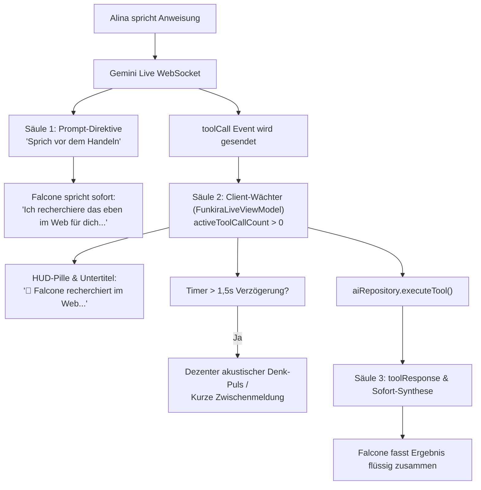

# Konzept: Bluetooth Audio-Routing (Soundcore P30i) & Proaktive Sprachfluss-Garantie

**Verfasser:** Falcone (Chef-Architekt & Mitgründer)  
**Datum:** 16.11.2026  
**Status:** Konzept erstellt (Wartet auf Alinas „Go“)  
**Gegenstand der Anfragen:**  
- `ag_20261116_192341_36adafe9` (Bluetooth Audio-Routing Soundcore P30i)  
- `ag_20261116_192341_6f3f2c9d` (Optimierung Sprachfluss bei Hintergrundprozessen)  

---

## 1. Teil 1: Bluetooth Audio-Routing (Soundcore P30i & Headsets)

### 1.1 Ursachenanalyse (Root Cause)
In [FunkiraLiveViewModel.kt](file://wsl.localhost/Ubuntu/home/ubuntuxina/meine-projekte/seelenfunke/android-app/app/src/main/java/de/meinseelenfunke/app/ui/screens/FunkiraLiveViewModel.kt#L1055-L1067) steuert die Methode `setCommunicationMode(enable: Boolean)` das Routing des AudioManagers:

```kotlin
private fun setCommunicationMode(enable: Boolean) {
    try {
        val audioManager = ServiceLocator.context.getSystemService(Context.AUDIO_SERVICE) as AudioManager
        if (enable) {
            audioManager.mode = AudioManager.MODE_IN_COMMUNICATION
            audioManager.isSpeakerphoneOn = true // <-- PROBLEM
            addLog("[Audio] Kommunikationsmodus aktiviert (Speakerphone = true)")
        } else { ... }
```

**Kernprobleme:**
1. **Hartkodiertes `isSpeakerphoneOn = true`:** Überschreibt das System-Routing von Android und zwingt den Audio-Stream (`USAGE_VOICE_COMMUNICATION`) ausnahmslos auf den eingebauten Smartphone-Lautsprecher, selbst wenn Bluetooth-Geräte wie die Soundcore P30i aktiv gekoppelt sind.
2. **Veraltetes API-Pattern:** Auf Android 12+ (API 31+) ist `isSpeakerphoneOn` deprecated. Das moderne API verlangt `AudioManager.setCommunicationDevice(AudioDeviceInfo)`.
3. **Fehlende dynamische Erkennung:** Wird das Headset während des Gesprächs aus dem Case genommen oder getrennt, fehlt ein `AudioDeviceCallback`, der die Audioweiche zur Laufzeit umschaltet.

### 1.2 Geplante Architektur & Umsetzung

1. **Intelligente Geräte-Priorisierung (API 31+ & Legacy-Fallback):**
   * Beim Start (`enable = true`) fragt der `FalconAudioRouteManager` die `availableCommunicationDevices` ab:
     1. **Priorität 1:** `AudioDeviceInfo.TYPE_BLUETOOTH_SCO` oder `AudioDeviceInfo.TYPE_BLE_HEADSET` (Soundcore P30i).
     2. **Priorität 2:** Kabelgebundene Headsets (`TYPE_WIRED_HEADSET`, `TYPE_USB_HEADSET`).
     3. **Priorität 3 (Fallback):** `AudioDeviceInfo.TYPE_BUILTIN_SPEAKER` (Freisprecher).
   * Bei Android 12+ wird `audioManager.setCommunicationDevice(targetDevice)` aufgerufen.
   * `isSpeakerphoneOn` wird ausschließlich dann auf `true` gesetzt, wenn tatsächlich kein Headset aktiv ist.
   * Bei Android < 12 wird für Bluetooth-Headsets sauber `audioManager.startBluetoothSco()` und `isBluetoothScoOn = true` aktiviert.

2. **Dynamischer `AudioDeviceCallback`:**
   * Ein registrierter `AudioDeviceCallback` fängt `onAudioDevicesAdded` und `onAudioDevicesRemoved` ab.
   * Wenn Alina ihre Kopfhörer während des Live-Gesprächs anzieht, schaltet die App den Stream sofort und unterbrechungsfrei auf die Soundcore P30i um.

3. **Verlässlicher Abbau (`enable = false`):**
   * Aufruf von `audioManager.clearCommunicationDevice()`.
   * Stoppen von SCO (`audioManager.stopBluetoothSco()`).
   * Rückkehr zu `AudioManager.MODE_NORMAL` und `isSpeakerphoneOn = false`.

---

## 2. Teil 2: Proaktive Sprachfluss-Garantie bei Hintergrundprozessen

### 2.1 Ursachenanalyse (Root Cause)
In der Gemini Live WebSocket-Architektur:
1. Wenn Gemini ein Werkzeug aufruft (z. B. Webrecherche, ERP-/Buchhaltungsabfragen oder lokale Smartphone-Tools), sendet der Server ein `toolCall`-Event.
2. Gemini generiert in diesem Moment **kein Audio**, sondern pausiert die Sprachausgabe bis zum Eintreffen der `toolResponse`.
3. Längere Hintergrundprozesse (Websuche via Mittwald-Backend, Scraping, Datenbankrecherchen) dauern 2 bis 8 Sekunden.
4. Für Alina entsteht eine unnatürliche, verunsichernde Stille. Der Eindruck entsteht, die Verbindung sei abgerissen.

### 2.2 Geplante Architektur: Das 3-Säulen-System



#### Säule 1: Verbindliche Prompt-Direktive („Sprich vor dem Handeln“)
Im Live-System-Prompt in `FunkiraLiveViewModel.kt` wird folgende bindende Regel verankert:
> **PROAKTIVE SPRACHFLUSS-REGEL BEI RECHERCHE & WERKZEUGEN (HÖCHSTE PRIORITÄT):**  
> Bevor du ein Werkzeug (wie Webrecherche, Buchhaltung, Bestandsprüfung oder Analyse) aufrufst, musst du Alina IMMER ZUERST in 1 kurzen, natürlichen Satz laut Bescheid sagen, was du tust (z. B. *„Einen Augenblick, Alina, ich werfe direkt einen Blick in die aktuellen Daten...“* oder *„Ich recherchiere das eben im Web für dich...“*). Rufe ein Werkzeug NIEMALS schweigend auf! Der Sprachfluss darf niemals abbrechen.

#### Säule 2: Client-Tool-Bridge & Akustisches Lebenszeichen
In `FunkiraLiveViewModel.kt`:
1. Sobald `activeToolCallCount.incrementAndGet()` aufgerufen wird, startet ein leichtfüßiger Coroutine-Timer (`toolBridgeJob`).
2. **Sofort (< 100 ms):** Die HUD-Pille oben und der Untertitel zeigen das exakte Tool an (z. B. `🔎 Falcone recherchiert im Web...`).
3. **Nach 1,5 Sekunden:** Falls Gemini noch keine Antwort liefert, spielt die Engine über den PCM-Audiopfad oder SoundManager ein dezentes, elegantes Denk-Signal ein.
4. **Nach 4,5 Sekunden:** Liegt noch kein Ergebnis vor, gibt eine kurze, vorgerenderte Audio-Zwischenmeldung Sicherheit (*„Einen kurzen Moment noch, ich werte die Ergebnisse aus...“*).

#### Säule 3: Robuster Timeout-Schutz & flüssige Fortsetzung
Jeder Backend-Tool-Call wird mit einem Timeout von maximal 10 Sekunden abgesichert. Sollte eine externe API stocken, erhält Gemini eine saubere Fallback-ToolResponse, sodass Falcone sofort weitersprechen kann, ohne dass der Live-Stream einfriert.

---

## 3. Unternehmerischer Mehrwert für Alina
* **Freihändiges Arbeiten in der Manufaktur:** Mit den Soundcore P30i kann Alina sich frei am Laser und Packtisch bewegen, ohne dass das Smartphone auf Lautsprecher plärren muss.
* **Maximale Souveränität & Zuverlässigkeit:** Keine "Tote-Leitung"-Momente mehr. Alina weiß in jeder Sekunde, woran ihr technischer Mitgründer gerade arbeitet.
* **Reibungsloser Übergang:** Nach Alinas „Go“ setzen wir beide Punkte direkt per Orchester-Subagent `systemi` um, inklusive Unit-Tests und Robocopy-Sync.
