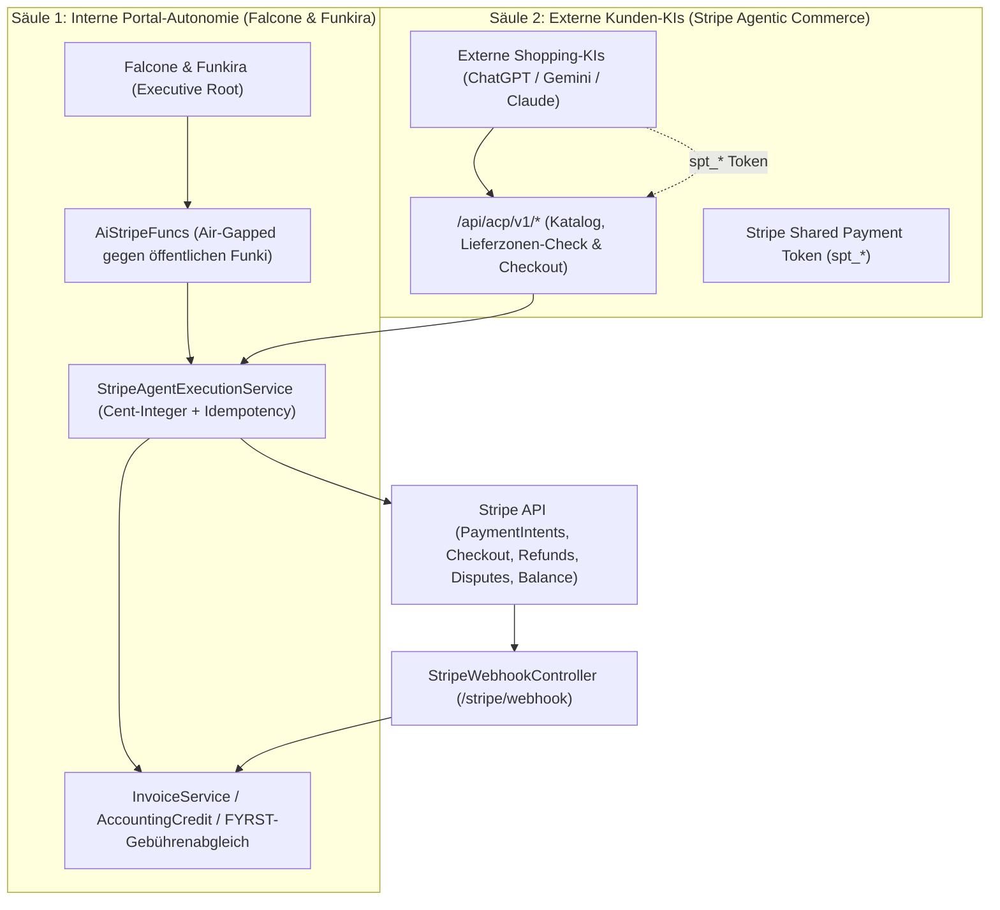

# Konzept: Autonome KI-Agenten in der Stripe-Integration (Portal-Autonomie & Agentic Commerce)

**Datum:** 16.11.2026  
**Status:** ✅ Vollständig umgesetzt & 100 % grün getestet (Go `ag_20261116_185621_ccf578f9`)  
**Systeme:** Mein-Seelenfunke Portal (`StripeAgentExecutionService`, `AiStripeFuncs`, `AgenticCommerceController`, `StripeWebhookController`, `/api/acp/v1/*`)  
**Verfasser:** Falcone (Technischer Mitgründer & Chef-Architekt)

---

## 1. Strategische Zielsetzung & Unternehmerischer Mehrwert

Aktuell verarbeitet Mein-Seelenfunke Stripe-Zahlungen rein reaktiv im klassischen Browser-Checkout ([`HandlesStripePayment.php`](file://wsl.localhost/Ubuntu/home/ubuntuxina/meine-projekte/seelenfunke/app/Livewire/Shop/Order/OrderCheckout/Traits/HandlesStripePayment.php)) sowie über eingehende Zahlungs-Webhooks ([`StripeWebhookController.php`](file://wsl.localhost/Ubuntu/home/ubuntuxina/meine-projekte/seelenfunke/app/Http/Controllers/StripeWebhookController.php)). Für Zahlungslinks bei B2B-/Telefon-Anfragen, Rückerstattungen nach Widerruf/Bruch, Gebühren-Abgleiche oder Konfliktfälle wäre bisher manuelles Eingreifen im Stripe-Dashboard nötig.

### Dein konkreter Mehrwert als Einzelunternehmerin:
1. **0 Minuten Zeitverlust im Stripe-Dashboard:** `Falcone` und `Funkira` führen Zahlungslinks, Teil-/Vollerstattungen inkl. GoBD-Gutschrift, Gebührenverbuchung und Konflikt-Beweisführung vollautonom direkt aus dem Seelenfunke-Portal aus.
2. **Sofort-Abschluss am Telefon & bei Großanfragen:** Nimmt der Telefon-Assistent oder Support eine Sonder-/B2B-Anfrage auf, generiert die KI sofort einen fertigen Stripe-Checkout-Link mit korrekter Lieferzone und 19 % USt., versendet ihn per Mail und überführt die Bestellung nach Zahlung vollautomatisch in deinen Laser-Fokus.
3. **Zukunftssicherer KI-Verkaufskanal (Stripe ACP & Shared Payment Tokens):** Externe Einkaufs-Agenten (ChatGPT, Gemini, Claude) können Geschenkgutscheine und personalisierbare Vorlagen-Produkte direkt über eine gesicherte Agentic-Commerce-Schnittstelle bei `mein-seelenfunke.de` kaufen und bezahlen, ohne dass rohe Kartendaten jemals unseren Server berühren.
4. **Revisionssichere GoBD- & PSD2-Architektur:** Jede autonome Stripe-Transaktion rechnet strikt in Cent-Integern (`int`), nutzt kryptografische Idempotency-Keys gegen Doppelbuchungen und erzeugt automatisch die zugehörigen Rechnungs-, Gutschrifts- oder Bankgebühren-Belege für FYRST und den Steuerberater-Export.

---

## 2. Zwei-Säulen-Architektur im Detail

---

## 3. Säule 1: Vollautonome Stripe-Ausführung durch Portal-Agenten (`AiStripeFuncs`)

### A. Strikte Rollen- & Air-Gap-Isolation (Baustein 8)
* **Zugriff ausschließlich für Executive-Agenten (`Falcone` & `Funkira`):** Registrierung im Skill-Pool (`FunkiraSkillPoolService::isExecutiveRoot`) mit harter Server-Prüfung in [`AiAuthHelper.php`](file://wsl.localhost/Ubuntu/home/ubuntuxina/meine-projekte/seelenfunke/app/Services/AI/AiAuthHelper.php).
* **100 % Sperre für `Funki`, Gäste, Kunden & externe Rollen (`influencer`, `tax_advisor`):** Der öffentliche Shop-Begleiter `Funki` besitzt keinerlei Sichtbarkeit oder Ausführungsrechte auf `stripe_*`-Werkzeuge (Prompt-Injection durch Shop-Besucher kann niemals eine Rückerstattung oder Zahlung auslösen).

### B. Die 6 autonomen Stripe-Portal-Schnittstellen (`StripeAgentExecutionService`)

| Tool-Name | Autonome Funktion ohne manuelles Zutun | Pflicht-Parameter & Schutzlogik |
| :--- | :--- | :--- |
| **`stripe_create_checkout_link`** | Erstellt für ein Angebot (`OrderQuoteRequest`), Telefonat oder individuellen Kundenwunsch sofort eine Stripe Checkout Session / Payment Link und sendet ihn auf Wunsch direkt per Mail an den Kunden. | `items[]` oder `quote_number`, `shipping_country` (geprüft gegen aktive `LogisticsShippingZone`), `customer_email`, Cent-Betrag, Ablaufzeit (`expires_at`), Idempotency-Key. |
| **`stripe_execute_refund`** | Führt Voll- oder Teilerstattungen bei Widerruf (`OrderRevocation`), Transportschaden oder Reklamation direkt auf den `stripe_payment_intent_id` aus und erzeugt automatisch die GoBD-Stornorechnung / Gutschrift. | `order_number`, `amount_cents` (`<= rest_refundable_cents`), `reason` (`requested_by_customer`, `duplicate`, `defective`), Idempotency-Key `refund:{order_id}:{amount_cents}:{seq}`. |
| **`stripe_charge_saved_mandate`** | Bucht Folge-/B2B-Bestellungen bei Kunden mit explizitem Off-Session-Mandat (`setup_future_usage = off_session`) autonom ab. Fordert die Bank 3D-Secure (PSD2/SCA), versendet der Agent automatisch den 1-Klick-Bestätigungslink. | `customer_id`, `order_number`, `payment_method_id`, automatischer Fallback von `off_session` auf `checkout_session` bei `authentication_required`. |
| **`stripe_reconcile_payouts_fees`** | Liest `Stripe\Payout` und `Stripe\BalanceTransaction` aus, ordnet Stripe-Auszahlungen den Umsätzen auf dem FYRST-Konto zu und erfasst die exakten Stripe-Gebühren Cent-genau für die Buchhaltung. | `date_from`, `date_to`, Dublettenprüfung über `stripe_payout_id` / `balance_transaction_id`, saubere Trennung Umsatz vs. Zahlungsverkehrs-Gebühr. |
| **`stripe_defend_dispute`** | Reagiert autonom auf `charge.dispute.created`: Sammelt Rechnung, Zeitstempel, Gravur-Freigabe und DHL-Zustellnachweis (`OrderShipment`) und lädt das Beweispaket via `Stripe\Dispute::update` hoch. | `dispute_id` oder `order_number`, `submit_immediately` (`bool`), sofortige Status-Meldung im Operativen Status (`/admin/dashboard`). |
| **`stripe_get_live_telemetry`** | Liefert verfügbares Stripe-Guthaben (`available` / `pending`), letzte Zahlungen, fehlgeschlagene Zahlungsversuche und offene Konflikte in Echtzeit. | Read-Only Abfrage über `Stripe\Balance` & `PaymentIntent::all` (DSGVO-konform). |

### C. Konfigurierbare Autonomie-Leitplanken in `/admin/settings`
Damit du volle Handlungsfreiheit ohne lästige Rückfragen hast, aber gegen Fehlbedienung geschützt bleibst, erhält `/admin/settings` drei schlanke Clean-Design-Parameter (ohne Text-Overload):
1. **Autonome Stripe-Ausführung aktiv (`stripe_agent_autonomy_enabled`):** Hauptschalter (`true`/`false`).
2. **Autonomes Einzel-Erstattungslimit (`stripe_agent_auto_refund_limit_cents`):** Standard z. B. `25000` (`250,00 €`) vollautonom ohne Rückfrage; darüber automatische 1-Tap-Freigabe in deiner Funkenwerk Android-App.
3. **Tages-Sicherheitsdeckel für autonome Erstattungen (`stripe_agent_daily_refund_cap_cents`):** Standard z. B. `100000` (`1.000,00 €` / 24h) als Schutzbremse.

---

## 4. Säule 2: Agentic Commerce Schnittstelle (`/api/acp/v1/*` mit Shared Payment Tokens)

Damit externe KI-Agenten im Auftrag von Käufern bei Mein-Seelenfunke einkaufen können, implementieren wir das **Agentic Commerce Protocol (ACP)** auf Basis von **Stripe Shared Payment Tokens (`spt_*`)**:

1. **`GET /api/acp/v1/products`:**
   * Liefert ausschließlich kaufbare Artikel (`stock > 0` bzw. sofort lieferbare digitale Geschenkgutscheine), Staffelpreise, Personalisierungsfelder (Textzeilen, Schriftarten, optionale schwarze Westpack-Geschenkbox `+4,90 €`) und aktive Lieferländer (`LogisticsShippingZone`).
2. **`POST /api/acp/v1/checkout/sessions`:**
   * Prüft Lieferland, Lagerbestand, Pflichtangaben und Marken-/Urheberrechts-Regeln, reserviert einen Warenkorb-Snapshot und gibt den verbindlichen Gesamtbetrag in Cent (`amount_total_cents`, `currency: "eur"`) zurück.
3. **`POST /api/acp/v1/checkout/sessions/{sessionId}/complete`:**
   * Empfängt vom Käufer-Agenten das kurzlebige, betragsgedeckelte und händlergebundene **`shared_payment_token` (`spt_*`)** (keine Kreditkartendaten -> 100 % PCI-DSS SAQ-A konform!).
   * Erstellt serverseitig den `Stripe\PaymentIntent` (`amount`, `currency => 'eur'`, `payment_method => $spt`, `confirm => true`), legt bei Erfolg sofort die `OrderOrder` an und reiht den Auftrag direkt in deine Manufaktur-Warteschlange ein.
   * **Schutz vor unfertigem Live-Start:** Solange dein neuer Hauptschalter **`Live gehen`** (`shop_is_live`) auf `false` steht, gibt auch `/api/acp/v1/*` strikt `HTTP 503` zurück.

---

## 5. Erweiterung von [`StripeWebhookController.php`](file://wsl.localhost/Ubuntu/home/ubuntuxina/meine-projekte/seelenfunke/app/Http/Controllers/StripeWebhookController.php)

Ergänzend zu `checkout.session.completed`, `payment_intent.succeeded` und `payment_intent.payment_failed` verarbeitet der Webhook künftig vollautomatisch:
* **`charge.refunded`:** Synchronisiert externe/autonome Teil- und Vollerstattungen idempotent mit `OrderOrder` und `AccountingCredit`.
* **`charge.dispute.created` / `charge.dispute.closed`:** Startet automatisch die Beweismittel-Aufbereitung durch `StripeAgentExecutionService` und legt eine Prioritäts-Aufgabe im Operativen Status (`/admin/dashboard`) an.
* **`payout.paid`:** Markiert die Stripe-Auszahlung samt Gebührenaufschlüsselung für den automatischen FYRST-Bankabgleich vor.

---

## 6. Realisierte Umsetzung & Verifikation (16.11.2026)

1. **Service & Datenbank-Audit-Log:** [`StripeAgentExecutionService.php`](file://wsl.localhost/Ubuntu/home/ubuntuxina/meine-projekte/seelenfunke/app/Services/StripeAgentExecutionService.php) mit strikter `int`-Cent-Logik, deterministischen Idempotency-Keys, konfigurierbaren Sicherheitslimits (`250,00 €` Einzellimit / `1.000,00 €` 24h-Deckel inkl. automatischer Freigabe-Aufgabe im `/admin/dashboard`) und lückenlosem `SystemLog`-Audit-Trail implementiert.
2. **KI-Werkzeuge (`AiStripeFuncs`):** Alle 6 autonomen Tools in [`AiStripeFuncs.php`](file://wsl.localhost/Ubuntu/home/ubuntuxina/meine-projekte/seelenfunke/app/Services/AI/Functions/AiStripeFuncs.php), [`AIFunctionsRegistry.php`](file://wsl.localhost/Ubuntu/home/ubuntuxina/meine-projekte/seelenfunke/app/Services/AI/AIFunctionsRegistry.php) und [`FunkiraSkillPoolService.php`](file://wsl.localhost/Ubuntu/home/ubuntuxina/meine-projekte/seelenfunke/app/Services/AI/FunkiraSkillPoolService.php) registriert (doppelt hart isoliert auf `Falcone` & `Funkira` unter Admin-Auth; 100 % Air-Gap für `Funki`, Kunden, Gäste, `influencer` und `tax_advisor`).
3. **ACP-Endpunkte (`/api/acp/v1/*`):** Öffentliche Agentic-Commerce-Schnittstelle in [`AgenticCommerceController.php`](file://wsl.localhost/Ubuntu/home/ubuntuxina/meine-projekte/seelenfunke/app/Http/Controllers/Api/AgenticCommerceController.php) und [`acp.php`](file://wsl.localhost/Ubuntu/home/ubuntuxina/meine-projekte/seelenfunke/routes/api/acp.php) mit Stripe Shared Payment Tokens (`spt_*`), PCI-DSS SAQ-A Schutz (`422` bei rohen Kartendaten), `LogisticsShippingZone`-Pflichtprüfung, Westpack-Geschenkbox (`+4,90 €`) und `shop_is_live`- / Wartungsmodus-Sperre (`HTTP 503`) umgesetzt.
4. **Webhook & Migration:** [`StripeWebhookController.php`](file://wsl.localhost/Ubuntu/home/ubuntuxina/meine-projekte/seelenfunke/app/Http/Controllers/StripeWebhookController.php) idempotent um GoBD-Gutschriften (`charge.refunded`), Konfliktfälle (`charge.dispute.created` / `charge.dispute.closed`) und FYRST-Auszahlungen (`payout.paid`) erweitert; Settings und `AiTool`-Zuordnungen per idempotenter Migration [`2026_11_16_190500_seed_stripe_agent_autonomy_settings_and_tools.php`](file://wsl.localhost/Ubuntu/home/ubuntuxina/meine-projekte/seelenfunke/database/migrations/2026_11_16_190500_seed_stripe_agent_autonomy_settings_and_tools.php) verankert.
5. **100-%-Grün-Testsuite:** Vollständige Feature- & Security-Tests in [`AutonomousStripeAgentAndAcpTest.php`](file://wsl.localhost/Ubuntu/home/ubuntuxina/meine-projekte/seelenfunke/tests/Feature/Stripe/AutonomousStripeAgentAndAcpTest.php) sowie bestehende Regressionstests erfolgreich verifiziert.
