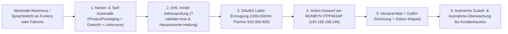

# Konzept: Vollautonomer DHL-API-Autopilot & Tresor-Bestandsprüfung

**Datum:** 16.11.2026  
**Status:** 📋 Konzept & Tresor-Prüfung vorgelegt (Warte auf Go & Hinterlegung der DHL-GKP-Daten im Tresor)  
**Systeme:** [`DhlService.php`](file://wsl.localhost/Ubuntu/home/ubuntuxina/meine-projekte/seelenfunke/app/Services/DhlService.php), [`FunkenwerkPrintService.php`](file://wsl.localhost/Ubuntu/home/ubuntuxina/meine-projekte/seelenfunke/app/Services/System/FunkenwerkPrintService.php), [`WorkshopFocusApiController.php`](file://wsl.localhost/Ubuntu/home/ubuntuxina/meine-projekte/seelenfunke/app/Http/Controllers/Api/WorkshopFocusApiController.php), [`CheckDhlDeliveryStatus.php`](file://wsl.localhost/Ubuntu/home/ubuntuxina/meine-projekte/seelenfunke/app/Console/Commands/CheckDhlDeliveryStatus.php), Funkenwerk-Tresor & MUNBYN ITPP941AP (`192.168.188.149`)  
**Verfasser:** Falcone (Technischer Mitgründer & Chef-Architekt)

---

## 1. Ergebnis der Tresor- & Umgebungs-Prüfung

Gemäß deinem Auftrag habe ich zuerst deinen lokalen **Funkenwerk-Tresor** (per Zero-Secret-Abfrage `--tresor-list`) sowie die Server-Konfigurationen geprüft:

1. **Lokaler Funkenwerk-Tresor:**
   * Aktuell sind **2 Einträge** vorhanden (`Stripe Sandbox` und `Mittwald - AI Agent Hosting`).
   * **Ergebnis:** Es liegen **noch keine DHL-Zugangsdaten** im lokalen Funkenwerk-Tresor vor.
2. **Portal-Konfiguration (Lokal & Stage):**
   * In `.env` sind aktuell ausschließlich **DHL-Sandbox-Platzhalter** hinterlegt (`DHL_SANDBOX=true`, Test-EKP `3333333333` sowie ein Sandbox-Developer-Key). Echte Geschäftskunden-Produktionsdaten sind noch nicht eingetragen.
3. **Bereits vorhandenes technisches Fundament (ca. 60 % stehen schon!):**
   * [`DhlService.php`](file://wsl.localhost/Ubuntu/home/ubuntuxina/meine-projekte/seelenfunke/app/Services/DhlService.php) erstellt Sendungen gegen die `Parcel DE Shipping API v2` und speichert PDF + Sendungsnummer in `OrderShipment`.
   * [`FunkenwerkPrintService.php`](file://wsl.localhost/Ubuntu/home/ubuntuxina/meine-projekte/seelenfunke/app/Services/System/FunkenwerkPrintService.php) reiht Etiketten direkt für deinen lokalen Thermodrucker **MUNBYN ITPP941AP (`192.168.188.149`)** in die Druck-Queue ein.
   * [`CheckDhlDeliveryStatus.php`](file://wsl.localhost/Ubuntu/home/ubuntuxina/meine-projekte/seelenfunke/app/Console/Commands/CheckDhlDeliveryStatus.php) fragt die Zustellung automatisch über `api-eu.dhl.com/track/shipments` ab.

---

## 2. Was uns noch fehlt: Deine Checkliste für 100 % Live-Bereitschaft

Damit die KI echte, abrechenbare Versandetiketten drucken kann, benötigen wir im **Funkenwerk-Tresor** folgende Daten (bitte niemals im Klartext in den Chat schreiben, sondern direkt als Einträge in deinem **Funkenwerk-Tresor** speichern):

1. **Vertrag im DHL Geschäftskundenportal (`geschaeftskunden.dhl.de`):**
   * **10-stellige EKP (DHL-Kundennummer):** z. B. `50xxxxxxxx`.
   * **Dedizierter GKP-Systembenutzer + Passwort:** *Wichtiger Mitgründer-Tipp:* Lege im GKP unter *Verwaltung -> Benutzer verwalten -> Systembenutzer anlegen* unbedingt einen **Systembenutzer** für die API an! Normale persönliche GKP-Passwörter laufen bei DHL alle 90 Tage zwangsweise ab und würden den Autopiloten sonst vierteljährlich stoppen; ein Systembenutzer läuft **10 Jahre durchgängig ohne Passwortablauf**.
   * **Teilnahmenummern (2-stellig, meist `01`):** Für **DHL Paket (`V01PAK`)**, **DHL Kleinpaket (`V62KP`)** (spart bei flachen Sendungen bis `8 cm` Höhe und `1 kg` massiv Porto!) sowie optional **DHL Warenpost / Paket International (`V66WPI` / `V53WPAK`)**.
2. **App im DHL Developer Portal (`developer.dhl.com`):**
   * App im Production-Modus mit freigeschalteten APIs: **`Parcel DE Shipping (Post & Parcel Germany) v2`** und **`Shipment Tracking - Unified`** (optional **`Parcel DE Returns`**).
   * Daraus: **`API Key` (`Client ID`)** und **`API Secret` (`Client Secret`)**.
   * *(Falls du erst nur den normalen Login zu `geschaeftskunden.dhl.de` und `developer.dhl.com` in den Funkenwerk-Tresor legst, kann ich über unseren Zero-Secret Tresor-Broker den Systembenutzer und die Developer-App auch gemeinsam mit dir beantragen/einrichten!)*

---

## 3. Architektur des vollautonomen DHL-API-Autopiloten (`DhlAutopilotService`)

Unser Ziel: Du legst das gravierte und gereinigte Unikat nur noch in den Karton, klebst das automatisch ausgeworfene Etikett aus deinem MUNBYN-Drucker auf und bist fertig. Alles Digitale erledigt die KI zu 100 % selbstständig.

### Die 5 Ausbaustufen gegenüber dem heutigen Stand:

1. **Moderne OAuth2-Authentifizierung & Auto-Token-Refresh (`DhlService` Upgrade):**
   * Umstellung auf den aktuellen DHL OAuth2-Standard (`POST /parcel/de/account/ropc/v1/token` mit gecachtem Bearer-Token + automatischem Fallback für Sandbox), damit die Anbindung langfristig wartungsfrei läuft.
2. **Wirtschaftliche Tarif-Automatik (`Kleinpaket` vs. `Paket` vs. `International`):**
   * Statt wie bisher jede Sendung starr als teures `V01PAK`-Standardpaket zu buchen, liest der Autopilot die empfohlene Verpackung aus `ProductPackagingConfigurator` (`OrderOrder::resolveRecommendedShippingBox()`):
     * **Bis `35,3 x 25,0 x 8,0 cm` und `<= 1,0 kg` innerhalb DE (z. B. Luftpolsterumschlag, Schmuckboxen, Schieferherzen):** Automatisch **DHL Kleinpaket (`V62KP`)** -> spart dir pro Sendung rund `2,00 €` bis `2,50 €` Versandkosten!
     * **Größere / schwerere Sendungen oder Bruch-Sonderglas (z. B. `Der Seelen Kristall` mit dickem Polsterkarton > 8 cm):** Automatisch **DHL Paket (`V01PAK`)** inkl. `500 €` Transportversicherung.
     * **Ausland (gemäß aktiver `LogisticsShippingZone`):** Automatisch `V53WPAK` / `V66WPI` inkl. Zollinhaltserklärung (`CN23`), falls nötig.
3. **Natives 4x6-Zoll Thermo-Format für deinen MUNBYN ITPP941AP (`910-300-600`):**
   * Umstellung von `910-300-410` (`103 x 199 mm`) auf **`910-300-600` (`100 x 150 mm` Thermo)**, exakt passend auf deine 4x6-Zoll-Rollenetiketten ohne Randbeschnitt oder Skalierungsunschärfe.
4. **KI-Selbstheilung bei Adressfehlern & volle Sprach-/Portal-Werkzeuge (`AiShippingFuncs`):**
   * Vor dem scharfen Druck prüft der Autopilot die Empfängeradresse via DHL `validate=true` (und heilt typische Kundeneingaben wie zusammengeschriebene Straße/Hausnummer, `ß`/`ss`, Adresszusätze `c/o` oder Packstation + Postnummer automatisch).
   * Scheitert eine Adresse hart (z. B. nicht existente PLZ), druckt er kein fehlerhaftes Kosten-Label, sondern legt sofort eine präzise Korrektur-Karte im Operativen Status (`/admin/dashboard`) an.
   * Neue KI-Werkzeuge für `Falcone` & `Funkira` (streng Air-Gapped gegen den öffentlichen `Funki`):
     * `dhl_autopilot_ship_order`: Vollautomatischer Komplettversand inkl. MUNBYN-Sofortdruck (z. B. auf Zuruf *„Funkira, Auftrag ist verpackt, druck das Label“*).
     * `dhl_cancel_label`: Storniert ein versehentlich gedrucktes Label vor dem Tagesabschluss (`DELETE /orders`) kostenfrei bei DHL und druckt bei Bedarf sofort ein korrigiertes Etikett.
     * `dhl_create_return_label`: Erstellt bei genehmigtem Widerruf oder Reklamation selbstständig ein DHL-Retourenlabel (PDF + QR-Code) und sendet es dem Kunden.
     * `dhl_get_live_shipment_radar`: Prüft alle unterwegs befindlichen Pakete und warnt aktiv bei Filial-Lagerung, Verzögerung `> 4 Werktage` oder Rückläufern.
5. **0-Klick Integration am Manufaktur Mini-PC (`192.168.188.151`) & im Web-Cockpit:**
   * Klickst du nach dem Verpacken auf `DHL Label drucken & Weiter`, läuft die gesamte Kette (Tarifwahl -> DHL-API -> PDF-Archivierung -> MUNBYN-Sofortdruck -> Kunden-Tracking-Mail -> nächster Auftrag im Fokus) in unter **2 Sekunden** ohne ein einziges weiteres Popup durch.

---

## 4. Nächste Schritte

1. **Deine Entscheidung („Go“):** Gib mir Bescheid, ob wir die technische Autopilot-Architektur (`DhlAutopilotService`, `V62KP`/`V01PAK`-Tarifautomatik, `100x150mm` MUNBYN-Format, Adress-Vorabprüfung & `AiShippingFuncs`) bereits komplett gegen die **DHL-Sandbox** fertigbauen und mit `100 %` grünen Tests ausrollen sollen.
2. **Scharfschaltung für echte Pakete:** Sobald dein DHL-Geschäftskundenvertrag aktiv ist, hinterlegst du `EKP`, `GKP-Systembenutzer` und `Developer API Key + Secret` im **Funkenwerk-Tresor**, und wir schalten mit einem einzigen Schalter von Sandbox auf Echtbetrieb um.
