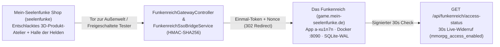

# Konzept & Umsetzungsbericht: Das Funkenreich als eigenes Spiel-Projekt & Saubere Shop-Trennung (Baustein 0)

> **Datum:** 18.11.2026  
> **Status:** ✅ 100 % Grün umgesetzt & live auf Stage/Mittwald verifiziert (`94/94` Selbsttests grün)  
> **Verantwortlich:** Spieli (`spieli` · Lead Game Director) & Systemi/Produkti unter Chef-Dirigent Falcone  
> **Ziel-Domain:** `https://game.mein-seelenfunke.de` (Mittwald Managed-PHP-App `a-xu1n7n`)  
> **Eigenständiger Projektpfad:** `/home/ubuntuxina/meine-projekte/funkenreich` ([`funkenreich.md`](file://wsl.localhost/Ubuntu/home/ubuntuxina/meine-projekte/funkenreich/funkenreich.md))

---

## 1. Unternehmerische & Technische Ausgangslage

Mit dem Wachstum der 3D-Halle der Helden, der 10-stufigen Magma-Welt, des Händlersystems und des Multiplayer-Chats im Hauptportal `Mein-Seelenfunke` entstand eine klare architektonische Anforderung:
1. **Reiner, blitzschneller Manufaktur-Shop (`mein-seelenfunke.de`):** Das E-Commerce-Portal für handveredelte Laser-Unikate bleibt schlank, wartungsarm und frei von zehntausenden Zeilen 3D-Rollenspiel-Logik.
2. **Eigenständiges 60-FPS Spiel-Studio (`game.mein-seelenfunke.de`):** „Das Funkenreich“ erhält ein eigenes, hochperformantes PHP-8.4- und ES-Module-Projekt ohne Framework-Ballast, mit **0 % Spielcode-Verlust** und einer modularen Baukasten-Struktur für die Ausbaustufen Baustein 1 bis 6.

---

## 2. Architektur der Sauberen Trennung (Baustein 0)

### 2.1 Eigenständige Infrastruktur, Deployment & Spezial-Subagenten
- **Getrennte Codebase & Container:** Vollständig autarkes Repository unter `/home/ubuntuxina/meine-projekte/funkenreich` (`\\wsl.localhost\Ubuntu\home\ubuntuxina\meine-projekte\funkenreich`).
  - **Lokal:** Eigener Docker-Container **`mein_funkenreich_server`** auf Port **`:8090`**.
  - **Live / Stage auf Mittwald mStudio (`p-g27wim`):** Eigene Managed-PHP-8.4-App **`a-xu1n7n`** (`funkenreich-game`, Pfad `/home/p-g27wim/html/funkenreich-game`, `customDocumentRoot: "/public"`) unter **`https://game.mein-seelenfunke.de`** mit automatischem Let's-Encrypt ACME-SSL/TLS und eigener DNS-Subzone.
  - **1-Befehl-Rollout:** Reproduzierbares Deployment direkt über **`./funki funkenreich-deploy`**.
- **Dediziertes Spieli-Studio & Leitarchitektur:** Gesteuert über die verbindliche Architektur-Landkarte [`funkenreich.md`](file://wsl.localhost/Ubuntu/home/ubuntuxina/meine-projekte/funkenreich/funkenreich.md) und vier spezialisierte Subagenten:
  - **`spieli`** (Lead Game Director, Engine & Next-Gen Movement Architect)
  - **`spieli1`** (3D Character, Rigging, Armor-Extraction & Animation Artist)
  - **`spieli2`** (Combat, Abilities, Shader-VFX & Matte Audio Designer)
  - **`spieli3`** (RPG Backend, SSO-Gate, Naming & 13-Slot Paperdoll-UI Architect)

### 2.2 Eigenständige PHP 8.4 + SQLite-WAL Engine (`app/` & `public/index.php`)
- **Zero Framework-Bloat:** Direkter Front-Controller ([`public/index.php`](file://wsl.localhost/Ubuntu/home/ubuntuxina/meine-projekte/funkenreich/public/index.php)) mit eigenem PSR-4 Autoloader (`Funkenreich\*` in [`app/Bootstrap.php`](file://wsl.localhost/Ubuntu/home/ubuntuxina/meine-projekte/funkenreich/app/Bootstrap.php)), gehärteten Sessions (`HttpOnly`, `SameSite=Lax`, Session-Rotation) und striktem CSRF-Schutz.
- **Atomare SQLite-WAL Persistenz ([`PlayerStoreService.php`](file://wsl.localhost/Ubuntu/home/ubuntuxina/meine-projekte/funkenreich/app/Services/PlayerStoreService.php)):** Speichert Spieler-Profile, Funken-Salden, 6-Herzen-Escrow, Magma-Fortschritt, 6-Slot-Rucksack, aktive Distrikt-Peers, Chat-Ringpuffer und verbrauchte SSO-Nonces lokal unter `storage/database/funkenreich.sqlite` mittels `BEGIN IMMEDIATE TRANSACTION` (`< 1 ms` Antwortzeit, 0 externe Datenbank-Abhängigkeit).
- **Suchmaschinen- & Closed-Alpha-Schutz:** Jede Antwort trägt `X-Robots-Tag: noindex, nofollow, noarchive` (ergänzt durch `Disallow: /` in `public/robots.txt`). Unautorisierte Besucher erhalten auf `GET /` immer **HTTP `403`** mit der edlen Schwarz-Gold Vorschau-Seite ([`gate_locked.php`](file://wsl.localhost/Ubuntu/home/ubuntuxina/meine-projekte/funkenreich/app/Views/gate_locked.php)) und auf API-Routen HTTP `403` JSON (`closed_alpha_locked`).

### 2.3 Kryptografisches Closed-Alpha-Gate, 1-Klick-Freischaltung & 30s Live-Widerruf
- **Shop-seitige Brücke:** [`FunkenreichSsoBridgeService.php`](file://wsl.localhost/Ubuntu/home/ubuntuxina/meine-projekte/seelenfunke/app/Services/Gamification/FunkenreichSsoBridgeService.php) und [`FunkenreichGatewayController.php`](file://wsl.localhost/Ubuntu/home/ubuntuxina/meine-projekte/seelenfunke/app/Http/Controllers/Frontend/FunkenreichGatewayController.php) erzeugen kurzlebige, HMAC-SHA256-signierte Einmal-Tokens (`iss: "mein-seelenfunke"`, `sub_type`, `sub_id`, `mmorpg_access: true`, `exp`, 32-Zeichen `nonce`).
- **Zentrale 1-Klick-Freischaltung (`MMORPG-Zugang`):** In der Benutzerverwaltung unter `/admin/users` bzw. `/admin/user-management` ([`SystemUserManagement.php`](file://wsl.localhost/Ubuntu/home/ubuntuxina/meine-projekte/seelenfunke/app/Livewire/Shop/System/SystemUserManagement.php)) steuert Alina über das Flag `customers.mmorpg_access_enabled` per 1-Klick, welche Tester Zugang zur Außenwelt erhalten (inkl. Audit-Eintrag in `SystemLog`; Administratoren besitzen automatisch Zugriff).
- **Atomarer Replay-Schutz & Session-Rotation ([`SsoGateGuard.php`](file://wsl.localhost/Ubuntu/home/ubuntuxina/meine-projekte/funkenreich/app/Security/SsoGateGuard.php)):** Prüft beim Aufruf von `GET /sso/callback?token=<base64url>.<hex_hmac_sha256>` die Signatur zeitkonstant via `hash_equals` und verbucht jedes `nonce` einmalig in `used_sso_nonces` (Wiederholungsversuche enden sofort mit HTTP `403`). Nach erfolgreicher Verifikation rotiert `SsoGateGuard` die Session-ID und leitet per **`HTTP 302`** sauber auf `/` weiter, sodass kein Token in der Adresszeile oder Browser-Chronik verbleibt.
- **30-Sekunden Live-Revocation:** Aktive Kunden-Sessions werden alle `30s` kryptografisch signiert (`X-Funkenreich-Timestamp` + `X-Funkenreich-Signature`) gegen `/api/funkenreich/access-status` geprüft. Wird `MMORPG-Zugang` im Shop deaktiviert, endet die aktive Spiel-Session spätestens beim nächsten Zyklus sofort.

### 2.4 Verlustfreie 3D-Engine (`0 %` Spielcode-Verlust) & Modulare ES-Ordnerstruktur
- **100 % Autarke Assets (`0` externe CDNs):** Lokale Einbindung von Three.js (`three.min.js`, `three.module.min.js`, `GLTFLoader.js`), Alpine.js (`alpine.min.js`), allen 10 Funki-`.glb`-Modellen, Showroom-Texturen, `.webp`-Fähigkeits-Icons und 2-Spur-BGM/SFX.
- **Modulare ES-Baukasten-Struktur unter `public/js/funkenreich/{core,character,combat,world,ui,engine}`:**
  - `core/GameConfig.js` & `core/AudioEngine.js`
  - `character/MovementSpec.js` (Physik, Sprung, `Shift`-Sprint, `shortestAngleDiff`, `1s` Ninja-Wall-Cling, `-1` Wall-Backflip & 24-Bone-Rig für Baustein 1 & 2)
  - `combat/AbilityCatalog.js` (Fähigkeiten 1..5 & 4er-Kombo für Baustein 1 & `spieli2`)
  - `world/MagmaGymSpec.js` & `world/MerchantCatalog.js` (S-Kurven-Anker Raum 1..10, Händler & 13-Slot-Paperdoll-Vorbereitung für Baustein 3)
  - `ui/GameHudController.js` (WeakMap-isolierte HUD-, Distrikt-, Chat-, Händler- & Inventar-Steuerung)
  - `engine/LegacyFullWorld3D.js` (Kompletter 18.698-Zeilen 3D-Spielkern 1:1 verlustfrei eingebunden inkl. Goldklinge in der rechten Hand, 6 Herzen, Mana, Magma Raum 1..10 & Multiplayer)

---

## 3. Entschlacktes 3D-Produkt-Atelier im Hauptportal (`seelenfunke`)

Parallel zur Auslagerung des Spiels wurde [`seelenfunke-louvre-showroom-3d.js`](file://wsl.localhost/Ubuntu/home/ubuntuxina/meine-projekte/seelenfunke/public/js/seelenfunke-louvre-showroom-3d.js) im Shop konsequent zu einem edlen, leichtgewichtigen **3D-Produkt-Atelier mit goldener Halle der Helden** veredelt:

1. **Entfernung von über `7.100` Zeilen RPG-Ballast aus dem Shop:**
   - Sämtliche Rollenspiel-Systeme (NPC-Händler, 6-Herzen-/Mana-Balken, Goldklinge & Kampf-Skills `1..5`, Heiltrank-Rucksack sowie die 10-Stufen-Magma-Kammer) wurden vollständig aus dem Shop-Frontend entfernt.
   - Das Atelier im Shop lädt dadurch spürbar schneller und bleibt zu 100 % auf die Manufaktur-Unikate, die 3D-Sternebewertungs-Station und das soziale Treffen in der Halle der Helden fokussiert.
2. **Vollautomatische dynamische Hallen-Skalierung:**
   - Die Architektur skaliert vollautomatisch mit der Anzahl aktiver Shop-Produkte (`rows = Math.ceil(count / 2)`, präzises `6,20 m` Achsraster und GPU-schonende `InstancedMesh`-Vitrinen). Werden Produkte ergänzt oder deaktiviert, wachsen oder schrumpfen Hallenlänge, Glasdach, Beleuchtung und Nord-Portal (`hallNorthZ`) nahtlos ohne manuellen Code-Eingriff mit.
3. **3D Schwarzer Edel-Gutscheinumschlag (`_populateVoucherEnvelope3D`):**
   - Für den Geschenkgutschein thront in der Vitrine auf einem 24K-Gold-Aufsteller eine maßgetreue **C6-Manufaktur-Skulptur (`162 x 114 mm`)** aus mattschwarzem Feinkarton mit feinem Papierkorn-Bump, echten 3D-Briefklappen, 4 diagonalen 24K-Gold-Zierleisten, plastischem 3D-Gold-Wachssiegel (Lorbeerkranz & Herz-Relief) sowie `MEIN SEELENFUNKE`-Goldprägung auf der Rückseite auf 24K-Gold-Aufsteller, ganz ohne `three_d_active` auf der regulären Gutschein-Kaufseite verändern zu müssen.
4. **Herzliches Wording & Clean-Design am „Tor zur Außenwelt“:**
   - Über dem Bogenschlussstein (`keystone`) des West-Portals thront völlig überdeckungsfrei (`0,0 mm` Überlappung) das 3D-Schild **`Tor zur Außenwelt`** mit dem Untertitel **`Bald warten hier fantastische Welten & Abenteuer`**.
   - Beim Anklicken öffnet sich ein freundliches **Light-Mode-Modal** komplett ohne technischen „MMORPG“-Fachjargon: *„Hinter diesem Tor warten bald eine fantastische Welt und spannende Abenteuer auf dich, an denen das Team von Mein-Seelenfunke in Zukunft arbeiten möchte.“*
   - Für Administratoren und per `MMORPG-Zugang` freigeschaltete Tester erscheint direkt darunter der goldene Direkt-Button **`In die Außenwelt starten`**, der nahtlos über das HMAC-SSO-Gate nach `https://game.mein-seelenfunke.de` überleitet.

---

## 4. Qualitätssicherung & Testergebnis (`94/94` Grün)

Die automatisierte Pflicht-Test-Suite [`tests/run_tests.php`](file://wsl.localhost/Ubuntu/home/ubuntuxina/meine-projekte/funkenreich/tests/run_tests.php) verifiziert bei jedem Lauf insgesamt **`94/94` Checks** zu **100 % Grün**: PHP-8.4-Syntax, ES-Module-Syntax via `node --input-type=module --check`, lokale Asset-Vollständigkeit (`0` externe CDNs), `0` KI-Gedankenstriche, SSO-Signatur- & Nonce-Replay-Abwehr, `30s` Live-Widerruf, Multiplayer-Distrikt-Sharding (`Soft-Cap 16` / `Hard-Cap 20`), Magma-6-Herzen-Escrow, Level-Abstufung bei `0/6` Herzen, Händler-Käufe sowie echte HTTP-End-to-End-Aufrufe gegen `public/index.php` und Live-Prüfung auf `https://stage.mein-seelenfunke.de` sowie `https://game.mein-seelenfunke.de`.
