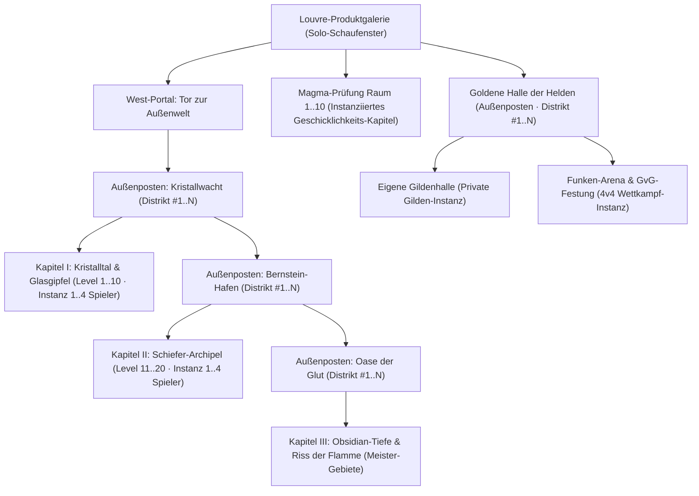
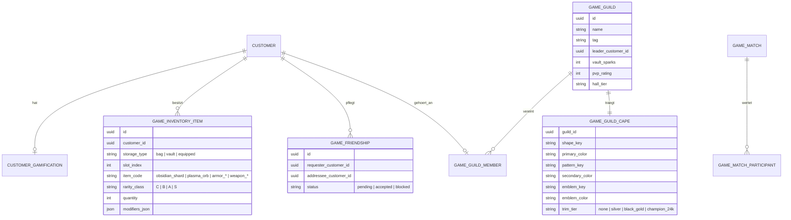

# Zukunfts-Masterkonzept (Ideen-Speicher): Ausbau des „Funkenreichs“ zum instanziierten Online-Rollenspiel (Guild-Wars-1-Architektur)

**Datum:** 18.11.2026  
**Status:** 💡 Strategischer Ideen-Speicher & Langzeit-Architekturplan (Konzept für späteren Ausbau, noch nicht im Live-Code aktiviert)  
**Vorbild-Architektur:** *Guild Wars 1* (*Prophecies*, *Factions*, *Nightfall*) kombiniert mit der Schwarz-Gold-Manufakturwelt von `Mein-Seelenfunke`  
**Verknüpfte Bestands-Systeme:** [Konzept_3D_User_Lobby_und_Goldene_Halle_der_Helden.md](file://wsl.localhost/Ubuntu/home/ubuntuxina/meine-projekte/seelenfunke/Abschlussberichte/Konzepte/Konzept_3D_User_Lobby_und_Goldene_Halle_der_Helden.md), [Workflow_Gamification_Clean_Design.md](file://wsl.localhost/Ubuntu/home/ubuntuxina/meine-projekte/seelenfunke/Abschlussberichte/Workflows/Workflow_Gamification_Clean_Design.md), [LobbyInstanceService.php](file://wsl.localhost/Ubuntu/home/ubuntuxina/meine-projekte/seelenfunke/app/Services/Gamification/LobbyInstanceService.php), [LavaParkourService.php](file://wsl.localhost/Ubuntu/home/ubuntuxina/meine-projekte/seelenfunke/app/Services/Gamification/LavaParkourService.php) & [GameConfig.php](file://wsl.localhost/Ubuntu/home/ubuntuxina/meine-projekte/seelenfunke/app/Services/Gamification/GameConfig.php)  
**Verfasser:** Falcone (Technischer Mitgründer & Chef-Architekt)

---

## 1. Leitidee & Unternehmerisches Ziel

Hinter dem heute bereits im Westflügel der Louvre-Galerie sichtbaren, verschlossenen **„Tor zur Außenwelt“** soll langfristig ein vollwertiges, im Browser und mobil spielbares **3D-Online-Rollenspiel („Das Funkenreich“)** entstehen, das sich architektonisch und spielerisch am legendären Prinzip von **Guild Wars 1 (*Prophecies*, *Factions*, *Nightfall*)** orientiert:

1. **Begehbare Städte & Außenposten mit Distrikten:** Treffpunkte zum Sehen und Gesehenwerden, Chatten, Handeln, Gruppenbilden und Präsentieren der eigenen Rüstung sowie des eigenen **Gilden-Umhangs**.
2. **Instanziierte Abenteuer-Level & Kampagnen-Welten:** Beim Durchschreiten eines Portals betritt der Spieler (allein, mit KI-Wächtern oder als 4er-Freundes-/Gildengruppe) eine eigene, ruckelfreie Prüfungs- und Kampf-Instanz.
3. **Sammelbare Gegenstände, Rüstungen, Waffen & Seltene Essenzen:** Von einfachen Handwerksstoffen bis zu seltenen Prestige-Materialien wie **`Obsidianscherben`** und **`Plasmakugeln`**.
4. **Faire PvP-Arenen & Gildenkämpfe (`GvG`):** Können, Timing und Teamspiel entscheiden statt Geldbeutel (horizontale Balance ohne Pay-to-Win).
5. **Eigene Freundschaftsliste & Gilden-System mit 3D-Umhang-Editor:** Echte soziale Bindung direkt auf `mein-seelenfunke.de`.
6. **Einzigartige Brücke zur realen Manufaktur Gifhorn:** Gesammelte Funken schützen durch attraktive Ingame-Ziele (Rüstungen, Waffen, Gilden-Umhänge) aktiv die Shop-Marge bei Rabattgutscheinen und eröffnen völlig neue physische Bestellimpulse (z. B. das eigene Gilden-Wappen oder den Helden-Titel als echtes lasergraviertes K9-Kristallglas oder Schiefer-Wappenschild).

---

## 2. Welt- & Zonen-Architektur nach dem Guild-Wars-Prinzip

### 2.1 Drei strikt getrennte Raum-Typen (Maximale Performance bei minimalen Serverkosten)
* **Typ A · Schaufenster-Zonen (`Solo`):** Die helle Produktgalerie (`/shop`). Null Netzwerk-Tick, 100 % Fokus auf die Manufaktur-Unikate.
* **Typ B · Außenposten & Städte (`Distrikte #1..N`, Soft-Cap `16`, Hard-Cap `20`):**
  * Beispiele: *Halle der Helden*, *Kristallwacht*, *Bernstein-Hafen*, *Oase der Glut*, *Arena-Vorhalle*.
  * Hier stehen NPC-Händler, Rüstungsschmiede, Waffenschmiede, der **Gilden-Registrator**, der **Umhangweber** sowie die accountweite **Funken-Truhe** (Vorbild: *Xunlai-Truhe*).
  * Spieler können oben rechts wie in *Guild Wars* gezielt den Distrikt wechseln (z. B. `Distrikt #2`), um sich mit Freunden oder Gildenmitgliedern am Brunnen zu treffen.
* **Typ C · Instanziierte Erkundungsgebiete, Prüfungen & Gildenhallen (`1 bis 4` Spieler):**
  * Sobald der Gruppenleiter durch ein Gebiets-Portal schreitet, erzeugt der Server eine isolierte Raum-Instanz exakt für diese `1 bis 4` Spieler.
  * Wer lieber allein spielt, kann wie in *Guild Wars Nightfall* bis zu **3 freigespielte KI-Begleiter („Wächter“)** in seine Gruppe mitnehmen.
  * Im Browser wird immer nur das aktuelle Gebiet geladen (Lazy-Loading von komprimierten `.glb`-Umgebungskacheln); beim Zonenwechsel wird der Grafikspeicher der vorherigen Zone vollständig geleert (`0` Speicherleck, stabile `60 FPS` auf PC und Smartphone).

### 2.2 Geplante Kampagnen-Kapitel hinter dem „Tor zur Außenwelt“

| Kapitel | Inspiration | Stil & Umgebung | Level-Bereich | Besondere Mechanik & Beute |
| :--- | :--- | :--- | :--- | :--- |
| **Grundwelt: Magma-Prüfung** | Klassische Prüfungen | Basalt, Goldadern, Lava | Raum `1..10` | Präzisions-Parkour, Fallen, Grund-Funken & Meisterschlüssel-Tor ab Raum 6 |
| **Kapitel I: Kristallgipfel** | *Prophecies* | Verschneite Gipfel, K9-Kristallhöhlen, Lichtbrücken | Gebiet `1..10` | Prisma-Strahlenrätsel, Eis- & Kristall-Wächter, *Quarzstaub* & *Kristallprismen* |
| **Kapitel II: Schiefer-Archipel** | *Factions* | Schwarze Schieferklippen, Gold-Pagoden, Bernsteinmeer | Gebiet `11..20` | Schnelle Kombo-Wellen, Zeit-Ränge (`Meister-Zeit`), seltene Waffen-Rohlinge |
| **Kapitel III: Sonnenwüste & Obsidian-Riss** | *Nightfall* & *Riss des Kummers* | Goldene Dünen, Schwarze Obelisken, Ewige Schmiede | Meister-Stufen | Rekrutierbare KI-Wächter, Elite-Bosse, Drop-Chance auf **`Obsidianscherben`** & **`Plasmakugeln`** |

---

## 3. Kampfsystem, 8er-Fähigkeiten-Deck & Horizontale Progression

Genau wie in *Guild Wars 1* soll nicht derjenige gewinnen, der 1.000 Stunden lang Zahlen aufbläst, sondern derjenige, der seine **Fähigkeiten klug zusammenstellt („Build-Bau“)** und im richtigen Moment reagiert:

1. **Kompaktes 8-Plätze-Fähigkeiten-Deck (unten mittig):**
   * **Plätze `1 bis 5` (Aktive Waffen- & Klassen-Fertigkeiten):** Frei zusammenstellbar im Außenposten aus einem wachsenden Pool erlernter Fertigkeiten (im Kampfgebiet selbst gesperrt, genau wie in *Guild Wars*).
   * **Platz `6` (Elite-Fertigkeit mit Goldrahmen):** Maximal **eine** besonders mächtige Elite-Fertigkeit pro Build (kann von Bossen in späten Leveln erbeutet werden).
   * **Plätze `7 & 8` (`Q` & `R`, Verbrauchs-Slots):** Heiltränke, Ausdauer-Essenzen oder Schutzrollen.
2. **Vier klare Spielstile (jederzeit im Außenposten wechselbar über die angelegte Waffe):**
   * **Sonnenwächter (Schwert & Schild):** Nahkampf-Kombo, Blocken, Aegis-Schutzschild für Verbündete.
   * **Obsidianspalter (Zweihand-Hammer):** Flächen-Bodenschläge, Unterbrechen gegnerischer Zauber (*Interrupt*), Rüstungsbrecher.
   * **Prismenweber (K9-Kristallstab):** Fernkampf-Lichtlanzen, Gruppen-Heilung und Entzauberung.
   * **Schattengraveur (Zwillingsklingen / Runenbogen):** Hohe Beweglichkeit, Kritische Kombo-Ketten und Präzisionsschüsse.
3. **Horizontale Höchstwerte (Kein Pay-to-Win, kein Endlos-Zahlen-Grind):**
   * Ab Erreichen der Maximalstufe (`Stufe 10` bzw. Kampagnen-Stufe `20`) haben alle Meister-Rüstungen dieselbe faire Schutz-Obergrenze.
   * Neue Rüstungen und Waffen unterscheiden sich durch **einzigartige 3D-Optik, Leuchtspuren, Runen-Spezialisierungen** (z. B. `+Lebenspunkte` gegen `-Mana` wie Überlegene Runen in *Guild Wars*) und Seltenheit.

---

## 4. Gegenstände, Seltene Materialien, Rüstungen & Waffen (`KLASSE C / B / A / S`)

Alle Gegenstände folgen strikt unserem Clean-Design-Standard ([Workflow_Gamification_Clean_Design.md](file://wsl.localhost/Ubuntu/home/ubuntuxina/meine-projekte/seelenfunke/Abschlussberichte/Workflows/Workflow_Gamification_Clean_Design.md)): klare 1-Zeilen-Titel, Einstufung in **`KLASSE C`**, **`KLASSE B`**, **`KLASSE A`** oder **`KLASSE S`**, keine Textwüsten.

### 4.1 Währung & Wertspeicher-Materialien (Inspiriert von Platin, Ektoplasmakugeln & Obsidianscherben)

| Bezeichnung | Klasse | Herkunft im Spiel | Verwendungszweck |
| :--- | :--- | :--- | :--- |
| **`Seelenfunken (✨)`** | Basiswährung | Level-Truhen, PvP-Siege, Tagesaufgaben, Website-Funkenjagd, Shop-Treue | Universelle Hauptwährung für Händler, Tränke, Handwerk, Gilden-Gründung & Shop-Rabattgutscheine |
| **`Quarzstaub` / `Schiefersplitter` / `Edelstahlbarren`** | `KLASSE C` | Gewöhnliche Beute in Kapitel I & II, Zerlegen alter Ausrüstung | Grundmaterial beim Schmied für Standard-Rüstungen und Einsteiger-Waffen |
| **`K9-Kristallprisma` / `14K-Goldblatt`** | `KLASSE B` | Seltene Truhen ab mittleren Leveln & beim Seltenen-Material-Händler | Veredelung von `KLASSE A`-Rüstungen, Schildern und Gilden-Bannern |
| **`Obsidianscherbe`** | `KLASSE A` / `S` | Seltener Drop im *Obsidian-Riss*, Magma-Meistertruhen (`Raum 9..10`) & GvG-Turniertruhen | Kernzutat für die legendäre **Obsidian-Meisterrüstung** (Hommage an die *Riss-Rüstung* aus *Guild Wars*) |
| **`Plasmakugel`** | `KLASSE S` | Sehr seltener Drop in schweren Meister-Gebieten & hochrangigen PvP-Ehrentruhen | Hochwert-Handelsgut für **leuchtende Plasma-/Äther-Waffen**, Elite-Runen und Prestige-Schmiedekunst (Vorbild: *Ektoplasmakugel*) |
| **`Herz des Seelenfunkens`** | `KLASSE S` | Einmalige Erstabschluss- & Weltboss-Trophäe | Schmieden einer einzigartigen 24K-Meisterwaffe mit goldener Funken-Spur |

### 4.2 Ausrüstungs-Plätze, Rüstungs-Sets & Waffen
1. **Ausrüstungs-Plätze im Charakter-Fenster (`Inventar` auf Taste `I`):**
   * `Kopf` (Helm / Reif / Krone)
   * `Brust` (Harnisch / Robe)
   * `Hände` (Panzerhandschuhe / Armschienen)
   * `Füße` (Stiefel / Beinschienen)
   * `Rücken` (**Gilden-Umhang** mit dynamischem Gilden-Wappen, ein-/ausblendbar)
   * `Haupthand` & `Nebenhand` (Waffe + Schild/Fokus oder Zweihandwaffe)
2. **Beispielhafte Prestige-Rüstungslinien:**
   * **Manufaktur-Lehrling (`KLASSE C`):** Schlichtes Leder & gebürsteter Stahl.
   * **Schiefer-Wächter (`KLASSE B`):** Dunkler Nero-Marquina-Plattenpanzer mit matten Goldkanten (`#C5A059`).
   * **Kristall-Templer (`KLASSE A`):** Facettierte K9-Kristall-Schulterplatten mit sanfter Lichtbrechung.
   * **Obsidian-Meisterrüstung (`KLASSE S`):** Tiefschwarzer Vulkanglas-Harnisch mit feinen goldenen Glutadern; erfordert beim Meisterschmied z. B. `75 Obsidianscherben` + `75 Plasmakugeln` + `2.500 ✨ Seelenfunken`.
3. **Aufbewahrung (`Rucksack` + `Tresor`):**
   * Unterwegs trägt der Spieler seinen **`Rucksack`** (erweiterbar durch erspielbare Gürteltaschen von `6` auf `20` Plätze).
   * In jedem Außenposten steht der **`Tresor`** (accountweite Lagertruhe mit Material-Fach für bis zu `250` Stück je Materialtyp plus Ausrüstungs-Fächer).

### 4.3 Warum diese Ökonomie die reale Shop-Marge von `Mein-Seelenfunke` schützt
In einem normalen Bonusprogramm gibt es für gesammelte Punkte nur ein einziges Ziel: **Rabattgutscheine** (was bei Vielsammelnden die Marge drückt).  
Durch begehrte Ingame-Ziele wie die **Obsidian-Rüstung**, **Plasmakugel-Waffen**, **Gilden-Gründung** und **Umhang-Borten** entsteht ein freiwilliger, hochmotivierender **Funken-Kreislauf im Spiel („Funken-Senke“)**:
* Gelegenheitsspieler lösen ihre `250 / 600 / 1.200` Funken glücklich für `5 % / 10 % / 15 %` Shop-Gutscheine bei ihrer nächsten Gravur-Bestellung ein.
* Leidenschaftliche Vielspieler investieren tausende `funken_balance` stolz in ihre Gilde, ihren Umhang und ihre `KLASSE S`-Ausrüstung, während ihr `funken_total_earned` sie in der **Halle der Helden** nach ganz oben bringt, **ohne** dass dadurch unbegrenzt Rabattgutscheine ausgeschüttet werden.

---

## 5. PvP-Modus, PvP-Gegenstände & Gildenkämpfe (`Arena`)

Inspiriert von den legendären **Zufallsarenen**, **Bündniskämpfen** und **Gildenkämpfen (`GvG`)** aus *Guild Wars 1*:

### 5.1 Drei faire Wettkampf-Modi
1. **1v1 Ehren-Duell (`Duell`):**
   * Zwei Spieler in der Arena-Vorhalle oder auf der Freundschaftsliste fordern sich zu einem Best-of-3-Duell heraus (`90 Sekunden` pro Runde).
2. **4v4 Zufalls- & Team-Arena (`Funken-Arena`):**
   * Schnelle `3-Minuten`-Matches auf kompakten, symmetrischen 3D-Karten (*Obsidian-Hof*, *Kristallbrücke*, *Schiefer-Tempel*).
   * Spielziel im Wechsel: Klassischer Team-Wettkampf oder *Relikt-Kontrolle* (Mittelpunkt halten).
3. **4v4 / 8v8 Gildenkampf (`GvG · Schlacht um die Goldene Halle`):**
   * Die Königsdisziplin wie in *Guild Wars*: Jede Gilde besitzt auf einer symmetrischen Karte ihre eigene **Gilden-Basis mit Flaggenstand und Gildenherrn (NPC)**.
   * Taktisches Zusammenspiel aus Angriff, Flaggenkontrolle in der Kartenmitte und Verteidigung.
   * **Saison-Ehre:** Die bestplatzierte Gilde des Monats wird namentlich samt ihrem 3D-Gilden-Wappen auf den **Ehrenbannern der Halle der Helden** ausgestellt und schaltet für den gesamten Monat den exklusiven **24K-Meister-Goldsaum** am Gilden-Umhang frei.

### 5.2 Spezielle PvP-Gegenstände & Belohnungen
* **Faire Normierung:** Im PvP zählen identische Basis-Rüstungswerte für alle Teilnehmer; niemand kann sich mit Echtgeld stärkere Kampfwerte kaufen.
* **PvP-Beute & Champion-Händler:**
  * Für gewonnene Runden erhalten Spieler **`Seelenfunken ✨`** sowie **Arena-Ehrenzeichen**.
  * In PvP-Siegestruhen und beim Arena-Rüstmeister gibt es exklusive **PvP-Waffen & Schilde** (z. B. *Gladiatoren-Klinge*, *Obsidian-Turmschild*, *Flammender Kristallstab*, *Champion-Helm*) sowie ab hohen Rängen Chancen auf **`Obsidianscherben`** und **`Plasmakugeln`**.

---

## 6. Persönliche Freundschaftsliste (`Freunde` · Taste `N`)

Jeder Spieler besitzt ein eigenes, datenschutzkonformes Kontakte-Modul direkt in der 3D-Welt und im Spieler-Cockpit:

1. **Aufbau der Freundschaftsliste (Clean-Design, 3 kompakte Reiter):**
   * **`Freunde`:** Bestätigte Kontakte, sortiert nach Online-Status (`Online` oben in Grün/Gold, `Offline` dezent ausgegraut).
   * **`Anfragen`:** Eingehende und ausgehende Freundschaftsanfragen (Freundschaft entsteht **nur beidseitig** nach aktiver Annahme; Anfragen sind auf max. `5` offene Anfragen pro Stunde gedrosselt gegen Spam).
   * **`Blockiert`:** Ignorierte Spieler (blendet deren Chat-Nachrichten, 3D-Sprechblasen, Duell- und Gruppeneinladungen sofort vollständig aus).
2. **Live-Aufenthaltsanzeige & 1-Klick-Aktionen:**
   * Neben jedem Online-Freund steht kurz der aktuelle Ort: z. B. *`Halle der Helden #1`*, *`Kristalltal (2/4)`* oder *`Funken-Arena`*.
   * **Direkt-Buttons am Eintrag:**
     * `Flüstern` (privater 1:1-Nachrichtenkanal, geschützt durch `ShowroomChatGuardService`)
     * `Nachreisen` (wechselt bei freiem Platz direkt in denselben Außenposten-Distrikt)
     * `Einladen` (lädt den Freund in die eigene `4er`-Gruppe für Level oder Arena ein)
     * `Duell` (startet eine 1v1-Anfrage)
   * **Privatsphäre-Schalter:** Jeder Spieler kann seinen Status jederzeit auf *`Unsichtbar / Ruhemodus`* stellen.

---

## 7. Gilden-System & Der 3D-Gilden-Umhang-Konfigurator (`Gilde` · Taste `G`)

Eines der prägendsten Erlebnisse aus *Guild Wars 1* war das Gründen einer eigenen Gilde inklusive individuellem **Gilden-Kürzel `[TAG]`** hinter dem Spielernamen und dem gemeinsamen **Gilden-Umhang**, den jedes Mitglied stolz auf dem Rücken trägt.

### 7.1 Gilde gründen, Rollen & Eigene Gildenhalle
1. **Gründung beim `Gilden-Registrator` (in der Halle der Helden):**
   * Voraussetzungen: Aktive Magie + einmalige Gründungsurkunde für **`500 ✨ Seelenfunken`**.
   * Festlegung von **Gildenname** (`3 bis 28` Zeichen) und **Gilden-Kürzel** (`2 bis 4` Buchstaben, z. B. `[SF]`, `[GLAS]`, `[GOLD]`), geprüft über den mehrschichtigen Wortfilter (`PlayerNameValidator`) inklusive Dublettenschutz (`UNIQUE`).
   * Im 3D-Raum erscheint über jedem Mitglied dezent: **`Spielername [TAG]`**.
2. **Mitglieder-Hierarchie & Größe:**
   * Bis zu **`50` Mitglieder** pro Gilde in vier klaren Rängen:
     * **`Anführer`** (1x: Umhang-Design, Beförderungen, Gildenhalle, Auflösung)
     * **`Offizier`** (Mitglieder einladen/entfernen, GvG-Anmeldung, Tagesnachricht)
     * **`Mitglied`** (voller Zugriff auf Gildenhalle, Gilden-Chat & Umhang)
     * **`Anwärter`** (Probezeit nach Beitritt)
3. **Begehbare 3D-Gildenhalle (Freischaltbar über die gemeinsame Gildenkasse):**
   * Gildenmitglieder können Funken, `Obsidianscherben` und Materialien gemeinsam beim Schatzmeister einzahlen, um eine **eigene instanziierte 3D-Gildenhalle** freizuschalten (z. B. *Kristall-Insel*, *Schiefer-Zitadelle* oder *Goldene Oase*).
   * Ausbaustufen in der Gildenhalle: Eigener `Tresor`, `Händler`, `Schmied`, Trainings-Golems für Kombo-Tests und Trophäen-Podeste.

### 7.2 Der 3D-Gilden-Umhang-Editor (`Umhang`)
Da unser 3D-Funki-Charakter bereits ein animiertes Rücken-Umhang-Mesh mit federnder Laufphysik besitzt, kann der Gilden-Umhang ohne Zusatz-Download über einen deterministischen **5-Schichten-Vektor-Baukasten** live als Textur (`512×512` `CanvasTexture` mit Anisotropie) erzeugt werden:

| Schicht | Auswahlmöglichkeiten im Editor | Sicherheits- & Performance-Vorteil |
| :--- | :--- | :--- |
| **1. Schnittform** | *Klassischer Wappenmantel*, *Schwalbenschwanz*, *Rittermantel*, *Duellanten-Schärpe* | 4 schlanke Geometrie-Varianten am Rücken-Bone |
| **2. Grundstoff & Hauptfarbe** | `16` edle, matte Tuchfarben (*Obsidian*, *Elfenbein*, *Saphir*, *Rubin*, *Smaragd*, *Purpur*, *Anthrazit* u. a.) | Mattes PBR-Stoffmaterial ohne künstlichen Neon-Glow |
| **3. Hintergrund-Muster & Zweitfarbe** | `12` heraldische Teilungen (*Geviertelt*, *Längsgeteilt*, *Sparren/Chevron*, *Raute*, *Sonnenstrahl*, *Bordüre*) | Kostet `0 Bytes` Bildspeicher in der Datenbank (reiner JSON-Code) |
| **4. Gilden-Emblem (Wappen)** | `48` kuratierte Vektor-Wappen (*Phönix*, *Drache*, *Krone*, *Schwert & Schild*, *Kristall*, *Flamme*, *Wolf*, *Löwe*, *Eule*, *Kompass*, *Amboss* u. a.) + Emblemfarbe | **100 % rechtssicher & jugendfrei**: Kein freier Bild-Upload möglich, daher null Risiko durch fremde Markenlogos oder unzulässige Motive |
| **5. Saum / Borte (`Trim`)** | *Schlicht*, *Silber-Borte*, *Schwarz-Gold-Borte (`#C5A059`)* (erspielbar) sowie **24K-Meister-Goldsaum** (für GvG-/Ranglisten-Spitzengilden) | Sofort sichtbares Prestige-Merkmal in jedem Außenposten wie in *Guild Wars 1* |

### 7.3 Der Manufaktur-Brückenschlag: „Vom Gilden-Wappen zum echten Unikat“
Weil jedes Gilden-Wappen im Umhang-Editor aus sauberen, hochauflösenden Vektorpfaden besteht, ergibt sich ein weltweit einzigartiges Feature für `Mein-Seelenfunke`:
* Im Gilden-Menü gibt es den dezenten Light-Mode-Button **„Gilden-Wappen als Manufaktur-Unikat verewigen“**.
* Mit 1 Klick öffnet sich der **Seelenfunke-Produktkonfigurator**, in dem das exakte Vektor-Wappen der Gilde, das `[TAG]` und auf Wunsch der Spielername bereits perfekt zentriert als **xTool-UV-Laser-Gravurvorlage** auf einer **Schieferplatte**, einem **K9-Kristall-Trophäenblock** oder einem **Edelstahl-Anhänger** geladen sind.
* Damit verwandelt sich emotionale Gilden-Zugehörigkeit direkt in echte Gruppen-Bestellungen für die Manufaktur in Gifhorn (z. B. 10 Gildenfreunde bestellen sich zum Jahres-Treffen ihren echten Gilden-Kristall).

---

## 8. Technische Ziel-Architektur (Skalierung auf Tausende Spieler ohne Kostenexplosion)

Damit dieser Großausbau weder die Ladezeit des Shops belastet noch teure Spezialserver erzwingt, greift eine saubere **Zwei-Schichten-Trennung**:

### 8.1 Schicht 1: Laravel + MySQL (Autoritative Wahrheit & Wirtschaft)
Laravel bleibt das alleinige, revisionssichere Grundbuch für alles, was dauerhaften Wert hat:
* Charakter-Stufe, `funken_balance`, `funken_total_earned`, `Inventar`/`Tresor`, `Obsidianscherben` & `Plasmakugeln` (immer in `DB::transaction` + `lockForUpdate()`, niemals blind aus dem Client übernommen).
* Gilden-Stammdaten, Umhang-JSON, Freundschaftsbeziehungen und PvP-Saison-Ranglisten.

### 8.2 Schicht 2: Leichtgewichtiger Echtzeit-Instanz-Worker (`WebSockets` für Koop & PvP)
Sobald über friedliche Außenposten hinaus **echte 4er-Koop-Kämpfe und 4v4-PvP-Arenen** hinzukommen, übernimmt ein schlanker **Node.js-WebSocket-Game-Worker** (wie der bereits auf Mittwald vorhandene Node-Container) den reinen Echtzeit-Bewegungs- und Kampf-Takt (`15 bis 20 Hz`, Binär-/Kompakt-Pakete à `< 80 Bytes`):
* **Server-Autoritatives Kampf-Protokoll:** Der Client sendet nur Eingaben (*„laufe Richtung X/Z“*, *„aktiviere Skill 2 auf Ziel Y“*); Abklingzeiten, Mana, Reichweite, Unterbrechungen und Treffer berechnet ausschließlich der Server (unhackbar gegen Speed-, Teleport- oder Damage-Cheats).
* **Ressourcen-Effizienz:** Ein einziger Node.js-Prozess im Arbeitsspeicher hält problemlos `100` parallele 4er-Instanzen + `20` Außenposten-Distrikte (**über `1.000 bis 2.000` gleichzeitige Live-Spieler**) bei wenigen hundert Megabyte RAM.
* **Strikte Asset-Kapselung:** Alle zusätzlichen 3D-Welten, Rüstungs-Sets und Monster liegen getrennt unter `/public/game-assets/chapters/...` und werden ausschließlich dann gestreamt, wenn ein Spieler aktiv durch das Portal tritt (`0 KB` Mehrgewicht für normale Shop-Käufer).

### 8.3 Geplantes Datenmodell (Übersicht für spätere Migrationen)

---

## 9. Rechtssicherheit, Jugendschutz, DSGVO & die 10 Seelenfunke-Bausteine

1. **Glücksspielrecht (GlüStV 2021) -> `0 %` Glücksspiel-Risiko:**
   * Es gibt **keine** gegen Echtgeld kaufbaren Zufalls-Truhen (Lootboxen).
   * `Seelenfunken`, `Obsidianscherben`, `Plasmakugeln`, Waffen und Rüstungen sind **weder für Echtgeld kaufbar noch in Echtgeld auszahlbar**; ein externer Echtgeld-Handel zwischen Spielern ist technisch und per AGB ausgeschlossen.
2. **UWG & Abmahnschutz:**
   * Klare, transparente Trennung zwischen dem kostenlosen Bonus-/Rollenspiel und realen Manufaktur-Bestellungen; keinerlei Kaufdruck-Timer oder irreführende Kinder-Kaufaufforderungen („Direct Exhortations“ nach Anhang zu § 3 Abs. 3 UWG).
3. **Jugendschutz (JMStV / USK-Leitlinien) & Markenästhetik:**
   * Edle Fantasy-/Licht-/Kristall-/Obsidian-Inszenierung ohne Blut- oder Splatter-Effekte: Besiegte Gegner lösen sich in goldene und dunkle Funkenpartikel auf; im PvP kniet ein besiegter Held ehrenvoll nieder, bis er wiederbelebt wird oder am Respawn-Schrein erscheint.
4. **DSGVO & Chat-/Gilden-Sicherheit:**
   * Anzeige im Spiel standardmäßig über anonymen Funki-Code oder geprüften `player_name`; Klarnamen erscheinen niemals ohne explizites `ranking_opt_in` + `use_real_name`.
   * Freundschaftsliste, Gilden-Chat und Flüster-Nachrichten durchlaufen denselben gehärteten Wort-, Link- und PII-Filter (`ShowroomChatGuardService`) inklusive 2-Strike-Shadow-Mute, 1-Klick-Blockierfunktion und Löschkaskade bei Kontolöschung (Art. 17 DSGVO).
   * Kein freier Bild-Upload für Gilden-Umhänge (ausschließlich kuratierter Vektor-Baukasten -> `100 %` Schutz vor Urheberrechtsverletzungen und strafbaren Symbolen).
5. **UI/UX Clean-Design & Light-Mode:**
   * Alle Menüs (`Inventar`, `Tresor`, `Freunde`, `Gilde`, `Umhang`, `Arena`) bleiben im hellen, matten Seelenfunke-Light-Mode (`#FAF8F5` / `#FFFFFF` + `#C5A059` Schwarz-Gold), ohne erklärende Subtexte und ohne KI-Gedankenstriche.

---

## 10. Sinnvoller Ausbau-Fahrplan in 5 Ausbaustufen (Modulare Roadmap für später)

Damit `Mein-Seelenfunke` jederzeit stabil bleibt und jede Ausbaustufe sofort spielbar Spaß macht, lässt sich das Gesamtkonzept später Schritt für Schritt in **5 abgeschlossenen Etappen** umsetzen:

* **Etappe 1 · Soziales Fundament (`Freunde` & `Tresor`):**
  Persönliche Freundschaftsliste (`N`), Online-/Zonen-Anzeige, 1-Klick-Distrikt-Nachreisen, Flüstern sowie die accountweite Lagertruhe (`Tresor`) in der Halle der Helden.
* **Etappe 2 · Gilden & 3D-Gilden-Umhang (`Gilde` & `Umhang`):**
  NPC `Gilden-Registrator` & `Umhangweber`, `[TAG]`-Anzeige über dem Charakter, 5-Schichten-Vektor-Umhang live am 3D-Funki, Gilden-Chat sowie die **1-Klick-Übergabe des Gilden-Wappens in den realen Produktkonfigurator**.
* **Etappe 3 · Schmiedekunst, Waffen, Rüstungen & Seltene Essenzen:**
  Erweiterung des Ausrüstungs-Systems (`KLASSE C / B / A / S`), 4 Waffen-Spielstile, Einführung von `Obsidianscherben` und `Plasmakugeln` sowie die schmiedbare *Obsidian-Meisterrüstung*.
* **Etappe 4 · Öffnung des „Tors zur Außenwelt“ (Koop-Kapitel I bis III via WebSocket-Worker):**
  Anbindung des Node.js-Echtzeit-Instanz-Workers, 4er-Gruppenbildung, KI-Wächter-Begleiter und schrittweise Öffnung der Kampagnen-Gebiete (*Kristallgipfel*, *Schiefer-Archipel*, *Obsidian-Riss*).
* **Etappe 5 · Wettkampf-Arenen & Gildenkämpfe (`PvP` & `GvG`):**
  1v1-Duell-Ring, 4v4 `Funken-Arena`, monatliche `GvG`-Meisterschaft um das Ehrenbanner in der Halle der Helden, PvP-Champion-Waffen und der exklusive **24K-Meister-Goldsaum** für Siegergilden.
