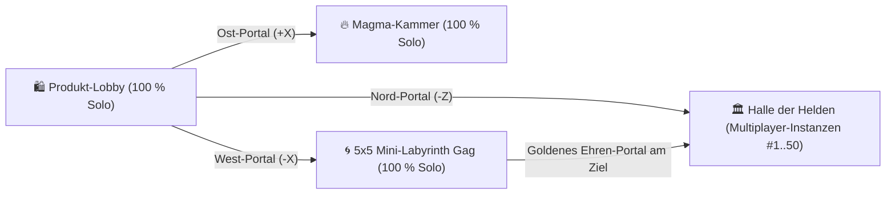

# Architektur & Umsetzung: Kompaktes 3D-Boutique-Mini-Labyrinth & Zonen-Isolierte „Halle der Helden“

**Datum:** 17.11.2026  
**Status:** ✅ 100 % Grün umgesetzt & live auf Stage + Live ausgerollt (`37/37` Tests, `1.675` Assertions Grün)  
**Systeme:** [`seelenfunke-louvre-showroom-3d.js`](file://wsl.localhost/Ubuntu/home/ubuntuxina/meine-projekte/seelenfunke/public/js/seelenfunke-louvre-showroom-3d.js), [`funkenwerk-heroes-3d.js`](file://wsl.localhost/Ubuntu/home/ubuntuxina/meine-projekte/seelenfunke/public/js/funkenwerk-heroes-3d.js), [`LobbyInstanceService.php`](file://wsl.localhost/Ubuntu/home/ubuntuxina/meine-projekte/seelenfunke/app/Services/Gamification/LobbyInstanceService.php), [`MiniLabyrinthService.php`](file://wsl.localhost/Ubuntu/home/ubuntuxina/meine-projekte/seelenfunke/app/Services/Gamification/MiniLabyrinthService.php), [`MiniLabyrinthController.php`](file://wsl.localhost/Ubuntu/home/ubuntuxina/meine-projekte/seelenfunke/app/Http/Controllers/Api/MiniLabyrinthController.php) & [`CustomerLobbyController.php`](file://wsl.localhost/Ubuntu/home/ubuntuxina/meine-projekte/seelenfunke/app/Http/Controllers/Api/CustomerLobbyController.php)  
**Verfasser:** Falcone (Technischer Mitgründer & Chef-Architekt)

---

## 1. Zonen-Isolierte Multiplayer-Architektur („Produkt-Lobby alleine, Heldenhalle zusammen“)

1. **Ruhiges Solo-Shopping in `gallery`, `lava` & `labyrinth` (`SOLO_ZONES`):**
   * In der normalen **Produkt-Lobby (`gallery`)** sowie in der **Magma-Kammer (`lava`)** und im **Mini-Labyrinth (`labyrinth`)** ist jeder Besucher komplett **alleine unterwegs** (`solo_mode: true`, `peers: []`).
   * Weder fremde Avatare noch Chat-Bubbles oder Instanz-Menüs lenken beim Betrachten der Seelenfunke-Unikate ab; zudem läuft in den Solo-Zonen kein unnötiger Hintergrund-Polling-Timer und es wird kein Platz in den Heldenhallen-Instanzen blockiert.
2. **Gemeinsames Multiplayer-Erlebnis exklusiv in der `🏛️ Halle der Helden` (`MULTIPLAYER_ZONES = ['heroes']`):**
   * Sobald ein eingeloggter Kunde das Nord-Portal oder das Abkürzungs-Portal im Mini-Labyrinth in die **`Halle der Helden`** durchschreitet (`zone = 'heroes'`), bucht [`LobbyInstanceService.php`](file://wsl.localhost/Ubuntu/home/ubuntuxina/meine-projekte/seelenfunke/app/Services/Gamification/LobbyInstanceService.php) ihn automatisch per Auto-Sharding ein (`SOFT_CAP = 16`, Freundes-Reserve bis `HARD_CAP = 20`, manueller Wechsel `🌐 Instanz #1..50` im HUD).
   * Verlässt der Spieler die `Halle der Helden` wieder in Richtung Produkt-Lobby, Lava oder Mini-Labyrinth, wird sein Heldenhallen-Slot sofort serverseitig freigegeben und lokal werden alle Remote-Peers geleert.

---

## 2. Kleiner, spaßiger Boutique-Labyrinth-Gag im West-Flügel (`5x5`, `60 FPS`)

1. **Kompakter `5x5`-Grundriss in exakt 1 Draw-Call:**
   * Am schleierfreien West-Durchgang (`x = -12.0, z = 0.0`, voller Sicherheitsabstand zu allen Produkt-Stelen, `polygonOffset` ohne Z-Fighting) öffnet sich ein heller Louvre-Light-Mode-Pavillon (`#FAF8F5`, Calacatta-Marmorboden `y = 0`, Beaux-Arts Glas-Tonnengewölbe).
   * Drei täglich rotierende, garantiert in **15 bis 25 Sekunden** spielbare `5x5`-Grundrisse (`dailyVariant(): 0..2`) werden mit `~1.62 m` hohen Kalkstein-/Marmor-Hecken samt matter 24K-Gold-Deckleiste über ein einziges `THREE.InstancedMesh` (**1 Draw-Call**) und sauberer Kreis-gegen-AABB-Wandkollision dargestellt.
2. **Spaß-Elemente & Belohnungs-Balance (`+3 ✨` pro Tag):**
   * **2 goldene Boing-Spaß-Pads:** Wer in eine kurze Mini-Abzweigung tappt, wird vergnügt mit einem kleinen Feder-Impuls (`vy = 7.5`), goldenem Sternenring, Audio-Chime und schelmischer Clean-Design-Plakette (`Hoppla! Falscher Gang 😄` / `Boing! Weiter links ✨`) überrascht.
   * **Goldener Spaß-Buzzer & Pokal-Sockel (`x = -28.5, z = 0.0`):** Löst per Klick eine goldene 3D-Konfetti-Fontäne mit Triumph-Fanfare aus (auch für Gäste jederzeit zum Spaß nutzbar) und schreibt eingeloggten Kunden **1x pro Kalendertag `+3 ✨` Funken** gut, ohne die echte Shop-Kaufwährung (`1,00 € = 1 ✨`) zu verwässern.
   * **Direkt-Portal in die `🏛️ Halle der Helden`:** Unmittelbar hinter dem Ziel-Buzzer führt ein goldener Ehrenbogen direkt in die Multiplayer-Heldenhalle.

---

## 3. Manipulationssichere Konsolen- & Server-Härtung (Zero Client Trust)

1. **Client-Kapselung ohne `window`-Angriffsfläche:**
   * `createLouvreShowroom` in [`seelenfunke-louvre-showroom-3d.js`](file://wsl.localhost/Ubuntu/home/ubuntuxina/meine-projekte/seelenfunke/public/js/seelenfunke-louvre-showroom-3d.js) gibt ausschließlich eine mit `Object.freeze(...)` versiegelte UI-Fassade zurück; `engine`, `player`, `scene`, `camera`, Koordinaten und Run-Tokens liegen privat in der Modul-Closure bzw. in `WeakMap`-Containern.
2. **Serverseitige Anti-Cheat-Prüfung:**
   * [`CustomerLobbyController.php`](file://wsl.localhost/Ubuntu/home/ubuntuxina/meine-projekte/seelenfunke/app/Http/Controllers/Api/CustomerLobbyController.php) und [`LobbyInstanceService.php`](file://wsl.localhost/Ubuntu/home/ubuntuxina/meine-projekte/seelenfunke/app/Services/Gamification/LobbyInstanceService.php) blockieren verbotene Konsolen-/Cheat-Schlüssel (`command`, `cmd`, `exec`, `eval`, `god_mode`, `give_sparks`, `set_level`, `INF`/`NAN` u. a.) sofort mit HTTP `422` und beziehen `level`, `display_name`, `peer_id` und `ship_class` zu 100 % aus `Auth::guard` + Datenbank.
   * [`MiniLabyrinthService.php`](file://wsl.localhost/Ubuntu/home/ubuntuxina/meine-projekte/seelenfunke/app/Services/Gamification/MiniLabyrinthService.php) prüft Start -> `CP1 (-22.0, 0.0, >= 1.6s)` -> `GOAL (-28.5, 0.0, >= 3.5s)` über einen HMAC-SHA256-signierten Single-Use-`claim_token`, `Cache::lock` und `DB::transaction` (`lockForUpdate`).

---

## 4. Automatisierte Verifikation

* [`MiniLabyrinthGagAndSecurityTest.php`](file://wsl.localhost/Ubuntu/home/ubuntuxina/meine-projekte/seelenfunke/tests/Feature/Gamification/MiniLabyrinthGagAndSecurityTest.php), [`Customer3DLobbyInstancesTest.php`](file://wsl.localhost/Ubuntu/home/ubuntuxina/meine-projekte/seelenfunke/tests/Feature/Gamification/Customer3DLobbyInstancesTest.php), [`LobbyAntiManipulationSecurityTest.php`](file://wsl.localhost/Ubuntu/home/ubuntuxina/meine-projekte/seelenfunke/tests/Feature/Security/LobbyAntiManipulationSecurityTest.php), [`LavaParkourAntiCheatTest.php`](file://wsl.localhost/Ubuntu/home/ubuntuxina/meine-projekte/seelenfunke/tests/Feature/Gamification/LavaParkourAntiCheatTest.php), [`FunkenwerkHallOfHeroesAndProductFocusTest.php`](file://wsl.localhost/Ubuntu/home/ubuntuxina/meine-projekte/seelenfunke/tests/Feature/Gamification/FunkenwerkHallOfHeroesAndProductFocusTest.php) & [`Louvre3DShowroomTest.php`](file://wsl.localhost/Ubuntu/home/ubuntuxina/meine-projekte/seelenfunke/tests/Feature/Shop/Louvre3DShowroomTest.php): **37 Tests, 1.675 Assertions, 0 Fehler (100 % Grün)**.
