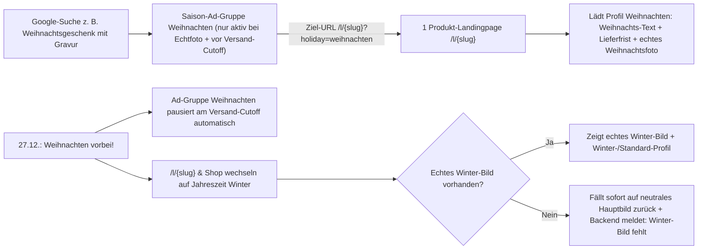

# Konzept & Machbarkeitsanalyse: Saison- & Feiertags-gesteuerter Google-Ads-Autopilot, Multi-Profil-Landingpages & Bild-Fallback-Kaskade („Bis zum letzten Klick“)

**Stand:** 17.11.2026  
**System:** Mein-Seelenfunke (`Product.php`, `MarketingLandingPage.php`, `LandingPageView.php`, `MarketingLandingPages.php`, `HolidayOfferAutopilotService.php`, `SeoController.php`, `OrderCheckoutSuccess.php`, `cookieconsent-config.js`) & Funkenwerk Desktop Suite (`MarketingEngine.cs` Space #8 `🚀 Ads & Budget`)  
**Status:** **Vorstufe A & A.2 sowie Hauptstufe B (Stufe 1) umgesetzt & getestet (17.11.2026)** (Google-Ads- & Cloud-API-Infrastruktur auf `0,00 €`, Consent Mode v2, Cookie-Kategorie `marketing`, `AW-18579999677/cZPCCMjkirodEL2X0ZtF` Kaufwert-Conversion, Admin-Steuerung unter `/admin/settings` & Echtfoto-Gatekeeper im Shopping-Feed aktiv); **Stufe 2 & 3** warten planmäßig auf alle echten, selbst fotografierten Produktfotos.

---

## 0. Verbindliche Grundregeln & Zusammenspiel der 3 Zahnräder

Damit bezahlte Werbung, Produktdarstellung und Verkaufsseiten zu jeder Jahreszeit und an jedem Feiertag wie ein präzises Uhrwerk ineinandergreifen, gelten drei eiserne Grundsätze:

1. **100 % echte eigene Manufaktur-Fotos (Kein KI-Bild in Google Ads):**
   * Das Google-Ads- und Google-Merchant-Center-Konto wird erst eröffnet und bespielt, wenn Alina die Produktfotos selbst echt fotografiert und im System hinterlegt hat.
   * **Wichtiger Foto-Hinweis für Google Shopping:** Die echten Produkt- und Saisonfotos dürfen im Bild selbst **keine eingebrannten Werbetexte, Rabatt-Badges oder Wasserzeichen** enthalten, da das Google Merchant Center Text-Overlays im Produktbild automatisch ablehnt.
   * Ein technischer **Echtfoto-Gatekeeper** prüft `is_ai_generated === false` sowohl für das neutrale Hauptbild als auch für jedes beworbene Saison-/Feiertagsbild.
2. **Google Ads bewirbt immer konkrete Zugpferd-Produkte und leitet direkt auf `/l/{slug}`:**
   * Bezahlte Produkt-Anzeigen leiten **niemals** auf die allgemeine Startseite `/`, sondern immer direkt auf die fokussierte **Produkt-Landingpage `/l/{slug}`** (bzw. bei Anlass-Kampagnen auf `/l/{slug}?holiday={anlass}`).
   * Dort erhält der Besucher ohne Streuverlust exakt das gesuchte Produkt, das passende echte Anlass-Foto, den passenden Anlass-Text, die Lieferzeit bis zum Fest und mit einem Klick den Einstieg in den 3D-Konfigurator.
3. **1 Landingpage pro Produkt mit 13 logischen Vorlagen-Profilen + strikter Hauptbild-Fallback:**
   * Statt für jedes Produkt dutzende einzelne Landingpages anzulegen, besitzt jedes Produkt **genau eine einzige URL `/l/{slug}`**, die im Hintergrund das passende **Vorlagen-Profil (`1 Standard/Evergreen` + `4 Jahreszeiten` + `8 Feiertage`)** lädt.
   * Ist ein Feiertag (z. B. Weihnachten) vorbei und für die anschließende Jahreszeit (`Winter`) liegt noch kein eigenes Echtfoto vor, fällt das Produktbild **sofort und ausnahmslos auf das neutrale Hauptbild (`is_main = true`)** zurück, während am Produkt selbst im Backend klar gemeldet wird, welche Jahreszeiten-/Feiertagsbilder noch fehlen.

---

## 1. Bild-Fallback-Kaskade nach Feiertagen & Fehlmeldung am Produkt (`Product.php`)

### 1.1 Gewünschte Soll-Logik (Was passiert, wenn Weihnachten vorbei ist?)
Angenommen, Alina hat für ein Produkt das **neutrale Hauptbild** (`is_main = true`) sowie die **echten Weihnachtsbilder** fotografiert und hinterlegt, aber die Bilder für `Winter`, `Frühling` oder `Valentinstag` fehlen noch:

1. **Während des aktiven Feiertagsfensters (z. B. Advent bis 26.12.):**
   * Shop, Produktkarte, Landingpage `/l/{slug}` und Google-Shopping-Feed zeigen automatisch das **Weihnachtsbild**.
2. **Sobald Weihnachten vorbei ist (ab 27.12., 00:00 Uhr):**
   * Das System prüft ausschließlich die aktuell aktive **Jahreszeit** (`Winter`).
   * **Kein Rückgriff auf fremde oder vergangene Feiertage!** Ist für `Winter` noch kein eigenes Bild hinterlegt, greift **sofort das neutrale Hauptbild (`is_main = true` in `media_gallery`)** als sauberer Fallback. Es darf im Januar, Februar oder Sommer niemals ein übrig gebliebenes Weihnachtsbild angezeigt werden.
3. **Klare Meldung fehlender Saison-/Feiertagsbilder direkt am Produkt:**
   * In [`Product::getSeasonalImageSetStatus()`](file://wsl.localhost/Ubuntu/home/ubuntuxina/meine-projekte/seelenfunke/app/Models/Product/Product.php#L2589-L2650) sowie im Vollständigkeits-Check [`Product.php`](file://wsl.localhost/Ubuntu/home/ubuntuxina/meine-projekte/seelenfunke/app/Models/Product/Product.php#L1425-L1441) prüft das Produkt alle **12 Slots** (`4 Jahreszeiten`: Winter, Sommer, Herbst, Frühling + `8 Feiertage`: Weihnachten, Ostern, Valentinstag, Muttertag, Vatertag, Halloween, Hochzeit, Geburtstag).
   * In der Produktübersicht (`/admin/products`) und in Schritt 2 (`Medien`) meldet das `!`-Badge am Produkt exakt: `Saison-Bilder (1/12)` inkl. Tooltip aller noch offenen Anlässe (`Offen: Winter, Sommer, Herbst, Frühling, Ostern...`).
   * **Geplante Schärfung:** Fehlt genau das Bild der **gerade aktiven Jahreszeit** oder des **nächsten bevorstehenden Feiertags** (innerhalb der nächsten 21 Tage), hebt der Produkt-Status dies gezielt hervor (*„Aktuelles Saisonbild Winter fehlt (Neutrales Hauptbild aktiv)“*).

### 1.2 Aufgedeckte Ist-Fehler im aktuellen Code (Vor Live-Nutzung der Saisonbilder zu beheben)
Bei der Code-Prüfung von [`Product.php`](file://wsl.localhost/Ubuntu/home/ubuntuxina/meine-projekte/seelenfunke/app/Models/Product/Product.php#L1960-L2268) wurden **drei konkrete Fallback-Fallen** identifiziert, durch die ein hinterlegtes Weihnachtsbild aktuell auch nach Weihnachten weiter angezeigt würde:

1. **Falle 1 in [`resolvePreferredHolidayCandidates()`](file://wsl.localhost/Ubuntu/home/ubuntuxina/meine-projekte/seelenfunke/app/Models/Product/Product.php#L1990-L1996):**
   * Im Jahreszeiten-Fallback für `'winter'` steht aktuell `['Winter', 'Weihnachten', 'Valentinstag', 'Geburtstag']` (und analog bei `'ostern'`/`'sommer'`/`'herbst'` fremde Feiertage). Fehlt im Januar das `Winter`-Bild, zieht der Code fälschlich `Weihnachten` statt auf das neutrale Hauptbild zurückzufallen.
   * **Fix:** Außerhalb eines aktiven Feiertagsfensters darf als Kandidat **nur die aktuelle Jahreszeit** (`'Winter'`, `'Frühling'`, `'Sommer'` oder `'Herbst'`) geprüft werden, niemals ein vergangener oder fremder Feiertag.
2. **Falle 2 in [`resolveMainImageMeta()`](file://wsl.localhost/Ubuntu/home/ubuntuxina/meine-projekte/seelenfunke/app/Models/Product/Product.php#L2197-L2214):**
   * Findet die Methode kein Bild zur aktuellen Jahreszeit, greift aktuell eine Schleife (*„nutze das erste gepflegte Saisonbild als Fallback“*). Ist nur `Weihnachten` gepflegt, zeigt der Shop selbst im Hochsommer das Weihnachtsfoto, statt zu Zeile 2258 (`is_main = true`, neutrales Hauptbild) durchzufallen.
   * **Fix:** Diesen beliebigen Ersttreffer-Fallback ersatzlos entfernen, damit sauber das neutrale Hauptbild (`is_main = true`) übernimmt.
3. **Falle 3 in [`resolveSeasonalTemplate()`](file://wsl.localhost/Ubuntu/home/ubuntuxina/meine-projekte/seelenfunke/app/Models/Product/Product.php#L2053-L2055):**
   * Gibt bei fehlendem Treffer aktuell `$activeTemplates->first(...)` zurück (z. B. Weihnachts-Vorlage im Juli) statt `null`.
   * **Fix:** Bei Nicht-Treffer strikt `null` zurückgeben, damit `resolveMainImageMeta()` verlässlich auf das neutrale Hauptbild (`is_main = true`) zurückfällt.

---

## 2. Schlaue Produkt-Landingpage-Architektur: 1 URL `/l/{slug}` mit 13 Vorlagen-Profilen

### 2.1 Warum NIEMALS mehrere separate Landingpages pro Artikel anlegen?
Würden wir pro Produkt eigene Seiten für Standard, 4 Jahreszeiten und 8 Feiertage anlegen, entstünden bei 9 Produkten sofort **117 einzelne Landingpages**. Das würde zu massivem Pflegeaufwand, Duplicate-Content-Abwertungen bei Google SEO und zersplitterten Google-Ads-Qualitätsfaktoren führen.

### 2.2 Die Lösung: 1 Landingpage (`/l/{slug}`) + 13 logische Vorlagen-Profile (`seasonal_profiles`)
Jedes Produkt behält **genau eine einzige, dauerhafte Landingpage `/l/{slug}`** (z. B. `/l/seelen-kristall`) in [`MarketingLandingPage.php`](file://wsl.localhost/Ubuntu/home/ubuntuxina/meine-projekte/seelenfunke/app/Models/Marketing/MarketingLandingPage.php) und [`LandingPageView.php`](file://wsl.localhost/Ubuntu/home/ubuntuxina/meine-projekte/seelenfunke/app/Livewire/Landing/LandingPageView.php).

* **Ist-Zustand im Code:** `/l/{slug}` unterstützt zwar bereits `?holiday=weihnachten` und wechselt das Hero-Bild sowie das Hintergrund-Banner, aber **Titel, Headline, Verkaufstext (`sales_copy`), CTA, die 3 Vorteile und der Story-Aufbau sind aktuell noch statisch und jahreszeitenblind**.
* **Soll-Architektur (`seasonal_profiles` JSON auf `MarketingLandingPage`):**
  Jede Landingpage besitzt neben ihrem zeitlosen **Standard-Profil (Evergreen-Fallback)** bis zu **12 Anlass-Profile** analog zu den 12 Bild-Slots (`Winter, Frühling, Sommer, Herbst` + `Weihnachten, Valentinstag, Ostern, Muttertag, Vatertag, Halloween, Hochzeit, Geburtstag`).
* **Was ein Profil auf der Landingpage dynamisch steuert:**
  1. **Hero-Kicker & Anlass-Lieferhinweis:** z. B. zu Weihnachten *„Handveredeltes Weihnachtsgeschenk aus Gifhorn“* inkl. automatischem Hinweis auf rechtzeitige Fertigung vor dem Versand-Cutoff (verschwindet nach dem Cutoff automatisch!).
  2. **Anlass-Headline (`h1`) & Verkaufstext (`sales_copy`):** Passend zur Emotion des Anlasses (Weihnachtsbaum, Muttertag, Valentinstag, Hochzeit oder zeitlose Erinnerung) inkl. automatischer `sanitizeLegalCopy()`-Prüfung (keine KI-Gedankenstriche, ehrliche Materialangaben).
  3. **Exakt 3 kurze Vorteile mit goldenem Haken (`✓` in `#C5A059`):** Anlassgerecht zugeschnitten (z. B. bei Geschenkanlässen mit direktem Hinweis auf die optionale schwarze Westpack-Schmuckbox und das Schwarz-Gold-Geschenkpapier).
  4. **Story-Sektion, Konfigurator-Vorauswahl & Hero-Bild:** Übergibt beim Klick auf den CTA die passende Saison-Vorlage an den 3D-Konfigurator und nutzt für das Bild exakt die reparierte **Hauptbild-Fallback-Kaskade** aus Abschnitt 1.
* **Intelligente Lade-Reihenfolge beim Aufruf von `/l/{slug}`:**
  1. **Gezielter Google-Ads-Aufruf (`/l/{slug}?holiday=weihnachten`):** Lädt das Profil `Weihnachten` (für 100 % Message-Match zur Google-Anzeige). **Sicherheits-Guard:** Ist der Feiertag kalendarisch bereits vorbei (z. B. Klick auf alten Link am 28.12.), werden keine abgelaufenen Lieferversprechen („Pünktlich zu Heiligabend“) mehr eingeblendet, sondern sauber auf das aktuelle Jahreszeiten-/Standard-Profil umgeschaltet.
  2. **Regulärer Aufruf (`/l/{slug}`) während eines aktiven Feiertagsfensters (vor Versand-Cutoff):** `HolidayOfferAutopilotService` erkennt z. B. `Weihnachten` oder `Muttertag` -> lädt vollautomatisch das Feiertags-Profil.
  3. **Regulärer Aufruf außerhalb von Feiertagen (z. B. 27.12.):** Springt in derselben Sekunde automatisch auf das aktive **Jahreszeiten-Profil** (`Winter`, `Frühling`, `Sommer`, `Herbst`).
  4. **Fallback ohne Pflegezwang:** Ist für eine Jahreszeit kein eigener Text überschrieben, greift lückenlos das **zeitlose Standard-Profil**. Im Backend-Editor (`/admin/landing-pages`) kann Alina per Profil-Auswahl (`Standard` + 12 Anlässe) jedes Profil auf Knopfdruck abmahnsicher vorbefüllen lassen und individuell feinschleifen.

---

## 3. Saison- & Feiertags-Orientierung im Google-Ads-Autopiloten

### 3.1 Das 2-Schichten-Modell pro Zugpferd-Produkt
Google Ads bewirbt gezielt unsere margenstarken **Zugpferde** (`VK >= 35 €` und `Netto-DB vor Ads >= 20 €`, berechnet durch `HolidayOfferAutopilotService`) und trennt jede Produkt-Kampagne sauber in zwei Schichten:

| Schicht | Laufzeit | Beispiel-Keywords (`[Exact]` / `"Phrase"`) | Anzeigentext (RSA) | Ziel-URL & geladenes Landingpage-Profil |
| :--- | :--- | :--- | :--- | :--- |
| **Schicht A: Evergreen-Basisgruppe** | Ganzjährig aktiv | `[3d glasgravur foto]`, `[handschrift gravur kette]`, `[erinnerungsgeschenk mit gravur]` | Zeitlose Manufaktur-USPs (*Handveredelt in Gifhorn, Live-3D-Vorschau*) | `/l/{slug}` (zeigt automatisch aktuelle Jahreszeit bzw. neutrales Hauptbild) |
| **Schicht B: Feiertags- & Saison-Anzeigengruppen** | Nur im Vorlauf-Fenster bis exakt zum **Manufaktur-Versand-Cutoff** | `[weihnachtsgeschenk mit gravur]`, `[persönliches muttertagsgeschenk]`, `[valentinstagsgeschenk mit foto]` | Emotionaler Anlass-Text + Sitelinks (*Geschenkbox wählbar, Fertigung in Gifhorn*) | `/l/{slug}?holiday=weihnachten` (lädt exakt das Weihnachts-Profil + echtes Weihnachtsfoto) |

### 3.2 Automatischer Lebenszyklus einer Feiertags-Kampagne (Beispiel Weihnachten)
1. **Vorbereitungs-Impuls (z. B. Mitte Oktober):** Der Autopilot prüft über `HolidayOfferAutopilotService` den nächsten großen Anlass (`Weihnachten`) und checkt pro Zugpferd-Produkt: *Liegt ein echtes Weihnachtsfoto (`!is_ai_generated`) vor und ist das Weihnachts-Profil auf `/l/{slug}` bereit?*
   * Fehlt bei einem Zugpferd noch das echte Weihnachtsfoto, meldet der **Operative Status (`/admin/dashboard`)** rechtzeitig: *„Für Weihnachts-Ads fehlt noch das echte Weihnachtsfoto bei Produkt X“*.
2. **Anlage „Bis zum letzten Klick“ (`PAUSED`):** Für alle bereiten Zugpferde legt die Google Ads API die Weihnachts-Anzeigengruppen inkl. Keywords, Negativ-Keywords, Anzeigentexten und Ziel-URL `/l/{slug}?holiday=weihnachten` fix und fertig im Status **`PAUSED`** im Google-Ads-Konto an. Alina prüft kurz und klickt nur noch auf **„Aktiv“**.
3. **Automatischer Versand-Cutoff-Stopp vor dem Fest:** Sobald der in `HolidayOfferAutopilotService` / `SystemDeliveryTimes` definierte **Manufaktur-Annahmeschluss vor Weihnachten** erreicht ist (z. B. 19./20.12., damit jedes Unikat pünktlich unterm Baum liegt), pausiert der tägliche Wächter die Weihnachts-Anzeigengruppen **vollautomatisch**. Kein einziger Werbe-Euro wird nach Annahmeschluss verbrannt!
4. **Nahtloser Übergang nach dem Fest:** Ab dem Cutoff übernimmt wieder ruhig die ganzjährige **Evergreen-Basisgruppe** auf `/l/{slug}` (mit `Winter`-Profil bzw. neutralem Hauptbild), bis im Januar der Vorlauf für den **Valentinstag** startet.

---

## 4. Technische Übertragungs-Architektur & Die 3-Säulen-Strategie

* **Kein Browser-Klick-Bot auf `ads.google.com`:** Wegen Sperrgefahr (`Circumventing Systems`) erfolgt die Anlage ausschließlich über die **offizielle Google Ads API (`Explorer Access`, kostenlos bis 2.880 Operationen/Tag)** sowie optional als **1-Klick CSV-Export für den Google Ads Editor**.
* **Die 3 Kampagnen-Säulen zum Start (bewusst ohne PMax-Blackbox):**
  1. **Säule 1: Brand-Schutz (`~1,50 €/Tag`)** auf `[mein seelenfunke]` und `[meinseelenfunke]`.
  2. **Säule 2: High-Intent Search für Zugpferde (`~3,50 bis 7,00 €/Tag`, Schicht A Evergreen + Schicht B aktiver Feiertag)** direkt auf `/l/{slug}` bzw. `/l/{slug}?holiday={anlass}`. Displaynetzwerk & Suchpartner technisch deaktiviert; harte Negativ-Keyword-Mauer ab Tag 1 (`-gratis`, `-kostenlos`, `-billig`, `-selber machen`, `-vorlage`, `-amazon`, `-temu`, `-aliexpress`, `-dm`, `-rossmann`).
  3. **Säule 3: Google Merchant Center (`/feed/google-shopping.xml`)** für kostenlose Shopping-Einträge (`0,00 €`) + optionales Shopping für Zugpferde. Der Feed nutzt dieselbe reparierte Bild-Kaskade (echtes Anlass-Foto ohne Text-Overlay -> sonst echtes Jahreszeiten-Foto -> sonst echtes neutrales Hauptbild).

---

## 5. Vier harte Sicherheits- & Kosten-Airbags im Code

1. **Harter `PAUSED`-Schreibschutz:** Neue Kampagnen, Anzeigengruppen und Anzeigen werden technisch ausschließlich mit `status = PAUSED` übertragen; scharfschalten kann nur Alina manuell.
2. **Harter Tagesbudget-Deckel (`Micros-Guard`):** Schützt vor Faktor-1.000.000-Rechenfehlern bei Google-`micros` und blockiert jedes Tagesbudget oberhalb eines festen Sicherheitsdeckels (z. B. `15,00 €/Tag`).
3. **Einbahnstraße für Schutz-Eingriffe (CPA- & Versand-Cutoff-Wächter):** Der tägliche Wächter darf bei Überschreiten von `max_cpa` ohne Kauf oder exakt zum **Feiertags-Versand-Cutoff** automatisch **pausieren** und auf `/admin/dashboard` melden, aber niemals eigenmächtig aktivieren oder Budgets erhöhen.
4. **Zero-Secret-Tresor:** OAuth2-Tokens liegen lokal DPAPI-/AES-256-GCM-verschlüsselt im Funkenwerk-Tresor.

---

## 6. Geordneter Umsetzungs-Fahrplan (Was sofort sinnvoll ist vs. was auf alle Echtfotos wartet)

### Vorstufe A (UMGESETZT & GETESTET am 15.11.2026)
1. **Erledigt: Bild-Fallback-Reparatur in [`Product.php`](file://wsl.localhost/Ubuntu/home/ubuntuxina/meine-projekte/seelenfunke/app/Models/Product/Product.php):** Alle 3 Fallback-Fallen (`resolvePreferredHolidayCandidates`, `resolveMainImageMeta`, `resolveSeasonalTemplate`) sind behoben. Direkt nach einem Feiertag (z. B. ab `27.12. 00:00 Uhr`) greift sofort das **neutrale Hauptbild (`is_main = true`)**, solange `Winter` o. ä. noch fehlt; gleichzeitig melden `getSeasonalImageSetStatus()`, `getReadinessReport()` und Schritt 2 (`Medien`) exakt das fehlende aktive Saison-/Feiertagsbild direkt am Produkt.
2. **Erledigt: Multi-Profil-Engine für die Produkt-Landingpages (`/l/{slug}`):** [`MarketingLandingPage.php`](file://wsl.localhost/Ubuntu/home/ubuntuxina/meine-projekte/seelenfunke/app/Models/Marketing/MarketingLandingPage.php), [`LandingPageView.php`](file://wsl.localhost/Ubuntu/home/ubuntuxina/meine-projekte/seelenfunke/app/Livewire/Landing/LandingPageView.php) und [`MarketingLandingPages.php`](file://wsl.localhost/Ubuntu/home/ubuntuxina/meine-projekte/seelenfunke/app/Livewire/Shop/Marketing/MarketingLandingPages.php) steuern pro Produkt 1 zentrale URL `/l/{slug}` mit `seasonal_profiles` (`1 Standard` + `4 Jahreszeiten` + `8 Feiertage`), inkl. 13-Profile-Editor im Backend, automatischer Text-Vorbefüllung, `✓`-Vorteilen in `#C5A059`, Post-Holiday-Guard für Ad-Klicks (`gclid`/`ad=1`) und automatisierter Testabdeckung ([`SeasonalLandingPageAndImageFallbackTest.php`](file://wsl.localhost/Ubuntu/home/ubuntuxina/meine-projekte/seelenfunke/tests/Feature/Marketing/SeasonalLandingPageAndImageFallbackTest.php)).

### Vorstufe A.2 (UMGESETZT am 17.11.2026: Komplette Google-Ads- & Google-Cloud-API-Einrichtung auf `0,00 €`)
1. **Google Ads Werbekonto (`Mein Seelenfunke`, Kunden-ID `792-675-8923`):**
   * Abrechnung als Geschäftskonto über Zahlungsprofil `Alina Steinhauer Organisation (9554-0689-9279)` mit SEPA-Lastschriftmandat auf das **FYRST-Geschäftskonto (`••29 00`)** eingerichtet (`0` sekundäre Privatkarten, `0,00 €` Saldo, `0` aktive Kampagnen, `0,00 €/Tag` Budget).
   * Konto-Härtung abgeschlossen: Automatisch angewendete Empfehlungen **deaktiviert**, Anrufaufzeichnung **deaktiviert**, Google-Verkaufsanrufe & Werbe-E-Mails **deaktiviert**, EU-DSGVO-Datenschutzkontakt (`Alina Steinhauer`, `kontakt@mein-seelenfunke.de`, Gifhorn) hinterlegt.
   * Pflicht-Erklärungen abgeschlossen: EU-Politik-Anzeigen (`Nein`), Finanzierungsquelle (`Alina Steinhauer`) und Überprüfung der Werbetreibenden / Organisationsdaten (`Alina Steinhauer, Germany` verifiziert).
   * Primäre Kauf-Conversion **`Kauf (Mein-Seelenfunke Shop)`** eingerichtet: Google-Tag `AW-18579999677` (GTM-Container `GTM-WMXF5ZT3`), `send_to: 'AW-18579999677/cZPCCMjkirodEL2X0ZtF'`, transaktionsspezifischer Wert in `EUR`, Zählmethode `Alle`, datengetriebene Attribution, ohne automatisches E-Mail-Scraping (`Erweiterte Conversions` aus).
2. **Google Ads Verwaltungskonto / MCC (`Mein-Seelenfunke Verwaltung`, Manager-ID `497-855-5570`) & Cloud-API (`SEELEN` / `gen-lang-client-0670786367`):**
   * `API-Center` im MCC `497-855-5570` eingerichtet (`Entwicklertoken` generiert, Zugriffsebene **`Explorer-Zugriff`** aktiv).
   * In Google Cloud Projekt `SEELEN` (`gen-lang-client-0670786367`): `Google Ads API` (`googleads.googleapis.com`) aktiviert und Zugriffsebene auf **`Explorer`** (`2.880 Produktions-API-Vorgänge/Tag`) freigeschaltet.
   * Google Auth Platform für `mein-seelenfunke.de` auf **Produktion** veröffentlicht (permanente Refresh-Tokens ohne 7-Tage-Ablauf) und Desktop-OAuth-Client **`Funkenwerk Google Ads KI-Broker`** erstellt (JSON lokal im `Downloads`-Ordner zur Übernahme in den `Funkenwerk Tresor`, Zero-Secret).

### Hauptstufe B (Stufe 1 umgesetzt & getestet; Stufe 2 & 3 starten, sobald alle echten Produktfotos vorliegen)
1. **Erledigt am 17.11.2026 — Stufe 1 (DSGVO-Tracking & Shopping-Feed):** Cookie-Kategorie `marketing` + Google Consent Mode v2 (`denied` Default, dynamisches Nachladen erst nach Opt-In) in [`cookieconsent-config.js`](file://wsl.localhost/Ubuntu/home/ubuntuxina/meine-projekte/seelenfunke/public/lib/dp_cookieconsent/js/cookieconsent-config.js) und [`frontend_layout.blade.php`](file://wsl.localhost/Ubuntu/home/ubuntuxina/meine-projekte/seelenfunke/resources/views/components/layouts/frontend_layout.blade.php), zentrale Admin-Konfiguration (`AW-18579999677` / `cZPCCMjkirodEL2X0ZtF`) in [`SystemShopConfig.php`](file://wsl.localhost/Ubuntu/home/ubuntuxina/meine-projekte/seelenfunke/app/Livewire/Shop/System/SystemShopConfig.php) & [`SystemSettingSeeder.php`](file://wsl.localhost/Ubuntu/home/ubuntuxina/meine-projekte/seelenfunke/database/seeders/SystemSettingSeeder.php), Kaufwert-Conversion mit Dublettenschutz in [`OrderCheckout.php`](file://wsl.localhost/Ubuntu/home/ubuntuxina/meine-projekte/seelenfunke/app/Livewire/Shop/Order/OrderCheckout/OrderCheckout.php) & [`OrderCheckoutSuccess.php`](file://wsl.localhost/Ubuntu/home/ubuntuxina/meine-projekte/seelenfunke/app/Livewire/Shop/Order/OrderCheckout/OrderCheckoutSuccess.php), Echtfoto-Gatekeeper (`google_shopping_require_real_photos`) in [`SeoController.php`](file://wsl.localhost/Ubuntu/home/ubuntuxina/meine-projekte/seelenfunke/app/Http/Controllers/SeoController.php), Datenschutzerklärung in [`datenschutz.blade.php`](file://wsl.localhost/Ubuntu/home/ubuntuxina/meine-projekte/seelenfunke/resources/views/frontend/pages/datenschutz.blade.php) sowie automatisierte Feature-Tests ([`GoogleTagAndShoppingGatekeeperTest.php`](file://wsl.localhost/Ubuntu/home/ubuntuxina/meine-projekte/seelenfunke/tests/Feature/Marketing/GoogleTagAndShoppingGatekeeperTest.php)).
2. **Stufe 2 (Saison- & Evergreen-Kampagnen-Studio in Funkenwerk Space #8):** Generator für Evergreen- & Feiertags-Anzeigengruppen auf `/l/{slug}` bzw. `/l/{slug}?holiday={anlass}` inkl. Echtfoto-Prüfung, Abmahnschutz-Filter und CSV-Export.
3. **Stufe 3 (Google-Ads-API-Push als `PAUSED` + Versand-Cutoff-Wächter):** Direkter Upload ins Google-Ads-Konto `792-675-8923` bis zum letzten Klick + automatische Feiertags-Cutoff-Pausierung & Live-CPA-Status auf `/admin/dashboard`.
