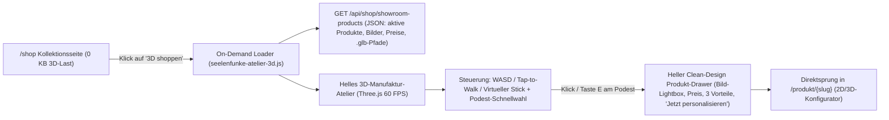

# Konzept & Machbarkeitsstudie: Immersiver 3D-Showroom („3D shoppen“) auf `/shop`

**Datum:** 16.11.2026  
**Autor:** Falcone (Technischer Mitgründer & Chef-Architekt)  
**Auftrags-ID:** `ag_20261116_185257_29e7042b`  
**Status:** Konzept erstellt (Wartet auf explizites „Go“ von Inhaberin Alina Steinhauer)

---

## 1. Ehrliche Mitgründer-Einschätzung & Unternehmerischer Mehrwert

**Machbarkeit: 100 % machbar, und zwar ohne Fremd-Engine-Ballast direkt auf unserer vorhandenen Infrastruktur.**

Warum sich dieses Feature für **Mein-Seelenfunke** unternehmerisch wirklich lohnt (und wo die Fallstricke liegen, die wir von Tag 1 an vermeiden):
1. **Alle teuren 3D-Assets existieren bereits:** Im Gegensatz zu normalen Online-Shops, die für einen 3D-Showroom erst monatelang Modelle bauen müssen, besitzen wir bereits **alle komprimierten Produkt-`.glb`-Modelle** (Kristall, Echtgold-/Silber-Schmuck, Schiefer, Anhänger) **und** alle **10 Funki-Charakter-Modelle (`Lv. 1` bis `Lv. 10`)**.
2. **Starker Marken-USP & Verweildauer:** Ein begehbares, lichtdurchflutetes **Gifhorner Manufaktur-Atelier** hebt Mein-Seelenfunke sofort von jedem 08/15-Geschenkeshop auf Etsy oder Amazon ab und verbindet Produktkatalog + Funki-Stufen organisch miteinander.
3. **Null Risiko für SEO & Conversion auf `/shop`:** Der klassische 2D-Shop unter `/shop` bleibt zu 100 % unverändert schnell (`0 KB` Zusatzlast beim Seitenaufruf). Die 3D-Engine lädt ausschließlich **On-Demand** erst dann, wenn der Kunde aktiv auf **`3D shoppen`** klickt.

---

## 2. Technische Engine-Entscheidung: `Three.js v0.182` statt Babylon.js

Als dein technischer Mitgründer gebe ich dir hier **eine klare Architekturentscheidung**:
* **Empfehlung: Natives `Three.js v0.182` + `MeshoptDecoder` (bereits im Projekt installiert) statt Babylon.js.**
* **Grund:** `Three.js v0.182` treibt bereits unseren 3D-Produktkonfigurator sowie die 3D-Wasserstadt (`public/js/funkenwerk-heroes-3d.js`) mit stabilen 60 FPS an. Babylon.js würde ~3,5 MB zusätzlichen JavaScript-Ballast, doppelte Shader-Pipelines und abweichende PBR- Glas-/Gold-Darstellungen bedeuten. Mit `Three.js` sehen K9-Kristallglas, 14k-Ion-Plating-Gold und Schiefer im Showroom **1:1 identisch** aus wie im Produktkonfigurator.

---

## 3. Raumgestaltung, Steuerung & Seelenfunke Clean-Design (Baustein 1 & 2)

### A. Einstieg auf `/shop` (`ProductFrontendFilterArea`)
* Oben in der Filter-/Kopfleiste von `/shop` sitzt ein dezenter, edler Button im hellen Schwarz-Gold-Stil: **`3D shoppen`** (Icon: Würfel/Atelier, `#C5A059` Akzent, ohne erklärende Subtexte).
* Klick öffnet das Vollbild-Overlay im selben Fenster (mit klarem `× Zurück zum Shop`-Button oben rechts).

### B. Das 3D-Atelier (Immer freundlich & hell statt dunkler Gaming-Höhle)
* **Architektur:** Lichtdurchflutete Boutique-Galerie mit hellem Naturstein-/Warmweiß-Boden (`#FAF8F5`), sanftem Oberlicht, warmen Holz-/Messing-Akzenten und mattschwarzen Ausstellungs-Podesten mit feiner `#C5A059` Goldkante.
* **Dynamische Podeste aus der Datenbank:** Jedes aktive Produkt (`status = 'active'`) erhält automatisch ein eigenes Podest in der passenden Themen-Nische (*Glas & Kristall*, *Schmuck & Atelier*, *Schiefer & Metall*). Auf dem Podest schwebt/rotiert sanft das echte `.glb`-Modell im realen Größenverhältnis (oder ein gerahmtes Galerie-Aufsteller-Display, falls ein Produkt rein digital/ohne `.glb` ist).
* **Spieler-Charakter:**
  * Eingeloggte Kunden laufen mit **ihrer aktuell erreichten Funki-Stufe (`Lv. 1` bis `Lv. 10`)** durch das Atelier.
  * Gäste laufen mit dem freundlichen Basis-Funki (`Lv. 2`).

### C. Kinderleichte Steuerung auf Desktop & Smartphone (Kein Frust!)
1. **Desktop:** `WASD` / Pfeiltasten zum Laufen, Maus ziehen zum Umsehen, **Klick auf ein Podest** (oder `Enter` / `E` in Podestnähe) öffnet das Produkt. Zusätzlich **Tap-to-Walk**: Klickt ein Kunde direkt auf ein Podest in der Ferne, läuft Funki automatisch dorthin!
2. **Smartphone / Tablet:** Sanfter virtueller Daumen-Stick unten links **plus** direktes Antippen jedes sichtbaren Podests (Funki läuft automatisch hin) **plus** eine schlanke horizontale Podest-Leiste (`‹ Vorheriges Stück | Nächstes Stück ›`), falls jemand einhändig durch die Kollektion gleiten möchte.

### D. Produkt-Detailansicht direkt in der 3D-Welt (Light-Mode Drawer)
Sobald man ein Produkt am Podest anklickt, gleitet rechts ein **heller Seelenfunke Clean-Design Drawer** (`bg-white`, `text-gray-900`, kein Darkmode im Shop-Frontend!) ins Bild:
* **Interaktiver Bild-Slider + Lightbox:** Alle echten Produktbilder inkl. Maßbild (letzte Position mit mm-Maßen) direkt durchblätterbar und per Klick als Lightbox vergrößerbar.
* **Klare Fakten:** Produktname, Preis (inkl. MwSt.), Lieferzeit-Badge und exakt die **3 kurzen Vorteile mit goldenem Haken (`✓` in `#C5A059`)**.
* **Direkter Abschluss ohne Umweg:**
  * Bei personalisierbaren Unikaten: Gold-Schwarz Primärbutton **`Jetzt personalisieren`** -> führt direkt zum 2D/3D-Konfigurator auf `/produkt/{slug}`.
  * Bei Sofortkauf-/Digital-Produkten: **`In den Warenkorb`** direkt aus dem 3D-Atelier heraus.

---

## 4. Schlanker Umsetzungsplan (Nach deinem „Go“)

1. **Read-Only Showroom-Datenquelle:** Leichtgewichtiger gecachter Endpunkt/Payload für aktive Shop-Produkte (Titel, Slug, Preis, Galerie-URLs, `.glb`-Pfad, Kategorie, 3 Vorteile; respektiert selbstverständlich unsere `Shop Live-Freigabe`-Sperre!).
2. **`public/js/seelenfunke-atelier-3d.js`:** Modulare 60-FPS Three.js-Szene (Instanced Geometrie für Podeste/Raum, Lazy-Loading der `.glb`-Modelle nach Distanz, Kollisionskreis um Podeste, Desktop-`WASD` + Mobile-Touch/Tap-to-Walk).
3. **UI-Integration in `/shop`:** `3D shoppen`-Button in `ProductFrontendFilterArea` + heller Produkt-Drawer mit Lightbox & Direkt-CTA.
4. **Automatisierte Tests & Performance-Guard:** PHPUnit-Feature-Test für Daten-Payload, Wartungs-/Live-Sperre und `0 KB` Initial-Overhead auf `/shop`.

---

**Bereit für dein Urteil:** Wenn dir dieser Aufbau (helles Manufaktur-Atelier mit eigenem Funki-Charakter, `WASD` + Tap-to-Walk + heller Produkt-Drawer direkt auf `/shop`) gefällt, gib mir einfach kurz das **„Go“**!
