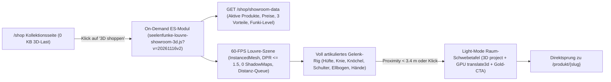

# Konzept & Machbarkeitsstudie: Immersiver 3D-Showroom („3D shoppen“) auf `/shop`

**Datum:** 16.11.2026  
**Autor:** Falcone & Agenti (KI-Architektur & 60-FPS 3D-Welten)  
**Auftrags-IDs:** `ag_20261116_185257_29e7042b`, `ag_20261116_185534_b2629338`, `ag_20261116_185621_ccf578f9` sowie Performance-, Gelenk-Rig- & Raum-Schild-Upgrade `ag_20261116_211159_e783a984`, `ag_20261116_211249_d80fe20b`, `ag_20261116_211305_e5f58cab`, `ag_20261116_211355_3c79041a`  
**Status:** ✅ Vollständig umgesetzt & 60-FPS optimiert (`GET /shop/showroom-data`, `public/js/seelenfunke-louvre-showroom-3d.js?v=20261116v2`, schwebende Light-Mode Raum-Tafel & voll artikuliertes 3D-Gelenk-Rig)

---

## 1. Ehrliche Mitgründer-Einschätzung & Unternehmerischer Mehrwert

**Machbarkeit: 100 % nativ umgesetzt auf unserer vorhandenen Three.js-Infrastruktur (`0 KB` Initial-Last auf `/shop`).**

1. **Alle 3D-Assets & Markenwerte vereint:** Aktive Shop-Produkte (`status = 'active'`) erscheinen mit ihren komprimierten `.glb`-Modellen (bzw. gerahmten Museums-Aufstellern) in einer edlen Louvre-Galerie.
2. **Null Risiko für SEO & Ladezeit auf `/shop`:** Der reguläre 2D-Shop unter `/shop` lädt `0 KB` 3D-Skripte vorab. Erst beim Klick auf **`3D shoppen`** wird das ES-Modul on-demand geladen; beim Schließen fällt die CPU-/GPU-Last strikt auf `0 %` zurück (`cancelAnimationFrame`, `AbortController`, `dispose`, `forceContextLoss`).
3. **100 % flüssiger Museumsrundgang ohne Popup-Überflutung:** Statt bildschirmblockierender Produkt-Popups liest der Besucher Produktinfos direkt am physischen Podest-Schild (`Stufe 1`) sowie auf einer luftigen, im 3D-Raum über dem fokussierten Podest verankerten Light-Mode-Schwebetafel (`Stufe 2`).

---

## 2. Architektur der 3 Technischen Kern-Säulen (`v20261116v2`)

### A. Butterweiche 60-FPS Performance
* **Zero Dynamic Light Overload & Zero Shadow Maps:** Exakt `1x HemisphereLight` + `1x DirectionalLight` ohne Echtzeit-Shadow-Maps (`shadowMap.enabled = false`), kombiniert mit vorberechnetem `PMREM`-Studio-Environment, gebackenen AO-Bodenkontaktschatten und schnellen Studio-MatCaps für den Avatar.
* **Konsequentes `THREE.InstancedMesh`-Batching:** Sämtliche statischen Architektur- und Podest-Wiederholungen (Kolonnaden-Pfeiler, Kapitelle, Boden-Intarsien, Louvre-Rautenfachwerk, Goldknoten, AO-Schatten, Sockel, Monolithen, Goldkragen, Samtauflagen, Vitrinenhauben, Eckprofile, Lichtkegel und Schildträger) sind gebündelt.
* **Fillrate-, GC- & Streaming-Disziplin:** Strikte Begrenzung via `renderer.setPixelRatio(Math.min(window.devicePixelRatio || 1, 1.5))`, wiederverwendete Scratch-Vektoren ohne Pro-Frame-Allokationen und eine nach Spieler-Distanz sortierte Nachlade-Queue (`exhibitLoadQueue`, 1 Exponat pro Tick inkl. `512px` Textur-Downscaling).

### B. Natürliche Geh- & Gelenkanimationen (0 % Foot-Sliding)
* **Hierarchisches 3D-Gelenk-Rig:**
  * **Bein-Kette links & rechts:** `hipPivotL/R` -> Oberschenkel -> `kneePivotL/R` -> Unterschenkel -> `anklePivotL/R` -> modellierter Schuh mit Gold-Rahmensohle.
  * **Arm- & Hand-Kette links & rechts:** `shoulderPivotL/R` -> Oberarm -> `elbowPivotL/R` -> Unterarm -> `wristPivotL/R` -> modellierte Handfläche, Daumen & 4 Finger (`fingerCurlL/R`).
  * **Rumpf, Hüfte & Funki-Visor-Kopf:** Distanzgekoppelte Schrittphase (`walkPhase += stepDist * 4.48`), vertikaler Doppelstand-Impuls (`cos(2 * walkPhase)`), Kreuzgang-Gegenschwung, sanftes Gehen-Stehen-Blending (`1 - Math.exp(-dt * 10)`), natürliches Blinzeln und dezenter Kopf-Blick zum nächstgelegenen Exponat.

### C. Physische Podest-Schilder & Schwebende Raum-Infos statt Popups (Baustein 1 & 2)
* **Stufe 1 (Physisches 3D-Podest-Schild):** Jedes Podest trägt vorn ein helles Light-Mode-Schild (`#FAF8F5`, `#C5A059` Goldrahmen, Text `#111827`) mit Kategorie, Produktname und Preis (`ab XX,XX €`).
* **Stufe 2 (World-Space Floating Card):** Tritt der Besucher näher als `< 3.4 m` an ein Podest heran (oder klickt ein Podest an), erscheint direkt über der Vitrine im 3D-Raum verankert (`project(camera)` + `translate3d(x, y, 0)`) eine kompakte Light-Mode-Schwebetafel mit Gold-Kategorie, Produktname, Preis, maximal **3 kurzen Vorteilen** (`✓` in `#C5A059`) und **1 direktem Gold-Button** (`Jetzt gestalten` bzw. `Zum Produkt`). Läuft man weiter, blendet die Tafel automatisch zum nächsten Podest um.
