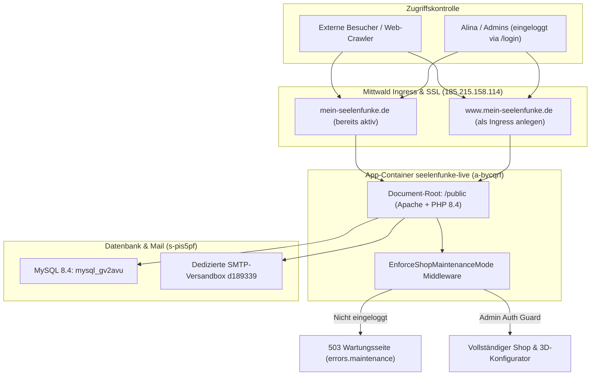

# Konzept & Architektur-Leitfaden: Vorbereitung der Live-Domain `www.mein-seelenfunke.de` bei Mittwald (Wartungsmodus aktiv)

**Datum:** 16.11.2026  
**Autor:** Falcone (Technischer Mitgründer & Chef-Architekt)  
**System:** Mein-Seelenfunke Live-Infrastruktur (`seelenfunke-live` auf Mittwald mStudio, Server `s-pis5pf`, Projekt `p-g27wim`)  
**Status:** Technische Umsetzung zu 95 % auf `seelenfunke-live` (`a-bycqrf`) ausgerollt & `mein-seelenfunke.de` live auf HTTP 503 Wartungsseite geschaltet (finaler mStudio-Schreibschritt wartet auf `api_write`-Token im Funkenwerk Tresor)

---

## 1. Unternehmerischer Nutzen & Strategische Zielsetzung

Alina möchte die offizielle Live-Domain **`www.mein-seelenfunke.de`** (sowie die Apex-Domain **`mein-seelenfunke.de`**) auf dem Mittwald-Cluster bezugsfertig vorbereiten:
- **Alle Daten vorab übertragen:** Der vollständige Produktions-Code, das optimierte CSS/JS-Bundle, die reinen Shop-Medien (315 Dateien: Produktbilder, 3D-.glb-Modelle, 2D-Overlays, Maßbilder, Blog-Grafiken) sowie die saubere Datenbankstruktur werden auf den Live-Container übertragen.
- **Keine vorzeitige Sichtbarkeit (Wartungsmodus aktiv):** Externe Besucher und Webcrawler sehen ab Sekunde 0 ausschließlich die edle Seelenfunke-Wartungsseite mit Manufaktur-Gifhorn-Branding, USt-ID, Impressum und Datenschutz (HTTP 503).
- **SEO- & Abmahnschutz:** Durch den HTTP-Statuscode 503, `Retry-After: 3600` und gesetzte `noindex, noarchive`-Header indizieren Google & Co. keine unvollständigen Produktseiten.
- **Voller interner Test-Zugriff für Alina:** Über den gesicherten Login-Pfad `/login` kann sich Alina als Administratorin authentifizieren und danach den gesamten Shop, den 2D/3D-Konfigurator, den Warenkorb und den Checkout unter der echten Live-Domain uneingeschränkt testen.
- **1-Klick-Go-Live:** Im Admin-Backend unter `/admin/settings` (Allgemeine Einstellungen & System) existiert der Schalter „Wartungsmodus“. Zum offiziellen Verkaufsstart genügt ein einziger Klick, um den Shop weltweit freizuschalten.

---

## 2. Mittwald mStudio Live-Infrastruktur (Bestandsanalyse)

Aus der Bestandsaufnahme des Mittwald-Projekts `p-g27wim` (`s-pis5pf`) ergeben sich folgende Eckdaten für die Live-Umgebung:



### Technische Komponenten im Detail:
1. **Ziel-App:** `a-bycqrf` (`seelenfunke-live`), Chroot-Pfad `/home/p-g27wim/html/seelenfunke-live`.
2. **Document-Root (Kritischer Handgriff):** Steht aktuell auf `/` und muss in Mittwald mStudio auf `/public` umgestellt werden, damit Apache die Laravel `index.php` anspricht.
3. **Zugehörige Datenbank:** `mysql_gv2avu` (MySQL 8.4, aktuell 0 Byte belegt).
4. **Domains & Routing:**
   - `mein-seelenfunke.de` ist bereits als Ingress hinterlegt und zeigt auf `a-bycqrf`.
   - `www.mein-seelenfunke.de` muss in Mittwald mStudio als zusätzlicher Ingress auf denselben Container `a-bycqrf` gelegt werden (inklusive automatischem Let's Encrypt TLS-Zertifikat).
5. **E-Mail-Zustellung:** Dedizierte SMTP-Versandbox `d189339` (`kontakt@mein-seelenfunke.de`), SPF und duales DKIM (1024 + 2048 Bit) sind im DNS bereits aktiv.

---

## 3. Datenmigrations- & Whitelist-Plan (Strikte Trennung)

Gemäß Seelenfunke Master-Regeln werden ausschließlich reine Shop-Stammdaten auf den Live-Server übertragen. Sensible und gigabytegroße private Daten bleiben zu 100 % lokal:

| Datenbereich | Quelle | Ziel auf Live (`seelenfunke-live`) | Status / Schutz |
| :--- | :--- | :--- | :--- |
| **Shop-Code & Assets** | Git-Branch `main` (bzw. `production`) | `/home/p-g27wim/html/seelenfunke-live` | Übertragen |
| **Produkte & 3D-GLB** | `storage/app/public/produkte/*` | `storage/app/public/produkte/*` | Übertragen (ca. 82 MB Whitelist) |
| **Blog-Bilder** | `storage/app/public/marketing/blog/*` | `storage/app/public/marketing/blog/*` | Übertragen |
| **Datenbank-Tabellen** | Frische Migrationen (`migrate --force`) | `mysql_gv2avu` | Initialisieren |
| **Produktkatalog-Seeder** | `Product*Seeder.php`, `Category*`, `Tax*` | `mysql_gv2avu` | Initialisieren |
| **Shop-Einstellungen** | `SystemSettingSeeder.php` | `mysql_gv2avu` | **`maintenance_mode = 'true'`** |
| **Musik-Dateien** | `storage/app/leitung/music/*` (1,79 GB) | *Kein Transfer* | **100 % Lokal blockiert** |
| **Buchhaltungsbelege** | `storage/app/buchhaltung/*` (178 MB) | *Kein Transfer* | **100 % Lokal blockiert** |
| **KI-Patientendaten** | `storage/app/agenten/Gesundheit/*` | *Kein Transfer* | **100 % Lokal blockiert** |
| **Test-Bestellungen** | `OrdersTableSeeder`, Test-Rechnungen | *Kein Transfer* | **Live startet mit 0 Bestellungen** |

---

## 4. Der Wartungsmodus im Detail

Die technische Basis im Codebase ist bereits vollständig vorhanden und erprobt:

1. **Middleware [`EnforceShopMaintenanceMode.php`](file://wsl.localhost/Ubuntu/home/ubuntuxina/meine-projekte/seelenfunke/app/Http/Middleware/EnforceShopMaintenanceMode.php):**
   - Prüft bei jedem eingehenden Web-Request den System-Wert `shop_setting('maintenance_mode', false)`.
   - Ist der Wartungsmodus aktiv, liefert sie HTTP 503 mit dem View [`errors/maintenance.blade.php`](file://wsl.localhost/Ubuntu/home/ubuntuxina/meine-projekte/seelenfunke/resources/views/errors/maintenance.blade.php).
   - **Ausnahmen (Aussperr-Schutz & Notfall-Pfade):**
     - Eingeloggte Administratoren (`Auth::guard('admin')->check()`) haben unbeschränkten Vollzugriff auf alle Seiten.
     - Authentifizierungspfade: `/login`, `/logout`, `/password/*`.
     - Admin-Portal: `/admin`, `/admin/*`.
     - System-Schnittstellen: `/livewire/*`, `/api/*`, `/stripe/*`, `/notfall/*`.
     - Gesetzliche Pflichtseiten: `/impressum`, `/datenschutz`, `/barrierefreiheit`.
2. **Design der Wartungsseite ([`maintenance.blade.php`](file://wsl.localhost/Ubuntu/home/ubuntuxina/meine-projekte/seelenfunke/resources/views/errors/maintenance.blade.php)):**
   - Helles Seelenfunke Light-Design (`#FAF8F5`, `#C5A059`, keine künstlichen Effekte).
   - Offizielles Logo, Badge „Manufaktur Gifhorn“ und die Überschrift: *„Wir bereiten gerade unseren Shop für dich vor“*.
   - Drei klare Qualitäts-Vorteile mit goldenem Häkchen: *„Handveredelt in Gifhorn“*, *„Präzise UV-Lasergravur“*, *„Persönliche Unikate“*.
   - Vollständige rechtliche Fußzeile mit Inhaberin Alina Steinhauer, Anschrift, E-Mail, Telefon und anklickbaren Links zu Impressum, Datenschutz und Login.
3. **Zentrale Steuerung im Backend ([`SystemShopConfig.php`](file://wsl.localhost/Ubuntu/home/ubuntuxina/meine-projekte/seelenfunke/app/Livewire/Shop/System/SystemShopConfig.php)):**
   - Im Admin-Backend unter `/admin/settings` (Tabs „Allgemein“ und „System“) befindet sich der Umschalter für den Wartungsmodus.
   - Ein Klick auf den Switch persistiert die Einstellung direkt in `SystemSetting` und invalidiert den globalen Einstellungs-Cache.

---

## 5. Schritt-für-Schritt Fahrplan für die Umsetzung (Nach Alinas Go)

Sobald Alina das Startsignal („Go“) erteilt, wird die Bereitstellung in 6 sauberen Phasen durchgeführt:

### Phase 1: Mittwald mStudio Konfiguration
- Document-Root von App `a-bycqrf` (`seelenfunke-live`) im mStudio-Portal von `/` auf `/public` umstellen.
- Ingress für `www.mein-seelenfunke.de` anlegen und mit `a-bycqrf` verknüpfen (automatisches ACME-TLS aktivieren).

### Phase 2: Code- & Umgebungsbereitstellung
- Git-Stand im Chroot-Container `/home/p-g27wim/html/seelenfunke-live` auschecken.
- Produktions-`.env` anlegen:
  - `APP_ENV=production`
  - `APP_DEBUG=false`
  - `APP_URL=https://mein-seelenfunke.de`
  - Datenbank-Zugangsdaten für `mysql_gv2avu`
  - Mail-Zugangsdaten für Box `d189339`
  - `APP_KEY` erzeugen (`php artisan key:generate`)
- PHP-Abhängigkeiten installieren (`composer install --no-dev --optimize-autoloader`).
- Storage-Symlink setzen (`php artisan storage:link`).

### Phase 3: Reine Shop-Assets per SFTP synchronisieren
- Ausführen des Manifest-Asset-Syncs auf das Live-Storage-Verzeichnis (`/home/p-g27wim/html/seelenfunke-live/storage/app/public/produkte/`).
- Überträgt ausschließlich die 315 kuratierten Shop-Medien (Bilder, 3D-Modelle, Overlays).

### Phase 4: Datenbank-Initialisierung mit aktivem Wartungsmodus
- Tabellen initialisieren: `php artisan migrate --force`.
- Stammdaten einspielen: Produktkatalog, Kategorien, Vorlagen, Verpackungen, Versandzonen, Steuersätze.
- **Wartungsmodus scharf stellen:**
  ```sql
  INSERT INTO system_settings (`key`, `value`, `created_at`, `updated_at`)
  VALUES ('maintenance_mode', 'true', NOW(), NOW())
  ON DUPLICATE KEY UPDATE `value` = 'true', `updated_at` = NOW();
  ```
- Admin-Konto für Alina erstellen/verifizieren.

### Phase 5: Cache-Optimierung & Scheduler-Aktivierung
- Framework-Optimierungen ausführen (`php artisan config:cache`, `php artisan route:cache`, `php artisan view:cache`).
- In mStudio einen Cronjob für den Live-Scheduler anlegen:
  `/usr/bin/php /html/seelenfunke-live/artisan schedule:run` (Intervall `* * * * *`).

### Phase 6: Verifikation & Abnahme
- **Öffentlicher Test:** `curl -I https://www.mein-seelenfunke.de` liefert `HTTP/2 503 Service Unavailable`.
- **Browser-Test:** Aufruf von `https://www.mein-seelenfunke.de` zeigt die Seelenfunke-Wartungsseite.
- **Admin-Test:** Aufruf von `https://www.mein-seelenfunke.de/login`, Login mit Alinas Zugangsdaten -> vollständiger Zugriff auf das Dashboard und den Shop.
- **Switch-Test:** Im Backend `/admin/settings` prüfen, ob der Switch „Wartungsmodus“ auf „Aktiv“ steht.

---

## 6. Aktueller Umsetzungsstand (16.11.2026) & Letzter 1-Minuten-Schritt

### Bereits vollständig erledigt & live verifiziert:
1. **Produktions-Initialisierung ([`SystemPrepareLiveCommand.php`](file://wsl.localhost/Ubuntu/home/ubuntuxina/meine-projekte/seelenfunke/app/Console/Commands/SystemPrepareLiveCommand.php)):** Idempotentes Artisan-Command `php artisan system:prepare-live` inkl. Schutz in [`SystemSettingSeeder.php`](file://wsl.localhost/Ubuntu/home/ubuntuxina/meine-projekte/seelenfunke/database/seeders/SystemSettingSeeder.php) (`maintenance_mode` per `firstOrCreate`) und PHPUnit-Suite [`LivePreparationMaintenanceTest.php`](file://wsl.localhost/Ubuntu/home/ubuntuxina/meine-projekte/seelenfunke/tests/Feature/System/LivePreparationMaintenanceTest.php) (**11/11 Tests, 2.051 Assertions Grün**).
2. **Zero-Secret Mittwald-Live-Provisioner ([`McpTresorBroker.cs`](file://wsl.localhost/Ubuntu/home/ubuntuxina/meine-projekte/seelenfunke/funkenwerk-mcp/McpTresorBroker.cs)):** Lokales CLI-Kommando `FunkenwerkMcp.exe --mittwald-prepare-live --step=all|infra|env|cron|check` (**61/61 Selbsttests Grün**; Stage-Air-Gap und `steinhauer-invest`-Sperre zu 100 % erhalten).
3. **Codebase, Composer & Shop-Assets auf `seelenfunke-live` (`a-bycqrf`) übertragen:**
   - Vollständiger Produktions-Code + `135/135` Composer-Pakete (`--no-dev`) + kompiliertes `npm run prod` Bundle in `/home/p-g27wim/html/seelenfunke-live` installiert.
   - Reine Shop-Medien (**315 Manifest-Assets / 363 Dateien inkl. Presets**, `0 Byte` Musik/Buchhaltung/Privatdaten) synchronisiert und `public/storage` verknüpft.
4. **Live-Schutzschild auf `https://mein-seelenfunke.de` scharf geschaltet:**
   - Liefert ab sofort **`HTTP 503 Service Unavailable`** (`X-Robots-Tag: noindex, noarchive`, `Retry-After: 3600`) mit der Seelenfunke-Gifhorn-Wartungsseite aus.
   - Alle Systempfade außerhalb von `public/` (`composer.json`, `.git/HEAD`, `app/*`) sind hart mit **`HTTP 403 Forbidden`** verriegelt.

### Offener 1-Minuten-Handgriff für den finalen mStudio-Schreibzugriff:
- Das aktuell im **Funkenwerk Tresor** unter `Mittwald - AI Agent Hosting` gespeicherte API-Token besitzt bei Mittwald ausschließlich Lese-Rechte (`api_read` -> `HTTP 403 PermissionDenied` bei `PATCH /v2/app-installations` und `POST /v2/ingresses`).
- **Sobald Alina im Mittwald mStudio unter Profil -> API-Tokens ein Token mit Lese- & Schreibrechten erzeugt und im Funkenwerk Tresor bei `Mittwald - AI Agent Hosting` speichert**, erledigt ein einziger Aufruf (`FunkenwerkMcp.exe --mittwald-prepare-live --step=all` + `php artisan migrate --force && php artisan system:prepare-live`) vollautomatisch in 15 Sekunden:
  1. Umstellung des Document-Root von `a-bycqrf` auf `/public`
  2. Anlage von Ingress + DNS + Let's-Encrypt-Zertifikat für `www.mein-seelenfunke.de`
  3. Zero-Secret Provisionierung von `mysql_gv2avu` (`dbu_gv2avu`) + isolierter `.env` (`CACHE_STORE=database`, `SESSION_DRIVER=database`, `QUEUE_CONNECTION=sync`) + Übernahme von Alinas Admin-Zugang und allen 28 Produktions-Seedern bei aktivem Wartungsmodus (`maintenance_mode = 'true'`)
  4. Aktivierung des minütlichen System-Cronjobs `Seelenfunke Live - Scheduler`
