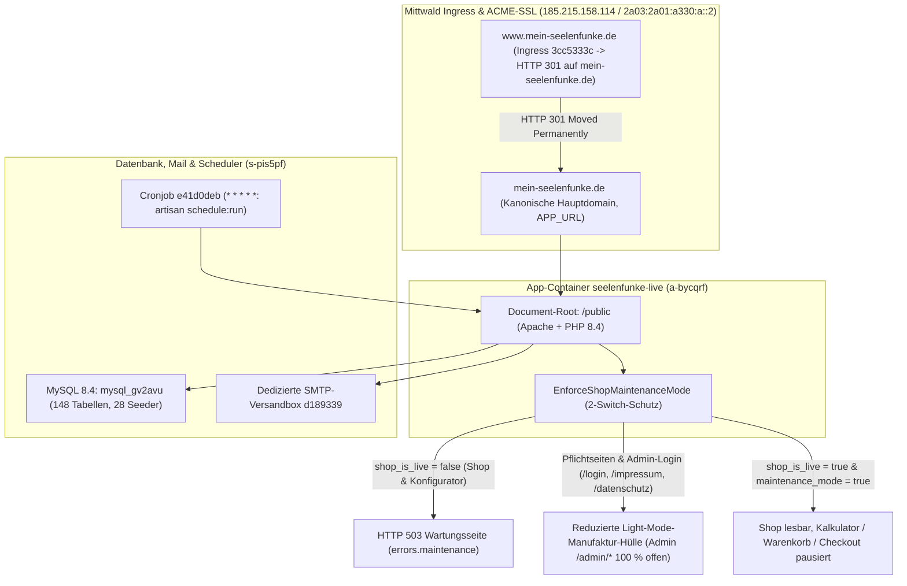

# Konzept & Architektur-Leitfaden: Vorbereitung der Live-Domain `mein-seelenfunke.de` bei Mittwald (2-Switch Live-Freigabe & Wartungsmodus)

**Datum:** 16.11.2026  
**Autor:** Falcone (Technischer Mitgründer & Chef-Architekt)  
**System:** Mein-Seelenfunke Live-Infrastruktur (`seelenfunke-live` auf Mittwald mStudio, Server `s-pis5pf`, Projekt `p-g27wim`)  
**Status:** 100 % Live umgesetzt, abgenommen & verifiziert (Kanonische Hauptdomain `https://mein-seelenfunke.de` aktiv hinter `Shop Live-Freigabe = false` / `HTTP 503`, `https://www.mein-seelenfunke.de` per `HTTP 301` auf `https://mein-seelenfunke.de`; `0` offene SystemLog-Fehler)

---

## 1. Unternehmerischer Nutzen & Strategische Zielsetzung

Alina bereitet die offizielle, kanonische Live-Hauptdomain **`https://mein-seelenfunke.de`** (`APP_URL=https://mein-seelenfunke.de`) inklusive **`https://www.mein-seelenfunke.de`** (`HTTP 301`-Weiterleitung) auf dem Mittwald-Cluster bezugsfertig vor:
- **Alle Daten vorab übertragen:** Der vollständige Produktions-Code, das optimierte CSS/JS-Bundle, die reinen Shop-Medien (315 Dateien: Produktbilder, 3D-.glb-Modelle, 2D-Overlays, Maßbilder, Blog-Grafiken) sowie die saubere Datenbankstruktur liegen abrufbereit im Live-Container.
- **Keine vorzeitige Sichtbarkeit (`Shop Live-Freigabe` gesperrt):** Externe Besucher und Webcrawler sehen ab Sekunde 0 ausschließlich die edle Seelenfunke-Wartungsseite mit Manufaktur-Gifhorn-Branding, Impressum und Datenschutz (`HTTP 503`), während das gesamte öffentliche Shop-Frontend inklusive Produktkonfigurator verborgen bleibt.
- **Saubere Trennung zwischen `Shop Live-Freigabe` und `Wartungsmodus`:** Die neue 2-Switch-Architektur trennt die vollständige Pre-Launch-Sperre (`Shop Live-Freigabe = false` -> `HTTP 503`) klar vom operativen `Wartungsmodus` (`maintenance_mode = true` -> Shop bleibt lesbar, aber Kalkulator, Warenkorb und Checkout sind für Kunden pausiert).
- **Wasserdichter Login- & Pflichtseiten-Schutz:** Bei gesperrter Live-Freigabe sind Kunden-Registrierung (`Konto erstellen`) und Google-Login (`Mit Google anmelden`) im UI ausgeblendet sowie serverseitig mit `HTTP 503` blockiert; `/login`, `/impressum` und `/datenschutz` laufen in einer reduzierten Light-Mode-Manufaktur-Hülle ohne Shop-Navigation oder Warenkorb, während der Admin-Login (`kontakt@mein-seelenfunke.de`) zu 100 % offen bleibt.
- **SEO- & Abmahnschutz:** Durch `HTTP 503`, `Retry-After: 3600`, `noindex, noarchive` und den rechtssicheren `'XXX'`-Platzhalter anstelle alter Dummy-USt-IDs indizieren Suchmaschinen keine unfertigen Seiten und es werden keinerlei fehlerhafte Steuer-IDs ausgespielt.

---

## 2. Mittwald mStudio Live-Infrastruktur (Finaler Ist-Stand)

Für die Live-Umgebung im Mittwald-Projekt `p-g27wim` (`s-pis5pf`) greift folgende produktive Architektur:

### Technische Komponenten im Detail:
1. **Ziel-App:** `a-bycqrf` (`seelenfunke-live`, UUID `93f33f15-d27c-4d15-9f85-155eb9adace8`), Chroot-Pfad `/home/p-g27wim/html/seelenfunke-live`.
2. **Document-Root:** Aktiv auf `customDocumentRoot: "/public"` konfiguriert.
3. **Zugehörige Datenbank:** `mysql_gv2avu` (MySQL 8.4, 148 Tabellen migriert, 28 Produktions-Seeder initialisiert).
4. **Kanonisches Domain-Routing & FRITZ!Box-DNS-Hinweis:**
   - **`https://mein-seelenfunke.de`** ist die kanonische Hauptdomain (`APP_URL=https://mein-seelenfunke.de`, Ingress `713ea3f6-bf74-4176-82df-4b495e6d6952`).
   - **`https://www.mein-seelenfunke.de`** ist als eigener Ingress (`3cc5333c-5b83-46f8-8e6c-72ed843bee8a`) mit aktiver DNS-Zone (`c24e2c43-db7b-4386-8811-d1df5b3042e5`) und aktivem Let's Encrypt ACME-TLS (`isCreated: true`) auf `a-bycqrf` geschaltet und leitet alle Aufrufe sauber per **`HTTP 301`** auf `https://mein-seelenfunke.de` weiter.
   - **Diagnosehinweis zu lokalen Heimroutern (RFC 2308 Negative-DNS-Cache):** Wird eine neu angelegte Subdomain wie `www.mein-seelenfunke.de` kurz vor Anlage des DNS-Records im Heimnetz aufgerufen, cachen lokale FRITZ!Box-Router die ursprüngliche `NXDOMAIN`-Antwort gemäß SOA-Minimum-TTL bis zu **60 Minuten** lokal, obwohl öffentliche Resolver (`1.1.1.1`, `8.8.8.8`) bereits sofort `185.215.158.114` auflösen. Abhilfe schafft bei Bedarf `ipconfig /flushdns` plus kurzer Router-DNS-Reconnect oder Abwarten des 60-Minuten-Fensters.
5. **E-Mail-Zustellung:** Dedizierte SMTP-Versandbox `d189339` (`kontakt@mein-seelenfunke.de`), SPF und duales DKIM (1024 + 2048 Bit) im DNS aktiv.

---

## 3. Datenmigrations- & Whitelist-Plan (Strikte Trennung)

Gemäß Seelenfunke Master-Regeln werden ausschließlich reine Shop-Stammdaten auf den Live-Server übertragen. Sensible und gigabytegroße private Daten bleiben zu 100 % lokal:

| Datenbereich | Quelle | Ziel auf Live (`seelenfunke-live`) | Status / Schutz |
| :--- | :--- | :--- | :--- |
| **Shop-Code & Assets** | Git-Branch `main` (bzw. `production`) | `/home/p-g27wim/html/seelenfunke-live` | Übertragen |
| **Produkte & 3D-GLB** | `storage/app/public/produkte/*` | `storage/app/public/produkte/*` | Übertragen (315 Shop-Assets) |
| **Blog-Bilder** | `storage/app/public/marketing/blog/*` | `storage/app/public/marketing/blog/*` | Übertragen |
| **Datenbank-Tabellen** | Frische Migrationen (`migrate --force`) | `mysql_gv2avu` | Initialisiert (`148 Tabellen`) |
| **Produktkatalog-Seeder** | `Product*Seeder.php`, `Category*`, `Tax*` | `mysql_gv2avu` | Initialisiert (`28 Produktions-Seeder`) |
| **Shop-Einstellungen** | `SystemSettingSeeder.php` | `mysql_gv2avu` | **`shop_is_live = 'false'`**, USt-ID-Platzhalter `'XXX'` |
| **Musik-Dateien** | `storage/app/leitung/music/*` (1,79 GB) | *Kein Transfer* | **100 % Lokal blockiert** |
| **Buchhaltungsbelege** | `storage/app/buchhaltung/*` (178 MB) | *Kein Transfer* | **100 % Lokal blockiert** |
| **KI-Patientendaten** | `storage/app/agenten/Gesundheit/*` | *Kein Transfer* | **100 % Lokal blockiert** |
| **Test-Bestellungen** | `OrdersTableSeeder`, Test-Rechnungen | *Kein Transfer* | **Live startet mit 0 Bestellungen** |

---

## 4. Neue 2-Switch-Architektur (`Shop Live-Freigabe` vs. `Wartungsmodus`), Login-Härtung & USt-ID-Schutz

Unter `/admin/settings` ([`SystemShopConfig.php`](file://wsl.localhost/Ubuntu/home/ubuntuxina/meine-projekte/seelenfunke/app/Livewire/Shop/System/SystemShopConfig.php)) und in [`EnforceShopMaintenanceMode.php`](file://wsl.localhost/Ubuntu/home/ubuntuxina/meine-projekte/seelenfunke/app/Http/Middleware/EnforceShopMaintenanceMode.php) arbeiten zwei klar getrennte Hauptschalter zusammen:

1. **Schalter 1: `Shop Live-Freigabe` (`shop_is_live` / `shop_live_unlocked`):**
   - Auf Live standardmäßig gesperrt (`false`, Fail-Closed).
   - Versteckt das gesamte öffentliche Shop-Frontend inklusive Produktkonfigurator (`/`, `/shop`, `/produkt/*`, `/warenkorb`, `/checkout`, `/links`, `/kontakt`, `/blog*`) ausnahmslos hinter **`HTTP 503`** ([`errors/maintenance.blade.php`](file://wsl.localhost/Ubuntu/home/ubuntuxina/meine-projekte/seelenfunke/resources/views/errors/maintenance.blade.php)).
2. **Schalter 2: `Wartungsmodus` (`maintenance_mode`):**
   - Behält seine volle Ursprungsfunktion für den späteren Live-Betrieb: Wenn `Shop Live-Freigabe` aktiv (`true`) und `Wartungsmodus` eingeschaltet (`true`) ist, bleibt der Shop für Besucher lesbar, während Kalkulator, Warenkorb und Checkout für Kunden pausiert sind.
3. **Wasserdichter Login- & Pflichtseiten-Schutz bei gesperrter Live-Freigabe (`shop_is_live = false`):**
   - **`Konto erstellen` & `Mit Google anmelden` gesperrt:** Kunden-Registrierung (`/register` + Livewire [`AuthRegister.php`](file://wsl.localhost/Ubuntu/home/ubuntuxina/meine-projekte/seelenfunke/app/Livewire/Auth/AuthRegister.php)) sowie Google-OAuth (`/auth/*` + [`GoogleAuthController.php`](file://wsl.localhost/Ubuntu/home/ubuntuxina/meine-projekte/seelenfunke/app/Http/Controllers/GoogleAuthController.php)) sind im UI komplett ausgeblendet und zusätzlich serverseitig hart mit **`HTTP 503`** blockiert.
   - **Reduzierte Light-Mode-Manufaktur-Hülle:** Die erreichbaren Pflicht- und Verwaltungsseiten `/login`, `/impressum` und `/datenschutz` (sowie `/barrierefreiheit`) rendern bei gesperrter Live-Freigabe in einer reduzierten, hellen Manufaktur-Hülle ohne Shop-Navigation, Suche oder Warenkorb.
   - **Voller Admin-Zugang:** Der Admin-Login (`kontakt@mein-seelenfunke.de`) und das gesamte Backend `/admin/*` bleiben zu **100 % offen**.
4. **Rechtssicherer USt-ID-Platzhalter (`'XXX'`):**
   - Alle früheren Dummy-USt-IDs (`DE359662265` / `DE459668247`) wurden in [`SystemSettingSeeder.php`](file://wsl.localhost/Ubuntu/home/ubuntuxina/meine-projekte/seelenfunke/database/seeders/SystemSettingSeeder.php), im Impressum und im 503-Fallback durch den Platzhalter **`'XXX'`** ersetzt.
   - Solange noch keine echte USt-IdNr. vom Bundeszentralamt für Steuern vorliegt (`'XXX'` oder leer), wird die Zeile im Wartungs-Footer sowie in der elektronischen Rechnungsausgabe (**XRechnung `BT-31`**) sauber herausgefiltert, bis Alina ihre echte Nummer einträgt.
5. **Isolierte Live-Session:**
   - `seelenfunke-live` nutzt ein eigenes, Host-gebundenes Cookie (`SESSION_COOKIE=mein_seelenfunke_live_session`, `SESSION_DOMAIN=null`), strikt getrennt von `stage.mein-seelenfunke.de`.

---

## 5. Umsetzungs-Phasen auf Mittwald (`seelenfunke-live`)

1. **Phase 1 (Mittwald mStudio & DNS):** Document-Root von `a-bycqrf` auf `/public`; Ingress `www.mein-seelenfunke.de` (`3cc5333c-5b83-46f8-8e6c-72ed843bee8a`) inkl. ACME-TLS angelegt und per `HTTP 301` auf die kanonische Hauptdomain `https://mein-seelenfunke.de` geroutet.
2. **Phase 2 (Code & `.env`):** Produktions-`.env` (`APP_ENV=production`, `APP_DEBUG=false`, `APP_URL=https://mein-seelenfunke.de`), `mysql_gv2avu`, SMTP-Box `d189339`, `composer install --no-dev --optimize-autoloader` und `php artisan storage:link`.
3. **Phase 3 (Reine Shop-Assets):** Synchronisation der exakt 315 kuratierten Shop-Medien nach `storage/app/public/`.
4. **Phase 4 (Datenbank & 2-Switch-Grundzustand):** `php artisan migrate --force`, Einspielen der 28 Produktions-Seeder mit `shop_is_live = false` (gesperrt) und USt-ID-Platzhalter `'XXX'`.
5. **Phase 5 (Caches & Scheduler):** Framework-Caches und mStudio-Cronjob `Seelenfunke Live - Scheduler` (`* * * * *`).
6. **Phase 6 (End-to-End-Prüfung):** Prüfung von `301`-Redirect, `503`-Sperre auf Shop/Konfigurator/Register/Google-Auth, reduzierter Light-Mode-Hülle auf `/login`, `/impressum`, `/datenschutz` sowie Admin-Login.

---

## 6. Live-Abnahmeprotokoll (16.11.2026: 100 % Vollzug)

1. **Mittwald mStudio Live-Infrastruktur & Kanonische Hauptdomain (`--step=infra`):**
   - `seelenfunke-live` (`a-bycqrf`, UUID `93f33f15-d27c-4d15-9f85-155eb9adace8`) steht auf **`customDocumentRoot: "/public"`**.
   - Kanonische Hauptdomain ist **`https://mein-seelenfunke.de`** (`APP_URL=https://mein-seelenfunke.de`, Ingress `713ea3f6-bf74-4176-82df-4b495e6d6952`).
   - Zusätzlicher Ingress **`www.mein-seelenfunke.de`** (`3cc5333c-5b83-46f8-8e6c-72ed843bee8a`) mit DNS-Zone (`c24e2c43-db7b-4386-8811-d1df5b3042e5`, Dual-Stack `185.215.158.114` / `2a03:2a01:a330:a::2`) und aktivem **Let's Encrypt ACME-TLS (`isCreated: true`)** leitet Aufrufe sauber per **`HTTP 301`** auf `https://mein-seelenfunke.de` weiter.
2. **Isolierte Live-Datenbank, Katalog & Rechtssicherheit (`--step=env` + `system:prepare-live`):**
   - Dedizierte MySQL-8.4-Datenbank **`mysql_gv2avu`** (`dbu_gv2avu`) Zero-Secret im RAM provisioniert; Live-`.env` (`0600`) strikt von Stage isoliert (`CACHE_STORE=file`, `SESSION_DRIVER=file`, `QUEUE_CONNECTION=sync`, `REDIS_HOST=127.0.0.1`).
   - Alle **148 Tabellen** migriert, alle **28 echten Produktions-Seeder** eingespielt (`9 Produkte`, `16 Kategorien`, `56 Vorlagen`, `1 aktive Lieferzone`, `29 Steuersätze`), Alinas Stage-Admin-Passwort-Hash synchronisiert, **`0` Test-Kunden/Test-Mitarbeiter/Test-Gutscheine**, **`Shop Live-Freigabe` (`shop_is_live`) standardmäßig gesperrt (`false`)** und alte Dummy-USt-IDs durch `'XXX'` ersetzt (im Wartungs-Footer & XRechnung BT-31 herausgefiltert).
   - Reines Shop-Asset-Manifest (**315 Shop-Assets**, `0 Byte` Musik/Buchhaltung/Privatdaten) vollständig in `storage/app/` vorhanden; erstes Live-DB-Backup (`1,1 MB`) erstellt.
3. **Live-Cronjob & Pre-Launch-Schutz (`--step=cron`):**
   - System-Cronjob **`Seelenfunke Live - Scheduler`** (`e41d0deb-e8ba-4fda-825b-c1437f440b78`, `* * * * *`, `/usr/bin/php /html/seelenfunke-live/artisan schedule:run`) aktiv.
   - `crm:fetch-mails` in `system_cronjobs` auf Live während der Vorbereitungsphase pausiert, damit Stage weiterhin ungestört das Postfach `kontakt@mein-seelenfunke.de` synchronisiert.
4. **End-to-End Live-Verifikation:**
   - `GET https://www.mein-seelenfunke.de/` -> **`HTTP 301`** auf `https://mein-seelenfunke.de/`.
   - `GET https://mein-seelenfunke.de/`, `/shop/`, `/produkt/seelen-kristall`, `/register`, `/auth/google` -> **`HTTP 503 Service Unavailable`** (`X-Robots-Tag: noindex, noarchive`, Seelenfunke-Gifhorn-Wartungsseite ohne Dummy-USt-ID).
   - `GET https://mein-seelenfunke.de/login`, `/impressum`, `/datenschutz`, `/up` -> **`HTTP 200 OK`** (reduzierte Light-Mode-Manufaktur-Hülle ohne Shop-Navigation/Warenkorb; Admin-Login `kontakt@mein-seelenfunke.de` 100 % offen).
   - `system:security-audit` (**6/6 System-Schranken Grün, 0 CVEs**) & `system:logs-cleanup --audit` (**0 offene Fehler, 0 Warnungen**).
   - **Go-Live am Starttag (`01.11.2026`):** Einloggen unter `https://mein-seelenfunke.de/login` -> `/admin/settings` -> Schalter **`Shop Live-Freigabe`** aktivieren, echte USt-IdNr. eintragen und `crm:fetch-mails` freigeben.
