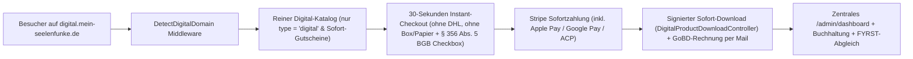

# Konzept: Reine Digital-Domain („1 Gehirn, 2 Schaufenster“) für 24/7 Sofort-Downloads

**Datum:** 16.11.2026  
**Autor:** Falcone (Technischer Mitgründer & Chef-Architekt)  
**Auftrags-ID:** `ag_20261116_191644_b4360f58`  
**Status:** 📋 Konzept vorgelegt (Warte auf explizites „Go“ & Domain-Entscheidung von Alina)

---

## 1. Ehrliche Mitgründer-Einschätzung & Unternehmerischer Mehrwert

**Kurzurteil: Unternehmerisch extrem stark, WENN wir es als „1 Gehirn, 2 Schaufenster“ auf unserer bestehenden Seelenfunke-Plattform bauen (statt ein zweites getrenntes Shopsystem zu pflegen).**

### Warum sich eine reine Digital-Domain für dich massiv lohnt:
1. **~96 % Marge ohne Werkstattzeit:** Digitale Produkte (personalisierbare Erinnerungs-/Geschenk-PDFs zum Selbstausdrucken, Laser-/Plotter-Vorlagen, Sofort-Gutscheine, 3D-Druck-Dateien, Ratgeber) haben **`0,00 €` Rohlingkosten, `0,00 €` Verpackung/LUCID, `0,00 €` DHL-Versand und `0` Minuten Arbeit am Laser**. Nur die Stripe-Gebühr (~`1,5 % + 0,25 €`) geht ab.
2. **Unabhängig von Manufaktur-Kapazität & Urlaub (`digital_domain_is_live`):** Selbst wenn der physische Shop wegen Großaufträgen, Urlaub oder vor dem Manufaktur-Vollstart pausiert ist, verkauft die Digital-Domain 24/7 vollautomatisch weiter.
3. **`0,00 €` zusätzliche Serverkosten bei Mittwald (`p-g27wim`):** Auf deinem bestehenden Mittwald-Projekt sind noch über `44 GiB` frei. Wir schalten die Digital-Domain einfach als zusätzlichen Ingress auf denselben Container auf.
4. **Null doppelte Buchhaltung:** Alle Digital-Umsätze fließen vollautomatisch in deine bestehende GoBD-Rechnungskette (`InvoiceService`), dein FYRST-Geschäftskonto, deinen Steuerberater-Export und dein zentrales `/admin/dashboard`.

---

## 2. Klare Mitgründer-Empfehlung zur Domain-Wahl (1 klare Entscheidung)

Statt 10 Optionen empfehle ich dir folgende zweistufige Lösung:
* **Empfehlung zum Sofort-Start (`0,00 €` Zusatzkosten, 0 Minuten Wartezeit):** **`digital.mein-seelenfunke.de`** als eigenständige Subdomain auf deinem bereits bezahlten Mittwald-Paket einrichten. Vorteil: Sofort kostenlos per Let's Encrypt verschlüsselt, stärkt die Google-Autorität deiner Hauptmarke `mein-seelenfunke.de` und wirkt für Kunden sofort vertrauenswürdig.
* **Optionale spätere Ergänzung (~`0,90 €/Monat`):** Falls du künftig komplett markenunabhängige B2B-/Maker-Dateien (z. B. Laser-SVGs oder 3D-Druck-Vorlagen) verkaufen willst, lässt sich jederzeit eine eigene Domain wie `funkenwerk-digital.de` auf exakt dieselbe Weiche zeigen lassen.

---

## 3. Technische Architektur („1 Gehirn, 2 Schaufenster“)

### Die 5 konkreten System-Bausteine bei Umsetzung:
1. **Host-Erkennung (`DetectDigitalDomain` Middleware):**
   * Erkennt automatisch den Host (`digital.mein-seelenfunke.de` bzw. konfigurierbare Digital-Domain sowie lokal `?domain=digital` zum Testen).
   * Besitzt im `/admin/settings` einen **eigenen Live-Schalter (`digital_domain_is_live`)**, komplett unabhängig vom physischen `shop_is_live`-Schalter!
2. **Lupenreiner Digital-Katalog & Helles Clean-Design (Baustein 1 & 2):**
   * Blendet auf der Digital-Domain automatisch alle physischen Rohlinge, Versandhinweise und den physischen 3D-Rohling-Raum aus; zeigt ausschließlich aktive `type = 'digital'` Produkte und digitale Sofort-Gutscheine im freundlichen Seelenfunke Light-Mode.
3. **Reibungsloser 30-Sekunden-Checkout & Abmahnschutz (`§ 356 Abs. 5 BGB`):**
   * Kein Versandadress-Formular, keine Lieferzonen-Hürde (außer Rechnungsland für USt.), keine Schmuckbox-/Geschenkpapier-Abfrage.
   * **Gesetzlicher Pflichtschutz gegen Widerrufs-Missbrauch (`§ 356 Abs. 5 BGB`):** Verbindliche Checkbox vor dem Kauf (*Zustimmung zur sofortigen Vertragsausführung vor Ablauf der Widerrufsfrist und Kenntnisnahme des Erlöschens des Widerrufsrechts*), revisionssicher mit Zeitstempel in `OrderOrder` und auf der PDF-Rechnung dokumentiert.
4. **Automatischer EU-OSS-Umsatzsteuer-Wächter (`§ 3a Abs. 5 UStG`):**
   * Bei digitalen Verkäufen an Privatkunden im EU-Ausland gilt bis **`10.000 €` Netto-Jahresumsatz** regulär deine deutsche `19 %` USt. (du brauchst zum Start **kein** OSS-Bürokratie-Verfahren!).
   * Ein kleiner Zähler im Finanz-Backend überwacht deine EU-Digitalumsätze automatisch und gibt dir im `/admin/dashboard` frühzeitig bei `8.000 €` Bescheid.
5. **Sofort-Auslieferung (`0` Handgriffe für dich):**
   * Unser bestehender [`DigitalProductDownloadController.php`](file://wsl.localhost/Ubuntu/home/ubuntuxina/meine-projekte/seelenfunke/app/Http/Controllers/Customer/DigitalProductDownloadController.php) liefert die Datei unmittelbar nach `payment_status = paid` über eine kryptografisch signierte Download-URL auf der Erfolgsseite und per E-Mail aus (und setzt den Auftrag im `/admin/orders` automatisch ohne Laser-Schritt auf erledigt).

---

## 4. Benötigte Entscheidung für dein „Go“

Gib mir kurz Bescheid:
1. Sollen wir direkt mit **`digital.mein-seelenfunke.de`** (`0,00 €` Zusatzkosten bei Mittwald, inkl. eigenem `digital_domain_is_live`-Schalter, 30s-Instant-Checkout, `§ 356 Abs. 5 BGB`-Schutz & `10.000 €`-OSS-Wächter) starten, oder schwebt dir ein eigener Domainname (z. B. `funkenwerk-digital.de`) vor?
