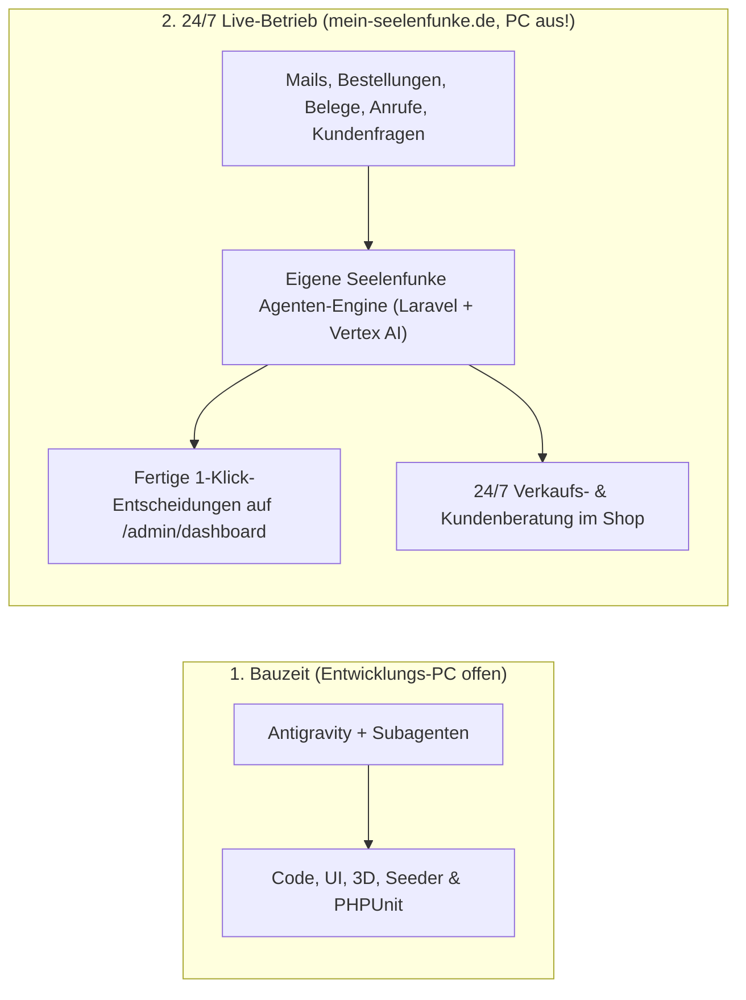
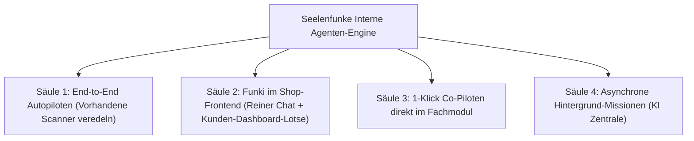

# Konzept & Brainstorming: Eigene Interne Seelenfunke KI-Agenten-Architektur (100 % Unabhängig von Antigravity)

> **Stand:** 20.11.2026 | **Status:** 100 % Lokal Implementiert & Getestet (Nach Alinas „Go“ umgesetzt)
> **Ziel:** Aufbau einer dauerhaft eigenständigen, hochpräzisen internen Agenten-Logik direkt in `Mein-Seelenfunke` (`Laravel / PHP + Google Cloud Vertex AI`), die im täglichen Manufaktur- und Shop-Betrieb echten unternehmerischen Mehrwert liefert, ohne von Antigravity abhängig zu sein.

---

## 1. Ehrliche Ursachen-Analyse: Warum wirkt Antigravity aktuell „krasser“ als unsere API-Agenten?

Auf den ersten Blick entsteht leicht der Eindruck, Antigravity hätte ein „besseres Gehirn“, während unsere eigenen Agenten „nur per API“ laufen. Technisch stimmt das **nicht**: Über unsere Google Cloud Vertex AI Anbindung ([VertexAiService.php](file://wsl.localhost/Ubuntu/home/ubuntuxina/meine-projekte/seelenfunke/app/Services/AI/VertexAiService.php)) haben wir Zugriff auf **exakt dieselbe Gemini-3.x-Modellfamilie** (`gemini-3.5-flash-lite`, `gemini-3.5-flash`, `gemini-3.1-pro-preview`).

Der Qualitätsunterschied entsteht zu **90 % durch das Laufzeit-Gerüst (Agentic Harness)** rund um das Sprachmodell:

| Merkmal | Warum Antigravity so stark wirkt | Warum klassische interne API-Chats schwächeln |
| :--- | :--- | :--- |
| **1. Kontext vor dem Start** | Bekommt automatisch Architektur-Karten (`ai_map.md`), feste Regeln und exakte Dateiausschnitte vorab injiziert. | Startet oft in einem „leeren Chatfenster“ ([AiWorkspace.php](file://wsl.localhost/Ubuntu/home/ubuntuxina/meine-projekte/seelenfunke/app/Livewire/Shop/Ai/AiWorkspace.php)) und muss sich Fakten erst mühsam über mehrere Tool-Aufrufe zusammensuchen. |
| **2. Subagenten-Isolation** | Startet für Spezialaufgaben einen **frischen, isolierten Subagenten** mit eigenem Kontextfenster und nur den wenigen relevanten Werkzeugen. | Ein einzelner Chat-Agent schleppt langen Gesprächsballast und dutzende Werkzeuge gleichzeitig mit sich herum -> Fokusverlust & Halluzinationsgefahr. |
| **3. Prüfschleife (Self-Verify)** | Arbeitet im Zyklus **Lesen -> Planen -> Handeln -> Prüfen -> Korrigieren**. | Macht meist nur einen einzelnen API-Aufruf („One-Shot“) und gibt die erste ungeprüfte Antwort direkt aus. |
| **4. Einsatzgebiet** | Sitzt lokal auf dem Entwicklungs-PC mit Terminal, Git und PHPUnit. | Sitzt auf dem Webserver und wird oft wie ein „Allzweck-Chatbot“ angesprochen, statt tief in Geschäftsprozesse eingebettet zu sein. |

> [!IMPORTANT]
> **Die wichtigste Erkenntnis für uns als Gründer:**
> Wir dürfen im Shop kein „zweites Antigravity zum Programmieren“ nachbauen. Auf einem Live-Shop-Server darf niemals eine KI eigenmächtig PHP-Code umschreiben! Stattdessen bauen wir unsere internen Agenten für genau das Feld aus, in dem **Antigravity komplett machtlos ist**: den **24/7-Echtzeitbetrieb von `mein-seelenfunke.de`, wenn dein PC ausgeschaltet ist oder du in der Werkstatt am UV-Laser stehst.**

---

## 2. Klare Machtverteilung: „Werft“ vs. „24/7-Schiffs-Crew“

Damit wir null doppelte Arbeit haben und kein Geld für sinnlose API-Spielereien verbrennen, gilt eine glasklare Trennung:

- **Antigravity = Die Werft (Design-Time):** Baut Features, pflegt Seeder, schreibt Tests. Kostet uns kein Vertex-API-Guthaben, schläft aber sofort ein, sobald du das Notebook zuklappst.
- **Eigene Seelenfunke Agenten-Engine = Die 24/7-Crew (Run-Time):** Lebt zu **100 % unabhängig von Antigravity** in unserem eigenen Laravel-Code auf unserem eigenen Server. Selbst wenn du Antigravity monatelang nicht öffnest, laufen alle internen Agenten unverändert weiter.

---

## 3. Wie wir unsere eigene API-Agenten-Logik auf Top-Niveau heben (5 Architektur-Hebel)

Wir können die größten Stärken von Antigravity (Subagenten-Isolation, Vorab-Kontext, Selbstkontrolle) direkt in unsere eigene PHP-Architektur rund um [GeminiAgent.php](file://wsl.localhost/Ubuntu/home/ubuntuxina/meine-projekte/seelenfunke/app/Services/AI/GeminiAgent.php), [FunkiraSkillPoolService.php](file://wsl.localhost/Ubuntu/home/ubuntuxina/meine-projekte/seelenfunke/app/Services/AI/FunkiraSkillPoolService.php) und [ProcessAiWorkspaceTask.php](file://wsl.localhost/Ubuntu/home/ubuntuxina/meine-projekte/seelenfunke/app/Jobs/ProcessAiWorkspaceTask.php) einbauen:

### Hebel 1: Eigener PHP-Subagenten-Orchestrator (`SfInternalOrchestrator`)
Unsere 10 Fachprofile (`Buchi`, `Bestelli`, `Produkti`, `Marketi`, `Einkaufi`, `Globi`, `Lasi`, `Dr. Funki`, `Agenti`, `Systemi`) existieren inklusive ihrer spezialisierten Rollen-Tools bereits in der Datenbank!
- **Nach außen (UI):** Du sprichst weiterhin entspannt nur mit **Funkira** (Workspace) oder **Falcone** (Leitung/Mobile-Call). Kein unübersichtlicher Agenten-Zoo im Chat!
- **Unter der Haube (PHP-Orchestrierung):** Wenn eine Aufgabe mehrere Abteilungen berührt (z. B. *„Prüfe die Retoure zu Bestellung #1042, erstelle den Gutschrift-Entwurf und formuliere die Kundenantwort“*), versucht `Funkira` das **nicht** mehr in einem einzigen überladenen Prompt zu lösen. Stattdessen spawnt unser eigener PHP-Orchestrator gezielt **isolierte Mikro-Läufe**:
  1. `Bestelli-Worker` (frischer Kontext, nur 4 Order-Tools, `temperature: 0.1`) prüft Auftrags- und Widerrufsstatus.
  2. `Buchi-Worker` (frischer Kontext, nur 3 Rechnungs-Tools, `temperature: 0.0`) prüft Cent-Beträge.
  3. `Funkira` fasst das geprüfte Ergebnis zusammen und legt die fertige Aktion zur Freigabe vor.
- **Effekt:** Drastisch höhere Treffsicherheit, weil jeder Teil-Aufruf nur ein winziges, glasklares Werkzeug-Set sieht!

### Hebel 2: „PHP-First Context Dossiers“ statt blindem Tool-Ping-Pong
Sprachmodelle machen Fehler, wenn sie sich Basisdaten erst über 5 API-Runden zusammensuchen müssen.
- **Lösung:** Bevor überhaupt der erste Token an Vertex AI gesendet wird, baut eine schnelle PHP-Klasse in `< 10 ms` ein **verifiziertes Fakten-Dossier** direkt aus MySQL zusammen (z. B. `OrderContextDossier`: Kunde, Positionen, Gravur-Konfiguration, Zahlungsstatus, DHL-Tracking, bisherige Mails).
- Die KI muss **nichts raten und nichts nachschlagen**, sondern bekommt 100 % harte Fakten geliefert und konzentriert sich rein auf Bewertung, Lösung und Formulierung. Das spart rund **60 bis 70 % Input-Tokens** und eliminiert Zahlendreher.

### Hebel 3: Deterministisches „Quality & Safety Gate“ nach jedem KI-Lauf
Kein interner Agent darf ungeprüft nach außen wirken oder Daten speichern:
1. **Harte PHP-Validierung:** Prüft automatisch auf verbotene KI-Gedankenstriche, nicht existierende Bestellnummern, exakte Cent-Summen, DSGVO-Opt-in ([AiAuthHelper.php](file://wsl.localhost/Ubuntu/home/ubuntuxina/meine-projekte/seelenfunke/app/Services/AI/AiAuthHelper.php)) und abmahnsichere Produktbegriffe (*„14 Karat vergoldeter Edelstahl“*, *„Handveredelt in Deutschland (Manufaktur Gifhorn)“*).
2. **Freigabe-Prinzip (Human-in-the-Loop):** Externe Aktionen (E-Mail an Kunden senden, Buchung festschreiben, Gutschein aktivieren) werden als **1-Klick-Entwurf** auf `/admin/dashboard` abgelegt. Du behältst immer das letzte Wort, sparst dir aber 95 % der Tipparbeit.

### Hebel 4: Intelligentes 3-Stufen-Modell-Routing (Maximaler IQ im `50 €` Monatsbudget)
Nicht jede Aufgabe braucht dasselbe Modell. Unser interner Router wählt automatisch die wirtschaftlichste Stufe:

| Stufe | Vertex-Modell | Kosten / 1 Mio. (In/Out) | Idealer Einsatz in `Mein-Seelenfunke` |
| :--- | :--- | :--- | :--- |
| **Stufe 1: Triage & Wächter** | `gemini-3.5-flash-lite` | `\$0.075` / `\$0.30` | E-Mail-Vorsortierung, Spam-Erkennung, Intent-Klassifizierung, Format-/Regel-Prüfung (tausende Aufrufe kosten nur wenige Cent). |
| **Stufe 2: Operativer Alltag** | `gemini-3.5-flash` | `\$0.15` / `\$0.60` | Kundenberater `Funki` im Shop, Beleg-OCR, Antwort-Entwürfe, Produkt-/Blog-Assistent, Standard-Tool-Ausführung. |
| **Stufe 3: Chef-Reasoning** | `gemini-3.1-pro-preview` | `\$1.25` / `\$5.00` | Gezielt **nur** für komplexe Mehr-Schritt-Pläne in `ProcessAiWorkspaceTask`, schwierige Reklamations-/Widerrufsfälle und tiefgehende Finanz-/Monatsanalysen. |

### Hebel 5: Lebendiges Gedächtnis über unsere Wissensdatenbank (`AiKnowledgeBase`)
Antigravity liest Markdown-Dateien im Repo; unsere internen Agenten lesen in Millisekunden unsere MySQL-Wissensdatenbank ([AiKnowledgeBase.php](file://wsl.localhost/Ubuntu/home/ubuntuxina/meine-projekte/seelenfunke/app/Models/Ai/AiKnowledgeBase.php)). Wenn wir wichtige Unternehmensregeln, Laser-Parameter, Lieferantenkonditionen und FAQ-Antworten strukturiert in der Wissensdatenbank synchron halten, arbeiten unsere internen Agenten dauerhaft mit demselben Unternehmenswissen.

---

## 4. Konkreter Nutzen-Fahrplan: Vorhandene Einzel-KI-Features zu echten End-to-End-Pipelines verbinden

Wichtige Bestandsaufnahme: Wir haben in `Mein-Seelenfunke` bereits starke Einzel-Bausteine wie den **Foto-Scan unter `/admin/financial-variable-costs`** ([AccountingQuickEntry.php](file://wsl.localhost/Ubuntu/home/ubuntuxina/meine-projekte/seelenfunke/app/Livewire/Shop/Accounting/AccountingQuickEntry.php) + [ReceiptAiScannerService.php](file://wsl.localhost/Ubuntu/home/ubuntuxina/meine-projekte/seelenfunke/app/Services/AI/ReceiptAiScannerService.php)), den **Mail-Trichter** ([MailAiSortService.php](file://wsl.localhost/Ubuntu/home/ubuntuxina/meine-projekte/seelenfunke/app/Services/Management/MailAiSortService.php)), den **Dateitrichter** ([DateitrichterService.php](file://wsl.localhost/Ubuntu/home/ubuntuxina/meine-projekte/seelenfunke/app/Services/AI/Workspace/DateitrichterService.php)) und den **Frontend-Chat `Funki`** ([AiFrontendSupportChat.php](file://wsl.localhost/Ubuntu/home/ubuntuxina/meine-projekte/seelenfunke/app/Livewire/Frontend/Support/AiFrontendSupportChat.php)).

**Wir bauen deshalb nichts doppelt!** Stattdessen schließen wir genau die Lücken, wegen denen bisherige Insel-Funktionen im Alltag noch umgangen wurden, und bündeln sie in **4 klaren Wertschöpfungs-Säulen**:

### Säule 1: Vorhandene Scanner zu echten End-to-End-Autopiloten veredeln
Warum wurden Belege bisher oft lieber im Antigravity-Chat gebucht, obwohl `/admin/financial-variable-costs` bereits „Foto-Scan mit KI“ besitzt? Weil dem bestehenden Insel-Scanner 4 entscheidende Profi-Schritte fehlen, die **`Buchi-Worker`** jetzt zentral übernimmt (ohne ein zweites Scan-Modul zu bauen):
1. **Eine gemeinsame `Buchi`-Beleg-Pipeline (`ReceiptAiScannerService` + `Buchi-Worker`):**
   - Egal ob du einen Beleg direkt unter `/admin/financial-variable-costs` hochlädst, im `KI Zentrale`-Chat ablegst oder per E-Mail an `kontakt@mein-seelenfunke.de` erhältst: Es läuft immer **dieselbe zentrale Buchi-Pipeline**.
   - **Schließt die 4 bisherigen Lücken:**
     1. *Logische Dateibenennung* (`YYYY-MM-DD_Haendler_Kurzbeschreibung.pdf` in `storage/app/buchhaltung/receipts/` statt zufälliger UUID).
     2. *Harter Dubletten-Check* (Datei-Hash + Rechnungsnummer + Datum/Cent-Betrag/Händler-Abgleich).
     3. *Saubere Trennung Gewerblich vs. Privat & Mischbon-Prüfung* (inkl. Seelenfunke-Lieferantenwissen für Westpack, Glücksfieber, PrintEquipment).
     4. *Seeder-Sicherheit:* [AccountingSeeder.php](file://wsl.localhost/Ubuntu/home/ubuntuxina/meine-projekte/seelenfunke/database/seeders/AccountingSeeder.php) darf echte über die App/Web-UI gescannte Belege bei lokalem `db:seed` nicht mehr löschen bzw. erhält einen sauberen Sync-Export!
2. **E-Mail- & Support-Vorbereiter (`MailAiSortService` + `Bestelli-Worker`):**
   - Eingehende Kunden-Mail wird automatisch mit Kundenkonto & Bestellung verknüpft und liegt mit fertigem Antwort-Entwurf im Operativen Status auf `/admin/dashboard` bereit.
3. **Rohling- & Verpackungs-Frühwarner (`Einkaufi-Worker`):**
   - Meldet proaktiv auf `/admin/dashboard`, wenn ein Rohling oder eine Westpack-Schmuckbox bei aktuellem Bestelltempo knapp wird, inklusive konkreter Nachbestellmenge.

### Säule 2: `Funki` im Shop-Frontend (Reiner Chat-Begleiter + Kunden-Dashboard-Lotse, KEINE Telefonie!)
- **Strikte Rollentrennung:** `Funki` telefoniert **niemals**! Er bleibt zu 100 % unser charmanter, strikt air-gappter **Frontend-Support- & Verkaufs-Chat** ([AiFrontendSupportChat.php](file://wsl.localhost/Ubuntu/home/ubuntuxina/meine-projekte/seelenfunke/app/Livewire/Frontend/Support/AiFrontendSupportChat.php)). *(Hinweis: Die Whitelist-Telefon-Sekretärin auf `+49 5371 7269023` in [TwilioCallController.php](file://wsl.localhost/Ubuntu/home/ubuntuxina/meine-projekte/seelenfunke/app/Http/Controllers/Api/TwilioCallController.php) bleibt exklusiv `Funkira` für deine privaten Whitelist-Kontakte.)*
- **Gezieltes Wissens-Upgrade für `Funki` (`AiKnowledgeBaseSeeder` + lokaler 0-Token-Wegweiser):**
  Wir schleusen `Funki` vollständiges, klickgenaues Wissen ein, wie der Kunde sein **Kunden-Dashboard & Konto** bedient und wo er was findet:
  1. **Übersicht & Profil (`/customer/dashboard`, `/customer/profile`):** Lieferadresse ändern, Passwort wechseln, Geburtsdatum für `+50` Geburtstags-Funken hinterlegen, DSGVO-Datenexport & KI-Datenschutz-Opt-in verwalten.
  2. **Bestellungen & Gravur-Blueprint (`/orders`):** Live-Produktionsstatus, DHL-Sendungsverfolgung und Einsicht in die gespeicherte **Gravur-Vorschau (Blueprint-Verlauf)**.
  3. **Rechnungs-Archiv & Gutscheine (`/invoices`, `/customer/dashboard`):** PDF-Rechnungen und Geschenkgutschein-PDFs jederzeit selbst herunterladen.
  4. **Dein Funki & Prämien (`/funki`):** Eigene übersichtliche Prämien-Seite (Aktualisierung älterer Modal-Wegweiser!), Seelenfunken gegen 5 % / 10 % / 15 % Gutscheine tauschen, Level 1 bis 10, Titel & Ränge sowie Opt-in für die *Halle der Helden*.
  5. **Bewertungen & Support (`/reviews`, `/support`, `/widerruf`):** Produktbewertungen (`+15` Funken) & Erlebnis-Feedback abgeben, offene Support-Tickets einsehen sowie Konfigurator- & 3D-Atelier-Bedienung Schritt für Schritt erklären.

### Säule 3: „1-Klick-Co-Piloten“ direkt in den Admin-Masken (Statt Wechsel in den Chat!)
Überall dort, wo du im Admin-Backend ohnehin arbeitest, sitzt ein **gezielter Aktions-Button** mit perfektem Vorab-Kontext:
- **Produkte & Magazin (`/admin/products`, `/admin/marketing-blog`):** Button *„SEO- & Magazintext vorschlagen“* (garantiert ohne KI-Gedankenstriche, mit ehrlichen Materialangaben und exakten Rohling-Maßen).
- **Bestellungen, Angebote & Widerrufe (`/admin/orders`, `/admin/quote-requests`, `/admin/revocations`):** Button *„Individuelles Angebot / Antwort formulieren“* auf Basis der echten Warenkorb-Kalkulation.
- **Morgen-Briefing auf `/admin/dashboard` & per Sprache (`Falcone`):** Ein Klick liefert in 20 Sekunden deinen glasklaren Tagesfokus für Werkstatt, Versand und dringende Mails.

### Säule 4: Die `KI Zentrale` (`/admin/ai/workspace`) für echte Mehr-Schritt-Aufträge
Die `KI Zentrale` bleibt dein Spezial-Werkzeugkasten für **größere asynchrone Recherchen und Auswertungen**, die im Hintergrund über `ProcessAiWorkspaceTask` laufen:
- Marktrecherche & Geschenk-Trend-Analyse (`Globi-Worker` / `Marketi-Worker`).
- Monats-Auswertung von Support-Fragen & Kundenbewertungen zur Produktverbesserung (z. B. welche Fragen Kunden an `Funki` stellen, die noch in der Wissensdatenbank fehlen).
- Dokumenten-Ablage & automatische Sortierung im Dateitrichter (`DateitrichterService`) sowie Pflege der Wissensdatenbank.

---

## 5. Was wir bewusst NICHT tun (Schutz vor Kosten, Fehlern & Doppelbau)

1. **Keine doppelten KI-Funktionen bauen:** Wo ein starker Baustein wie `ReceiptAiScannerService` unter `/admin/financial-variable-costs` bereits existiert, bauen wir keinen zweiten Scanner daneben, sondern hängen `Buchi` direkt als gemeinsamen Profi-Layer (Dubletten-Check, saubere Dateibenennung, Gewerblich/Privat, Seeder-Schutz, Mail-/Chat-Anbindung) an genau denselben Service.
2. **Keine Telefonie für `Funki`:** `Funki` bleibt reiner Frontend-Support-Chat im Shop; Telefonie gehört ausschließlich zu `Funkira` als private Whitelist-Sekretärin.
3. **Keine Code-Generierung durch interne API-Agenten:** Interne Agenten ändern niemals `.php`-, `.blade.php`- oder `.js`-Dateien. Dafür bleibt Antigravity lokal zuständig.
4. **Kein unkontrolliertes Dauer-Chatten von Agenten untereinander:** Maximal **1 Orchestrator -> 1 bis 3 gezielte Worker-Calls -> 1 PHP-Prüfung -> Ergebnis**.
5. **Keine vollautomatischen Abbuchungen, Stornos oder Kunden-Mails ohne deine Freigabe** (1-Klick-Entwurf auf `/admin/dashboard`).

---

## 6. Empfohlene Ausbau-Reihenfolge (Bereit für dein „Go“)

Wir bauen auf unserem vorhandenen Fundament in **3 schlanken, abwärtskompatiblen Ausbaustufen** auf:

1. **Stufe 1 (Sofort-Mehrwert im Shop-Frontend: `Funki` Kunden-Dashboard-Wissen):**
   - Vollständiges, klickgenaues Wegweiser-Wissen in `AiKnowledgeBaseSeeder.php` + Aktualisierung der veralteten Modal-Hinweise in `AiFrontendSupportChat.php` auf die neuen echten Routen (`/customer/dashboard`, `/customer/profile`, `/orders` inkl. Blueprint-Vorschau, `/invoices`, `/funki`, `/reviews`, `/support`).
2. **Stufe 2 (Vereinheitlichte `Buchi`-Beleg-Pipeline statt Insel-Scanner):**
   - Upgrade des vorhandenen `ReceiptAiScannerService` + `AccountingQuickEntry` zu einer einzigen `Buchi`-Pipeline: logische Dateinamen (`YYYY-MM-DD_Haendler_...`), Dubletten-Prüfung, Seelenfunke-Lieferantenwissen, **Seeder-Schutz** (damit `AccountingSeeder` gescannte Belege nicht löscht + optionaler Seeder-Sync) sowie direkte Nutzbarkeit aus E-Mail-Anhängen und dem `KI Zentrale`-Chat. *(Inkl. Clean-Design-Bereinigung der Subtexte/Gedankenstriche in `accounting-quick-entry.blade.php`.)*
3. **Stufe 3 (Interner Orchestrator & Co-Piloten):**
   - Schlanker `SfInternalOrchestrator` + `ContextDossierBuilder` + `AiOutputQualityGate` für isolierte Fach-Läufe (`Bestelli` E-Mail-/Ticket-Antwortentwürfe auf `/admin/dashboard`, `Einkaufi` Bestands-Frühwarner, 1-Klick-Text-Co-Piloten in Produkten/Magazin).
