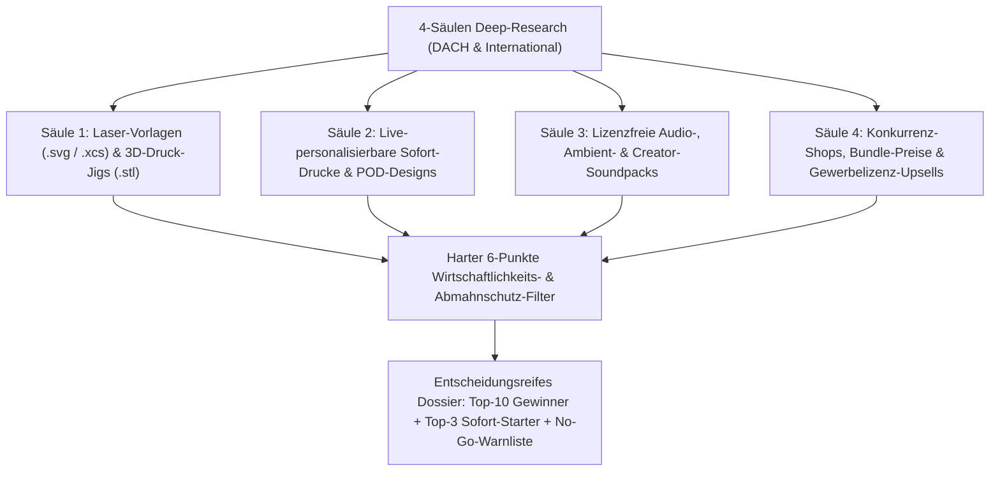

# Konzept: Umfangreiche Markt-, Konkurrenz- & Nischenanalyse für Digitale Produkte

**Datum:** 16.11.2026  
**Autor:** Falcone (Technischer Mitgründer & Chef-Architekt) · **Research-Leitung:** Globi  
**Auftrags-ID:** `ag_20261116_193337_c18c676f`  
**Status:** 📋 Konzept vorgelegt (Warte auf explizites „Go“ von Alina)

---

## 1. Zielsetzung & Ehrlicher Mitgründer-Mehrwert

Der Markt für digitale Downloads ist zweigeteilt: Auf der einen Seite gibt es völlig überlaufene `1,99 €`-Massenware (Standard-Canva-Planer, generische KI-Cliparts), die kaum die Zahlungsgebühren deckt. Auf der anderen Seite existieren **hochprofitable Spezial-Nischen (`9,90 €` bis `49,90 €` Warenkorbwert)**, in denen Käufer für **geprüfte Qualität, sofortige Personalisierung oder gewerbliche Nutzungslizenzen** gerne zahlen.

**Dein unfairer Wettbewerbsvorteil gegenüber 99 % aller Digital-Verkäufer:**
1. **Echte Manufaktur-Hardware (xTool F2 Ultra UV + RA3 + Bambu Lab A1):** Während fast alle SVG-Verkäufer auf Etsy ihre Dateien nie selbst gelasert haben (offene Pfade, falsche Steckschlitze für `3 mm` Holz/Acryl), kannst du **praxisgeprüfte `.svg`/`.xcs`-Laserdateien & 3D-Druck-Nullpunktvorrichtungen (`.stl`)** mit echten Parameter-Tabellen anbieten.
2. **Eigener Live-2D-Konfigurator im Browser:** Kunden können sich Poster, Urkunden, Trauer-/Hochzeitskarten oder Geschenkgutscheine selbst live gestalten und erhalten 5 Sekunden nach Stripe-Zahlung ihr fertiges `300 DPI` Druck-PDF (0 Minuten Arbeit für dich!).
3. **Eigene Medien- & Sound-Pipeline (`Funkenwerk Craft`):** Lizenzfreie Audio-/Ambient-/Creator-Bundles lassen sich inklusive automatischem PDF-Lizenz-Zertifikat ausliefern.

---

## 2. Aufbau der 4-Säulen Deep-Research (Durchführung durch Globi, Produkti & Marketi)

Nach deinem „Go“ schwärmen unsere Research-Agenten parallel über reale Marktplätze (**Etsy DACH/International, Creative Fabrica, Gumroad, DesignBundles, MakerWorld/Printables, Audio-Marktplätze & Suchtrends**) aus und prüfen vier konkrete Sektoren:

### Die 4 Untersuchungsfelder im Detail:
1. **Säule 1: Laser-Vorlagen (`.svg`, `.dxf`, native xTool `.xcs`-Projekte) & Maker-Vorrichtungen (`.stl`):**
   * Analyse der meistverkauften Laser-Dateien (Geldgeschenk-Aufsteller, 3D-Lichthäuser, Hochzeits-/Geburts-Dekoration, Schiefer-Gravurvorlagen, Stecksysteme exakt für `3,0 mm` & `4,0 mm` Sperrholz/Acryl).
   * Analyse von **digitalen `.stl`-Vorrichtungen für Laser-Besitzer** (z. B. xTool F2 / S1 / F1 / M1 Zentrier-Schablonen für Schieferplatten, Hundemarken, Kugelschreiber & Gläser: extrem kaufkräftige Zielgruppe mit kaum deutscher Konkurrenz!).
2. **Säule 2: Personalisierbare Instant-Prints & Print-on-Demand (POD) Designs:**
   * Welche Nischen (Seelentröster/Gedenkprints, Haustier-Porträtvorlagen, Hochzeits-Willkommensschilder, Familien-Stammbäume, Tauf-/Geburtsposter, Humor-/Berufs-Shirts) erzielen stabile Preise ab `12,90 €` statt Cent-Beträgen?
   * Vergleich: Reine Digital-Datei für Endkunden vs. fertige POD-Design-Bundles inkl. Kleingewerbe-Lizenz.
3. **Säule 3: Audio, Soundpools & Meditations-/Creator-Pakete:**
   * Ehrliche Prüfung der Zahlungsbereitschaft: Wo wird Audio durch kostenlose KI-Tools entwertet (Warnung vor Fehlinvestition!) und wo zahlen YouTuber, Podcaster, Hochzeitsredner, Trauerredner, Kosmetik-/Yogastudios oder Streamer heute noch gutes Geld für kuratierte, sofort rechtssicher lizenzierte Audio-Pakete (inkl. PDF-Freigabezertifikat für YouTube/Instagram)?
4. **Säule 4: Konkurrenz-Demontage & Preispsychologie:**
   * Auswertung echter Top-Verkäufer: Wie schnüren sie **Mega-Bundles (`19,90 €` bis `39,90 €`)**? Wie funktioniert der **Kleingewerbe-Lizenz-Hebel** (z. B. Privatnutzung `9,90 €`, gewerbliche Lizenz bis 200 Stück `29,90 €`)? Was bemängeln Käufer in `1- bis 3-Sterne-Bewertungen` am häufigsten, sodass wir es sofort besser machen?

---

## 3. Harte Bewertungskriterien (Kein Schönreden!)

Jede untersuchte Produktidee erhält eine ungeschönte Mitgründer-Bewertung nach 6 Kriterien:
1. **Reale Nachfrage & Bewertungs-Geschwindigkeit** (Kaufen echte Menschen das aktuell jede Woche?)
2. **Konkurrenzdruck & Kopierschutz** (Wie leicht austauschbar ist die Datei?)
3. **Realistischer Netto-Erlös pro Verkauf** (Ziel: mindestens `9,90 €` bis `39,90 €` über Bundles/Lizenzen)
4. **Erstellungsaufwand & Automatisierungsgrad** in unserem Ökosystem
5. **100 % Rechtssicherheit** (Urheberrecht, Markenfreiheit, GEMA-Freiheit, klare Lizenzbedingungen)
6. **Cross-Selling-Potenzial** zu `Mein-Seelenfunke`

---

## 4. Ergebnis-Lieferumfang nach deinem „Go“

Du erhältst einen strukturierten, komplett entscheidungsreifen Abschlussbericht unter `Abschlussberichte/Produkte/Produkte_Marktanalyse_Digitale_Bestseller.md` mit:
1. **Schonungsloser No-Go-Liste:** Welche Digital-Kategorien heute Zeitverschwendung sind (und warum).
2. **Top-10 Digital-Produkt-Gewinnern** (mit konkreten Marktbeispielen, Preisempfehlung, Lizenzmodell und exakter Konkurrenz-Lücke).
3. **Deiner klaren Mitgründer-Startempfehlung („Die Top 3 für Woche 1“):** Welche 3 digitalen Produktlinien den höchsten Sofort-Ertrag bei geringstem Zeitaufwand auf deiner neuen Digital-Domain bringen.

*(Hinweis: Da es sich um eine sehr tiefe Mehr-Quellen-Recherche handelt, kann parallel auch `/boost` oder unser paralleles Research-Orchester unter `Globi` genutzt werden.)*

**Bereit für den Start:** Gib mir einfach ein kurzes **„Go für die Digital-Marktanalyse“** (gerne auch mit Hinweis, falls dich eine weitere spezielle Nische besonders reizt)!
