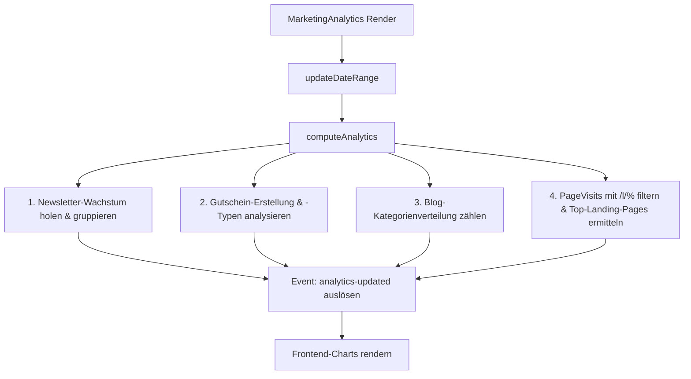

# Marketing - Analyse

Dieses Dokument beschreibt die technische Struktur und den Datenfluss des Marketing-Analyse-Moduls im Laravel-Projekt. Das Modul bereitet Marketing-Kennzahlen (Newsletter-Wachstum, Gutscheingenerierung, Blog-Kategorienverteilung, Gutscheintypen und Landing-Page-Aufrufe) für das Backend-Dashboard auf.

## Zielsetzung
Das Analyse-Modul bietet Administratoren eine aggregierte Übersicht über die Performance laufender Marketing-Aktivitäten. Durch die zeitliche Filterung (7, 30, 90, 365 Tage oder Gesamtlaufzeit) lassen sich Trends im Kundenverhalten und der Erfolg von Kampagnen ablesen.

---

## Beteiligte Komponenten & Modelle

### Livewire-Controller
* [MarketingAnalytics](file:///wsl.localhost/Ubuntu/home/ubuntuxina/meine-projekte/seelenfunke/app/Livewire/Shop/Marketing/MarketingAnalytics.php)
  * Verwaltet den Zustand der Filtereinstellungen (`$dateRange`).
  * Berechnet in `computeAnalytics()` die strukturierten Statistikdaten.
  * Löst das Livewire-Event `analytics-updated` für Frontend-Diagramme (Chart.js) aus.

### Verwendete Modelle
* [MarketingNewsletterSubscriber](file:///wsl.localhost/Ubuntu/home/ubuntuxina/meine-projekte/seelenfunke/app/Models/Marketing/MarketingNewsletterSubscriber.php)
  * Wird herangezogen, um das Wachstum der verifizierten Abonnenten zu messen (`is_verified = true`).
* [MarketingVoucher](file:///wsl.localhost/Ubuntu/home/ubuntuxina/meine-projekte/seelenfunke/app/Models/Marketing/MarketingVoucher.php)
  * Liefert die Anzahl und Typen (`percentage`, `absolute`, `shipping`) der erstellten Gutscheine.
* [MarketingBlogPost](file:///wsl.localhost/Ubuntu/home/ubuntuxina/meine-projekte/seelenfunke/app/Models/Marketing/MarketingBlogPost.php)
  * Wird über die Relation `category` geladen, um die Verteilung von Blog-Artikeln nach Kategorien aufzuzeigen.
* [PageVisit](file:///wsl.localhost/Ubuntu/home/ubuntuxina/meine-projekte/seelenfunke/app/Models/Tracking/PageVisit.php)
  * Zeichnet Seitenaufrufe im Frontend auf. Aufrufe mit dem Pfadmuster `/l/%` werden als Landing-Page-Visits gefiltert und ausgewertet.
* [MarketingLandingPage](file:///wsl.localhost/Ubuntu/home/ubuntuxina/meine-projekte/seelenfunke/app/Models/Marketing/MarketingLandingPage.php)
  * Wird genutzt, um Landing-Page-Pfade zu Namen und Produkten aufzulösen.

---

## Technische Funktionsweise & Datenfluss

### 1. Zeitraum-Berechnung (`updateDateRange`)
Je nach gewählter `$dateRange` (7, 30, 90, 365 Tage oder `all`) wird der Startzeitpunkt `$dateFrom` (mittels Carbon) berechnet:
* `7`: Letzte 7 Tage.
* `30`: Letzte 30 Tage.
* `90`: Letzte 90 Tage.
* `365`: Letzte 365 Tage.
* `all`: Letzte 5 Jahre.

### 2. Datenaggregations-Logik (`computeAnalytics`)
Die Methode `computeAnalytics()` wird bei jedem Rendern aufgerufen und gruppiert Daten basierend auf dem Zeitraum:
* Bei **großen Zeiträumen** (`365` oder `all`) erfolgt die Gruppierung monatlich (`Y-m`).
* Bei **kleineren Zeiträumen** erfolgt sie täglich (`Y-m-d`).

### 3. Ausgewertete Datensätze
1. **Newsletter Growth**: Ermittlung aller verifizierten Abonnenten im gewählten Intervall. Die Gruppierung erfolgt nach Datum, um eine Wachstumskurve darzustellen.
2. **Voucher Generation**: Anzahl der neu erstellten Rabattcodes.
3. **Blog Categories**: Kreisdiagramm-Daten über die Verteilung von Blog-Einträgen auf Kategorien.
4. **Voucher Types**: Verteilung der Rabattarten (`percentage` -> Prozentual, `absolute` -> Fester Wert, `shipping` -> Versandkostenfrei).
5. **Landing Page Visits**: Gesamtanzahl an Aufrufen aller Landing-Pages im Zeitraum.
6. **Top Landing Pages**: Die 4 meistbesuchten Landing-Pages werden über `PageVisit::groupBy('path')` ermittelt und mit den Produktnamen aus `MarketingLandingPage` angereichert.

---

## Frontend-Kopplung
Im zugehörigen Blade-View [marketing-analytics.blade.php](file://wsl.localhost/Ubuntu/home/ubuntuxina/meine-projekte/seelenfunke/resources/views/livewire/shop/marketing/marketing-analytics/marketing-analytics.blade.php) werden die aufbereiteten Arrays als JSON-Daten an Chart.js-Instanzen übergeben. Das Event `analytics-updated` triggert bei Updates ein Re-Rendering der Diagramme.

---

## 4. Funkenwerk Integration & KI-Wissensdatenbank (Stand: 05.11.2026)

Um das Laravel-Webportal schlank zu halten (die älteren Web-Module `MarketingGoogleAds` und `MarketingInstagram` werden nicht weiter aufgebläht), ist die operative Content-, Social-Media- und Wettbewerbs-Strategie zweistufig verankert:

1. **KI-Wissensdatenbank ([`AiKnowledgeBaseSeeder.php`](file://wsl.localhost/Ubuntu/home/ubuntuxina/meine-projekte/seelenfunke/database/seeders/AiKnowledgeBaseSeeder.php)):**
   - Eigene Kategorie **`Marketing, Social Media & Viral-Strategie`** mit den Master-Dossiers `marketing-masterplan-meinseelenfunke-2026` und `marketing-top20-accounts-und-37-fragen-analyse`.
   - Enthält das komplette Wissen zu `@meinseelenfunke`, der White-Glove-Werkstatt-Signatur (weiße Handschuhe, xTool F2 Ultra UV, schwarze matte Westpack-Schmuckschachteln), den 3 CapCut-Pro-Master-Vorlagen, den 20 Top-Benchmark-Accounts (TikTok & Instagram) sowie dem 37-Punkte-Röntgenkatalog.

2. **Funkenwerk Desktop-Modul Space #8 ([`MarketingEngine.cs`](file://wsl.localhost/Ubuntu/home/ubuntuxina/meine-projekte/seelenfunke/funkenwerk/MarketingEngine.cs) & [`MainWindow.xaml`](file://wsl.localhost/Ubuntu/home/ubuntuxina/meine-projekte/seelenfunke/funkenwerk/MainWindow.xaml)):**
   - **Tagesempfehlung ganz oben (`🎬 HEUTE DREHEN`):** Zeigt ohne Suchaufwand sofort das heutige Video-Rezept in 4 klaren Schritten (*1. Bereitlegen, 2. Hook 0–3s, 3. Aufnahme 3 Clips, 4. CapCut & Posten*) inkl. 1-Klick-Buttons für *Produkt wechseln*, *🎄 Saison-Motto*, *🔄 Shop-Sync*, *Caption kopieren*, *Kamera öffnen*, *In To-Do übernehmen* und *Als gedreht markieren*.
   - **Endlos-Rotation (`Runde 1, 2, 3...`):** Sobald alle Drehtage erledigt sind, startet automatisch die nächste Runde mit neuen Produkt-Kombinationen aus allen aktiven Shop-Produkten.
   - **Dynamische Shop-Produkt-, Jahreszeiten- & Feiertags-Synchronisation (`GET /api/funki/marketing/live-context` via [`HolidayOfferAutopilotService.php`](file://wsl.localhost/Ubuntu/home/ubuntuxina/meine-projekte/seelenfunke/app/Services/Marketing/HolidayOfferAutopilotService.php)):**
     - **Automatische Produkt-Integration:** Jedes neu im Shop (`/admin/products`) angelegte physische Produkt wird beim Start von Funkenwerk oder per `🔄 Shop-Sync` automatisch erkannt. Funkenwerk berechnet aus Verkaufspreis, Einkaufspreis, Laser-/Arbeitskosten und Verpackung live den **Netto-Deckungsbeitrag**, den **Ziel-CPA**, den **Max. Stopp-CPA** sowie die **Ads-Rolle** (`ZUGPFERD` ab >= 15 € Netto-DB vs. `ORGANISCH / BUNDLE`), erkennt das nötige Werkstatt-Equipment (`xTool RA3 Rotationsmodul`, `Schwarze Westpack-Box`, `LED-Leuchtsockel`), verknüpft die `/l/{slug}`-Landingpage und fügt automatisch ein fertiges 4-Schritte-Drehrezept in den Drehplan und die Produkt-Rotation ein.
     - **Automatische Jahreszeiten & 11 Shop-Feiertage:** Koppelt den Marketing-Plan direkt an die 4 Shop-Jahreszeiten (`Frühling`, `Sommer`, `Herbst`, `Winter` inkl. Override aus `/admin/configuration`) sowie an alle **11 Feiertags-Kampagnen** aus `HolidayOfferAutopilotService` (*Valentinstag, Weltfrauentag, Ostern, Muttertag, Vatertag, Summer Sale, Halloween, 1. Advent, Weihnachten, Silvester/Neujahr, Winter Sale*) inkl. Countdown, Manufaktur-Versand-Cutoff und 1-Klick-Button **`🎄 Saison-Motto`** (webt saisonalen Hook, Lieferfrist-Hinweis und Hashtags direkt in das heutige Video-Rezept ein). Besitzt zusätzlich eine identische lokale C#-Kalender-Engine (inkl. Gaußscher Osterformel & 1. Advent) für 100 % Offline-Fähigkeit.
   - **Interaktive 4x3 Marketing-Routine (`1x Tag · 1x Woche · 1x Monat`):** Eigenes Routine-Board für *1x am Tag* (Posten, Kommentare beantworten, Skip-Rate & Views prüfen, 10 Min. Fokus-Scrolling), *1x die Woche* (Fester Werkstatt-Drehtag, Live Q&A / Live-Gravur, Top 3 Performer identifizieren, 5 Benchmark-Videos speichern) und *1x im Monat* (Content-Säulen Update, Community-Challenge, Volle Content-Analyse, 3 neue Formate testen) – mit automatischem Tages-, Wochen- und Monats-Reset sowie 1-Klick-To-Do-Übernahme.
   - **6 aufgeräumte Ansichten:** `🎬 Drehplan`, `⚡ Routine (Tag · Woche · Monat)`, `🏆 Top 20 Accounts (200 Videos)`, `🔬 37-Punkte Röntgen`, `✂️ CapCut & @meinseelenfunke` sowie `🚀 Ads & Influencer` (inkl. dynamischer Produkt-CPA-Matrix & Saison-Kampagnen-Fokus).
   - **Tokenarme Offline-Persistenz:** Alle Daten, Shop-Produkte, Feiertags-Kontexte und SHA-256-gecachten Analysen liegen lokal in `%LocalAppData%\Funkenwerk\MarketingVault\market_intelligence.json` (0 Tokens beim Öffnen, Filtern und täglichen Arbeiten).

---

## 5. Influencer & Affiliate Hub + 100 % Gratis-Muster (PR-Sample) Workflow (Stand: 05.11.2026)

Für handverlesene Creator, die per 2-Faktor-Einladungslink (`/partner/einladung/{token}`) ins Partnerprogramm aufgenommen werden, ist ein geschlossener **100 % Gratis-Muster (PR-Sample) & 3D-Konfigurator-Test**-Prozess integriert:

1. **Einladung & Freigabe (`/admin/marketing/influencer`):**
   - Neue Creator-Einladungen (`createInvitationSlot`) erhalten standardmäßig `sample_granted = true` (jederzeit im Einladungs- und Konfigurations-Modal umschaltbar oder über *„Neues 100 % Muster freigeben“* reaktivierbar).
2. **Verlinkungs- & Kooperationsvereinbarung im Creator Cockpit (`/employee/influencer/dashboard`):**
   - Sobald die Lieferadresse hinterlegt ist, bestätigt der Creator per Checkbox (`sample_terms_accepted_at`) die verbindliche Vereinbarung: Veröffentlichung von mindestens einer Story, einem Reel oder Beitrag innerhalb von **14 Tagen nach Erhalt** mit Verlinkung auf **Mein Seelenfunke** + persönlichem Kurzlink/Code, Werbekennzeichnung (`Werbung` / `Anzeige` gem. § 5a Abs. 4 UWG) und Repost-Erlaubnis.
   - Mit der Bestätigung wird automatisch ein persönlicher Einmal-Gutschein (`SAMPLE-{SLUG}-{RAND}`, `trigger_event = 'influencer_sample'`, `usage_limit = 1`) generiert.
3. **1-Klick-Start im 3D-Konfigurator & 0,00 € Checkout (`/checkout`):**
   - Über den Button *„Muster gestalten“* in der Produkttabelle wird der `SAMPLE-...`-Code automatisch in Warenkorb/Session hinterlegt und das Produkt im 3D-Konfigurator geöffnet.
   - Im Checkout werden Name, E-Mail und Lieferadresse des eingeloggten Creators (`Auth::guard('employee')`) vorausgefüllt. `CartService` rabattiert exakt **1 physisches Unikat (100 %) + Standardversand (100 %)** auf `0,00 €` (ohne Provisionsgutschrift).
4. **3D-Konfigurator-Feedback & Verlinkungs-Nachweis:**
   - Nach der Bestellung zeigt das Creator Cockpit den Live-Produktions- und DHL-Versandstatus inkl. 14-Tage-Frist.
   - Der Creator gibt dort sein **3D-Konfigurator-Feedback** (1 bis 5 Sterne + Freitext) sowie den **Link zum veröffentlichten Beitrag** (`sample_post_url`) ab, der im Admin-Hub und im Operativen Status (`/admin/dashboard`) zur 1-Klick-Prüfung (`Verlinkung bestätigen ✓`) erscheint.
