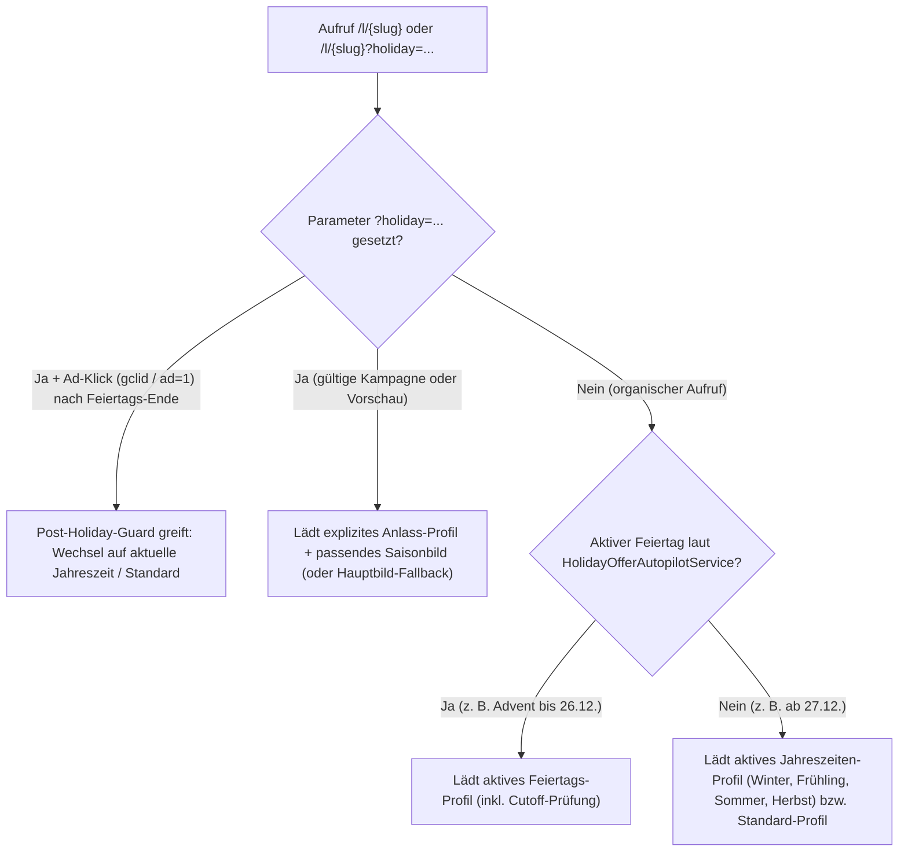

# Marketing: Dynamische Produkt-Landingpages (`/l/{slug}` mit 13 Vorlagen-Profilen)

**Stand:** 15.11.2026  
**System:** Mein-Seelenfunke (`MarketingLandingPage.php`, `LandingPageView.php`, `MarketingLandingPages.php`, `Product.php`)

---

## 1. Architektur-Prinzip: 1 Landingpage pro Produkt + 13 logische Vorlagen-Profile

Statt für jedes Produkt dutzende einzelne Landingpages für Jahreszeiten und Feiertage zu pflegen, besitzt jedes aktive Produkt **genau eine dauerhafte URL `/l/{slug}`**, die über das JSON-Feld `seasonal_profiles` in [`MarketingLandingPage.php`](file://wsl.localhost/Ubuntu/home/ubuntuxina/meine-projekte/seelenfunke/app/Models/Marketing/MarketingLandingPage.php) **13 logische Vorlagen-Profile** steuert:

* **1x Standard (Zeitlos / Evergreen-Fallback):** Speicherung auf den Hauptspalten (`title`, `headline`, `sales_copy`, `cta_text`).
* **4x Jahreszeiten-Profile (`seasonal_profiles`):** `Winter`, `Frühling`, `Sommer`, `Herbst`.
* **8x Feiertags- & Anlass-Profile (`seasonal_profiles`):** `Weihnachten`, `Valentinstag`, `Ostern`, `Muttertag`, `Vatertag`, `Halloween`, `Hochzeit`, `Geburtstag`.

---

## 2. Beteiligte Komponenten & Modelle

* **Model [`MarketingLandingPage.php`](file://wsl.localhost/Ubuntu/home/ubuntuxina/meine-projekte/seelenfunke/app/Models/Marketing/MarketingLandingPage.php):**
  * Synchronisiert sich automatisch mit jedem aktiven Produkt (`syncForProduct()`).
  * Erzeugt über `generateSeasonalProfileCopy()` und `generateAllSeasonalProfiles()` abmahnsichere, emotionsstarke Vorlagentexte ohne KI-Gedankenstriche (`sanitizeLegalCopy()`).
  * Steuert über `resolveActiveProfile()` und `buildDynamicProfile()` alle Sektionen des zentralen Master-Templates (`master-template.blade.php`): SEO-Titel, Anlass-Kicker im Hero, `<h1>`-Hook, **exakt 3 kurze Vorteile mit goldenem Haken (`✓` in `#C5A059`)**, Saison-Banner, Story-Überschrift, Verkaufstext und Abschluss-CTA.
* **Frontend-Komponente [`LandingPageView.php`](file://wsl.localhost/Ubuntu/home/ubuntuxina/meine-projekte/seelenfunke/app/Livewire/Landing/LandingPageView.php) & [`master-template.blade.php`](file://wsl.localhost/Ubuntu/home/ubuntuxina/meine-projekte/seelenfunke/resources/views/livewire/landing/partials/master-template.blade.php):**
  * Rendert `/l/{slug}` strikt im freundlichen **Light-Mode** mit mattem Schwarz-Gold (`#C5A059`).
  * Erkennt bezahlte Anzeigen-Aufrufe (`gclid`, `gad_source`, `ad=1`) und aktiviert bei abgelaufenen Feiertagen automatisch den **Post-Holiday-Guard** (`isCalendarHolidayRecentlyExpired()`), damit nach einem Fest niemals veraltete Feiertagstexte oder Lieferversprechen ausgespielt werden.
  * Protokolliert Aufrufe datenschutzkonform in [`PageVisit.php`](file://wsl.localhost/Ubuntu/home/ubuntuxina/meine-projekte/seelenfunke/app/Models/Tracking/PageVisit.php) mit 1-Stunden-IP-Hash-Sperre.
* **Admin-Komponente [`MarketingLandingPages.php`](file://wsl.localhost/Ubuntu/home/ubuntuxina/meine-projekte/seelenfunke/app/Livewire/Shop/Marketing/MarketingLandingPages.php) (`/admin/marketing-landing-pages`):**
  * Zeigt in Groß-, Mittel- und Listenansicht das aktuell aktive Vorlagen-Profil sowie eventuelle Bild-Fehlhinweise direkt auf der Kachel an.
  * Bietet im `Bearbeiten`-Modal einen **13-Profile-Umschalter**, Direkt-Vorschau (`/l/{slug}?holiday=...`), `127.0.0.1`-sicheres Link-Kopieren, `Profil aktiv`-Schalter und Einzelprofil-Speicherung (`Profil speichern`).
* **Produktbild-Kaskade in [`Product.php`](file://wsl.localhost/Ubuntu/home/ubuntuxina/meine-projekte/seelenfunke/app/Models/Product/Product.php):**
  * `resolveMainImageMeta()` prüft im aktiven Feiertagsfenster zuerst das Feiertagsbild, danach das Jahreszeitenbild und fällt bei fehlendem Folge-Saisonbild (z. B. am `27.12.` nach Weihnachten, wenn `Winter` noch fehlt) **sofort auf das neutrale Hauptbild (`is_main = true`)** zurück.
  * `getSeasonalImageSetStatus()` und `getReadinessReport()` melden direkt am Produkt (`active_missing_label`, `fallback_active`), welches Jahreszeiten- oder Feiertagsbild aktuell noch fehlt.

---

## 3. Auflösungs-Reihenfolge beim Aufruf von `/l/{slug}`

---

## 4. Verzahnung mit dem Google-Ads-Konzept

Die vollständige Strategie für Google Search Ads, Google Shopping Feed (`/feed/google-shopping.xml`), Echtfoto-Gatekeeper und Versand-Cutoff-Pausierung ist dokumentiert unter:
* [`Konzept_Google_Ads_Autopilot_und_Merchant_Strategie.md`](file://wsl.localhost/Ubuntu/home/ubuntuxina/meine-projekte/seelenfunke/Abschlussberichte/Konzepte/Konzept_Google_Ads_Autopilot_und_Merchant_Strategie.md)
