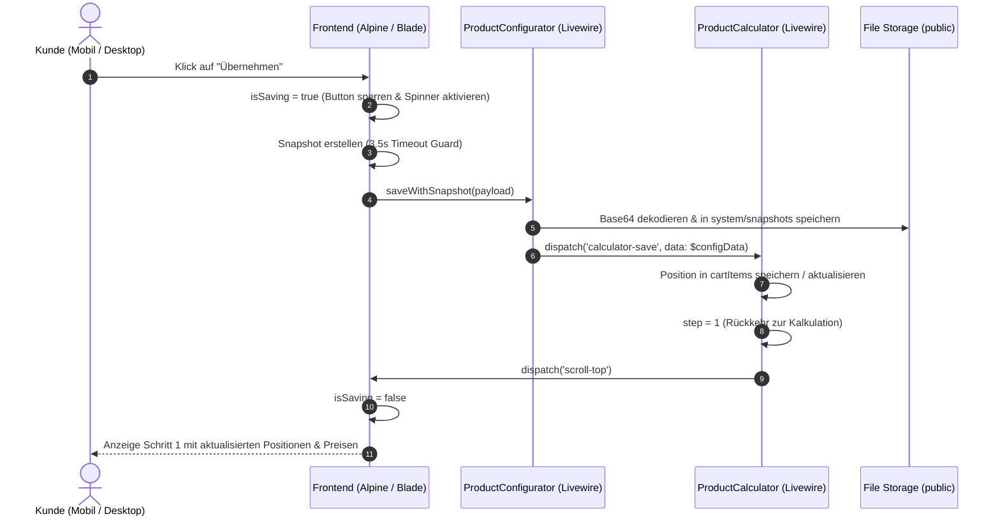

# Abschlussbericht: Produktkonfigurator & Product-Calculator Integration

**Datum:** 05. Oktober 2026  
**Bereich:** Produkte / Konfigurator (`ProductConfigurator`) & Mengenrechner (`ProductCalculator`)  
**Status:** Erfolgreich implementiert, bereinigt und automatisiert getestet  

---

## 1. Übersicht & Zielsetzung

Der Produktkonfigurator (`ProductConfigurator`) ist das zentrale Tool zur visuellen Personalisierung von Artikeln im Shop (2D-Canvas- und 3D-Three.js-Vorschau, Textgravuren, Logouploads, beidseitige Bearbeitung).

Er wird in zwei zentralen Anwendungsfällen betrieben:
1. **B2C-Direktkauf (`context="add"` / `context="edit"`):** Kunden konfigurieren Einzelartikel direkt auf der Produktdetailseite und legen sie in den regulären Warenkorb.
2. **B2B-Mengenrechner (`context="calculator"`):** Innerhalb des `ProductCalculator` (Schritt 2: „Design-Vorschau“) wird der Konfigurator als Sub-Komponente eingebunden, um Staffelpreise, Großmengen und individuelle Angebote mit Personalisierungsdaten anzureichern.

Ziel dieser Maßnahme war es:
- Den „Übernehmen“-Button auf Mobilgeräten fehlerfrei bedienbar zu machen.
- Eine klare visuelle Ladeanimation zu integrieren, um Verwirrung und Mehrfachklicks (Double-Submissions) zu unterbinden.
- Ein kritisches Einfrieren („Wird übernommen...“) im Schritt „Design-Vorschau“ des Produkt-Calculators vollständig zu beheben.
- Die gesamte Kette durch automatisierte Feature- und Integrationstests dauerhaft abzusichern.

---

## 2. Problemstellungen & Ursachenanalyse

### Problem 1: Button reagiert mobil nicht / Doppel-Klicks
- **Symptom:** Nutzer auf Smartphones konnten den Übernehmen-Button scheinbar nicht betätigen, oder es kam durch wiederholtes Tippen zu unkontrollierten Zuständen.
- **Ursachen:**
  1. *Fehlende visuelle Laderückmeldung:* Das Rendern von 2D-/3D-Snapshots auf rechenschwächeren Mobilgeräten benötigt 300–1.500 ms. Mangels sichtbarem Ladezustand klickten Nutzer mehrfach.
  2. *Widerrufs-Checkbox-Blockade:* Im Rechner-Kontext (`context="calculator"`) war im Backend noch die Validierungsprüfung auf `$config_confirmed` aktiv. Da die Checkbox für den B2B-Rechner irrelevant ist bzw. im UI ausgeblendet wurde, schlug das Speichern im Hintergrund stillschweigend fehl.

### Problem 2: Hängenbleiben in der „Design-Vorschau“ (Endlos-Spinner)
- **Symptom:** Nach dem Klick auf „Übernehmen“ wechselte der Button zu `Wird übernommen...`, der Ladekreis drehte sich endlos, und der Rechner wechselte nicht wie vorgesehen zurück zu Schritt 1.
- **Ursachenanalyse via Frontend-Error-Tracking (`SystemLog`):**
  ```text
  Frontend JS Error: Uncaught ReferenceError: snapshotBase64 is not defined
  Frontend Promise Error: snapshotBase64 is not defined
  ```
- **Technische Ursache:** In `scripts_frontend_1.blade.php` war die Variable `let snapshotBase64 = null;` innerhalb einer inneren Funktion/Block deklariert. Beim anschließenden Zusammenstellen des Payloads (`if (snapshotBase64) payload.front = snapshotBase64;`) trat ein `ReferenceError` auf.
- **Folge:** Das JavaScript brach ab, bevor der Livewire-Call `$wire.saveWithSnapshot(payload)` abgesetzt werden konnte. Da der Abbruch außerhalb des Fehler-Handlings lag, blieb `isSaving = true` dauerhaft bestehen und das Event `calculator-save` wurde nie an den übergeordneten `ProductCalculator` gefeuert.

---

## 3. Technische Lösungsarchitektur

### 3.1 Frontend & Alpine.js Optimierungen

1. **Reaktiver Ladezustand & Klickschutz:**
   - In `scripts_frontend_1.blade.php` wurde `isSaving: false` im Alpine-Scope etabliert.
   - Am Anfang von `submitConfig()` blockiert ein Guard sofort jede Folgeaktion:
     ```javascript
     if (this.isSaving) return;
     this.isSaving = true;
     ```
2. **Korrektur des Scopes & globale Fehlerabsicherung:**
   - `snapshotBase64` und `snapshotBackBase64` sind nun ganz oben in `submitConfig()` deklariert.
   - Der gesamte Ablauf ist in einem `try ... finally { this.isSaving = false; }` gekapselt, sodass der Zustand selbst bei Ausnahmen immer sauber zurückgesetzt wird.
3. **Mobile Timeout-Guard (3,5 Sekunden):**
   - Das Erstellen der Snapshots (Three.js WebGL / html2canvas) wird via `Promise.race` gegen einen 3,5-Sekunden-Timeout abgesichert.
   - Sollte ein Mobilgerät die Canvas-Projektion nicht rechtzeitig abschließen, bricht der Vorgang nicht ab, sondern speichert die Konfiguration zuverlässig ohne Snapshot weiter.
4. **Visuelles Feedback im Footer (`footer.blade.php`):**
   - Animierter SVG-Spinner und pulsierender Text: `Wird übernommen...`.
   - Button erhält `:disabled="isSaving"`, `cursor-wait` und `pointer-events-none`.
   - Die Widerrufsrecht-Checkbox wird im Modus `context="calculator"` vollständig ausgeblendet und gilt standardmäßig als genehmigt.

### 3.2 Backend-Logik (`ProductConfigurator.php` & `ProductCalculator.php`)

1. **`ProductConfigurator::mount()`:**
   - Automatische Vorbelegung von `$config_confirmed = true`, sobald `$context === 'calculator'`.
2. **`ProductConfigurator::save()`:**
   - Die Validierung `if ($this->context !== 'calculator' && !$this->config_confirmed)` schließt den Rechner-Modus explizit von der Endkunden-Widerrufsbestätigung aus.
   - Nach erfolgreicher Transaktion wird das Event ausgelöst:
     ```php
     $this->dispatch('calculator-save', data: $configData);
     ```
3. **`ProductCalculator::saveItemFromConfigurator()`:**
   - Hört auf `#[On('calculator-save')]`.
   - Speichert oder aktualisiert die Position in `$this->cartItems`.
   - Setzt `$this->step = 1`, berechnet Summen und Rabatte neu und scrollt die Seite nach oben (`$this->dispatch('scroll-top')`).

---

## 4. Datenfluss & Sequenz



---

## 5. Testabdeckung & Verifikation

Zur dauerhaften Absicherung wurde eine automatisierte Feature- und Integrationstest-Suite erstellt:

**Datei:** [`tests/Feature/Livewire/Shop/Product/ProductConfiguratorCalculatorIntegrationTest.php`](file:///wsl.localhost/Ubuntu/home/ubuntuxina/meine-projekte/seelenfunke/tests/Feature/Livewire/Shop/Product/ProductConfiguratorCalculatorIntegrationTest.php)

### Getestete Szenarien:
1. `configurator_in_calculator_mode_auto_confirms_and_dispatches_calculator_save`:
   Verifiziert, dass der Konfigurator im Rechner-Modus ohne manuelle Checkbox speichert und `calculator-save` mit Texten, Mengen und Produkt-IDs auslöst.
2. `configurator_in_add_mode_requires_manual_confirmation_checkbox`:
   Stellt sicher, dass der reguläre B2C-Warenkorb weiterhin zwingend die Checkbox-Bestätigung verlangt und bei fehlender Bestätigung validiert.
3. `configurator_processes_snapshots_and_stores_in_filesystem`:
   Prüft die Base64-Snapshot-Verarbeitung (Vorder- und Rückseite) und die physische Ablage im öffentlichen Storage unter `system/snapshots/`.
4. `product_calculator_transitions_from_step_2_back_to_step_1_upon_calculator_save`:
   Testet den gesamten Lebenszyklus im Rechner: Schritt 1 $\rightarrow$ `openConfig` (Schritt 2) $\rightarrow$ Event `calculator-save` $\rightarrow$ automatischer Rücksprung auf Schritt 1, Mengenprüfung und anschließende Aktualisierung (`editItem`).
5. `non_personalizable_product_bypasses_configurator_directly_into_calculator_cart`:
   Stellt sicher, dass Produkte ohne Personalisierung (`is_personalizable = false`) den Konfigurator automatisch überspringen und direkt in den Rechner übernommen werden.

### Test-Ergebnisse:
```bash
docker.exe exec mein_php_server php artisan test tests/Feature/Livewire/Shop/Product/ProductCalculatorTest.php tests/Feature/Livewire/Shop/Product/ProductConfiguratorCalculatorIntegrationTest.php
```
```text
PASS  Tests\Feature\Livewire\Shop\Product\ProductCalculatorTest
✓ it can calculate multiple products and volumes                       0.27s  
✓ it handles express delivery and validation                           0.08s  
✓ it submits quote and sends mails                                     0.11s  
✓ it saves item tax rate and preserves quote price in checkout         0.24s  
✓ it copies tax rate on backend conversion                             0.16s  
✓ it embeds product images in quote calculation pdf                    0.14s  

PASS  Tests\Feature\Livewire\Shop\Product\ProductConfiguratorCalculatorIntegrationTest
✓ configurator in calculator mode auto confirms and dispatches calcul… 0.11s  
✓ configurator in add mode requires manual confirmation checkbox       0.11s  
✓ configurator processes snapshots and stores in filesystem            0.08s  
✓ product calculator transitions from step 2 back to step 1 upon calc… 0.12s  
✓ non personalizable product bypasses configurator directly into calc… 0.07s  

Tests:    11 passed (66 assertions)
Duration: 1.64s
```

---

## 6. Fazit & Ausblick (Konfigurator & Rechner)

- Der mobile Übernehmen-Button reagiert nun unmittelbar und verhindert Doppel-Klicks zuverlässig.
- Das Einfrieren im Schritt „Design-Vorschau“ wurde durch Behebung des Scoping-Fehlers und Absicherung gegen Timeouts dauerhaft gelöst.
- Der Wechsel zwischen B2B-Kalkulator und Produktkonfigurator funktioniert nahtlos in beide Richtungen (Neuanlage und Bearbeitung bestehender Positionen).

---

## 7. Bilddarstellung im Angebots-PDF und der E-Mail (3D-Ansicht vs. Fallback)

### 7.1 Problemstellung & Fehleranalyse
Beim Erstellen von Angeboten über den Kalkulator (z. B. Anfrage `#AN-2026-SLEEJ`) wurde im generierten Angebots-PDF (`calculation_pdf_template.blade.php`) und in den Benachrichtigungs-Mails (`new_calc_mail_to_customer.blade.php`, `new_calc_mail_to_admin.blade.php`) fälschlicherweise das Standard-Katalogbild (z. B. `seelen-kristall_b.jpg` mit dem Mustertext „Sophia & Alexander“) anstelle der individuellen 3D-Vorschau (z. B. gravierter Kristall mit „Frohe Weihnachten! - Familie Mustermann -“) angezeigt.

**Ursachenanalyse:**
1. **Pfadpräfix-Mismatch (`snapshots/` vs. `system/snapshots/`):**
   In der Datenbank (`product_templates`) und teils in Konfigurationen waren Vorlagen-Snapshots mit dem Pfad `snapshots/<uuid>_front.jpg` hinterlegt. Das physische Ablageverzeichnis lautet jedoch `storage/app/public/system/snapshots/`.
   In `mail_item_list.blade.php` suchte die Datei-Auflösung nach `storage/snapshots/...` bzw. `app/public/snapshots/...`, schlug fehl und fiel bei der PDF-Generierung auf eine externe HTTP-URL zurück, die DomPDF im Docker-Container nicht auflösen konnte (404 / Verbindungsabbruch).
2. **Überschreiben vorhandener Snapshots in `ProductConfigurator.php`:**
   Wurde ein Artikel aus einer Vorlage geladen oder im Rechner übernommen, ohne dass die 3D-Engine sofort einen neuen Snapshot lieferte (z. B. wenn der Kunde keine Änderungen vornahm), wurde `snapshot_path` in `save()` mit einem leeren Array `[]` überschrieben. Dadurch griff `mail_item_list.blade.php` mangels vorhandenem Snapshot immer auf `main_image` zurück.
3. **Fehlende Skript-Vorabladung auf `/calculator`:**
   Auf der Rechner-Seite (`calculator.blade.php`) fehlten die Bundles `admin-bundle.js` und `html2canvas.min.js`. Beim dynamischen Livewire-Wechsel auf Schritt 2 („Design-Vorschau“) war Three.js unter Umständen noch nicht einsatzbereit, wodurch `submitConfig()` in den 2D-Fallback lief und keine Snapshots erzeugte.

---

### 7.2 Durchgeführte Maßnahmen & Implementierung

1. **Pfad-Normalisierung & Base64-Auflösung in [`mail_item_list.blade.php`](file:///wsl.localhost/Ubuntu/home/ubuntuxina/meine-projekte/seelenfunke/resources/views/global/mails/partials/mail_item_list.blade.php):**
   - Automatische Erkennung und Normalisierung von Snapshots: Pfade mit `snapshots/` werden transparent als `system/snapshots/` aufgelöst.
   - DomPDF-Base64-Inlining: Liegt ein Snapshot auf der Festplatte, wird er im PDF-Modus (`isPdf = true`) direkt als Base64 Data URI (`data:image/jpeg;base64,...`) eingebunden.
   - Mail-URL-Auflösung: In HTML-E-Mails erzeugt `asset('storage/' . $cleanRelPath)` stets die korrekte, öffentlich erreichbare URL.
   - **Strikte Fallback-Hierarchie:** Wenn ein 3D-Snapshot existiert, wird **nur** dieser dargestellt. Das Katalog-Produktbild (`main_image`) dient als reiner Fallback und wird nur angezeigt, wenn gar kein Snapshot vorhanden ist (z. B. bei Standard-Artikeln ohne Personalisierung). Beide Bilder werden niemals gleichzeitig dargestellt.

2. **Snapshot-Erhalt in [`ProductConfigurator.php`](file:///wsl.localhost/Ubuntu/home/ubuntuxina/meine-projekte/seelenfunke/app/Livewire/Shop/Product/ProductConfigurator/ProductConfigurator.php):**
   - Eigenschaft `public $snapshot_path = [];` hinzugefügt.
   - In `mount()` wird ein existierender Snapshot aus `$initialData['snapshot_path']` geladen.
   - In `save()` wird `$finalSnapshotPath = !empty($snapshotPath) ? $snapshotPath : $this->snapshot_path;` verwendet, sodass bestehende Snapshots niemals durch ein leeres Array überschrieben werden.

3. **3D-Engine Synchronisation & Preloading:**
   - In `resources/views/frontend/pages/calculator.blade.php` wurden `admin-bundle.js` und `html2canvas.min.js` eingebunden.
   - In `scripts_frontend_1.blade.php` wartet `submitConfig()` aktiv auf die Initialisierung der 3D-Engine (`Configurator3DEngine`), bevor Snapshots gerendert werden.

4. **Datenbankbereinigung (`product_templates`):**
   - Vorhandene Vorlagen mit fehlerhaftem Präfix wurden von `"snapshots/` auf `"system/snapshots/` migriert.
   - In `ProcessOrderDocumentsAndMails.php` wurde dieselbe Normalisierung implementiert, um auch E-Mail-Anhänge für Bestellungen abzusichern.

---

### 7.3 Testabdeckung & Verifikation

Ein dedizierter Test wurde implementiert:
**Datei:** [`tests/Feature/Livewire/Shop/Product/QuoteMailPdfImageRenderingTest.php`](file:///wsl.localhost/Ubuntu/home/ubuntuxina/meine-projekte/seelenfunke/tests/Feature/Livewire/Shop/Product/QuoteMailPdfImageRenderingTest.php)

**Getestete Fälle:**
1. `quote_renders_only_3d_snapshot_and_no_catalog_fallback_when_snapshot_exists`:
   Prüft, dass bei vorhandenem Snapshot nur die 3D-Ansicht gerendert wird und das Katalog-Bild ausgeschlossen ist. Prüft zusätzlich die Base64-Codierung im PDF und den fehlerfreien PDF-Export via DomPDF.
2. `quote_renders_snapshot_even_when_legacy_path_missing_system_prefix`:
   Prüft die Normalisierung von Legacy-Pfaden (`snapshots/...`) zu `system/snapshots/...` in Mail und PDF.
3. `quote_falls_back_to_product_image_only_when_no_snapshot_exists`:
   Prüft das korrekte Fallback-Verhalten auf das Katalogbild bei nicht-personalisierten Artikeln.
4. `configurator_preserves_initial_snapshot_when_saved_without_new_capture`:
   Prüft, dass bestehende Snapshots bei Re-Saves ohne neue Canvas-Aufnahme nicht überschrieben werden.

**Testergebnis der gesamten Produkt-Suite:**
```text
PASS  Tests\Feature\Livewire\Shop\Product\ProductCalculatorCapacityTest (3 Tests)
PASS  Tests\Feature\Livewire\Shop\Product\ProductCalculatorTest (6 Tests)
PASS  Tests\Feature\Livewire\Shop\Product\ProductConfiguratorCalculatorIntegrationTest (5 Tests)
PASS  Tests\Feature\Livewire\Shop\Product\ProductCreateTest (9 Tests)
PASS  Tests\Feature\Livewire\Shop\Product\QuoteMailPdfImageRenderingTest (4 Tests)

Tests:    27 passed (146 assertions)
Duration: 17.92s
```

---

## 8. Intelligente Foto-Qualitätsampel (20. Oktober 2026)

### 8.1 Problemstellung: Starre Pixel-Warnung
Bisher enthielt der Dateiupload-Bereich im Konfigurator ([`formluar.blade.php`](file://wsl.localhost/Ubuntu/home/ubuntuxina/meine-projekte/seelenfunke/resources/views/livewire/shop/product/product-configurator/partials/formluar.blade.php)) eine starre Abfrage auf `width < 877 || height < 877`. Diese führte zu folgenden Problemen:
1. **Fehlalarme bei Vektordateien:** SVGs haben keine festen Pixelmaße, erhielten aber dieselbe Warnung, obwohl sie für Lasergravuren unendlich scharf und perfekt geeignet sind.
2. **Kundenverunsicherung bei Breitformaten:** Ein Foto mit z. B. 2000×600 Pixeln besitzt exzellente Schärfe, wurde aber wegen der Höhe von < 877 px mit einer Warnung versehen.

### 8.2 Lösungsarchitektur: Das Ampelsystem
In [`formluar.blade.php`](file://wsl.localhost/Ubuntu/home/ubuntuxina/meine-projekte/seelenfunke/resources/views/livewire/shop/product/product-configurator/partials/formluar.blade.php) wurde ein dreistufiges, kundenfreundliches Ampelsystem implementiert:
1. **Vektorgrafiken (SVG):**
   - Sofortiges Erkennen von `image/svg+xml`.
   - Darstellung eines violetten Qualitäts-Badges: *„Vektordatei – Höchste Schärfe für Laserarbeiten“*.
2. **Optimal geeignete Rasterbilder (Grüne Ampel):**
   - Kriterium: Bildbreite und -höhe mindestens 350 px **oder** Gesamtpixelzahl >= 200.000 px.
   - Grünes Prüfsiegel mit Haken: *„Datei ist einsatzbereit und optimal für die Gravur geeignet.“*
3. **Sehr kleine Dateien (Gelbe Ampel / Hilfestellung):**
   - Nur wenn beide Dimensionen unter 350 px liegen, wird ein gelber, konstruktiver Tipp eingeblendet:
     *„Tipp für beste Ergebnisse: Das Bild ist recht klein. Für ein gestochen scharfes Laserergebnis empfehlen wir eine höhere Auflösung.“*
   - Der Upload wird nicht blockiert, sondern der Kunde freundlich beraten.

---

## 9. 3-Modi-Personalisierungs-Architektur (`studio`, `custom_fields`, `standard`), Dynamischer Eingabefeld-Baukasten & Konfigurator-Schriftarten (`type === 'font'`) (03. November 2026)

### 9.1 Zielsetzung & Produktstrategie
Nicht jedes Produkt benötigt den vollwertigen interaktiven 2D-/3D-Studio-Konfigurator. Insbesondere bei filigranem Gravurschmuck (nach dem Vorbild schlanker Personalisierungs-Shops wie *byheartjewelry.com*) oder fertig gelaserten Spruch-Artikeln steigert ein schlankes, direktes Eingabeformular die mobile Conversion-Rate erheblich und reduziert gleichzeitig den Einrichtungsaufwand für neue Produkte auf wenige Sekunden.

Hierfür unterstützt jedes Produkt in [`Product.php`](file://wsl.localhost/Ubuntu/home/ubuntuxina/meine-projekte/seelenfunke/app/Models/Product/Product.php) über `configurator_settings['personalization_mode']` (sowie `is_personalizable`) drei klar getrennte Betriebsmodi:

1. **Modus A – `studio` („🎨 Interaktives 2D/3D-Design-Studio“):**
   - Klassischer Echtzeit-Konfigurator mit 3D-Three.js-Modell (`.glb`), 2D-Canvas-Overlay, freier Text-/Motivplatzierung, Vorlagen-Karussell und 3D-Snapshot-Generierung.
2. **Modus B – `custom_fields` („⚡ Schlanke Schnell-Personalisierung / Nur Eingabefelder“):**
   - Kein 3D-Modell und kein Canvas-Editor nötig; die Produktgalerie bleibt auf der Produktdetailseite im Fokus.
   - Der Kunde füllt direkt schlanke, vom Admin frei definierte Eingabefelder aus (inklusive eigenem **`!`-Ausrufungszeichen-Tooltip** pro Feld, Zeichenzähler, Pflichtfeld-Prüfung, optionalem Feld-Aufpreis und **echter Konfigurator-Schriftarten-Auswahl**).
3. **Modus C – `standard` (`is_personalizable = false`, „📦 Fertiges Produkt / Bereit zum Kauf“):**
   - Für vorab gelaserte Spruch-/Motiv-Artikel mit festem Design: Keine Texteingabe und kein Widerrufs-Ausschluss-Haken erforderlich, sofortiger 1-Klick-Warenkorb.

---

### 9.2 Datenmodell & Feldtypen des Dynamischen Eingabefeld-Baukastens (`custom_fields`)
In [`Product::normalizeCustomFieldItem()`](file://wsl.localhost/Ubuntu/home/ubuntuxina/meine-projekte/seelenfunke/app/Models/Product/Product.php#L498-L580) und `Product::getCustomFieldsDefinition()` wird jedes Feld in `configurator_settings['custom_fields']` kanonisch normalisiert:

- **`id`** (`string`): Stabile eindeutige Kennung (z. B. `cf_name_1`, `cf_font`).
- **`label`** (`string`): Feldbeschriftung im Shop, Warenkorb, Laser-Steckbrief und auf der Rechnung (z. B. *„Dein Wunschname“*, *„Schriftart wählen“*).
- **`type`** (`string`): Unterstützte Feld-Arten:
  - `text`: Einzeiliges Textfeld mit Live-Zeichenzähler (`max_length`).
  - `textarea`: Mehrzeiliges Textfeld mit Live-Zeichenzähler.
  - `font`: **Schriftart-Auswahl (Konfigurator-Schriften)** – greift direkt auf die 22 lokal gehosteten `.woff2`-Schriftarten aus [`ConfiguratorService::getFonts()`](file://wsl.localhost/Ubuntu/home/ubuntuxina/meine-projekte/seelenfunke/app/Services/ConfiguratorService.php#L133-L159) zu (`Arial`, `Times New Roman`, `Verdana`, `Courier New`, `Georgia`, `ABeeZee`, `Alex Brush`, `Bebas Neue`, `Caveat`, `Cinzel`, `Comfortaa`, `Dancing Script`, `Great Vibes`, `Lobster`, `Lobster Two`, `Marck Script`, `Montserrat`, `Pacifico`, `Playfair Display`, `Righteous`, `Sacramento`, `Satisfy`).
  - `select`: Auswahl-Dropdown mit frei definierbaren, kommagetrennten Auswahlwerten (z. B. `Kein Symbol, ♥ Herz, ∞ Unendlichkeit, ★ Stern`).
  - `date`: Datums-Auswahlfeld.
- **`info_text`** (`string`): Individueller Hilfetext, der beim Klick oder Hover auf das gelb/goldene **`!`-Ausrufungszeichen** neben dem Feldnamen aufklappt.
- **`required`** (`bool`): Pflichtfeld-Steuerung.
- **`surcharge_cents` / `surcharge_price`**: Optionaler Aufpreis pro Feld (z. B. `+ 5,00 €` für eine optionale Rückseiten-Gravur), der nur berechnet wird, wenn das Feld nicht leer und nicht auf einer neutralen Option (`Kein Symbol`, `Keine`, `Nein`, `-`) steht.

---

### 9.3 Admin-Editor (`_edit_step_1.blade.php`) & „Neu (KI)“-Generator (`_list.blade.php`)
1. **Produkt-Editor Schritt 1 ([`_edit_step_1.blade.php`](file://wsl.localhost/Ubuntu/home/ubuntuxina/meine-projekte/seelenfunke/resources/views/livewire/shop/product/partials/edit-partials/_edit_step_1.blade.php) & [`ProductCreate.php`](file://wsl.localhost/Ubuntu/home/ubuntuxina/meine-projekte/seelenfunke/app/Livewire/Shop/Product/ProductCreate.php)):**
   - Unter „1. Produkttyp wählen“ erscheint bei aktiviertem Schalter *„Personalisierbares Produkt“* die Modus-Auswahl zwischen **„🎨 Interaktives 2D/3D-Design-Studio“** und **„⚡ Schlanke Schnell-Personalisierung (Nur Eingabefelder)“**.
   - **1-Klick-Schnell-Vorlagen:** `1× Wunschname`, `Wunschname + Schriftart` (`name_and_font`), `Name + Datum + Symbol`, `Bis zu 4 Namen`, `Vorder- & Rückseite (+5 €)`.
   - **Schriftarten-Auswahl im Baukasten (`type === 'font'`):** Alle 22 Konfigurator-Schriften werden als interaktive Kacheln in ihrer echten `@font-face`-Schrift dargestellt. Der Admin kann per Klick einzelne Schriften für das Produkt ein-/ausblenden oder über die Schnellfilter **„Alle 22 Schriften“**, **„✨ Top 6 Schmuck & Schreibschrift“** und **„Klassisch & Modern“** vorselektieren.
   - Unten stehen die beiden Direkt-Buttons **`+ Weiteres Eingabefeld hinzufügen`** (`addCustomField`) und **`𝐀 + Schriftart-Auswahl hinzufügen`** (`addCustomFontField`) bereit.
2. **Integration in „Neu (KI)“ ([`_list.blade.php`](file://wsl.localhost/Ubuntu/home/ubuntuxina/meine-projekte/seelenfunke/resources/views/livewire/shop/product/partials/_list.blade.php)):**
   - Direkt im KI-Produktgenerator kann vor dem Klick auf *„Produkt sofort verkaufsfertig anlegen“* zwischen `⚡ Schnell-Felder` (Standard-Empfehlung), `🎨 2D/3D-Studio` und `📦 Standard-Artikel` sowie den Feld-Vorlagen (inkl. `Wunschname + Schriftart`) gewählt werden.

---

### 9.4 Shop-Frontend, Bestellansicht & xTool-Laser-SVG-Export
1. **Kunden-Formular & Live-Schriftvorschau ([`custom_fields_form.blade.php`](file://wsl.localhost/Ubuntu/home/ubuntuxina/meine-projekte/seelenfunke/resources/views/livewire/shop/product/product-configurator/partials/custom_fields_form.blade.php)):**
   - Rendert bei `type === 'font'` ein visuelles Schriftarten-Dropdown, in dem jede erlaubte Schriftart direkt mit dem vom Kunden eingegebenen Wunschnamen in Echtzeit-`@font-face` dargestellt wird, ergänzt durch eine zentrierte **Schriftbild-Vorschau**-Box.
   - Beim Klick auf „In den Warenkorb“ überspringt [`scripts_frontend_1.blade.php`](file://wsl.localhost/Ubuntu/home/ubuntuxina/meine-projekte/seelenfunke/resources/views/livewire/shop/product/product-configurator/partials/scripts_frontend_1.blade.php) im Modus `custom_fields` jegliche 3D-/Canvas-Snapshot-Erstellung und speichert verzögerungsfrei.
2. **Durchgängige Speicherung & Preisberechnung ([`ProductConfigurator.php`](file://wsl.localhost/Ubuntu/home/ubuntuxina/meine-projekte/seelenfunke/app/Livewire/Shop/Product/ProductConfigurator/ProductConfigurator.php), [`HandlesConfiguratorLogic.php`](file://wsl.localhost/Ubuntu/home/ubuntuxina/meine-projekte/seelenfunke/app/Livewire/Shop/Product/ProductConfigurator/Traits/HandlesConfiguratorLogic.php), [`CartService.php`](file://wsl.localhost/Ubuntu/home/ubuntuxina/meine-projekte/seelenfunke/app/Services/CartService.php)):**
   - Speichert die Eingaben strukturiert in `configuration['custom_fields_data']` und überträgt den gewählten Schriftnamen (`type === 'font'`) samt Gravurtext zusätzlich nach `configuration['texts']`.
   - Validiert Pflichtfelder, Zeichenlängen und erlaubte Dropdown-/Schriftart-Werte serverseitig.
3. **Deduplizierte Admin-Bestellansicht & „Laser-Steckbrief“ ([`details-pane.blade.php`](file://wsl.localhost/Ubuntu/home/ubuntuxina/meine-projekte/seelenfunke/resources/views/livewire/shop/order/order-overview-partials/details-pane.blade.php)):**
   - In der Bestellansicht (`context === 'preview'`) erkennt `ProductConfigurator` anhand des gespeicherten Bestell-Snapshots (`savedCustomFieldsSnapshot`), ob die Bestellung im Modus `custom_fields` aufgegeben wurde, lädt kein 3D-Modell (`_engine`-Guard in `scripts_frontend_1.blade.php`) und zeigt im **Laser-Steckbrief** alle Felder inkl. `1-Klick-Kopieren`-Buttons sowie die gewählte Schriftart in ihrem echten `@font-face` an.
   - Doppelte Kacheln für „Besondere Kundenwünsche“ und „Ausführung, Verpackung & Extras“ wurden in `details-pane.blade.php` und `footer.blade.php` konsolidiert, sodass jede Information exakt einmal erscheint.
4. **Maßstabsgetreuer xTool-Laser-SVG-Export ([`FileDownloadService::downloadLaserSvg()`](file://wsl.localhost/Ubuntu/home/ubuntuxina/meine-projekte/seelenfunke/app/Services/Export/FileDownloadService.php#L228-L351)):**
   - Liest bei `custom_fields`-Bestellungen automatisch die gewählte Schriftart (`type === 'font'`) und die eingegebenen Gravurtexte aus, bettet die `.woff2`-Schriftdatei als Base64-`@font-face` in die SVG ein und erzeugt eine direkt in xTool Creative Space (XCS) importierbare Laserdatei.

---

### 9.5 Livewire 3 Root-Diff-Schutz (`PublicPropertyNotFoundException [$]`)
- **Ursache:** In `livewire.js` erzeugt die Funktion `diff(left, right, path = "")` bei gleich vielen Schlüsseln in unterschiedlicher Reihenfolge auf oberster Ebene einen leeren Schlüssel `""` (`updates: {"": {...}}`), den `HandleComponents::updateProperties()` nach `explode('.', '')` in `['$']` umwandelt (`PublicPropertyNotFoundException: Public property [$] not found`).
- **Dauerhafte Behebung (Defense-in-Depth):**
  1. **Serverseitig ([`AppServiceProvider.php`](file://wsl.localhost/Ubuntu/home/ubuntuxina/meine-projekte/seelenfunke/app/Providers/AppServiceProvider.php)):** Ein globaler `\Livewire\on('request', ...)`-Hook fängt Root-Level-Keys (`""` oder `"$"`) in `$payload['updates']` vor `HandleComponents::updateProperties()` ab und entpackt assoziative Eigenschafts-Arrays sauber in gültige Dot-Notation-Pfade.
  2. **Clientseitig ([`frontend-error-tracker.blade.php`](file://wsl.localhost/Ubuntu/home/ubuntuxina/meine-projekte/seelenfunke/resources/views/components/layouts/partials/frontend-error-tracker.blade.php)):** Ein globaler `Livewire.hook('commit', ...)`-Filter bereinigt fehlerhafte `""`-/`"$"`-Einträge bereits im Browser, ergänzt durch gezieltes `$wire.entangle('configSettings')` in [`three_js_main.blade.php`](file://wsl.localhost/Ubuntu/home/ubuntuxina/meine-projekte/seelenfunke/resources/views/livewire/shop/product/partials/edit-partials/step_4_partials/three_js_main.blade.php).

---

## 10. Wegfall leerer Rückseiten-Screenshots & Pixelgenaues Text-Einbrennen über vollflächige Fotos (10. November 2026)

### 10.1 Ausblendung von „Sicherung (Rückseite)“ bei leerer Rückseite („Keine Rückseite“)
- **Vorlagen-Bereinigung ([`ProductTemplateSeeder.php`](file://wsl.localhost/Ubuntu/home/ubuntuxina/meine-projekte/seelenfunke/database/seeders/ProductTemplateSeeder.php)):** Design-Vorlagen belegen ausschließlich die Vorderseite (`back_texts => []`), damit bei Wahl einer Vorderseiten-Vorlage im Hintergrund kein unbeabsichtigter Rückseiten-Text entsteht.
- **Snapshot-Bereinigung beim Speichern ([`ProductConfigurator.php`](file://wsl.localhost/Ubuntu/home/ubuntuxina/meine-projekte/seelenfunke/app/Livewire/Shop/Product/ProductConfigurator/ProductConfigurator.php)):** Hat der Kunde keine Rückseite gestaltet (`texts_back` und `logos_back` leer), wird `snapshot_path['back']` weder erzeugt noch gespeichert; etwaige verwaiste Rückseiten-Snapshots werden automatisch entfernt.
- **Prozessweite Ausblendung ([`left.blade.php`](file://wsl.localhost/Ubuntu/home/ubuntuxina/meine-projekte/seelenfunke/resources/views/livewire/shop/order/order-offer-detail-partials/left.blade.php), [`preview.blade.php`](file://wsl.localhost/Ubuntu/home/ubuntuxina/meine-projekte/seelenfunke/resources/views/livewire/shop/product/product-configurator/partials/preview.blade.php), [`mail_item_list.blade.php`](file://wsl.localhost/Ubuntu/home/ubuntuxina/meine-projekte/seelenfunke/resources/views/global/mails/partials/mail_item_list.blade.php), [`customer-orders-component.blade.php`](file://wsl.localhost/Ubuntu/home/ubuntuxina/meine-projekte/seelenfunke/resources/views/livewire/customer/customer-orders-component.blade.php), [`accounting-invoice-preview.blade.php`](file://wsl.localhost/Ubuntu/home/ubuntuxina/meine-projekte/seelenfunke/resources/views/livewire/shop/accounting/accounting-invoice-preview.blade.php)):** Sowohl in der Admin-Bestellansicht (`/admin/orders`) als auch in Bestellbestätigungs-Mails, im Kundenkonto und in der Rechnungsvorschau wird die Rückseiten-Sicherung sowie der Umschalter `Vorderseite / Rückseite` im Vorschau-Modus ausgeblendet, sobald keine Rückseiten-Daten vorliegen.

### 10.2 Sichtbarkeit & Einbrennen von Text über vollflächigen Kundenfotos (2D/3D, SVG & Kontur-PNG)
- **Synchroner Stage-State beim Speichern ([`scripts_frontend_1.blade.php`](file://wsl.localhost/Ubuntu/home/ubuntuxina/meine-projekte/seelenfunke/resources/views/livewire/shop/product/product-configurator/partials/scripts_frontend_1.blade.php), [`footer.blade.php`](file://wsl.localhost/Ubuntu/home/ubuntuxina/meine-projekte/seelenfunke/resources/views/livewire/shop/product/product-configurator/partials/footer.blade.php)):** `submitConfig()` übergibt den aktuellen `syncedStageState` (`texts`, `logos`, `texts_back`, `logos_back`) direkt im selben Aufruf an `$wire.saveWithSnapshot(payload, syncedStageState)`, sodass keine Texteingabe durch asynchrone Livewire-Roundtrips verloren geht.
- **2D- & 3D-Vorschau über hellen Fotobereichen ([`preview.blade.php`](file://wsl.localhost/Ubuntu/home/ubuntuxina/meine-projekte/seelenfunke/resources/views/livewire/shop/product/product-configurator/partials/preview.blade.php), [`scripts_frontend_2.blade.php`](file://wsl.localhost/Ubuntu/home/ubuntuxina/meine-projekte/seelenfunke/resources/views/livewire/shop/product/product-configurator/partials/scripts_frontend_2.blade.php)):**
  - Text-Elemente liegen im DOM und per Standard-`zIndex` (`30 + idx` vs. `10 + idx`) immer oberhalb von Bildern; das Auswählen eines Bild-Chips holt das Bild nicht mehr ungefragt vor den Text.
  - Ein mehrstufiger Kontrast-Schlagschatten im 2D-Editor (inkl. dediziertem Read-Only-Rendering im Admin-`preview`-Modus) sowie ein Kontrast-Halo (`strokeText`) auf der 3D-Textur halten helle Schrift auf hellen Fotopartien jederzeit lesbar.
  - Asynchrone `img.onload`-Callbacks der 3D-Engine greifen über `this._latestRenderArgs` immer auf den aktuellsten Text-State zu.
- **Pixelgenaues `.ttf`-Text-Einbrennen für xTool Studio ([`FileDownloadService.php`](file://wsl.localhost/Ubuntu/home/ubuntuxina/meine-projekte/seelenfunke/app/Services/Export/FileDownloadService.php)):**
  - Alle 64 Konfigurator-Schul-/Schreibschriften liegen zusätzlich als `.ttf` unter `public/fonts/ttf/` bereit.
  - In `clipAndNormalizeRasterLogoForLaser()` werden darüberliegende Texte (`$texts`) via `imagettftext()` in ihrer exakten `.ttf`-Schriftart, Position, Größe, Ausrichtung und Drehung samt hellem Kontrast-Halo direkt in das auf die Arbeitsbereich-Kontur zugeschnittene 762-DPI-Laserbild eingebrannt. Damit ist der Text sowohl in der **xTool Laser-SVG** als auch im **Kontur-PNG** ohne `clipPath`-Verlust in xTool Studio enthalten.

---

## 11. 3-Stufen-Startauswahl (`Neuling` → `Anfänger` → `Profi`), „Neulingsbild“ & Zentrales Saison-Hauptbild-Management (11. November 2026)

### 11.1 3-Stufen-Startauswahl („Wie möchtest du starten?“) im Frontend
In [`right.blade.php`](file://wsl.localhost/Ubuntu/home/ubuntuxina/meine-projekte/seelenfunke/resources/views/livewire/shop/product/partials/product-show/right.blade.php) und [`ProductShow.php`](file://wsl.localhost/Ubuntu/home/ubuntuxina/meine-projekte/seelenfunke/app/Livewire/Shop/Product/ProductShow.php) holt die Startauswahl alle Kundentypen mit einer klaren 3-Stufen-Progression ab:
1. **`Neuling` (`Einfache Variante`):**
   - **Aufbau:** Hauptüberschrift (fett) **`Neuling`**, Sub-Überschrift (nicht fett, `font-normal`) **`Einfache Variante`**, Untertext *„Gib einfach deinen Wunschtext und ein Symbol an.“*
   - **Funktion (`startBeginnerConfig()`):** Öffnet direkt das schlanke Schnell-Personalisierungs-Formular (`personalization_mode => 'custom_fields'`) innerhalb des Konfigurator-Fensters (ohne 2D/3D-Zeichenbrett) und lässt die linke Produktbild-Galerie via `variant-selected`-Event automatisch auf das hinterlegte **„Neulingsbild“** (`resolveBeginnerMediaMeta()`) springen.
2. **`Anfänger` (`Vorlage nutzen` – Silberrahmen):**
   - **Aufbau:** Gesamte Kachel im **Silberrahmen** (`border-2 border-slate-300 ring-1 ring-slate-200/80`), Hauptüberschrift (fett) **`Anfänger`**, Sub-Überschrift (nicht fett) **`Vorlage nutzen`**, Untertext *„Wähle eine Vorlage aus, um einen ersten Eindruck zu erhalten.“*
   - **Funktion (`openTemplatesList()`):** Öffnet die Design-Vorlagen-Übersicht des Produkts.
3. **`Profi` (`Selber Konfigurieren` – Goldrahmen):**
   - **Aufbau:** Gesamte Kachel im **Goldrahmen** (`border-2 border-[#C5A059] ring-1 ring-[#C5A059]/30`), Hauptüberschrift (fett) **`Profi`**, Sub-Überschrift (nicht fett) **`Selber Konfigurieren`**, Untertext *„Nur für Profis, die alle Details aus ihrem Produkt rausholen wollen. Leerstart.“*
   - **Funktion (`startCustomConfig()`):** Startet den interaktiven 2D/3D-Studio-Konfigurator im Leerstart (`personalization_mode => 'studio'`) und setzt die linke Galerie auf das reguläre Hauptbild zurück.

### 11.2 „Neulingsbild“ (`is_beginner`) & Zentrales Saison-/Feiertags-Hauptbild-Management unter „Medien“ (Schritt 2)
In [`_edit_step_2.blade.php`](file://wsl.localhost/Ubuntu/home/ubuntuxina/meine-projekte/seelenfunke/resources/views/livewire/shop/product/partials/edit-partials/_edit_step_2.blade.php), [`ProductCreate.php`](file://wsl.localhost/Ubuntu/home/ubuntuxina/meine-projekte/seelenfunke/app/Livewire/Shop/Product/ProductCreate.php) und [`Product.php`](file://wsl.localhost/Ubuntu/home/ubuntuxina/meine-projekte/seelenfunke/app/Models/Product/Product.php):
1. **Button „Neulingsbild“ (`setBeginnerImage($index)`):**
   - Jede Bildkachel in der Mediengalerie besitzt neben `Hauptbild` und `Hoverbild` den Button **`Neulingsbild`** inklusive Hover-Erklärungs-Tooltip (*„Zeigt dem Kunden in der Galerie automatisch die Vorschau (Symbol + Text), sobald er ‚Neuling‘ wählt.“*) sowie das grüne Badge **`Neulingsbild`**.
2. **Eigener Bereich „Automatisches Saison- & Feiertags-Hauptbild“ unterhalb von „Digitale Dokumente“:**
   - Bündelt den Automatik-Schalter (`toggleAutoSeasonalMainImage`) mit den **8 System-Anlässen** (`Weihnachten`, `Ostern`, `Hochzeit`, `Geburtstag`, `Valentinstag`, `Muttertag`, `Vatertag`, `Halloween`).
   - Zeigt pro Anlass automatisch das vorhandene Vorlagen-/Saisonbild samt Live-Status (`Heute im Shop aktiv`), erlaubt den direkten 1-Klick-Bild-Upload (`seasonal_media_uploads.{Holiday}`), das Umschalten des `KI-generiert`-Flags (`toggleSeasonalImageAiGenerated`) sowie das Zurücksetzen (`removeSeasonalMainImage`).

---

## 12. Realistisches 3D-Kristallglas („Der Seelen Kristall“ 180 × 200 × 40 mm) & Studio-Konfigurator UX-Feinschliff (11. November 2026)

### 12.1 Maßstabsgetreue 3D-GLB-Geometrie & Deckungsgleiches 2D-Overlay für „Der Seelen Kristall“
- **3D-GLB & Seeder ([`ProductAssetSeeder.php`](file://wsl.localhost/Ubuntu/home/ubuntuxina/meine-projekte/seelenfunke/database/seeders/ProductAssetSeeder.php), [`ProductSeeder.php`](file://wsl.localhost/Ubuntu/home/ubuntuxina/meine-projekte/seelenfunke/database/seeders/ProductSeeder.php), [`ProductTemplateSeeder.php`](file://wsl.localhost/Ubuntu/home/ubuntuxina/meine-projekte/seelenfunke/database/seeders/ProductTemplateSeeder.php)):**
  - Neuberechnung von `public/storage/3d-models/der-seelen-kristall.glb` nach realen Produktfotos und den exakten Rohling-Maßen **180 × 200 × 40 mm** (`0.180 × 0.200 × 0.040 m`): 36-fach facettierter Kronenschliff-Kristallkreis (Ø 180 mm, 20 mm Stärke, glatte Vorder-/Rückseite Ø 148 mm) auf trapezförmigem Kristallsockel (144 × 28 × 40 mm) mit leichtem optischen Grünschimmer an den geschliffenen Facettenkanten (`GlassEdge`).
  - Synchronisierung von `public/storage/overlays/der-seelen-kristall-overlay.png` per Orthographic-Projektion exakt passend zu `area_shape => 'circle'`, `area_left => 17.5`, `area_top => 24.0`, `area_width => 65.0`, `area_height => 65.0`.
- **Physikalisches Kristallglas-Rendering in Three.js ([`ConfiguratorService.php`](file://wsl.localhost/Ubuntu/home/ubuntuxina/meine-projekte/seelenfunke/app/Services/ConfiguratorService.php), [`_edit.blade.php`](file://wsl.localhost/Ubuntu/home/ubuntuxina/meine-projekte/seelenfunke/resources/views/livewire/shop/product/partials/_edit.blade.php), [`three_js_main.blade.php`](file://wsl.localhost/Ubuntu/home/ubuntuxina/meine-projekte/seelenfunke/resources/views/livewire/shop/product/partials/edit-partials/step_4_partials/three_js_main.blade.php)):**
  - Automatische Bounding-Box-Skalierung auf 2.2 Einheiten für reale Meter-Modelle (`maxDim < 0.8`) sowie zweistufiges `MeshPhysicalMaterial` (`GlassBody` mit `ior: 1.52`, `transmission: 0.94`, `attenuationColor: 0xebf7f4` und `GlassEdge` mit `roughness: 0.14`, `attenuationColor: 0xd0ebe4`).

### 12.2Aufgeräumte Studio-Konfigurator-Oberfläche (`preview.blade.php`, `formluar.blade.php`, `footer.blade.php`)
- **Kopfbereich & Layout-stabiles „Design sichern / laden“ ([`product-configurator.blade.php`](file://wsl.localhost/Ubuntu/home/ubuntuxina/meine-projekte/seelenfunke/resources/views/livewire/shop/product/product-configurator/product-configurator.blade.php)):**
  - Das Disketten-Icon (`Design Sichern`) sitzt rechts außen in der `Gestaltung`-Kopfzeile neben `Andere Vorlage wählen`; ein fester `w-7 h-7`-Platzhalter für `Design laden` verhindert jedes Springen beim Speichern.
- **Angedockte Werkzeugleisten ober- & unterhalb der Vorschau ([`preview.blade.php`](file://wsl.localhost/Ubuntu/home/ubuntuxina/meine-projekte/seelenfunke/resources/views/livewire/shop/product/product-configurator/partials/preview.blade.php)):**
  - Reine Pfeil-Icons für Undo/Redo (`<!-- Zurück und Vor Buttons (Undo / Redo) -->`), kompakte `2D` / `3D`-Umschalter und sauberer Seitenabstand (`px-3 sm:px-5`).
  - Oberhalb der Vorschau über die volle Breite angedockt: Erstellungsleiste (`+ Text | + Bild | Symbole | Sprüche`) ohne seitliche/obere Doppel-Border sowie darunter der vollbreite Zoom-Regler (`50 % – 250 %`).
  - Unterhalb der Vorschau über die volle Breite angedockt (2 luftige Reihen bei ausgewähltem Element):
    - **Reihe 1:** `Verschieben | Drehen | Größe | Zuschneiden` (bzw. `Schrift | Format` mit rechtsbündigem `right-0`-Popover ohne Abschneiden).
    - **Reihe 2 (ab Kopie):** `Kopie | Horiz. | Vertik. | Mitte | Löschen`.
- **Zentriertes Auswahl-Modal & Footer-Vorteils-Badges ([`formluar.blade.php`](file://wsl.localhost/Ubuntu/home/ubuntuxina/meine-projekte/seelenfunke/resources/views/livewire/shop/product/product-configurator/partials/formluar.blade.php), [`footer.blade.php`](file://wsl.localhost/Ubuntu/home/ubuntuxina/meine-projekte/seelenfunke/resources/views/livewire/shop/product/product-configurator/partials/footer.blade.php), [`right.blade.php`](file://wsl.localhost/Ubuntu/home/ubuntuxina/meine-projekte/seelenfunke/resources/views/livewire/shop/product/partials/product-show/right.blade.php), [`resources/views/frontend/footer/footer.blade.php`](file://wsl.localhost/Ubuntu/home/ubuntuxina/meine-projekte/seelenfunke/resources/views/frontend/footer/footer.blade.php)):**
  - `Symbole`, `Sprüche` und `Eigene Dateien` öffnen als zentriertes Overlay-Modal inkl. goldenem `!`-Info-Button und kompaktem `§ 3 AGB`-Urheberrechtshinweis.
  - Gelber Hintergrund/Border bei `✨ Treue-Bonus:` entfernt; `Soziales leisten` im Konfigurator-Footer gekürzt (Hover-Erklärung unverändert); die 3 Qualitäts-Badges (`Premium Qualität`, `Handveredelt`, `Sorgfältig verpackt`) als dezente Badges unter `Laserzertifiziert` in den globalen Footer verschoben.


