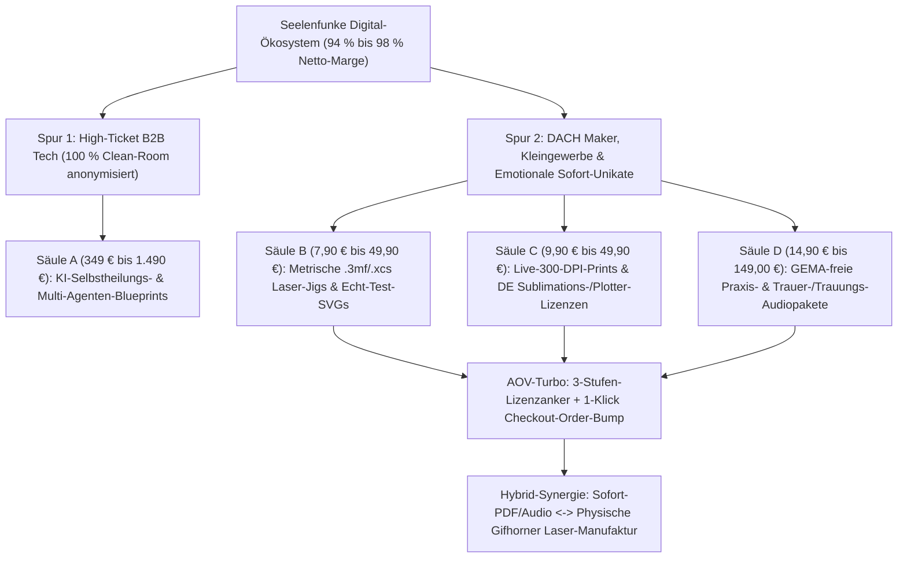

# Produkte: Umfangreiche Markt-, Konkurrenz- & Rechtsanalyse für Digitale Bestseller (`digital.mein-seelenfunke.de` & Hybrid-Shop)

**Erstellt am:** 16.11.2026  
**Verantwortliches Orchester:** Falcone (Gesamtstrategie) · Globi (Global Research, High-Ticket B2B & Synthese) · Lasi (Laser & 3D-Druck-Jigs) · Produkti (2D-Live-Konfigurator & Printables/POD) · Marketi (Audio, AOV-Psychologie, Traffic & IT-/Markenrecht)  
**Empirische Datenbasis:** 59 gezielte Live-Markt-, Plattform-, Gebühren- und Rechtsrecherchen (DACH, EU & US; Stand Ende 2026)  
**Zugehöriges Ursprungskonzept:** [`Konzept_Umfangreiche_Digital_Produkt_Markt_und_Konkurrenzanalyse.md`](file://wsl.localhost/Ubuntu/home/ubuntuxina/meine-projekte/seelenfunke/Abschlussberichte/Konzepte/Konzept_Umfangreiche_Digital_Produkt_Markt_und_Konkurrenzanalyse.md)

---

## 1. Executive Summary & Strategische 2-Spur-Positionierung

Der globale Markt für digitale Produkte hat sich bis Ende 2026 radikal gespalten: Im unteren Preissegment (`1,50 € bis 4,90 €`) hat die Flut generischer KI-Massenware (englische Sprüche, ungetestete Auto-Trace-SVGs, 08/15-Canva-Planer, Roh-KI-Musik und simple ChatGPT-Wrapper) die Preise und organischen Reichweiten vollständig zerstört. Gleichzeitig ist die Zahlungsbereitschaft dort auf Rekordwerte gestiegen, wo **echte physische Passgenauigkeit, produktionsreife Systemarchitektur, 5-Sekunden-Sofortpersonalisierung oder juristische Haftungssicherheit (B2B-Lizenzen & GEMA-Schutzbriefe)** geliefert werden.

Für Alina und das Seelenfunke-Ökosystem ergibt sich daraus eine hochprofitable **2-Spur-Strategie** mit Netto-Margen zwischen **94 % und 98 %** im eigenen Direktvertrieb:

* **Spur 1 (`High-Ticket B2B Tech` auf eigener neutraler Architektur-Sektion / `digital.mein-seelenfunke.de`):** Vollständig anonymisierte, branchenneutrale **Day-2 KI-Produktions- & Selbstheilungs-Blueprints (`349 € bis 1.490 €`)**, abgeleitet aus unserem realen 24/7-Systemwissen (ohne jeden namentlichen oder technischen Rückschluss auf `Mein-Seelenfunke`).
* **Spur 2 (`DACH Maker, B2B-Kleingewerbe & Anlass-Unikate`):** Metrische **`.stl`/`.3mf` + `.xcs` Laser-Vorrichtungen** für deutsche Rohlinge, echt-gelaserte deutsche **Anlass- & Trauer-Vorlagen**, **5-Sekunden Live-personalisierte `300 DPI` Sofort-Prints**, maßhaltige deutsche **Sublimations-/Plotter-Gewerbebundles** sowie **BGH-feste GEMA-freie Praxis- & Zeremonie-Audiopakete (`7,90 € bis 149,00 €`)**.

### 1.1 Ehrlicher Gesamtvergleich aller 5 untersuchten Digital-Sektoren

| Untersuchter Sektor | Reale VK-Spanne | Netto-Erlös je Kauf (Eigener Shop) | Wettbewerb in DACH | Einmaliger Erstellungsaufwand | Synergie zu bestehender SF-Technik | Ehrliches Mitgründer-Urteil |
| :--- | :--- | :--- | :--- | :--- | :--- | :--- |
| **1. High-Ticket B2B KI-Architektur-Blueprints** *(Säule A)* | **`349 € bis 1.490 €`** *(Netto B2B)* | **`338 € bis 1.445 €`** *(~97 % Marge)* | **Nahezu Null** *(weltweite Day-2-Lücke)* | Mittel bis Hoch *(15 bis 35 Std. Clean-Room-Extraktion je Paket)* | **100 % Wissen vorhanden** *(Sentinel, Zero-Secret Broker, Orchester, Voice)* | **KÖNIGSKLASSE (Note 1+):** Höchster Euro-Ertrag pro Stunde, Firmenkreditkarten-Sofortkauf `< 1.500 €`. |
| **2. Metrische 3D-Druck-Laser-Jigs & UV-Kristall-Kits** *(Säule B1)* | **`7,90 € bis 34,90 €`** *(Brutto)* | **`6,29 € bis 28,61 €`** *(~95 % Marge)* | **Extrem gering** *(US-Jigs in Zoll passen in DE nicht!)* | Niedrig *(2 bis 3 Std. je Jig am Bambu A1 + F2 Ultra UV)* | **Einzigartige Hardware-Kombi** *(xTool F2 Ultra UV + RA3 + Bambu Lab A1)* | **GEHEIMTIPP (Note 1+):** Konkurrenzloser metrischer Burggraben für PrintEquipment/Glücksfieber-Rohlinge. |
| **3. Deutsche Sublimations- & Plotter-Gewerbebundles** *(Säule C2)* | **`14,90 € bis 49,90 €`** *(Brutto)* | **`12,05 € bis 40,95 €`** *(~96 % Marge)* | Mittel *(aber kaum faire 250er Lizenzen ohne Namenszwang)* | Niedrig bis Mittel *(6 bis 10 Std. je 20er Bundle)* | **Sofort zu 100 % live-fähig** *(`DigitalProductDownloadController` steht!)* | **SCHNELLSTARTER (Note 1):** `0` Code-Umbau nötig, extrem starke B2B-Wiederkäuferquote. |
| **4. Live-personalisierte `300 DPI` Sofort-Prints & Deutsche Laser-SVGs** *(Säule C1 & B2)* | **`4,90 € bis 29,90 €`** *(Brutto)* | **`3,81 € bis 24,47 €`** *(~95 % Marge)* | Mittel *(Etsy nutzt umständliche Canva/Corjl-Logins)* | Mittel *(einmalig `300 DPI` PDF-Renderer + Vorlagenpflege)* | **Hoch** *(`ProductConfigurator` + direkter Brücke zu Laser-Unikaten)* | **MARKEN-HERZSTÜCK (Note 1-):** 5-Sekunden-UX schlägt Etsy um Längen; ideal für Trauer, Taufe & Last-Minute. |
| **5. Rechtssichere Praxis- & Zeremonie-Audiopakete** *(Säule D)* | **`19,90 € bis 149,00 €`** *(Brutto)* | **`16,18 € bis 122,90 €`** *(~96 % Marge)* | Selektiv *(Einzel-MP3s tot, Zertifikats-Pakete stark)* | Mittel *(DAW/Craft-Arrangement + Auto-Zertifikat-PDF)* | **Sehr hoch** *(`Funkenwerk Craft` + Bestatter-/Praxis-Zielgruppe)* | **STARKER B2B-HEBEL (Note 2+):** Goldgrube über GEMA-Kostenersparnis (`132 € bis 331 €/Jahr` gespart) & Order-Bumps. |

### 1.2 Die 3-Stufen-Ankerpreis-Psychologie & DACH-Traffic-Maschine (Spur 2)

Warum bleiben 90 % aller Digital-Verkäufer bei `4,00 €` Warenkorbwert hängen, während die Top 1 % im DACH- und US-Markt stabil **`25,00 € bis 42,00 €` Average Order Value (AOV)** erzielen? Durch die Kombination aus drei Verkaufshebeln direkt auf der eigenen Shop-Domain:

1. **3-Stufen-Lizenzanker auf jeder Produktseite (Decoy-Pricing):**
   * *Stufe 1 (Einstiegs-Anker, ~25 % Käuferanteil):* Einzelvorlage / Privatlizenz (`5,90 € bis 9,90 €`). Zieht Klicks über Pinterest und Google an.
   * *Stufe 2 („Beliebteste Wahl“, ~55 % Käuferanteil):* Kuratiertes Themen-Komplettset (`19,90 € bis 29,90 €`). Löst das gesamte Projekt des Kunden auf einen Schlag.
   * *Stufe 3 (B2B-AOV-Turbo, ~20 % Käuferanteil):* Kleingewerbe-, Studio- oder Praxis-Lizenz inkl. personalisiertem PDF-Zertifikat (`34,90 € bis 69,90 €`).
   * *Ergebnis:* Bei 100 Käufern steigt der Umsatz bei identischem Traffic von `790,00 €` (reiner Einzelverkauf) auf **`2.565,00 €` (`25,65 €` AOV)** vor Zusatzverkäufen.
2. **Kontextsensitiver 1-Klick Checkout-Order-Bump (`+7,90 € bis +14,90 €`):** Konvertiert bei Digital- und Hybridkäufen zu 20 % bis 30 % (z. B. *„Sofort-Gedenkkarte zum Ausdrucken + sanfte Trost-Hörreise für +9,90 € hinzufügen, falls du heute schon etwas überreichen möchtest“*).
3. **Priorisierte DACH-Traffic-Kanäle (ohne Werbebudget-Verbrennung):**
   * **Platz 1 (Sofort-Vertrauen): Echte 15- bis 30-Sekunden Werkstatt-Reels/TikToks/Shorts:** Live-Aufnahme am xTool F2 Ultra UV & Bambu Lab A1 („Snap-Fit ASMR“, wie Teile perfekt einrasten oder der K9-Kristall nivelliert wird) mit Verweis über `/links` (`MarketingLinktreePage`). Demontiert gesichtslose KI-Fake-Shops in Sekunden.
   * **Platz 2 (6 bis 12 Monate Halbwertzeit): Pinterest SEO + Winner-Pin-Ads:** Vertikale Problemlösungs-Pins (`1000 x 1500 px`) für Trauerfeier, Taufe, Hochzeit, DIY-Geschenke und Praxis-Einrichtung.
   * **Platz 3 (Höchste B2B- & KI-Such-Konversion): Evergreen-Magazin & GEO (`MarketingBlog`):** Fachartikel wie *„GEMA im Kosmetikstudio legal sparen: Pflichtangaben auf dem Zertifikat“* oder *„Day-2 AI Agent Security: Zero-Secret Broker vs. .env Keys“* werden direkt von Google, ChatGPT und Perplexity als Kaufquelle zitiert.
   * **Platz 4 (Gezielte Paid Search): Google Search Ads erst ab `39 €` Warenkorbwert** (für Praxis-Audio-Pakete, Gewerbe-Bundles und High-Ticket B2B KI-Blueprints).

---

## 2. Säule A (Königsklasse High-Ticket `349 € bis 1.490 €`): Universelle KI-Selbstheilungs- & Multi-Agenten-Code-Blueprints

### 2.1 Marktzahlen 2025/2026: Der Vibe-Coding-Shift & Gartners 40-%-Abbruchquote

Unsere Auswertung verifizierter Umsatzzahlen (TrustMRR, Stripe-Verifikationen, Indie-Benchmarks) beweist eine tektonische Verschiebung im Markt für bezahlte Entwickler-Pakete:

* **Klassische CRUD-Wrapper kühlen massiv ab:** `ShipFast` (Marc Lou, `$199 bis $299`) erzielte zwar über **`$1,3 Mio.` Lifetime-Umsatz** (Peak ~$40.000 im ersten Monat), fiel aber bis 2026 auf **`$1.000 bis $3.000/Monat`** zurück, weil KI-Coding-Tools wie Cursor und Claude Code einfache Login-/Stripe-/Datenbank-Gerüste heute in 20 Minuten kostenlos erzeugen. Auch einfache Laravel-Starterkits (`Laravel Spark` `$99/$199`, `Larafast` `$169 bis $199`, `SaaSykit` `$149 bis $239`) oder reine Markdown-Prompt-Sammlungen (`ClaudeKit` `$99`, `AgentKit Works` `$199`) deckeln sich bei rund `200 €`.
* **Tiefe B2B-Produktionsarchitektur erzielt dauerhaft Höchstpreise:**
  * **`Supastarter` (Jonathan Wilke, DE):** Verkauft Einmallizenzen zu **`$349` Solo (1 Seat)**, **`$799` Startup (5 Seats)** und **`$1.499` Agency (10 Seats + Kundenprojekte)** bei Stripe-verifizierten **`$10.000 bis $15.000+ MRR`** (`>$120.000 bis $180.000` Jahresrate).
  * **`Makerkit` (Giancarlo Buomprisco):** **`$299` Developer** bis **`$599+` Team License** (~`$8.600+/Monat` in der Wachstumsphase), getragen von strikter EULA-Trennung zwischen Einzelnutzern und Teams/Agenturen.
  * **`SaaS Pegasus` (Cory Zue):** **`$249` Professional** bis **`$999` Unlimited License**, stabil bei **`~$84.000+` Jahresumsatz** im reinen Bootstrap-Betrieb.
* **Die gigantische Marktlücke 2026 (Day-2 AI Operations):** Laut **Gartner** werden **über 40 % aller Agentic-AI-Projekte bis Ende 2027 abgebrochen**, ausdrücklich *nicht* wegen schwacher KI-Modelle, sondern wegen katastrophaler Day-2-Betriebsmängel: stille Halluzinations-Folgefehler (Silent Failures), unkontrollierte Token-Endlosschleifen, Klartext-API-Keys im Agenten-Speicher (Ambient Authority), gegenseitiges Überschreiben von Dateien durch parallele Agenten und Latenzen über `1.000 ms` bei KI-Telefonie. Externe Agenturen verlangen für solche Produktionssysteme **`$40.000 bis $250.000+`**, US-Enterprise-AI-SRE-SaaS (wie Resolve.ai oder Datadog Bits AI) kostet zehntausende Dollar jährlich plus DSGVO-kritischen Log-Abfluss in US-Clouds.
* **Die psychologische `< 1.500 €` Firmenkreditkarten-Schwelle:** Bei Senior-Entwickler-Tagessätzen von **`800 € bis 1.400 €`** verbrennen 3 bis 6 Monate Architektur-Irrwege **`30.000 € bis 90.000 €`**. Einen erprobten Referenz-Blueprint für **`349 € bis 1.490 €`** buchen CTOs, Agenturinhaber und Tech-Gründer sofort per Firmenkreditkarte über ihr R&D- oder Tooling-Budget, ohne eine langwierige Einkaufsfreigabe (Procurement) anstoßen zu müssen.

### 2.2 Das konkurrenzlose 4+1 High-Ticket Blueprint-Portfolio

| Blueprint-Produkt (100 % neutrale B2B-Positionierung) | Gelöstes C-Level / Engineering-Problem | Enthaltene Clean-Room-Komponenten | Solo / Startup (1 bis 3 Devs) | Team / Agency (bis 10 Devs + Client-Build) |
| :--- | :--- | :--- | :--- | :--- |
| **1. Autonomous Self-Healing Sentinel & `0-Byte` Log Engine** | Spart `$20k+/Jahr` für US-AI-SRE-Clouds; verhindert stille Produktionsausfälle & DSGVO-Log-Abfluss. | 4-Stufen-Selbstheilungs-Pipeline (Deduplizierung -> Diagnose -> isolierte Patch-/Runbook-Ausführung -> Verifikation & `0-Byte` Log-Reset), Token-Circuit-Breaker, 100 % In-VPC fähig. | **`390 €`** | **`990 €`** |
| **2. Zero-Secret Agent Execution Broker** | Stoppt API-Key-Exfiltration durch indirekte Prompt-Injection bei autonomen Tool- & Shell-Agenten. | Physische Trennung von Vault (Storage Plane) und Execution Proxy (Transport Injection): Klartext-Keys betreten niemals den Agenten-Kontext/RAM; Ephemeral Leases, Domain-Allowlist & Audit-Trail. | **`449 €`** | **`1.190 €`** |
| **3. Multi-Agent Conductor & Disjoint Lock Engine** | Verhindert Code-Zerstörung, teure OCC-Rollbacks & Context-Rot bei parallelen KI-Coding-Flotten. | Dirigenten-Topologie, Disjoint Write-Set Partitioning, Worktree-/Sandbox-Isolation, atomare Datei-Locks, kompaktes Rückmeldebudget & automatisches `--self-test` Pre-Merge-Gate. | **`349 €`** | **`890 €`** |
| **4. Sub-300ms Realtime Voice & Telephony Bridge** | Durchbricht die `1.000 ms` Kaskaden-Verzögerung, Echo-Loops & Tool-Call-Funkstille bei PSTN-KI-Telefonie. | `8 kHz` G.711 zu `24 kHz` PCM Streaming-Bridge, abgestimmte Server-VAD mit Barge-In-Schutz, Speculative Filler-Audio während DB-/MCP-Abfragen & DSGVO-Opt-in-Anonymisierungs-Gate. | **`490 €`** | **`1.290 €`** |
| **5. FLAGSHIP: Sovereign AI Production Suite (All-in-One)** | Komplettes Day-2-Referenz-Betriebssystem für KI-Agenturen, SaaS-Teams & Mittelstands-IT. | Alle 4 Blueprints als abgestimmte Referenz-Suite + sprachunabhängiges Architektur-Handbuch (ADR + Mermaid-C4), startfertiges Docker-Testlab & 12 Monate Minor-Updates. | **`990 €`** | **`1.490 €`** |

### 2.3 Clean-Room-Anonymisierung, Per-Buyer Fingerprinting & Deutscher B2B-Rechtsrahmen

1. **100 % Clean-Room-Anonymisierung (Null Bezug zu `Mein-Seelenfunke`):**
   * Jedes Paket wird als **synthetisches Neu-Artefakt ohne `.git`-Historie** auf einer neutralen Referenz-Domäne (z. B. `SentinelCore` / `AcmeOps`) aufgebaut.
   * Ein **automatisierter CI-Leak-Scanner** prüft vor jedem Release-Build sämtliche Dateien per harter Regex-Blockliste auf interne Klassennamen, Domains, Eigennamen, lokale IPs (`192.168.*`), WSL-Pfade und E-Commerce-/Manufaktur-Begriffe. Bei einem einzigen Treffer bricht der Build sofort ab.
   * Jedes Paket liefert sowohl **ausführbaren Referenz-Code** (Docker-Compose Lab mit `--self-test`-Suite für Laravel/PHP sowie TypeScript/Node-Bridge) als auch ein **sprachunabhängiges ADR- & Protokoll-Handbuch**, sodass auch Python-, Go- und Next.js-Teams sofort kaufen können.
2. **Technischer Kopierschutz & Dreistufiges Forensisches Watermarking:**
   * **Dynamisches Einmal-Token-ZIP statt offenem GitHub-Fork:** Verhindert 1-Klick-Clones; Auslieferung erfolgt nach Zahlung über zeitlich begrenzte Download-Tokens.
   * **Per-Buyer Ed25519-Signatur & Struktur-DNA:** Beim Packvorgang bettet der Worker in Echtzeit (a) ein sichtbares Lizenz-Zertifikat mit Käuferfirma & `License-UUID` in `LICENSE.md` und Core-Header, (b) eine kryptografisch mit unserem privaten **Ed25519-Schlüssel signierte `manifest.sig`** (beweist Supply-Chain-Integrität und bindet das Paket an die Rechnung) sowie (c) **unsichtbare deterministische Hash-Salts und Test-Fixture-UUIDs über 15+ verteilte Dateien** ein. Taucht ein Leak im Netz auf, identifiziert das forensische Wasserzeichen den Erstkäufer zweifelsfrei; ein wöchentlicher GitHub-Code-Search-Job meldet unbefugte Uploads sofort für DMCA-Takedowns.
3. **AGB-fester Deutscher B2B-Rechtsrahmen (`§ 14 BGB`, `§ 309 Nr. 7 BGB`, `§ 44b Abs. 3 UrhG`):**
   * **Striktes B2B-Only-Gate im Checkout (`§ 14 BGB`):** Verkauf ausschließlich an Unternehmer, Freiberufler und juristische Personen (Pflichtfeld Firmenname + aktive B2B-Bestätigung). Damit entfällt das Verbraucher-Widerrufsrecht vollständig.
   * **Urheberrecht & KI-Trainings-Opt-out (`§§ 69a ff. UrhG`, `§ 44b Abs. 3 UrhG`):** Einfaches, nicht übertragbares Nutzungsrecht; Agency-Lizenz erlaubt Einbau in Endkunden-Systeme, verbietet aber strikt die Weitergabe als eigenes Boilerplate/Open-Source. Zusätzlich greift ein **vertragliches und maschinenlesbares Text-and-Data-Mining-Verbot (`tdmrep.json` / Lizenzkopf nach `§ 44b Abs. 3 UrhG`)**, das die Einspeisung des Codes in fremde KI-Trainingspipelines oder öffentliche Prompt-Datenbanken untersagt.
   * **Wirksame deutsche B2B-Haftungsstaffel statt unwirksamer US-"AS-IS"-Floskel (`§§ 307, 309 Nr. 7 BGB`):** Da ein pauschaler englischer Haftungsausschluss (*"Provided AS IS without any liability"*) nach deutschem AGB-Recht selbst im B2B-Verkehr unwirksam ist und zur vollen gesetzlichen Haftung führt, nutzen wir die zweistufige deutsche Profilösung: (1) **Vertragliche Beschaffenheitsdefinition als prüfpflichtige *Educational Reference Architecture*** (kein schlüsselfertiges Sicherheitsprodukt für fremde Zielsysteme; zwingende Audit- und Staging-Prüfpflicht durch Fachpersonal des Käufers vor Produktivbetrieb) und (2) **BGB-konforme Haftungsstaffel** (unbeschränkt nur bei Vorsatz, grober Fahrlässigkeit, Arglist und Verletzung von Leben/Körper/Gesundheit nach `§ 309 Nr. 7 BGB`; Ausschluss leichter Fahrlässigkeit, außer bei Verletzung wesentlicher Kardinalpflichten, dort summenmäßig gedeckelt auf den vertragstypischen, vorhersehbaren Schaden in Höhe der 1- bis maximal 2-fachen Lizenzgebühr; B2B-Sachmängelverjährung 12 Monate).

---

## 3. Säule B (`7,90 € bis 49,90 €`): Laser-Vorlagen (`.svg`/`.xcs`) & Metrische 3D-Druck-Jigs (`.stl`/`.3mf`)

### 3.1 Der metrische Rohling-Burggraben bei 3D-Druck-Laser-Jigs (`.stl` + Bambu `.3mf` + `.xcs`)

In den USA verdienen spezialisierte Maker-Shops (*L3D Accessories*, *SongDawgDesigns*) mit digitalen Positionier-Schablonen (`3,50 $ bis 55,00 $` für Jig-Vaults) hervorragend. Unsere Analyse auf Etsy, Cults3D, Printables und MakerWorld zeigt jedoch eine **eklatante Versorgungslücke im gesamten DACH- und EU-Raum**:

* **Warum US-Jigs in Deutschland versagen:** Rund 95 % aller kommerziellen `.stl`-Jigs sind auf US-Zoll-Rohlinge (*JDS Industries*, *Home Depot*, Inch-Dog-Tags) konstruiert. Legt ein deutscher Laser-Besitzer Rohlinge von **PrintEquipment, Glücksfieber, Action, Ikea DE oder Amazon.de** ein, klemmen die Teile oder wackeln um `1,5 bis 4,0 mm`! Kostenlose Hobby-Modelle auf MakerWorld wiederum liefern fast nie eine deckungsgleiche `.xcs`-Kalibrierungsdatei und keinen Toleranzausgleich für schwankende Naturmaterialien.
* **Alinas einzigartige Dual-Hardware-Hoheit (`xTool F2 Ultra UV` + `RA3` + Förderband + `Bambu Lab A1`):** Gemäß unserer Manufaktur-Dokumentation ([`Brennpunkt_Masse.md`](file://wsl.localhost/Ubuntu/home/ubuntuxina/meine-projekte/seelenfunke/Abschlussberichte/Arbeitsdokumentation/Brennpunkt_Masse.md)) liefert Alina statt nackter `.stl`-Dateien ein **sofort produktionsfertiges 3-Komponenten-System**:
  1. **Fertig geslicte Bambu/Orca `.3mf`-Datei** (optimiert auf matt-schwarzes PLA/PETG gegen 355-nm-/455-nm-Laserreflexionen + direkt ins Bauteil geprägte Millimeter- & Fokus-Beschriftung) plus universelle `.stl`.
  2. **1:1 kalibrierte `.xcs`-Layoutdatei** mit Nullpunkt-Anleitung.
  3. **Direkte Einkaufs-Referenzliste** der exakt passenden deutschen Rohlinge.
* **Die 5 stärksten Jig- & UV-Spezialprodukte (`7,90 €` Einzel / `24,90 € bis 34,90 €` Master-Bundle):**
  1. **K9-Kristall & Glas-Trophäen Nivellier-Halter (`F2 Ultra UV Edition`, `11,90 € bis 14,90 €`):** Löst das in unserer Werkstatt nachgewiesene 1-mm-Schrägfuß-Problem bei Glas-Trophäen (`180 x 200 mm`) und K9-Quadern, das sonst die UV-Fokusebene zerstört.
  2. **Metrisches Schiefer-Jig `100 x 100 mm` & `Ø 100 mm` mit 3D-Biegefeder-Toleranzlippe (`7,90 € bis 9,90 €`):** Zentriert bruchraue Naturschieferplatten von `98,0 mm bis 102,0 mm` automatisch exakt auf Mitte.
  3. **Galvo- & Förderband-Serientrays (`7,90 €` Einzel / `19,90 €` Set):** Mehrfach-Aufnahmen für Eloxal-Alu-Visitenkarten (`85 x 54 mm`), Schmuckherzen (`45 x 40 mm`), Edelstahl-Marken & Kugelschreiber mit Steck-Verzahnung für das xTool Förderband.
  4. **RA3 / RA2 Pro Rotations-Zentrierlehre & Stielglas-Spannbacken (`12,90 € bis 16,90 €`):** Rechtwinklige Ausrichthilfe unter dem Galvo-Kopf plus schonende Backen für Leonardo- und Ikea-Gläser.
  5. **xTool F2 Ultra UV Glas- & 3D-Subsurface-Kristall Master-Kit (`24,90 € bis 29,90 €`):** Kalibrierungs-`.xcs` (Punktdauer `100 bis 1.000 µs` vs. `DPI 200 bis 600` aus unseren 16 realen Seelenkristall-Testreihen) + 5 wasserdichte, für `Konturgravur` optimierte 3D-Innengravur-Modelle (`.stl`/`.obj` für `70 x 70 x 150 mm` Blöcke: Lebensbaum, Herz-Galaxie, Pfote, Ringe). Spart jedem Käufer eines 4.000-Euro-UV-Lasers sofort `150 €` an verpfuschten Kristallrohlingen!

### 3.2 Echt-gelaserte deutsche `.svg`/`.xcs`-Vorlagen: 4-Kerf-Standard & Kleingewerbe-Hebel

* **Physische Ehrlichkeit (`<= 200 mm` Bauteilgrenze):** Wir bieten ausschließlich kompakte Steck-Aufsteller bis maximal `200 mm` Einzelteilgröße an, die auf Alinas `220 x 220 mm` Galvo-Feld real im Probeschnitt getestet wurden (keine ungetesteten `450 mm` Groß-Schwibbögen!).
* **Top-Nischen mit Preisstabilität:** **Deutsche Haustier- & Trauer-Gedenkaufsteller** (Regenbogenbrücke, Pfote/Engelsflügel, elektrisches Teelicht + Wechsel-Fotorahmen `10 x 15 cm`) sowie **deutsche Anlass- & Geldgeschenk-Aufsteller** (Einschulung mit Schultüte, Jugendweihe, Hochzeit, Ruhestand; verbundene deutsche Umlaute `ä/ö/ü/ß` ohne herausfallende Buchstaben-Inseln).
* **Der 4-Kerf-Ordner-Standard gegen die häufigste 1-Stern-Beschwerde:** Während Käufer auf Etsy massenhaft über wackelnde oder brechende `3,00 mm` Star-Schlitze klagen, enthält jedes Seelenfunke-Steckprodukt **4 fertig skalierte Schlitz-Ordner (`2,85 mm` / `2,95 mm` / `3,05 mm` / `3,15 mm` sowie `4,0 mm`) plus einen 30-Sekunden-Testkamm** zum Vorab-Messen des eigenen Sperrholzes, handbereinigte geschlossene Pfade (`>= 1,8 mm` Stegbreite), ein **echtes Foto des in Gifhorn gelaserten Werkstücks** und eine farbcodierte `.xcs`/`.svg`-Datei.
* **Zweistufiges Lizenzmodell & Vertriebskanäle:** Privatlizenz Einzel (`4,90 € bis 5,90 €`) / Themen-Bundle (`12,90 €`) vs. **Kleingewerbe-Lizenz bis 200 physisch gelaserte Fertigprodukte pro Design (`12,90 € bis 14,90 €` Einzel / `29,90 € bis 49,90 €` Kollektions-Paket)**. Primärvertrieb über eigenen Shop (`94 bis 96 %` Marge), flankiert von `kasuwa make` (`87 bis 89 %`), `Cults3D` (`80 %` für Jigs), `Etsy DE` und kostenlosen Lead-Teasern auf `xTool Atomm`.

---

## 4. Säule C (`9,90 € bis 49,90 €`): Live-personalisierbare `300 DPI` Sofort-Prints & Deutsche Sublimations-/Plotter-Bundles

### 4.1 B2C Live-Sofort-Prints in 5 Sekunden (Unser UX-Sieg über Canva, Corjl & Templett)

Auf Etsy scheitern oder verzweifeln täglich tausende Kunden am Personalisierungs-Prozess über Drittplattformen wie **Corjl, Templett, JetTemplate oder Canva**: Käufer mit *Apple Hide-My-Email* erhalten keinen Zugangslink, müssen erst ein Drittkonto anlegen, verschieben auf dem Smartphone (über 70 % Traffic-Anteil!) versehentlich Textebenen oder exportieren unscharfe `96 DPI` Web-PDFs, während Verkäufer `15 % bis 26 %` an doppelten Plattform- und Abo-Gebühren verlieren.

**Unser bereits vorhandener Technologie-Vorsprung in `Mein-Seelenfunke`:**
Mit [`ProductConfigurator.php`](file://wsl.localhost/Ubuntu/home/ubuntuxina/meine-projekte/seelenfunke/app/Livewire/Shop/Product/ProductConfigurator/ProductConfigurator.php), [`OrderCheckout.php`](file://wsl.localhost/Ubuntu/home/ubuntuxina/meine-projekte/seelenfunke/app/Livewire/Shop/Order/OrderCheckout/OrderCheckout.php) und [`DigitalProductDownloadController.php`](file://wsl.localhost/Ubuntu/home/ubuntuxina/meine-projekte/seelenfunke/app/Http/Controllers/Customer/DigitalProductDownloadController.php) gestaltet der Kunde sein Werk im freundlichen **Light-Mode ohne Drittanbieter-Account live am Handy**, sieht die geschützte Echtzeit-Vorschau und erhält **unter 5 Sekunden nach Stripe-/PayPal-Zahlung** automatisch ein **4-teiliges `300 DPI` Sorglos-Paket**:
1. `Heimdrucker_DIN_A4_300DPI.pdf` (echtes deutsches `210 x 297 mm` statt US-Letter-Trauerrand!),
2. `Druckerei_Profi_mit_3mm_Beschnitt.pdf` (exakt `216 x 303 mm` inkl. `5 mm` Sicherheitszone für CEWE, Flyeralarm & WIRmachenDRUCK),
3. `Sofortfoto_Automat_20x30cm_300DPI.jpg` (direkt am Fotodrucker bei dm/Rossmann/Müller ausdruckbar!),
4. `Kurzanleitung_Perfekter_Druck_1_Seite.pdf` (Papierempfehlung `200 bis 300 g/m²`, Skalierung `100 %`).

**Die 3 lukrativsten B2C-Sofort-Print-Linien (`9,90 € bis 29,90 €`):**
* **DACH Trauerfeier ("Celebration of Life") & Regenbogenbrücke-Gedenksets (`12,90 € bis 29,90 €`):** Willkommensschild A2 + Ablauf-/Liedkarte + Foto-Gedenkdruck + **Kerzentattoo-Wasserschiebefolien-Bogen** für Trauerkerzen. Inklusive genialer **Hybrid-Brücke** auf physischen Seelenfunke-Produktseiten (*„Du brauchst heute Abend schon etwas in der Hand? Lade sofort das passende Gedenk-Printset herunter inkl. 5 € Gutschein für deine spätere Laser-Gravur“*).
* **Taufe, Geburt & Hochzeit Schwarz-Gold Papeterie-Sets (`14,90 € bis 29,90 €`):** Geburtsdaten-Poster + 2x Patenbrief/Taufurkunde + Taufkerzen-Folie bzw. 1- bis 4-seitige Hochzeits-Tischzeitung („Wedding News“ mit 6 schnellen Konfigurator-Feldern statt supportintensiver 40-Seiten-Magazine).
* **Freitag-13:00-Uhr Notfall-Abschiedsposter & Gutschein-Urkunden (`9,90 € bis 16,90 €`):** Für Kollegen-Verabschiedung, Ruhestand oder Mutterschutz aus der Büro-Gruppenkasse, sofort auf jedem A4/A3-Bürodrucker einsatzbereit.

### 4.2 B2B Kleingewerbe-Goldgrube: Maßhaltige `200 x 85/90 mm` Tassen-Wraps & Faire 250er/500er Plotter-Lizenzen

Zehntausende deutsche Betreiberinnen von Selbstbedienungshäuschen („Mitnahmestübchen“), Marktständen, Hofläden und Nebenerwerbs-Shops (`§ 19 UStG`) leiden unter zwei Marktproblemen: US-Sublimationsdateien haben kaputte Umlaute und falsche Maße, und deutsche Plotter-Designer auf Kasuwa/Etsy verlangen `5 € bis 9 €` Aufpreis für winzige 10er-Stückzahlen plus eine geschäftsschädigende Namensnennungspflicht (*„Design by XY“* im Produkttitel).

* **Sofort ohne Code-Umbau startklar (statisches ZIP in `produkte/products-secure/`):**
  1. **Maßhaltige Deutsche Sublimations-Panorama-Wraps (`16,90 €` Privat / `34,90 €` Gewerbe für 15er Themen-Set):** Exakt kalibriert auf **PrintEquipment DURAGLAZE® 11oz Standardtassen** in **`200 x 85 mm` (`2362 x 1004 px`)** und **`200 x 90 mm` (`2362 x 1063 px`)** bei echten **`300 DPI` sRGB** (kein Pressen-Druckabfall an Rand/Boden!) sowie `236 x 208 mm` für 20oz Skinny Tumbler, inklusive bereits gespiegelter Sofort-Druck-PDFs für Einsteiger.
  2. **Kuratierte Deutsche B2B Plotter- & DTF-Bundles (`14,90 €` Privat / `29,90 € bis 49,90 €` Gewerbe für 20 bis 25 Motive):** Handbereinigte, entgitterungsfreundliche **SVG + DXF + `300 DPI` Transparent-PNG** (ohne weiße Pixel-Halos) mit 100 % geprüften deutschen Glyphen inkl. großem `ẞ`.
  3. **Unsere disruptive Kleingewerbe-Lizenz PRO:** Erlaubt bis zu **250 bzw. 500 physisch gefertigte Verkäufe pro Paket**, **OHNE Pflicht zur Urhebernennung am Endprodukt**, inklusive automatischer deutscher USt-Rechnung und personalisiertem PDF-Lizenz-Zertifikat auf den Firmennamen (strikt gesperrt bleiben Datei-Weitergabe, reine DTF-Meterware/Gangsheets an Dritte sowie Massen-POD-Plattformen wie Amazon Merch, Spreadshirt oder Redbubble).

---

## 5. Säule D (`14,90 € bis 149,00 €`): Rechtssichere Audio- & Zeremonie-Pakete (`Funkenwerk Craft`)

Während einzelne Lo-Fi-Beats durch Gratis-Archive und KI komplett entwertet sind, zahlen gewerbliche Praxen, Bestatter und Redner hohe Paketpreise für **rechtssichere Ruhe vor der GEMA und dramaturgisch fertige Zeremonie-Abläufe**:

1. **B2B-Champion: GEMA-freie Praxis-, Kosmetik-, Massage-, Yoga- & Wellness-Pakete (`39,90 € bis 149,00 €` Einmalkauf):**
   * *Der harte ROI-Beweis:* Ein Kosmetikstudio, Friseursalon oder eine Massagepraxis zahlt im GEMA-Tarif (M-U / V-BT) schon bis `100 qm` rund **`132,72 € bis 178,07 €` netto jedes Jahr** (bis `200 qm` ca. `265,44 €/Jahr`; über 6 Jahre rund `1.000 € bis 1.600 €+` Fixkosten!), und privates Spotify ist gewerblich illegal. Ein 4- bis 8-stündiges Seelenfunke/Funkenwerk-Praxispaket aus nahtlosen 60-Minuten-Ruhemixen amortisiert sich für die Studio-Inhaberin sofort im ersten Quartal.
   * *Das BGH-feste `§ 48 VGG` GEMA-Freiheitszertifikat:* Nach der strengen BGH-Rechtsprechung zur *GEMA-Vermutung* (`§ 48 VGG`) sind anonyme Pseudonym-Zertifikate bei Kontrollen wertlos. Unser System generiert beim Kauf automatisch ein **gerichtsfestes PDF-Vorführlizenz-Zertifikat** mit (a) vollständiger Trackliste & Spielzeiten, (b) **bürgerlichem Klarnamen und ladungsfähiger Anschrift der Urheberin (*Alina Steinhauer, Carl-Goerdeler-Ring 26, 38518 Gifhorn*)**, (c) ausdrücklicher Erklärung über das Nichtbestehen eines Wahrnehmungsvertrags mit GEMA, AKM, SUISA, SACEM, ASCAP oder BMI sowie (d) Firmenname, Anschrift und Rechnungsnummer des Käufers.
2. **Dramaturgische 4-Phasen Trauerfeier- & Freie-Trauung-Pakete (`19,90 €` Privat / `49,90 €` Bestatter & Redner / `59,90 €` inkl. Videografen-Livestream-Sync):**
   * Exakt nach realem Feier-Ablauf strukturiert (*1. Ankommen 15-Min-Loop, 2. Einzug, 3. Besinnung nach der Rede in 3-Min & 5-Min Fade-Out-Länge, 4. Auszug & Gang zum Grab*), ergänzt um unsere vertragliche **„100 % YouTube/Meta Content-ID-Clear Garantie“** (keine Stummschaltung bei Trauerfeier-Livestreams oder Hochzeitsfilmen!). Flankiert von **3-in-1-Praxis-Meditationen** (Audio + DOCX-Skript + Instrumental für Coaches, `49 € bis 99 €`) und sanften **Trost-Hörreisen (`9,90 €` Order-Bump)**.
3. **Verbindliche Schutzregel gegen KI-Musik-Haftung (`LG München I, Juli 2026, Az. 42 O 763/25`):**
   * Im Grundsatzurteil **GEMA gegen Suno (LG München I, Az. 42 O 763/25)** wurde unlizensiertes KI-Training mit GEMA-Repertoire als Urheberrechtsverstoß eingestuft; reproduziert eine Musik-KI memorisierte Melodiefolgen, haftet auch der gewerbliche Endkunde! Zudem genießen reine KI-Exporte nach `§ 2 Abs. 2 UrhG` keinen menschlichen Urheberrechtsschutz und unterliegen Kennzeichnungspflichten (`Art. 50 KI-VO`).
   * **Konsequenz:** Für gewerbliche Seelenfunke/Funkenwerk-Audiopakete werden **niemals ungeprüfte Suno-/Udio-Rohdateien** verkauft, sondern ausschließlich **menschlich in der DAW / `Funkenwerk Craft` arrangierte Eigenkompositionen** (eigenes MIDI-Arrangement, lizenzierte Sample-/Synth-Instrumente ohne Loop-Verbot, eigene Natur-Fieldrecordings & Mastering), wodurch echtes Urheber- (`§ 2 UrhG`) und Leistungsschutzrecht (`§ 85 UrhG`) originär bei Alina entsteht.

---

## 6. Schonungslose No-Go-Warnliste (Die 10 verbrannten Digital-Fallen 2026)

| Nr. | Verbrannte Produkt- oder Kanal-Falle | Realer Preis / Risiko 2026 | Warum wir strikt die Finger davon lassen |
| :--- | :--- | :--- | :--- |
| **1** | **08/15 Next.js / Laravel CRUD- & ChatGPT-Wrapper-Boilerplates** | Absterbend (`< $2k/Mon.`) | Werden von Cursor und Claude Code in 20 Minuten kostenlos generiert; nur tiefe Day-2-Architektur (`Säule A`) erzielt High-Ticket-Preise. |
| **2** | **Ungeprüfte 1-Klick-Suno/Udio-Musikpakete & Einzel-Lo-Fi-MP3s** | `0,00 € bis 1,99 €` + Klagegefahr | Kein Schutz nach `§ 2 Abs. 2 UrhG`, Plattform-Sperren und akutes Memorisierungs-Haftungsrisiko nach **LG München I (Az. 42 O 763/25)**. |
| **3** | **Google Shopping / Haupt-Merchant-Center für reine Digitalgüter** | **Kontosperrungs-Gefahr!** | Google Shopping ist für physische Versandware gebaut; Digital-Workarounds lösen automatisierte **Merchant-Center-Sperren („Misrepresentation“)** aus und gefährden Alinas physischen Hauptshop! |
| **4** | **Englische Standard-Spruch-SVGs & „5.000 PNG / Coaster Mega-Bundles“** | `1,99 € bis 3,99 €` | Durch Creative-Fabrica-Abos (`3,99 $/Monat`) und Scraper-Bots vollständig entwertet; Stundenlohn nahe `0 €`. |
| **5** | **Mehrschichtige KI-3D-Mandalas, Schattenboxen & KDP-Ausmalbücher** | Ruinöser Preiskampf | Tausende ungetestete Auto-Trace-Listings haben das Käufervertrauen zerstört; extrem hohe Beschwerdequote. |
| **6** | **Undatierte 400-Seiten-Alltags-, Fitness- & ADHS-Standardplaner (Canva)** | Überlaufen | Komplette Marktsättigung; Werbekosten übersteigen den Deckungsbeitrag um ein Vielfaches. |
| **7** | **Einfache Power/Speed-Materialtestgrids (`.xcs`) für Diodenlaser** | `1,10 € bis 2,50 €` | Durch das kostenlose integrierte `Material Test Array` in xTool Studio obsolet (lohnend sind nur echte UV-Glas/Kristall-Spezialkits). |
| **8** | **Ungetestete Großformat-Laserbausätze (`> 220 mm` Bauteilgröße)** | Reputationsverlust | Passen nicht am Stück auf das `220 x 220 mm` Galvo-Feld des F2 Ultra UV; wir verkaufen niemals ungetestete Steckdateien! |
| **9** | **Mehrseitige 30- bis 40-Seiten-Hochzeitszeitungen im Live-Konfigurator** | Support-Falle | Zu komplex für schnelle Smartphone-Eingabe; stattdessen knackige 1- bis 4-seitige „Wedding News“-Tischzeitungen anbieten. |
| **10** | **Fan-Art, Vereinslogos, Songtexte & geschützte Trend-Wörter** | **`1.800 € bis 10.000 €+` Abmahnung** | Automatisierte Marken- und Urheberrechts-Abmahnungen in DE bei `50.000 €+` Streitwert (siehe Sperrliste in Kapitel 8.6). |

---

## 7. Die Top-10 Digital-Produkt-Gewinner & Alinas „Top-3 Sofort-Startplan“

### 7.1 Die Top-10 konkreten Digital-Produkt-Gewinner im Direktvergleich

| Rang | Konkretes Digital-Produkt | Säule | Zielpreis (Solo/Privat -> Gewerbe/Team) | Einmal-Aufwand | Ertragspotenzial pro Arbeitsstunde | Technischer Pfad |
| :--- | :--- | :--- | :--- | :--- | :--- | :--- |
| **1** | **Sovereign AI Production Suite (4+1 Day-2 Blueprints: Self-Healing Sentinel & Zero-Secret Broker)** | Säule A | **`390 € bis 1.490 €`** *(B2B Netto)* | 20 bis 35 Std. (Clean-Room) | **Extrem hoch (`250 € bis 800 €+/Std.`)** | Signiertes Per-Buyer ZIP (`digital.mein-seelenfunke.de`) |
| **2** | **Deutsche B2B Plotter- & DTF-Themenbundles inkl. 250er/500er Gewerbelizenz ohne Namenszwang** | Säule C | **`14,90 € -> 39,90 €`** | 6 bis 8 Std. je 25er Set | **Sehr hoch (`80 € bis 180 €/Std.`)** | **Sofort startklar** (`products-secure/` ZIP + Lizenz-PDF) |
| **3** | **Metrisches 5er xTool + Bambu `.3mf`/`.xcs` Rohling-Jig-Paket (inkl. K9-Nivellierhalter & Feder-Schiefer-Jig)** | Säule B | **`7,90 €` Einzel -> `29,90 €` Set** | 10 bis 12 Std. (CAD + Test) | **Sehr hoch (`75 € bis 160 €/Std.`)** | **Sofort startklar** (Shop + Cults3D + Etsy) |
| **4** | **Maßhaltige Deutsche `200 x 85/90 mm` DURAGLAZE® Sublimations-Tassen-Wraps (`300 DPI` + Gewerbelizenz)** | Säule C | **`16,90 € -> 34,90 €`** | 5 bis 7 Std. je 15er Set | **Sehr hoch (`70 € bis 150 €/Std.`)** | **Sofort startklar** (`products-secure/` ZIP) |
| **5** | **xTool F2 Ultra UV K9-Kristall & 3D-Subsurface-Innengravur Master-Kit (`.xcs` + 5x `.stl`/`.obj` + `.3mf`)** | Säule B | **`24,90 € bis 29,90 €`** | 8 Std. (Daten liegen vor!) | **Sehr hoch (`70 € bis 140 €/Std.`)** | **Sofort startklar** (Globaler UV-Laser-Nischenhit!) |
| **6** | **GEMA-freies Praxis-, Kosmetik- & Massage-Musikpaket (4 bis 6 Std.) inkl. `§ 48 VGG` Klarnamen-Zertifikat** | Säule D | **`49,90 € bis 99,00 €`** *(B2B)* | 10 bis 14 Std. (`Craft` DAW) | **Hoch (`60 € bis 130 €/Std.`)** | Statisches Audio-ZIP + dynamisches Zertifikats-PDF |
| **7** | **Live-personalisiertes DACH Trauerfeier- & Regenbogenbrücke-Printset (`300 DPI` A4 + Bleed + Foto + Kerzenbogen)** | Säule C | **`14,90 € bis 24,90 €`** | 12 Std. (1x PDF-Renderer) | **Hoch + starker Laser-Upsell** | `ProductConfigurator` -> Auto-`300 DPI`-PDF-Paket |
| **8** | **Echt-gelaserte Deutsche Trauer- & Geldgeschenk-Aufsteller (`.svg`/`.xcs` mit 4-Kerf-Ordnern & Testkamm)** | Säule B | **`4,90 € -> 14,90 €`** *(Bundle `29,90 €`)* | 2 bis 3 Std. je Modell | **Hoch (`50 € bis 110 €/Std.`)** | **Sofort startklar** (Shop + `kasuwa make` + Etsy DE) |
| **9** | **Dramaturgisches 4-Phasen Trauerfeier- & Freie-Trauung-Audiopaket für Bestatter, Redner & Videografen** | Säule D | **`19,90 € -> 59,90 €`** | 8 bis 12 Std. (`Craft` DAW) | **Gut bis Hoch (`50 € bis 100 €/Std.`)** | Audio-ZIP + Content-ID-Clear & `§ 48 VGG` Zertifikat |
| **10** | **Live-personalisiertes Taufe-/Patenbrief-Set & Freitag-13:00-Uhr Kollegen-Abschiedsposter (`300 DPI`)** | Säule C | **`9,90 € bis 21,90 €`** | 2 Std. je Vorlage (nach Nr. 7) | **Gut (`45 € bis 90 €/Std.`)** | `ProductConfigurator` -> Auto-`300 DPI`-PDF-Paket |

### 7.2 Alinas klarer „Top-3 Sofort-Startplan“ (Geordnet nach maximalem Ertrag pro Stunde)

1. **Sofort-Schritt 1 (Maximaler Cashflow-Hebel pro Verkauf: `390 € bis 1.490 €`): Launch des ersten Clean-Room B2B KI-Blueprints (`Zero-Secret Agent Execution Broker` + `24/7 Self-Healing Sentinel`)**
   * *Warum zuerst:* Die Kernlogik existiert bereits erprobt in unserer eigenen Architektur. Durch saubere Clean-Room-Extraktion auf einer neutralen Referenz-Domäne inklusive automatischem Per-Buyer-ZIP-Watermarking und B2B-Checkout-Gate reicht bereits **ein einziger Agency-Verkauf (`1.190 € bis 1.490 €`)**, um denselben Reingewinn wie mit 350 billigen Einzeldateien auf Etsy zu erzielen.
2. **Sofort-Schritt 2 (`0 %` Code-Umbau im Shop nötig: `24,90 € bis 49,90 €` Körbe): Start der statischen DACH-Maker- & Kleingewerbe-Pakete**
   * *Warum als Zweites:* Unser `DigitalProductDownloadController` und der `§ 356 Abs. 5 BGB`-Checkout stehen bereits produktionsbereit! Wir legen (a) das **5er Metrische xTool + Bambu `.3mf`/`.xcs` Jig-Paket** (inkl. K9-Kristall-Nivellierhalter & UV-Master-Kit) und (b) die ersten **25er Deutschen Plotter-/DTF- & `200x85/90 mm` Sublimations-Gewerbebundles** direkt als geschützte ZIPs an und müssen lediglich den E-Mail-Bestätigungssatz nach `§ 312f Abs. 2 BGB` sowie den automatischen PDF-Lizenzschein ergänzen.
3. **Sofort-Schritt 3 (100 % Marken-Seele & Hybrid-Brücke: `14,90 € bis 59,90 €`): Ausbau des `300 DPI` Live-Print-Renderers & `§ 48 VGG` Audio-Zertifikats**
   * *Warum als Drittes:* Mit einem kompakten High-Res-PDF-Renderer am bestehenden `ProductConfigurator` erobern wir die im DACH-Raum völlig unterversorgte Nische für **5-Sekunden Trauerfeier-, Regenbogenbrücke- & Tauf-Printsets** (ohne Canva-Zwang!) und koppeln sie im Checkout direkt mit den **GEMA-freien Trauer-/Praxis-Audiopaketen** sowie Wertgutscheinen für Alinas physische Laser-Unikate.

---

## 8. Deutscher Rechts-, Steuer- & Abmahnschutz-Leitfaden (Verbindliche Checkliste)

1. **Widerrufsverzicht bei B2C-Downloads (`§ 356 Abs. 5 BGB` i.V.m. `§ 312f Abs. 2 BGB`):**
   * *Stufe 1 & 2 (bereits in [`OrderCheckout.php`](file://wsl.localhost/Ubuntu/home/ubuntuxina/meine-projekte/seelenfunke/app/Livewire/Shop/Order/OrderCheckout/OrderCheckout.php) aktiv):* Nicht-vorangekreuzte Pflicht-Checkbox vor Kaufabschluss (auch vor Apple/Google Pay!) mit Zustimmung zum vorzeitigen Vertragsbeginn und Kenntnisnahme des Widerrufsverlusts (`digital_waiver_accepted_at`).
   * *Stufe 3 (KRITISCHE PFLICHTPRÜFUNG vor Go-Live nach `§ 312f Abs. 2 BGB`):* Die automatische **Bestellbestätigungs-E-Mail (und/oder das Rechnungs-PDF)** als dauerhafter Datenträger **muss** den protokollierten Zustimmungssatz inkl. Zeitstempel ausdrücklich im Text wiederholen! Fehlt dieser Satz in der E-Mail, erlischt das 14-tägige Widerrufsrecht trotz geklickter Checkbox **nicht**!
2. **Digitale-Inhalte-Recht & Vorvertragliche Pflichtangaben (`§§ 327e, 327f BGB` & `Art. 246a EGBGB`):**
   * Auf jeder Produktdetailseite müssen Dateiformate, Dateigröße, enthaltene Stückzahl, benötigte Hard-/Software (z. B. *„ZIP-Entpacker, LightBurn / xTool Studio, nicht für Stickmaschinen“*) sowie die gewählte Lizenzart vor dem Kauf transparent stehen.
   * In den B2C-AGB wird für statische Mediendateien (PDF, SVG, DXF, STL, MP3) klargestellt, dass eine **einmalige Bereitstellung ohne fortlaufende Aktualisierungspflicht (`§ 327f BGB`)** geschuldet ist. Code-Blueprints aus Säule A werden strikt im reinen **B2B-Checkout (`§ 14 BGB`)** mit deutscher Haftungsstaffel nach `§ 309 Nr. 7 BGB` und TDM-Opt-out nach `§ 44b Abs. 3 UrhG` verkauft.
3. **Preisangabenverordnung & 30-Tage-Streichpreis-Falle (`§§ 3, 6, 11 PAngV`):**
   * B2C-Preise immer inkl. MwSt. mit Zusatz *„inkl. MwSt., Sofort-Download (keine Versandkosten)“*.
   * Bei Preisermäßigungen auf dasselbe Produkt zwingend den **niedrigsten Gesamtpreis der letzten 30 Tage (`§ 11 PAngV`)** ausweisen; niemals künstliche Launch-Streichpreise nutzen! Rechtssichere Alternative für Bundles: *„Paketpreis: 29,90 € (Summe im Einzelkauf: 69,00 €)“*.
4. **Umsatzsteuer & `10.000 €` EU-OSS-Schwelle (`§ 3a Abs. 5` & `§ 18j UStG`, `Art. 24b MwSt-DVO`):**
   * Solange alle grenzüberschreitenden EU-B2C-Warenfernverkäufe **plus** alle EU-B2C-Digitaldownloads zusammen unter **`10.000 €` netto/Kalenderjahr** liegen, gilt regulär `19 %` deutsche USt. Darüber greift sofort der EU-Wohnsitzsteuersatz via **OSS-Meldung** inklusive 10-jähriger Archivierungspflicht für **zwei widerspruchsfreie Standortnachweise** (Rechnungsland + Stripe-Kartenland/IP). Über unsere `LogisticsShippingZone`-Kopplung bleibt der Checkout bis zur aktiven EU-Freigabe sauber auf `DE` isoliert.
5. **Eiserne SIL-OFL-Schriftenpflicht bei SVGs, DXFs & PDFs (Kein „In-Pfade-Umwandeln“-Trugschluss!):**
   * Das Umwandeln einer Desktop-Schrift in Vektorpfade (`Create Outlines`) hebt das Weitergabeverbot kommerzieller Font-EULAs (Adobe, Canva Pro Einzelvektoren, Creative Market Standard) **nicht** auf! Für schneidbare SVG-/DXF-Dateien und eingebettete PDF-Schriften dürfen **ausschließlich Fonts unter der SIL Open Font License (`OFL.txt` lokal im Projekt archiviert)**, Fonts mit expliziter schriftlicher Cutfile-Redistributionslizenz oder eigene Handletterings verwendet werden.
6. **Verbindliche DPMA-/EUIPO-Marken-Sperrliste (Schutz vor `50.000 €+` Streitwert-Abmahnungen):**
   * Jeder deutsche Spruch auf Vorlagen wird vor Veröffentlichung im **DPMAregister (Nizza-Klassen 9, 14, 16, 20, 21, 25, 28)** geprüft. Folgende geschützte Marken sind in Produkttiteln, Dateinamen, SEO-Tags und Designs **ausnahmslos verboten**:

| Verbotene Marke (Akute Abmahnfalle!) | Verbindlicher abmahnsicherer Begriff bei Seelenfunke |
| :--- | :--- |
| **Lieblingsmensch** *(eingetragene Wortmarke in Geschenkeklassen!)* | *Herzensmensch (vorab je Klasse prüfen) / Mein wichtigster Mensch / Seelenmensch* |
| **Polaroid** *(Wortmarke + typisches Rahmenverhältnis)* | *Sofortbild-Stil / Retro-Fotorahmen* |
| **Stanley / Stanley Cup** *(massiv abgemahnt bei Tumbler-Wraps & Jigs!)* | *Isolierbecher (1,18 L / 40 oz) / Thermobecher* |
| **IKEA / Skadis / Ribba / Lack / Trofast** | *Lochwand-Ordnungssystem / Tiefer Objekt-Bilderrahmen* |
| **Thermomix / Vorwerk** | *Küchenmaschinen-Zubehör / Gleitbrett-Vorlage* |
| **Mensch ärgere Dich nicht** *(Marke Schmidt Spiele, Top-Laser-Abmahngrund!)* | *Klassisches Würfel-Laufspiel für 4 bis 6 Spieler* |
| **Onesie / Velcro / Post-it / Tempo / Tesa / Edding / Tupperware / Lego** | *Babybody / Klettband / Haftnotiz-Halter / Taschentuchbox / Marker-Halter / Klemmbausteine* |
