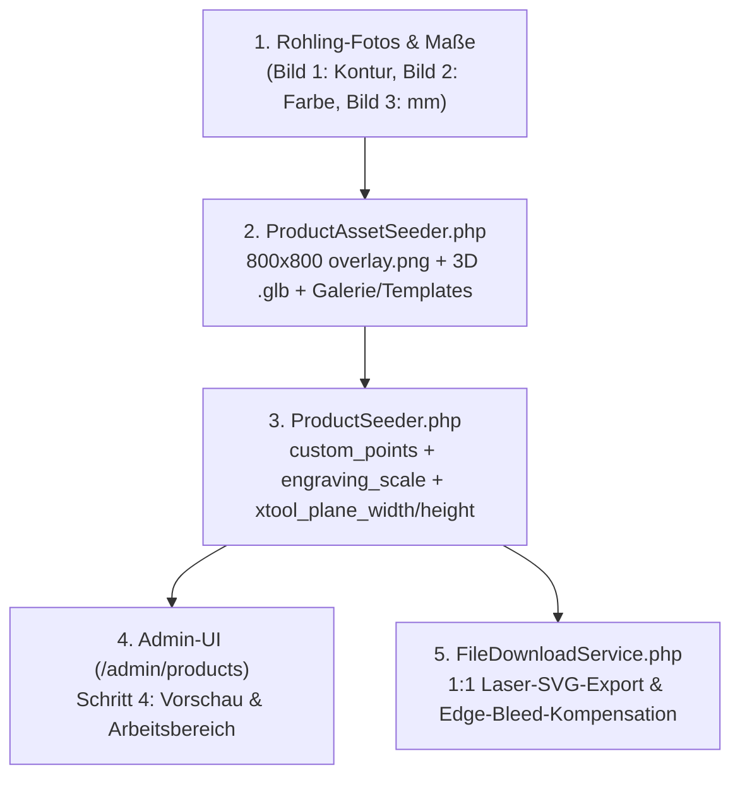

# Abschlussbericht & Prompt-Leitfaden: Maßstabsgetreue 2D-/3D-Produktkalibrierung, Overlay-Erstellung & Arbeitsflächen-Definition

**Status:** Aktiv / Verbindliche technische Referenz & Prompt-Vorlage  
**Projekt:** Mein-Seelenfunke (`/home/ubuntuxina/meine-projekte/seelenfunke`)  
**Abteilung:** Produkte / 2D- & 3D-Konfigurator / Laser-SVG-Pipeline (xTool F2 Ultra UV)  
**Referenz-Produkte:** *Der Seelenanhänger* (`seelen-anhaenger`) & *Die Seelen-Pfote* (`seelen-pfote-hundemarke`)  
**Letzte Aktualisierung:** 11.11.2026  

---

## 1. Zielsetzung dieses Berichts

Dieser Bericht dokumentiert den exakten technischen Ablauf sowie die optimale **Prompt-Struktur**, mit der ein physisches Manufaktur-Produkt im Seelenfunke-System so überarbeitet wird, dass:
1. **2D-Editor (`overlay.png`)**, **3D-Ansicht (`.glb`)**, **Produkt- & Vorlagenbilder (`media_gallery` / `product-templates`)** und **Technisches Maßblatt (`{slug}-dimensions.jpg`)** zu 100 % dem realen physischen Rohling entsprechen (inkl. korrekter Metallfarbe, Spiegelungen und echter transparenter Stanz-Durchbrüche).
2. Die **Arbeitsfläche (`custom_points`)** millimetergenau der realen Produktkontur folgt, Ösen sowie Stanzlöcher (z. B. Pfoten-Durchbruch) mit gleichmäßigem Sicherheitsabstand ausspart und im **Laser-SVG-Export (`FileDownloadService.php`)** ohne abgeschnittene Kanten 1:1 auf das reale Millimeter-Maß (`xtool_plane_width` × `xtool_plane_height`) abgebildet wird.

---

## 2. Die perfekte Prompt-Vorlage (Copy-Paste für zukünftige Produkte)

Wenn ein bestehendes oder neues Produkt auf Basis echter Rohling-Fotos maßstabsgetreu perfektioniert werden soll, führt folgender Prompt (zusammen mit **3 angehängten Bildern**) in einem einzigen Durchgang zum optimalen Ergebnis:

### Empfohlene Anhänge zum Prompt
* **Bild 1 (Top-Down-Foto des echten Rohlings):** Senkrecht von oben fotografierter Rohling auf neutralem, hellem Untergrund (zeigt die exakte Kontur, Stanzlöcher/Durchbrüche und reale Spiegelungen).
* **Bild 2 (Farb- & Material-Referenzfoto):** Leicht schräges Foto des Rohlings bei Tages-/Studiolicht (zeigt den echten Farbton des Metalls, z. B. warmes 14k Gold-Finish vs. Silber vs. Schwarz eloxiert, ohne dass dunkle Handyspiegelungen die Farbe verfälschen).
* **Bild 3 (Maßbild / Technische Daten):** Lieferanten-Maßbild oder Angabe der exakten Millimeter-Maße (`Breite × Höhe × Stärke in mm`, Gewicht in `g`).

### Copy-Paste Master-Prompt
```text
Überarbeite und prüfe das Produkt "[PRODUKTNAME]" ([SLUG]) komplett maßstabsgetreu nach den angehängten Originalfotos:

1. 2D-Overlay (overlay.png + saisonale Overlays) & Maßstabsgetreue Zentrierung:
   - Nutze Bild 1 als exakte geometrische Vorlage für Kontur, Proportionen, Fasen und Spiegelungen sowie Bild 2 für den echten Farbton ([z. B. warmes hochglanzpoliertes Gold / Silber / Schwarz eloxiert]).
   - Positioniere das Produkt im 800x800 Canvas exakt symmetrisch um die Mitte (400, 400), sodass min(X) + max(X) = 800 und min(Y) + max(Y) = 800 gilt (damit Three.js box.getCenter() in 3D zu 100 % deckungsgleich mit der 2D-Ansicht ist).
   - Alle Stanzlöcher / Durchbrüche ([z. B. obere Öse, Pfoten-Durchbruch unten rechts, Herz-Cutout]) müssen im PNG zu 100 % transparent (alpha = 0) mit realistischer 3D-Innenfase sein.

2. 3D-Ansicht (.glb in ProductAssetSeeder.php):
   - Überarbeite das 3D-Mesh exakt passend zur 800x800 Kontur des Overlays.
   - Setze alle Durchbrüche/Ausstanzungen detailliert mit alphaMode = 'MASK' (alphaCutoff = 0.35) und echten extrudierten 3D-Innenwänden ($addHoleWallAndBevel) um, sodass sie in der 3D-Ansicht perfekt sitzen und durchsichtig sind.
   - Berechne engraving_scale und back_engraving_scale exakt nach der Formel 800 / (maxSpanPx * 1.5) * 100, damit Text und Motive zwischen 2D-Editor und 3D-Ansicht keinen Millimeter verrutschen.

3. Arbeitsfläche (custom_points) & Laser-SVG-Maße (ProductSeeder.php & FileDownloadService.php):
   - Passe die Gravurfläche (custom_points) mit einem gleichmäßigen Sicherheitsabstand (ca. 10 px / 1,25 %) exakt an die neue Kontur an und spare Ösen sowie Durchbrüche sauber durch geschmeidige Bézier-Bögen aus.
   - Hinterlege die realen Millimeter-Maße (xtool_plane_width = [BREITE_MM], xtool_plane_height = [HOEHE_MM] aus Bild 3) und stelle sicher, dass auch flächendeckende Fotos im SVG-Export rundherum sauber ohne abgeflachte Ränder geclippt werden.

4. Produktbilder, Maßblatt & Produktvorlagen-Bilder:
   - Aktualisiere alle Produktbilder (main, back, lifestyle), das technische Maßblatt ({slug}-dimensions.jpg) und alle 8 Feiertags-Vorlagenbilder (product-templates/{slug}-*.jpg) sowie die Texte/Attribute im Seeder passend zum realen [Gold/Silber]-Rohling und führe die Seeder aus.
```

---

## 3. Technische Architektur & Wo man was im System einstellt



### 3.1 Wo wird die Arbeitsfläche und 2D/3D-Kalibrierung im System definiert?

Es gibt zwei synchronisierte Orte im System:

1. **Visueller Editor im Admin-Backend (`/admin/products`):**
   - Pfad im Menü: **Produkte $\rightarrow$ Produktübersicht (`/admin/products`) $\rightarrow$ Produkt bearbeiten $\rightarrow$ Schritt 4: „Vorschau & Arbeitsbereich“**.
   - Relevante Dateien der Admin-Oberfläche:
     - [`ProductCreate.php`](file://wsl.localhost/Ubuntu/home/ubuntuxina/meine-projekte/seelenfunke/app/Livewire/Shop/Product/ProductCreate.php) & [`ProductConfiguratorSettings.php`](file://wsl.localhost/Ubuntu/home/ubuntuxina/meine-projekte/seelenfunke/app/Livewire/Shop/Product/ProductConfiguratorSettings.php)
     - [`product-configurator-settings.blade.php`](file://wsl.localhost/Ubuntu/home/ubuntuxina/meine-projekte/seelenfunke/resources/views/livewire/shop/product/product-configurator-settings/product-configurator-settings.blade.php)
   - Dort können folgende Parameter live eingestellt und getestet werden:
     - **Arbeitsbereich-Form (`area_shape`):** `rect` (Rechteck), `circle` (Kreis) oder `custom` (Freiform-Polygon mit beliebig vielen Punkten).
     - **Polygon-Punkte (`custom_points`):** Liste aus `['x' => %, 'y' => %]`-Koordinaten (`0.00` bis `100.00`), bezogen auf das `800 × 800` Quadrat des Produkt-Overlays.
     - **Laser-Werkstückmaße (`xtool_plane_width` & `xtool_plane_height`):** Exakte Breite und Höhe der Arbeitsfläche in Millimetern für xTool Creative Space.
     - **3D-Modell & Gravur-Projektion (`model_scale`, `engraving_scale`, `back_engraving_scale`, `back_engraving_pos_z`):** Steuerung der 3D-Darstellung.

2. **Persistente Verankerung im Datenbank-Seeder (Pflicht nach Seelenfunke-Regel #5):**
   - Damit Einstellungen bei einem Re-Seed (`php artisan db:seed`) niemals verloren gehen, werden alle Werte dauerhaft in [`database/seeders/ProductSeeder.php`](file://wsl.localhost/Ubuntu/home/ubuntuxina/meine-projekte/seelenfunke/database/seeders/ProductSeeder.php) im Array `'configurator_settings'` des jeweiligen Produkts gespeichert.
   - Alle generierten Grafik- und 3D-Assets (`overlay.png`, `overlay_christmas.png`, `.glb`, `{slug}-dimensions.jpg`, Galerie- & Vorlagenbilder) werden deterministisch in [`database/seeders/ProductAssetSeeder.php`](file://wsl.localhost/Ubuntu/home/ubuntuxina/meine-projekte/seelenfunke/database/seeders/ProductAssetSeeder.php) erzeugt.

---

## 4. Die Mathematik der 100 %igen 2D-/3D-Deckungsgleichheit

### 4.1 Warum `min(X) + max(X) = 800` und `min(Y) + max(Y) = 800` im `800 × 800` Overlay Pflicht sind

In [`scripts_frontend_2.blade.php`](file://wsl.localhost/Ubuntu/home/ubuntuxina/meine-projekte/seelenfunke/resources/views/livewire/shop/product/product-configurator/partials/scripts_frontend_2.blade.php) lädt Three.js das `.glb`-Modell und führt folgende Zentrierung aus:
```javascript
const box = new THREE.Box3().setFromObject(model);
const center = box.getCenter(new THREE.Vector3());
model.position.sub(center);
```
Das 3D-Mesh wird in [`ProductAssetSeeder.php`](file://wsl.localhost/Ubuntu/home/ubuntuxina/meine-projekte/seelenfunke/database/seeders/ProductAssetSeeder.php) aus den Pixel-Koordinaten `(px, py)` des `800 × 800`-Overlays über die Transformation
$$X_{3\text{D}} = \frac{\text{px} - 400}{360}, \qquad Y_{3\text{D}} = \frac{400 - \text{py}}{360}$$
erzeugt.
- Wenn das Produkt im `800 × 800`-Bild exakt so platziert ist, dass sein linker und rechter Rand symmetrisch zu `400` liegen ($\text{px}_{\min} + \text{px}_{\max} = 800$) und sein oberer und unterer Rand ebenfalls symmetrisch zu `400` liegen ($\text{py}_{\min} + \text{py}_{\max} = 800$), dann ist der Bounding-Box-Mittelpunkt `box.getCenter()` exakt `(0, 0, 0)`.
- Dadurch verschiebt `model.position.sub(center)` das Modell um `(0, 0, 0)`, und die 2D-Bühnenmitte `(50 %, 50 %)` stimmt ohne manuelle Offsets (`engraving_pos_x = 0`, `engraving_pos_y = 0`) auf den Bruchteil eines Millimeters mit der 3D-Mitte überein!

| Produkt | Pixel-Spanne X (`800×800`) | Pixel-Spanne Y (`800×800`) | Symmetrie-Check (`min + max`) |
| :--- | :--- | :--- | :--- |
| **Der Seelenanhänger** (`seelen-anhaenger`) | `60.0 .. 740.0` (`680 px`) | `60.0 .. 740.0` (`680 px`) | `60 + 740 = 800` / `60 + 740 = 800` |
| **Die Seelen-Pfote** (`seelen-pfote-hundemarke`) | `80.0 .. 720.0` (`640 px`) | `238.0 .. 562.0` (`324 px`) | `80 + 720 = 800` / `238 + 562 = 800` |

### 4.2 Die exakte Formel für `engraving_scale`

Three.js projiziert das quadratische 2D-Gravur-Canvas (`800 × 800`) auf eine 3D-Ebene (`PlaneGeometry`), deren Basisgröße `maxPlaneSize` aus der größten Ausdehnung des 3D-Modells berechnet wird:
$$\text{maxPlaneSize} = \max(\Delta X_{3\text{D}}, \Delta Y_{3\text{D}}) \cdot 1{,}5 = \frac{\max(\Delta X_{\text{px}}, \Delta Y_{\text{px}})}{360} \cdot 1{,}5$$
Das gesamte `800 × 800`-Overlay entspricht in 3D-Einheiten einer Breite von $\frac{800}{360} = 2{,}2222$. Damit die 3D-Gravur-Ebene exakt dieselbe Größe wie das `800 × 800`-Overlay hat, muss `engraving_scale` (in Prozent) genau das Verhältnis dieser beiden Größen sein:
$$\text{engraving\_scale} = \frac{800}{\max(\Delta X_{\text{px}}, \Delta Y_{\text{px}}) \cdot 1{,}5} \cdot 100$$

- **Rechenbeispiel *Der Seelenanhänger* ($\max(\Delta X_{\text{px}}, \Delta Y_{\text{px}}) = 680\text{ px}$):**
  $$\text{engraving\_scale} = \frac{800}{680 \cdot 1{,}5} \cdot 100 = \frac{800}{1020} \cdot 100 = \mathbf{78{,}4\,\%}$$
- **Rechenbeispiel *Die Seelen-Pfote* ($\max(\Delta X_{\text{px}}, \Delta Y_{\text{px}}) = 640\text{ px}$):**
  $$\text{engraving\_scale} = \frac{800}{640 \cdot 1{,}5} \cdot 100 = \frac{800}{960} \cdot 100 = \mathbf{83{,}3\,\%}$$

---

## 5. Umsetzung von echten 3D-Durchbrüchen (Beispiel: Pfoten-Symbol & Öse bei „Die Seelen-Pfote“)

Damit ausgestanzte Konturen (wie der 5-teilige Pfotenabdruck unten rechts bei *Die Seelen-Pfote* mit nierenförmigem Hauptballen und 4 ovalen Zehenballen) sowohl in 2D als auch in 3D gestochen scharf und echt durchbrochen erscheinen, greifen in [`ProductAssetSeeder.php`](file://wsl.localhost/Ubuntu/home/ubuntuxina/meine-projekte/seelenfunke/database/seeders/ProductAssetSeeder.php) drei Mechanismen ineinander:

1. **Analytische Signed-Distance-Funktion (SDF) im 2D-Overlay (`renderPfoteGoldOverlay`):**
   - Der nieren-/herzförmige Hauptballen bei `(634.8, 478.9)` wird über eine polare Fourier-Reihe entlang der `225°`-Diagonalachse modelliert:
     $$R_{\text{pad}}(\delta) = 25{,}5 - 3{,}2\cos(\delta) - 1{,}2\cos(2\delta) - 6{,}8\cos(3\delta) + 2{,}0\cos(4\delta) \quad \text{mit } \delta = \theta - \frac{\pi}{4}$$
   - Zusammen mit den 4 gedrehten Ellipsen der Zehenballen und dem oberen Ösenloch `(400.0, 279.0, r = 23.5)` liefert `$holeSignedDistance($px, $py)` für jeden Subpixel den exakten euklidischen Abstand zur nächsten Lochkante.
   - Innerhalb der Löcher ist `alpha = 0` (100 % transparent); im Randbereich `0 < dEdge < 8.5 px` wird eine plastische 3D-Gold-Innenfase berechnet.
2. **Alpha-Masking im glTF-Material (`buildSingleTexturedGlb`):**
   - Im Material `PolishedGoldMetal` sind `'alphaMode' => 'MASK'` und `'alphaCutoff' => 0.35` gesetzt. Dadurch schneiden sowohl Three.js als auch externe 3D-Viewer alle transparenten Bereiche der Vorder- und Rückseite exakt entlang der Textur-Kontur aus.
3. **Extrudierte 3D-Innenwände (`$addHoleWallAndBevel` in `buildPfote3DMesh`):**
   - Damit man beim Drehen des 3D-Modells in den ausgestanzten Pfotenballen und in der Öse die reale Materialstärke (`1,8 mm`) sieht, erzeugt `$addHoleWallAndBevel` für die Öse, den nierenförmigen Hauptballen (`getPfoteMainPadPoints`) und alle 4 Zehenballen (`getPfoteToeDefinitions`) vertikale 3D-Mantelflächen zwischen $+z_{\text{Half}}$ und $-z_{\text{Half}}$, deren UV-Koordinaten auf opakes Gold `(300/800, 400/800)` zeigen.

---

## 6. Laser-SVG-Export & Schutz vor abgeflachten Rändern bei Vollflächen-Fotos

Wenn ein Kunde ein eigenes Foto groß über die gesamte Arbeitsfläche zieht, sorgt [`FileDownloadService.php`](file://wsl.localhost/Ubuntu/home/ubuntuxina/meine-projekte/seelenfunke/app/Services/Export/FileDownloadService.php) in zwei Stufen für einen abmahnsicheren, millimetergenauen Laser-Export:
1. **3-stufiges Corner-Preserving Chaikin-Smoothing (`buildWorkingAreaPolygonPercent`):**
   - Wandelt das `custom_points`-Polygon in eine hochauflösende, glatte Kurve um (identisch zur grünen Arbeitsbereich-Linie im 2D-Editor), während scharfe Kerben (wie die obere Herz-Einkerbung) exakt erhalten bleiben.
2. **Automatische Full-Area Edge-Bleed-Kompensation (`clipAndNormalizeRasterLogoForLaser`):**
   - Wenn ein rechteckiges Kundenfoto die Arbeitsflächen-Breite oder -Höhe zu $\ge 82\,\%$ ausfüllt, können die vier geraden Bildkanten bei stark gewölbten Formen (z. B. den äußeren Herzbögen bei `X = 11.15 %` und `X = 88.85 %`) knapp innerhalb des Polygons liegen und sonst eine senkrechte Schnittkante erzeugen.
   - Der Export berechnet automatisch den minimal erforderlichen Skalierungsfaktor `$scaleBleed` (bis max. `1.22`), sodass das Foto die gekrümmten Polygon-Außenränder vollständig ausfüllt und anschließend exakt entlang der glatten Polygon-Kurve ausgeschnitten wird.

---

## 7. Konfigurator Top-Bar, Zoom-Regler & Extra-Zoomfenster (Minimap)

Da bei mehrteiligen Produkten (z. B. Schlüsselanhängern mit Spaltring und Verbindungsgliedern) das gesamte Produkt maßstabsgetreu auf der Bühne dargestellt wird, befindet sich über und auf der 2D-Ansicht (`resources/views/livewire/shop/product/product-configurator/partials/preview.blade.php` & `scripts_frontend_1.blade.php`) folgende ergonomische Steuerung:

1. **Obere Steuerleiste außerhalb der Ansicht:**
   - **Links bündig:** `ZURÜCK | VOR` (Undo/Redo).
   - **Mittig:** `2D EDITOR | 3D ANSICHT` Switch.
   - **Rechts bündig:** `MAXIMAL` / `VERKLEINERN` Button.
2. **Zoom-Regler mittig oben auf der Ansicht (`100 %` bis `300 %`):**
   - Kompakter Weiß/Gold-Regler mit Lupen-Buttons (`-` / `+`), stufenlosem Slider (`stageZoom` von `1.0` bis `3.0`) und Klick-Reset (`100%`).
   - Beim ersten Heranzoomen fokussiert die Kamera automatisch auf das Zentrum der grünen Gravurfläche (`areaCenterX`, `areaCenterY`).
   - Alle Interaktionen (`drag`, `resize`, `rotate`, `crop`) rechnen über `getStageRect()` relativ zum gezoomten Zeichenbrett (`x-ref="drawingBoard"`), sodass Elemente in jeder Zoomstufe ohne Cursor-Versatz bewegt werden können.
3. **Extra-Zoomfenster (Navigator / Minimap) oben rechts (`stageZoom > 1.01`):**
   - Sobald herangezoomt wird, blendet sich oben rechts in der Ansicht das **Extra-Zoomfenster** (`x-ref="zoomMinimap"`) ein.
   - Es zeigt das gesamte Produkt samt grüner Gravurfläche als Übersicht und hebt den aktuellen Bildausschnitt mit einem **goldenen Rahmen** hervor, der sich per Maus oder Touch millimetergenau (`0,01 %` Auflösung) über das Produkt verschieben lässt.

---

## 7. 3-Stufen-Startauswahl (`Neuling` / `Anfänger` / `Profi`), Nicht-Manipulative 2D/3D-Vorschau & „Neulings-Position“

Unter *„Wie möchtest du starten?“* (`resources/views/livewire/shop/product/partials/product-show/right.blade.php`) wählt der Kunde aus drei kompakten, quadratischen Kacheln:
1. **Neuling (Einfache Variante – Smaragd-Rahmen):**
   - Öffnet für 2D/3D-Studio-Produkte die **echte 2D- & 3D-Ansicht im nicht-manipulativen Read-Only-Modus** (`$isBeginnerStudioMode = true`, `config.isBeginnerMode = true`) oberhalb der drei einfachen Eingabefelder (`1. Wunsch-Symbol`, `2. Wunschtext / Name`, `3. Schriftart`).
   - Alle manipulativen Werkzeuge (Verschieben, Drehen, Skalieren, Löschen, schwebender Werkzeugkasten, Ebenenleiste) sind ausgeblendet; aktiv bleiben der `2D Vorschau | 3D Ansicht` Switch, der `Zoom-Regler + Minimap` sowie der `Maximal`-Button.
   - **Neulings-Position (`HandlesConfiguratorLogic::getBeginnerPositionCoordinates` & Step 4.3 `working_area_config_ranges.blade.php`):**
     - **Symbol (oben mittig):** `beginner_symbol_x`, `beginner_symbol_y`, `beginner_symbol_size` (automatisch aus der Produktgeometrie bzw. `custom_points` berechnet und im Backend unter Schritt `4.3 -> 1. Arbeitsbereich (2D) -> ⚡ Neulings-Position` feinjustierbar).
     - **Wunschtext (unten mittig):** `beginner_text_x`, `beginner_text_y`, `beginner_text_size` (synchronisiert bei jedem Tastendruck in 0 ms via `syncBeginnerInputsToStage()` sowohl das 2D-Zeichenbrett als auch die 3D-WebGL-Gravurtextur und den 1:1 **xTool Laser-SVG-Export** unter `/admin/orders`).
2. **Anfänger (Vorlage nutzen – Silber-Rahmen):** Öffnet das Anlass-Vorlagen-Karussell und lädt die gewählte Vorlage in den 2D/3D-Editor.
3. **Profi (Selber Konfigurieren – Gold-Rahmen):** Öffnet den vollen 2D/3D-Studio-Konfigurator im Leerstart.
