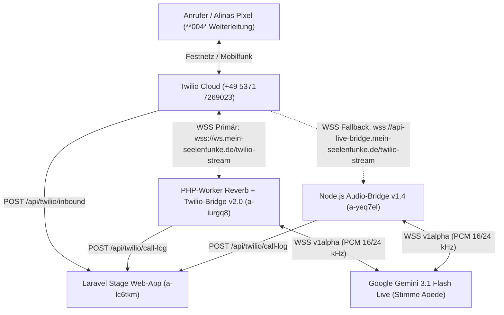

# System-Dokumentation: Support / Telefonie (Twilio & Gemini Voice Bridge)

> [!NOTE]
> **Vollständige Infrastruktur- & Mittwald-Container-Referenz:** Den detaillierten Gesamtaufbau aller Mittwald-Container (`a-lc6tkm`, `a-iurgq8`, `a-yeq7el`), SSH-Zugänge, Chroot-Regeln, `mittnitectl`-Neustarts und Deployment-Abläufe findest du in [`Support_Twilio_Call_Dokumentation.md`](file://wsl.localhost/Ubuntu/home/ubuntuxina/meine-projekte/seelenfunke/Abschlussberichte/Support/Support_Twilio_Call_Dokumentation.md).

Das Telefonie-Modul bindet das Fest- und Mobilfunknetz über bidirektionale Echtzeit-WebSockets an die Google Gemini Multimodal Live API (`models/gemini-3.1-flash-live-preview`, Stimme `Aoede`) an. Dies ermöglicht sowohl ausgehende KI-Telefonate als auch Alinas persönliche Whitelist-Telefonsekretärin (`Funkira`) inklusive vollautomatischer Nachbereitung im Dashboard und in der Funkenwerk Android App.

---

## 1. Übersicht & Zielsetzung

- **Sprachkanal & Smartphone-Sekretärin:** Entgegennahme weitergeleiteter Anrufe bekannter Kontakte (`+49 5371 7269023`) sowie Durchführung geplanter Telefonate mit natürlicher Echtzeit-Stimme (`Aoede`).
- **Echtzeit-Audio-Streaming ab Sekunde `0.0`:** Direkte bidirektionale Kopplung zwischen Twilio Media Streams und Gemini Live ohne vorgeschaltete Bandansage.
- **Automatisierte Nachbereitung:** Vollständige Transkription, strukturierte Zusammenfassung (*Besprochen*, *Rahmenbedingungen*, *Für dich zu tun*), automatische Aufgabenanlage auf `/admin/dashboard` sowie Push-Benachrichtigung aufs Smartphone.

---

## 2. Technische System-Architektur auf Mittwald mStudio

### 2.1 Laravel Backend (`seelenfunke-stage`, Container `a-lc6tkm`)
- **Livewire-Komponente:** [`SupportTelephony`](file://wsl.localhost/Ubuntu/home/ubuntuxina/meine-projekte/seelenfunke/app/Livewire/Shop/Support/SupportTelephony.php)
- **Webhook-Controller:** [`TwilioCallController`](file://wsl.localhost/Ubuntu/home/ubuntuxina/meine-projekte/seelenfunke/app/Http/Controllers/Api/TwilioCallController.php)
- **Whitelist- & Sekretärinnen-Service:** [`FunkiraPhoneConciergeService`](file://wsl.localhost/Ubuntu/home/ubuntuxina/meine-projekte/seelenfunke/app/Services/System/FunkiraPhoneConciergeService.php)
- **Modell:** [`SupportTelephonyCall`](file://wsl.localhost/Ubuntu/home/ubuntuxina/meine-projekte/seelenfunke/app/Models/SupportTelephonyCall.php)
- **Aufgabe:** Signaturprüfung (`X-Twilio-Signature`), `0,00 EUR` Whitelist-Filterung, Übergabe von System-Prompt & anonymisierter Kalender-Verfügbarkeit per einmaligem 256-Bit-Nonce-Token sowie strukturierte Post-Call-Auswertung.

### 2.2 Duale Audio-Bridge-Infrastruktur (`a-iurgq8` & `a-yeq7el`)
1. **Primäre Telefonie-Bridge im Reverb-Worker (`a-iurgq8`, `/html/worker-stage-3`):**
   - Läuft nativ in [`ReverbWithTwilioServerCommand`](file://wsl.localhost/Ubuntu/home/ubuntuxina/meine-projekte/seelenfunke/app/Console/Commands/ReverbWithTwilioServerCommand.php) und [`TwilioGeminiLiveBridgeService`](file://wsl.localhost/Ubuntu/home/ubuntuxina/meine-projekte/seelenfunke/app/Services/System/TwilioGeminiLiveBridgeService.php) (`v2.0-reverb-live-secretary`) unter `wss://ws.mein-seelenfunke.de/twilio-stream` (Health-Check: `https://ws.mein-seelenfunke.de/twilio-health`).
   - [`AudioMulawCodec`](file://wsl.localhost/Ubuntu/home/ubuntuxina/meine-projekte/seelenfunke/app/Services/System/AudioMulawCodec.php) konvertiert eingehendes `8 kHz G.711 mu-Law` knackfrei auf `16 kHz PCM` und ausgehendes `24 kHz PCM` per `3-Tap`-Tiefpassfilter auf `8 kHz mu-Law`.
2. **Dedizierte Node.js Live-AI & Audio-Bridge (`a-yeq7el`, `/html/twilio-bridge`):**
   - Läuft in [`server-twilio.js`](file://wsl.localhost/Ubuntu/home/ubuntuxina/meine-projekte/seelenfunke/server-twilio.js) (`v1.4-live-secretary`) unter `wss://api-live-bridge.mein-seelenfunke.de` (Health-Check: `https://api-live-bridge.mein-seelenfunke.de/health`).
   - Bedient primär den Live-AI-Sprachmodus für Web-Portal und Android (`/gemini-live`) sowie optional `/twilio-stream`.
3. **Unterbrechungserkennung (Barge-In / VAD):**
   - Spricht der Mensch, während die KI antwortet, sendet die Bridge sofort ein `clear`-Event an Twilio, um den aktuellen Wiedergabepuffer ohne Übersprechen zu leeren.

### 2.3 Google Gemini Live API & Post-Call-Auswertung
- **Live-Sprachmodell:** `models/gemini-3.1-flash-live-preview` über den `v1alpha` WebSocket-Endpunkt (Stimme `Aoede`).
- **Post-Call-Analyse:** `gemini-2.5-flash` (mit automatischem Fallback auf `gemini-flash-latest` sowie deterministischer Transkript-Extraktion über erzwungenes IPv4).

---

## 3. Datenfluss bei einem Telefonat

1. **Anrufeingang / Auslösung:** Twilio ruft `POST /api/twilio/inbound` auf (bzw. erhält bei Outbound-Calls direkt das `<Connect><Stream>`-TwiML).
2. **TwiML Stream:** Für freigegebene Anrufer öffnet Twilio sofort ab Sekunde `0.0` den bidirektionalen WebSocket-Stream zu `wss://ws.mein-seelenfunke.de/twilio-stream`.
3. **Live-Dialog:** Die Bridge verbindet sich mit Gemini Live, übermittelt den Kontext (Rufname des Kontakts, Kalender-Frei/Belegt-Status, Gesprächsziel) und führt das Gespräch in Echtzeit.
4. **Sauberes Gesprächsende:** Ruft die KI das Tool `end_call` auf, wartet die Bridge auf Geminis `turnComplete`, sendet ein `mark`-Event (`end_of_call`) an Twilio und schließt die Leitung erst, nachdem der letzte gesprochene Satz vollständig beim Anrufer abgespielt wurde.
5. **Auswertung & Aufgaben-Sync:** `POST /api/twilio/call-log` speichert das Gespräch in `support_telephony_calls`, legt auf `/admin/dashboard` eine Aufgabe samt abhakbarer Unteraufgabe an und sendet eine FCM-Push-Benachrichtigung an Alinas Smartphone.

---

## 4. Sicherheitssteuerung & Kostenkontrolle
- **Strikter `0,00 EUR` Whitelist-Türsteher:** Unbekannte oder nicht freigegebene Nummern werden vor Gesprächsannahme per `<Reject reason="busy"/>` abgewiesen (`0,00 EUR` Verbindungskosten, `0` KI-Tokens).
- **Nachtruhe-Switch & Tages-Kosten-Limit:** Globale Schutzschalter verhindern unerwünschte Telefonate außerhalb definierter Zeiten sowie Endlosschleifen.
- **Kryptografische Absicherung:** `X-Twilio-Signature`-Prüfung auf Webhooks, einmalige 256-Bit-Call-Nonces pro Gespräch und synchronisiertes `GEMINI_BRIDGE_SECRET` (inkl. `HMAC-SHA256`-Fallback) zwischen allen Mittwald-Containern.

---

## 5. Eingehende Whitelist-Sekretärin (`Funkira`) auf Gifhorner Rufnummer (`+49 5371 7269023`)

- **Twilio-Rufnummer:** `+49 5371 7269023` (`PNf6a25b6a41ab6c0c82e2b64839a84307`), gekoppelt an `POST https://stage.mein-seelenfunke.de/api/twilio/inbound` sowie `POST https://stage.mein-seelenfunke.de/api/twilio/inbound-status`.
- **Android-16 Smartphone-Kopplung:** Über die `**004*+4953717269023#`-Rufumleitung und den `FunkiraCallScreeningService` in der Funkenwerk Android App (`v1.7.1`) werden freigegebene Kontakte (`management_contacts.funkira_call_whitelist = true`) bei Besetzt, Nichtannahme oder Nichterreichbarkeit nahtlos an Funkira übergeben.
- **Natürliches Live-Gespräch ab Sekunde `0.0`:** Ohne starre Vorab-Audiodatei begrüßt Funkira den Anrufer live beim Vornamen, erfragt Anliegen, Eckdaten/Termine und konkrete Aufgaben für Alina und fasst alles übersichtlich auf `/admin/dashboard` sowie in der Android App zusammen.
