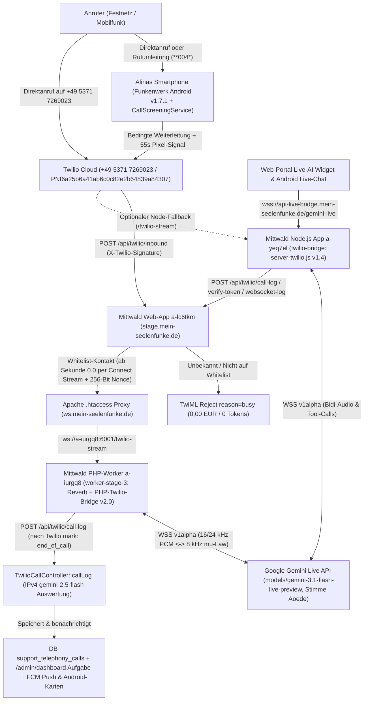

# Master-Architektur & Abschlussbericht: Twilio KI-Telefonie, Gemini Live & Mittwald mStudio

**Stand:** 15.11.2026  
**Systeme:** Twilio (`+49 5371 7269023`), Google Gemini Live API (`models/gemini-3.1-flash-live-preview` / `Aoede`), Mittwald mStudio (`Projekt p-g27wim`), Funkenwerk Android (`v1.7.1`) & Funkenwerk Desktop Collection (`SSH`, `FTP`, `MCP`)  
**Status:** Produktiv auf Stage verifiziert (`0` offene Fehler, vollautomatischer 4-Stufen-Rollout inkl. Container-Neustart auf `a-iurgq8` & `a-yeq7el`)

---

## 1. Gesamtarchitektur: Zusammenspiel von Twilio, Android, Mittwald & Gemini Live

Dieses Kapitel dokumentiert den verbindlichen Gesamtaufbau aller beteiligten Systeme, Container, Domains, WebSockets und Sicherheitsmechanismen.

### 1.1 End-to-End Daten- & Audiofluss



---

### 1.2 Vollständige Mittwald mStudio Container-, Domain- & SSH-Matrix (`Projekt p-g27wim`)

Auf Mittwald mStudio läuft **jede App und jeder Worker in einem eigenen, strikt isolierten Container** mit eigenem Dateisystem-Käfig (`Chroot`). Alle SSH-/SFTP-Verbindungen laufen über den Host **`ssh.altgemeinde.project.host`** (Port `22`, ausschließlich per `Ed25519`-Key `~/.ssh/id_ed25519` + SHA-256 Host-Key-Pinning), landen aber **je nach Benutzername in einem anderen Container**:

| mStudio App / Bereich | Shortcode | Exakter SSH-Benutzername | Funkenwerk-Profil (`SSH` / `FTP` / `MCP`) | Server-Pfad (`Chroot`-Wurzel) | Öffentliche Domain / Internes Ziel | Laufender Prozess & Aufgabe | `/var/run/mittnite.sock` vorhanden? |
| :--- | :--- | :--- | :--- | :--- | :--- | :--- | :--- |
| **Web-App Stage** (`seelenfunke-stage`) | **`a-lc6tkm`** | `kontakt@mein-seelenfunke.de@a-lc6tkm` | `Mittwald` | `/home/p-g27wim/html/seelenfunke-stage` | `https://stage.mein-seelenfunke.de` + `.htaccess`-Proxy für `ws.mein-seelenfunke.de` | Apache + PHP-FPM + minütlicher System-Cronjob `/usr/bin/php /html/seelenfunke-stage/artisan schedule:run` (`* * * * *`) | Nein (Web-Container) |
| **PHP-Worker Websocket** (`WORKER - Websocket Stage`) | **`a-iurgq8`** | `kontakt@mein-seelenfunke.de@a-iurgq8` | `Mittwald Websocket` | `/home/p-g27wim/html/worker-stage-3` | Intern: `http://a-iurgq8:6001` / `ws://a-iurgq8:6001`<br>Öffentlich via `.htaccess`: `wss://ws.mein-seelenfunke.de` | `mittnite` überwacht `php artisan reverb:start --host=0.0.0.0 --port=6001` (Reverb Pusher-Events **+ native Twilio-Sekretärin `v2.0`**) | **JA** (`mittnitectl job restart`) |
| **Node.js App** (`seelenfunke-nodejs`) | **`a-yeq7el`** | `kontakt@mein-seelenfunke.de@a-yeq7el` | `Mittwald Node.js App` | `/home/p-g27wim/html/twilio-bridge` | Öffentlich direkt verknüpft:<br>`https://api-live-bridge.mein-seelenfunke.de` | `mittnite` überwacht `node server-twilio.js` (`v1.4-live-secretary` für `/gemini-live`, `/twilio-stream` & `GET /health`) | **JA** (`mittnitectl job restart`) |
| **Allgemeiner Projekt-SSH / SFTP-Pod** | `a-bycqrf` / `sftp-nvhbhb` | `ssh-cqa7h4@a-bycqrf` | *(Wird in Funkenwerk automatisch auf `a-yeq7el` umgeleitet, sobald `Node.js` / `twilio-bridge` gewählt wird)* | `/home/p-g27wim` | Keine Web-/Worker-Prozesssteuerung | Nur allgemeiner Dateizugriff; besitzt **keinen** Zugriff auf den `mittnite`-Prozess von `a-iurgq8` oder `a-yeq7el` | Nein |
| **Live-Produktivsystem** (Air-Gapped) | Separater `production`-Branch | Technisch gesperrt für Stage-Tools | In `McpSecurityGuard.cs` & `./funki` gesperrt | `/home/p-g27wim/html/seelenfunke-live` | `https://mein-seelenfunke.de` | Vierfache Air-Gap-Sperre schützt Live vor jedem Stage-Autopilot-Zugriff | Gesperrt |

---

### 1.3 Die 3 goldenen Infrastruktur-Gesetze auf Mittwald mStudio

1. **Gesetz 1: Chroot-Käfig verbietet Symlinks nach außen (`cp` / `rsync` statt `ln -s`)**
   * Innerhalb des Containers `a-iurgq8` beginnt die Welt bei `/html/worker-stage-3`; innerhalb von `a-yeq7el` beginnt sie bei `/html/twilio-bridge`.
   * Ein Symlink wie `ln -s ../seelenfunke-stage/server-twilio.js` zeigt aus dem Container-Käfig heraus, ist zur Laufzeit tot (`Broken Link`) und führt sofort zu `MODULE_NOT_FOUND` bzw. `503 Service Unavailable`.
   * **Regel:** Alle benötigten Dateien werden durch `./funki sync-worker` physisch in die Zielordner `/home/p-g27wim/html/worker-stage-3` und `/home/p-g27wim/html/twilio-bridge` kopiert.
2. **Gesetz 2: Prozess-Neustart (`mittnitectl`) funktioniert nur im jeweiligen Ziel-Container**
   * Mittwalds Prozess-Supervisor heißt `mittnite` und lauscht auf dem lokalen Unix-Socket `/var/run/mittnite.sock` **innerhalb** des jeweiligen App-/Worker-Containers (`a-iurgq8` bzw. `a-yeq7el`).
   * Führt man `mittnitectl job restart` oder `killall node` im Web-Container (`a-lc6tkm`) oder im allgemeinen SSH-Pod (`a-bycqrf`) aus, schlägt dies fehl (`dial unix /var/run/mittnite.sock: no such file or directory`), und im RAM des App-Containers läuft alter Code weiter.
   * **Regel:** Für den Reverb-Worker immer als `kontakt@mein-seelenfunke.de@a-iurgq8` einloggen, für die Node.js-Bridge immer als `kontakt@mein-seelenfunke.de@a-yeq7el` einloggen und dort `mittnitectl job restart` ausführen (ein Löschen und Neuanlegen der App im mStudio ist **nicht** mehr nötig!).
3. **Gesetz 3: Unterschiedliches Domain-Routing für PHP-Worker vs. Node.js-App**
   * **PHP-Worker (`a-iurgq8`):** Nimmt auf Mittwald keinen direkten öffentlichen Domain-Traffic an (`503` bei Direktzuweisung im Panel), ist aber container-intern über seinen Shortcode `a-iurgq8:6001` erreichbar. Deshalb zeigt `ws.mein-seelenfunke.de` auf die Web-App `seelenfunke-stage` (`a-lc6tkm`), deren [`public/.htaccess`](file://wsl.localhost/Ubuntu/home/ubuntuxina/meine-projekte/seelenfunke/public/.htaccess) WebSocket- und HTTP-Anfragen transparent an `ws://a-iurgq8:6001/$1` bzw. `http://a-iurgq8:6001/$1` weiterleitet.
   * **Node.js-App (`a-yeq7el`):** Ist ein vollwertiger Web-App-Typ in mStudio. Die Subdomain `api-live-bridge.mein-seelenfunke.de` ist direkt mit `seelenfunke-nodejs` verknüpft; `server-twilio.js` lauscht zwingend auf `0.0.0.0` (IPv4) und dem von Mittwald gesetzten `process.env.PORT`.

---

### 1.4 Aufgabenteilung der beiden WebSocket-Bridges & Health-Checks

| Merkmal | 1. Native Reverb- & Telefonie-Bridge (`a-iurgq8`) | 2. Dedizierte Node.js Live-AI-Bridge (`a-yeq7el`) |
| :--- | :--- | :--- |
| **Aktive Version** | `v2.0-reverb-live-secretary` | `v1.4-live-secretary` |
| **Quellcode im Repo** | [`ReverbWithTwilioServerCommand.php`](file://wsl.localhost/Ubuntu/home/ubuntuxina/meine-projekte/seelenfunke/app/Console/Commands/ReverbWithTwilioServerCommand.php), [`TwilioGeminiLiveBridgeService.php`](file://wsl.localhost/Ubuntu/home/ubuntuxina/meine-projekte/seelenfunke/app/Services/System/TwilioGeminiLiveBridgeService.php), [`AudioMulawCodec.php`](file://wsl.localhost/Ubuntu/home/ubuntuxina/meine-projekte/seelenfunke/app/Services/System/AudioMulawCodec.php) | [`server-twilio.js`](file://wsl.localhost/Ubuntu/home/ubuntuxina/meine-projekte/seelenfunke/server-twilio.js) |
| **Primäre Aufgabe** | Pusher/Echo Echtzeit-Events (`/app/*`) **+ primärer Twilio-Telefonie-Stream (`/twilio-stream`)** | Bidirektionaler Audio-/Tool-Proxy für das Web-Widget „Live-AI“ & die Funkenwerk Android App (`/gemini-live`) + sekundärer `/twilio-stream`-Endpunkt |
| **Öffentliche WSS-URL** | `wss://ws.mein-seelenfunke.de/twilio-stream` | `wss://api-live-bridge.mein-seelenfunke.de/gemini-live` (bzw. `/twilio-stream`) |
| **Öffentlicher Health-Check** | `https://ws.mein-seelenfunke.de/twilio-health` | `https://api-live-bridge.mein-seelenfunke.de/health` |
| **Gemini API-Key Reload** | Live zur Laufzeit über `filemtime('.env')` ohne Prozess-Downtime | Automatisch beim `mittnitectl job restart` aus `/html/twilio-bridge/.env` |

---

### 1.5 Sicherheits-, Whitelist- & Authentifizierungs-Kette

1. **Twilio Webhook-Signatur & `0,00 EUR` Whitelist-Türsteher:**
   * Eingehende Anrufe auf **`+49 5371 7269023`** treffen auf `POST https://stage.mein-seelenfunke.de/api/twilio/inbound` ([`TwilioCallController::inbound`](file://wsl.localhost/Ubuntu/home/ubuntuxina/meine-projekte/seelenfunke/app/Http/Controllers/Api/TwilioCallController.php)).
   * Nach Prüfung von `X-Twilio-Signature` (`TWILIO_AUTH_TOKEN`) gleicht [`FunkiraPhoneConciergeService`](file://wsl.localhost/Ubuntu/home/ubuntuxina/meine-projekte/seelenfunke/app/Services/System/FunkiraPhoneConciergeService.php) die Rufnummer (inkl. `ForwardedFrom` und 55-Sekunden-Weiterleitungs-Signal von Alinas Pixel) gegen `management_contacts` (`funkira_call_whitelist = true`) ab.
   * **Nicht freigegeben:** Sofort `<Reject reason="busy"/>` vor Gesprächsannahme (`0,00 EUR` Twilio-Kosten, `0` Gemini-Tokens).
   * **Freigegeben:** Sofort `<Connect><Stream url="wss://ws.mein-seelenfunke.de/twilio-stream">` ab Sekunde `0.0` (ohne vorgeschaltetes `<Say>`/`<Play>`), gesichert durch ein einmaliges 256-Bit-Call-Nonce-Token im Cache (`ttl: 2h`).
2. **Container-übergreifende Authentifizierung (`GEMINI_BRIDGE_SECRET` + `HMAC-SHA256`):**
   * Damit `worker-stage-3` (`a-iurgq8`) und `twilio-bridge` (`a-yeq7el`) niemals mit `403`/`4003` an internen Endpunkten (`/api/ai/verify-token`, `/api/log/websocket`, `/api/twilio/call-log`) scheitern, synchronisiert `./funki sync-worker` automatisch `GEMINI_BRIDGE_SECRET` in alle drei `.env`-Dateien (`seelenfunke-stage`, `worker-stage-3`, `twilio-bridge`).
   * Zusätzlich besitzen [`SystemSecurityService.php`](file://wsl.localhost/Ubuntu/home/ubuntuxina/meine-projekte/seelenfunke/app/Services/System/SystemSecurityService.php) und [`server-twilio.js`](file://wsl.localhost/Ubuntu/home/ubuntuxina/meine-projekte/seelenfunke/server-twilio.js) einen kryptografischen Fallback via `HMAC-SHA256(APP_KEY, 'seelenfunke-internal-bridge-v1')`.
3. **Post-Call-Auswertung, Dashboard-Aufgabe & Android-Push:**
   * Nach sauberem Gesprächsende (`end_call` -> Gemini `turnComplete` -> Twilio `mark: end_of_call`) sendet die Bridge das Transkript an `POST /api/twilio/call-log`.
   * [`TwilioCallController::callLog`](file://wsl.localhost/Ubuntu/home/ubuntuxina/meine-projekte/seelenfunke/app/Http/Controllers/Api/TwilioCallController.php) ruft mit IPv4-Zwang (`force_ip_resolve => 'v4'`, `connect_timeout => 5`, `timeout(15)`) und Einzel-`try/catch`-Kaskade (`gemini-2.5-flash` -> `gemini-flash-latest` -> deterministischer Transkript-Fallback) die strukturierte Zusammenfassung ab (`summary` / *Besprochen*, `rahmenbedingungen` / *Eckdaten*, `action_required` / *Für dich zu tun*).
   * Das Ergebnis landet in `support_telephony_calls`, erzeugt auf `/admin/dashboard` eine Hauptaufgabe samt abhakbarer Unteraufgabe, sendet eine FCM-Push-Nachricht (inkl. automatischer Bereinigung abgemeldeter `UNREGISTERED`-Gerätetoken) und erscheint sofort in der Funkenwerk Android App.

---

### 1.6 Vollautomatischer Deployment- & Wartungs-Workflow (`./funki stage-deploy`)

Ein einziger Aufruf von `./funki stage-deploy` (bzw. MCP-Tool `stage_deploy`) erledigt alle vier Container-Schritte vollautomatisch:

1. **`[1/4]` Shop-Asset-Delta-Sync:** Überträgt ausschließlich geänderte öffentliche Shop-/3D-Medien per SFTP-SHA-256-Delta (`82,45 MB` Positivliste; Musik, Buchhaltung und Privatdaten bleiben zu 100 % lokal).
2. **`[2/4]` Stage-Web-App & Datei-Sync (`a-lc6tkm`):** Führt `git pull --ff-only origin main`, `php artisan migrate --force`, Cache-Warmup, `system:brain:generate`, **`./funki sync-worker`** (kopiert PHP-Code nach `worker-stage-3`, `server-twilio.js` nach `twilio-bridge` und gleicht `GEMINI_BRIDGE_SECRET` ab), `system:logs-cleanup --audit --prune` sowie den 6-Säulen-Systemcheck (`./funki check` über alle 93 Routen) aus.
3. **`[3/4]` WebSocket-Worker Neustart (`a-iurgq8`):** Verbindet sich per Ed25519-Key direkt mit `kontakt@mein-seelenfunke.de@a-iurgq8` und führt `mittnitectl job restart && mittnitectl job status` aus.
4. **`[4/4]` Node.js-Bridge Neustart (`a-yeq7el`):** Verbindet sich per Ed25519-Key direkt mit `kontakt@mein-seelenfunke.de@a-yeq7el` und führt `mittnitectl job restart && mittnitectl job status` aus.

**Schnellbefehle für den Alltag:**
* **Beide Hintergrund-Container (`a-iurgq8` + `a-yeq7el`) ohne komplettes Deploy sofort neu starten:**
  ```powershell
  "C:\Users\konta\Desktop\Funkenwerk Collection\Funkenwerk MCP\FunkenwerkMcp.exe" --stage-restart-workers
  ```
* **Manuelle Konsole öffnen:** In **Funkenwerk SSH** (oder über den `SSH`-Button in **Funkenwerk FTP**) das Profil **`Mittwald Websocket`** (`a-iurgq8`) oder **`Mittwald Node.js App`** (`a-yeq7el`) auswählen und `mittnitectl job restart` bzw. `mittnitectl job status` eingeben.

---

## 2. Chronologie der technischen Erkenntnisse & behobenen Fallstricke

Die folgenden Abschnitte dokumentieren die historischen Fehlerursachen aus dem Aufbau der Infrastruktur, damit diese Fallstricke bei künftigen Erweiterungen nie wieder auftreten.

### A. Das IPv6 / Port-Binding Problem (`0.0.0.0`)
Ursprünglich versuchte `server-twilio.js`, ohne explizite IP-Angabe zu lauschen. Node.js wählt dabei standardmäßig IPv6 (`::`). Der Mittwald Ingress-Loadbalancer spricht intern IPv4 und lieferte dadurch `503 Service Unavailable`.  
**Lösung:** `server-twilio.js` lauscht zwingend auf `0.0.0.0`.

### B. SSH-Container vs. App-Container Isolation (`mittnite`)
Bei früheren Tests im allgemeinen Projekt-SSH-Pod (`a-bycqrf`) oder im Web-Container (`a-lc6tkm`) liefen Befehle wie `killall node` ins Leere, weil Mittwald jede App in einem eigenen Pod kapselt.  
**Dauerhafte Lösung (seit Hinterlegung von `a-yeq7el`):** Direkter SSH-Login in den jeweiligen App-Container (`kontakt@mein-seelenfunke.de@a-yeq7el` für Node.js bzw. `kontakt@mein-seelenfunke.de@a-iurgq8` für Reverb) und sauberer Neustart über `mittnitectl job restart`.

### C. Das Symlink-Jail (Ursache früherer `503` / `MODULE_NOT_FOUND` Crashes)
Frühere Symlinks aus `/html/twilio-bridge` auf `../seelenfunke-stage` zeigten aus dem Chroot-Käfig der Node-App heraus und waren innerhalb des Containers tot, sodass Node beim Booten unsichtbar mit `MODULE_NOT_FOUND` abstürzte.  
**Dauerhafte Lösung:** Physisches Kopieren (`cp` in `./funki sync-worker`) in ein eigenständiges Verzeichnis `/home/p-g27wim/html/twilio-bridge` (Erstbefüllung inkl. `package.json`, `node_modules` und `.env`; laufende Updates über `./funki stage-deploy`).

---

## 3. Google Gemini Multimodal Live API Spezifika (`v1alpha`)

### A. Veraltete Modelle & Endpunkte (`Code 1008`)
`models/gemini-2.0-flash-exp` sowie `models/gemini-2.0-flash` auf `v1beta` unterstützen kein `BidiGenerateContent` mehr (`Code 1008: is not supported for bidiGenerateContent`).  
**Verbindliche Kombination:**
* **Endpunkt:** `v1alpha`
* **Modell:** `models/gemini-3.1-flash-live-preview` (Stimme `Aoede`)
* `server-twilio.js` schreibt ältere Client-Modellnamen automatisch auf `models/gemini-3.1-flash-live-preview` um.

### B. Aktuelle Audio-Payload-Syntax (`Code 1007`)
Das frühere Array `realtimeInput.mediaChunks` ist abgekündigt (`Code 1007: realtime_input.media_chunks is deprecated`). Audio wird direkt als `audio`-Objekt übergeben:
```json
{
    "realtimeInput": {
        "audio": {
            "mimeType": "audio/pcm;rate=16000",
            "data": "<base64>"
        }
    }
}
```

### C. Sauberes 16-Bit PCM Buffer-Casting (Vermeidung von Rauschen)
Gemini liefert `24 kHz` 16-Bit Little-Endian PCM. In Node.js muss ein `Buffer` vor der Übergabe an `WaveFile.fromScratch()` zwingend als `Int16Array` interpretiert werden (und in PHP übernimmt [`AudioMulawCodec.php`](file://wsl.localhost/Ubuntu/home/ubuntuxina/meine-projekte/seelenfunke/app/Services/System/AudioMulawCodec.php) die verlustarme Konvertierung inklusive `3-Tap`-Tiefpassfilter auf `8 kHz G.711 mu-Law`):
```javascript
const pcmBuffer = Buffer.from(part.inlineData.data, 'base64');
const int16Data = new Int16Array(pcmBuffer.buffer, pcmBuffer.byteOffset, pcmBuffer.length / 2);
const wav = new WaveFile();
wav.fromScratch(1, 24000, '16', int16Data);
```

### D. Natürlicher Gesprächsfluss & Unterbrechungsschutz
* **Outbound-Anrufe (KI ruft extern an):** Der System-Prompt weist die KI an, still abzuwarten, bis der Angerufene sich meldet (z. B. „Schmidt?“), damit es keine Übersprech-Kollision beim Abheben gibt.
* **Inbound-Sekretärin (Whitelist-Kontakt ruft Alina an):** Unmittelbar nach `setupComplete` begrüßt Funkira den bekannten Anrufer herzlich beim Vornamen, hört aktiv zu, klärt **Anliegen**, **Rahmenbedingungen** (inklusive anonymisierter frei/belegt-Orientierung aus Alinas Kalender ohne Preisgabe privater Termintitel) sowie **konkrete To-Dos für Alina**.

### E. Abbruchfreies Gesprächsende (`end_call` + Twilio `mark: end_of_call`)
Da Gemini den `toolCall` `end_call` asynchron sendet, noch während die letzten Audio-Pakete des Abschiedssatzes gestreamt werden, darf der WebSocket **niemals** sofort bei `end_call` geschlossen werden:
1. Bei `end_call` setzt die Bridge `shouldEndCall = true` und bestätigt Gemini die Tool-Antwort.
2. Erst wenn Gemini `{"serverContent":{"turnComplete":true}}` sendet, schickt die Bridge ein Mark-Event `{"event":"mark","mark":{"name":"end_of_call"}}` an Twilio.
3. Twilio spielt den gesamten gepufferten Abschiedssatz vollständig ab und sendet erst danach das `mark`-Event `end_of_call` zurück.
4. Genau bei diesem Rück-Event schließt die Bridge den Stream sauber (`ws.close()`) und übermittelt das vollständige Protokoll an `POST /api/twilio/call-log`.

---

## 4. Datenintegrität & Enterprise-UI im Backend (`/admin/support-telephony` & `/admin/dashboard`)

* **Keine doppelten Datensätze bei geplanten Outbound-Calls:** Die `planned_call_id` wird als TwiML-`<Parameter>` an die Bridge übergeben und beim Abschluss an `/api/twilio/call-log` zurückgemeldet, sodass der bestehende `planned`-Eintrag in `support_telephony_calls` präzise aktualisiert wird.
* **Chat-Bubble-Transkript & Ziel-Checkliste:** Im Backend wird das Gesprächsprotokoll als übersichtliches Chat-Interface (Anrufer vs. KI) samt visueller Zielerreichungs-Checkliste (`goals` & `next_steps`) dargestellt.
* **Zentrale Kommandozentrale (`/admin/dashboard`) & Android-Sync:** Jeder angenommene Sekretärinnen-Anruf erscheint sofort mit strukturierten Kacheln (*Besprochen*, *Rahmenbedingungen*, *Für dich zu tun*) auf dem Dashboard sowie in der Funkenwerk Android App (`ZentrumScreen` & `SettingsScreen`).
