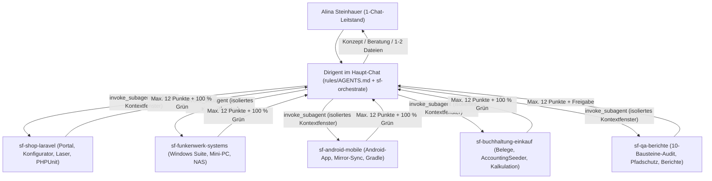

# Antigravity 1-Chat-Orchester (`seelenfunke-orchestrator`)

## 1. Zweck & Leitstand-Architektur
Das globale Antigravity-Plugin **`seelenfunke-orchestrator`** (`C:\Users\konta\.gemini\config\plugins\seelenfunke-orchestrator\`) bündelt die gesamte Entwicklungs-, Prüf- und Verwaltungsarbeit für **Mein-Seelenfunke** und **Funkenwerk** in **einem einzigen zentralen Haupt-Chat (Dirigent / Leitstand)** statt in dutzenden getrennten Einzel-Chats.

### Kernprinzipien des 1-Chat-Orchesters
1. **Ein einziger Leitstand statt Chat-Zersplitterung:** Alle Anfragen zu Shop, Laser-Manufaktur, Windows-Suite, Werkstatt Mini-PC, Synology NAS, Android-App, Buchhaltung und Dokumentation laufen im selben Haupt-Chat zusammen.
2. **Triage & Baustein-3-Gate im Haupt-Chat:**
   * **Direkt im Leitstand (ohne Subagent):** Strategische Fragen, Mitgründer-Entscheidungen, Konzepte vor einem expliziten **„Go“** (Baustein 3) sowie winzige, klar eingegrenzte Direkt-Edits an 1 bis 2 bekannten Dateien.
   * **Zwingende Delegation (`invoke_subagent`):** Code-Recherchen über mehr als 4 Dateien, neue Features, Refactorings, Compiler-Builds (`dotnet`, `gradlew`), umfangreiche Test-Suiten (`php artisan test`, `--self-test`) sowie abteilungsübergreifende Vorhaben.
3. **Isolierte 100-%-Kontextfenster pro Hintergrund-Subagent:** Jeder gestartete Spezialist arbeitet in einem eigenen, frischen Kontextfenster. Große Datei-Reads, Stacktraces, Build-Ausgaben und Testläufe belasten niemals das Kontextfenster des Haupt-Chats.
4. **Kompaktes 12-Punkte-Rückmeldebudget:** Jeder Hintergrund-Subagent arbeitet seine Pflicht-Tests eigenständig bis **100 % Grün** ab und sendet dem Dirigenten ausschließlich eine komprimierte Ergebnis-Meldung von **maximal 12 Stichpunkten** (geänderte Pfade als sichere Links, Prüfstatus und exakte Testzahlen) zurück. Dadurch bleibt der Haupt-Chat über Wochen schnell, präzise und kontextsparend.
5. **Echte Parallelität & strikter Dateikonflikt-Schutz:**
   * Betreffen Teilaufgaben getrennte Verzeichnisse (z. B. `app/` im Laravel-Shop und `android-app/` auf Android), starten die zuständigen Spezialisten **parallel** im selben Schritt (`Model: "inherit"`, `Workspace: "inherit"`).
   * Müssen zwei Teilaufgaben **dieselbe Datei** bearbeiten, werden niemals zwei schreibende Subagenten gleichzeitig darauf angesetzt, sondern streng seriell nacheinander ausgeführt.

---

## 2. Plugin-Komponenten & Datei-Übersicht
Installationspfad: `C:\Users\konta\.gemini\config\plugins\seelenfunke-orchestrator\`

### Manifest, Regelwerk & Orchestrierungs-Skill
* [`plugin.json`](file:///C:/Users/konta/.gemini/config/plugins/seelenfunke-orchestrator/plugin.json): Offizielles Antigravity-Plugin-Manifest (`v1.0.0`, Autor: `Mein-Seelenfunke (Alina Steinhauer)`), inklusive 3 Schnellstart-Prompts und Schwarz-Gold-Sternlogo ([`assets/logo.svg`](file:///C:/Users/konta/.gemini/config/plugins/seelenfunke-orchestrator/assets/logo.svg)) sowie Kurzübersicht in [`README.md`](file:///C:/Users/konta/.gemini/config/plugins/seelenfunke-orchestrator/README.md).
* [`rules/AGENTS.md`](file:///C:/Users/konta/.gemini/config/plugins/seelenfunke-orchestrator/rules/AGENTS.md): Dauerhaft aktive Dirigenten-Regel im Haupt-Chat (reines Markdown ohne YAML-Frontmatter). Steuert Delegations-Schwellen, Spezialisten-Auswahl, Parallelität, Dateikonflikt-Schutz und das 12-Punkte-Rückmeldebudget.
* [`skills/sf-orchestrate/SKILL.md`](file:///C:/Users/konta/.gemini/config/plugins/seelenfunke-orchestrator/skills/sf-orchestrate/SKILL.md): 3-Phasen-Koordinations-Leitfaden für komplexe Mehr-Abteilungs-Projekte:
  1. **Phase 1 (Triage & Baustein-3-Gate):** Konzept + Mehrwert vor Umsetzung neuer Features; Zerlegung nach Dateigrenzen nach „Go“.
  2. **Phase 2 (Konfliktfreie Delegation):** Übergabe von Zielpfaden (Windows-UNC), Schnittstellen-Vertrag (z. B. JSON-API-Schema zwischen Shop und Android), Pflicht-Tests bis 100 % Grün und 12-Zeilen-Rückmeldelimit.
  3. **Phase 3 (Abschluss-Abnahme & Dokumentation):** Prüfung von Teststatus, `php artisan ai:generate-map`, Verzeichnis-Sauberkeit, Pfad-/Link-Sicherheit und [`Abschlussberichte/README.md`](file://wsl.localhost/Ubuntu/home/ubuntuxina/meine-projekte/seelenfunke/Abschlussberichte/README.md).

### Die 5 spezialisierten Hintergrund-Subagenten (`agents/*.md`)
Alle 5 Agenten sind mit `subagent: true`, `mainAgent: false` und einer expliziten `tools:`-Whitelist definiert:

| Spezialist | Datei | Zuständigkeitsbereich & Pflicht-Prüfungen |
| :--- | :--- | :--- |
| **`sf-shop-laravel`** | [`sf-shop-laravel.md`](file:///C:/Users/konta/.gemini/config/plugins/seelenfunke-orchestrator/agents/sf-shop-laravel.md) | Laravel-Hauptportal (`Mein-Seelenfunke`), Livewire 3 (`#[Locked]`, Rollen-Isolation), Blade Clean-Design, 2D/3D-Konfigurator, `Product*Seeder.php`, xTool Laser-Cockpit, REST-API, PHPUnit in `mein_php_server` & `php artisan ai:generate-map`. |
| **`sf-funkenwerk-systems`** | [`sf-funkenwerk-systems.md`](file:///C:/Users/konta/.gemini/config/plugins/seelenfunke-orchestrator/agents/sf-funkenwerk-systems.md) | Funkenwerk Windows Desktop Suite (`funkenwerk*`, C#/WPF/.NET), Werkstatt Mini-PC (`funkenwerk-os-linux`, SSH `alina@192.168.188.151`), Funkira 3D-Atelier, Python-Brücken, MCP-Tools, `--self-test`-Suiten & Synology NAS (`\\nas\...`). |
| **`sf-android-mobile`** | [`sf-android-mobile.md`](file:///C:/Users/konta/.gemini/config/plugins/seelenfunke-orchestrator/agents/sf-android-mobile.md) | Funkenwerk Android-App & Homescreen-Widgets (`Kotlin` / `Jetpack Compose`), **zwingender Datei-Sync** von `android-app/` in den Windows-Mirror `C:\Users\konta\AndroidStudioProjects\seelenfunke-android` & `./gradlew testDebugUnitTest`. |
| **`sf-buchhaltung-einkauf`** | [`sf-buchhaltung-einkauf.md`](file:///C:/Users/konta/.gemini/config/plugins/seelenfunke-orchestrator/agents/sf-buchhaltung-einkauf.md) | Belege (`storage/app/buchhaltung/receipts/`), Verträge (`contracts/`), direkte Pflege in [`AccountingSeeder.php`](file://wsl.localhost/Ubuntu/home/ubuntuxina/meine-projekte/seelenfunke/database/seeders/AccountingSeeder.php) (Cent-Integer, exaktes Kaufdatum, Gewerblich vs. Privat, Dublettenprüfung) sowie wirtschaftlich durchgerechnete Einkaufs-/Verpackungsempfehlungen. |
| **`sf-qa-berichte`** | [`sf-qa-berichte.md`](file:///C:/Users/konta/.gemini/config/plugins/seelenfunke-orchestrator/agents/sf-qa-berichte.md) | Unabhängiger Qualitäts-, Security- und Regel-Auditor (**striktes Änderungsverbot** an Produktionscode). Prüft alle 10 Seelenfunke-Bausteine, Black-Screen-Pfadschutz (`file://wsl.localhost/...` / `file:///C:/...`), Clean-Design, `0` KI-Gedankenstriche und pflegt `Abschlussberichte/`. |

---

## 3. Alltags-Steuerung im 1-Chat-Leitstand
Im täglichen Betrieb wird nur noch **ein einziger Haupt-Chat** geöffnet und über folgende Werkzeuge gesteuert:

* **`/compact` (Kontext-Komprimierung statt neuem Chat):** Sobald der Haupt-Chat nach vielen Tagen oder Wochen umfangreich geworden ist, fasst `/compact` den bisherigen Verlauf verlustarm zusammen und gibt das Kontextfenster sofort wieder frei.
* **`/teamwork` (Parallele Abteilungs-Orchestrierung):** Ideal für größere Vorhaben über mehrere Welten hinweg (z. B. gleichzeitige API-Erweiterung im Shop, Anpassung in der Android-App und Audit durch QA).
* **`/plan` (Strukturierte Vorab-Planung):** Erstellt bei komplexen Umbauten vor der Ausführung einen klaren Schritt-für-Schritt-Plan zur Freigabe.
* **`@`-Mention für Alt-Chats:** Über `@` im Eingabefeld kann bei Bedarf Wissen oder Kontext aus einer älteren Einzel-Konversation gezielt einmalig in den zentralen Leitstand übernommen werden.
* **Plugin-Verwaltung in Antigravity:** Status, enthaltene Agenten, Regeln und Skills des Plugins lassen sich jederzeit direkt über die interne Verwaltungs-URI `customization://seelenfunke-orchestrator` im Antigravity-Customizations-Panel einsehen und verwalten.

---

## 4. Charakter „Falcone“, 5-Kanal-Parallelsteuerung & 24/7 Smartphone-Direktbrücke (`v1.8.5+`)
Der zentrale Mitgründer & Chef-Architekt trägt im Seelenfunke-Universum den offiziellen Namen **`Falcone`** (`F-A-L-C-O-N-E`, goldene Maßanzug-Rüstung `FALCONE · Mitgründer`, gepflegter Schnauzer, goldenes Monokel, männliche Stimme `Orus`, verankert in der Abteilung `Leitung` unter `/admin/organigramm` via [`falcon_selfie.png`](file://wsl.localhost/Ubuntu/home/ubuntuxina/meine-projekte/seelenfunke/public/shop/ai/images/falcon_selfie.png)). Damit Ideen, Bugs und Aufträge von unterwegs sowohl gesammelt in der `Leitung` als auch sauber getrennt in **5 parallelen Abteilungs-Chats** landen können, verbindet eine 2-Stufen-Brücke die **Funkenwerk Android-App**, **Mittwald Stage** und **Antigravity**:

1. **Android-App 1-Klick-Startseitenkarte, Master-Widget-Direktstart & 4-Faktor Fast-Unlock (`v1.8.5+`):**
   * Für Admin-Logins startet die App direkt im 60-FPS-3D-Fokusmodus ([`FalconFocusScreen.kt`](file://wsl.localhost/Ubuntu/home/ubuntuxina/meine-projekte/seelenfunke/android-app/app/src/main/java/de/meinseelenfunke/app/ui/screens/FalconFocusScreen.kt) & [`falcon3d.js`](file://wsl.localhost/Ubuntu/home/ubuntuxina/meine-projekte/seelenfunke/android-app/app/src/main/assets/falcon3d/falcon3d.js)). Zusätzlich sitzt direkt oben im Homescreen-[`MasterWidgetProvider.kt`](file://wsl.localhost/Ubuntu/home/ubuntuxina/meine-projekte/seelenfunke/android-app/app/src/main/java/de/meinseelenfunke/app/widget/MasterWidgetProvider.kt) der goldene **1-Tap `Falcone`-Button** (`btn_master_falcone`).
   * **Sicherheitsgeprüfter Trusted Fast-Unlock ([`SecurityIntentHelper.kt`](file://wsl.localhost/Ubuntu/home/ubuntuxina/meine-projekte/seelenfunke/android-app/app/src/main/java/de/meinseelenfunke/app/util/SecurityIntentHelper.kt)):** Wird die App über `"Hey Falcone"` oder ein signiertes Homescreen-Widget gestartet, während das Smartphone selbst bereits entsperrt ist (`!KeyguardManager.isDeviceLocked`), entfällt die doppelte In-App-Fingerabdruckabfrage; bei gesperrtem Smartphone bleibt die Sperre strikt aktiv.
   * Im Direktfenster [`AgDirectBottomSheets.kt`](file://wsl.localhost/Ubuntu/home/ubuntuxina/meine-projekte/seelenfunke/android-app/app/src/main/java/de/meinseelenfunke/app/ui/components/AgDirectBottomSheets.kt) (und per Sprachbefehl über `falcon_send_to_antigravity` in [`FalconClientTools.kt`](file://wsl.localhost/Ubuntu/home/ubuntuxina/meine-projekte/seelenfunke/android-app/app/src/main/java/de/meinseelenfunke/app/util/FalconClientTools.kt)) stehen **5 feste Abteilungs-Kanäle** (`👑 Leitung`, `🛍️ Shop`, `📱 Android`, `🖥️ Mini-PC`, `💶 Buchhaltung`) sowie `➕ Neu` (für isolierte Sonderprojekte) zur Auswahl.
2. **24/7 Stage-Zwischenpostfach (`/api/system/ag-direct-inbox`):**
   * [`AntigravityDirectInboxController.php`](file://wsl.localhost/Ubuntu/home/ubuntuxina/meine-projekte/seelenfunke/app/Http/Controllers/Api/AntigravityDirectInboxController.php), [`AntigravityDirectInboxService.php`](file://wsl.localhost/Ubuntu/home/ubuntuxina/meine-projekte/seelenfunke/app/Services/System/AntigravityDirectInboxService.php) und [`AntigravityDirectInboxCommand.php`](file://wsl.localhost/Ubuntu/home/ubuntuxina/meine-projekte/seelenfunke/app/Console/Commands/System/AntigravityDirectInboxCommand.php) (`php artisan system:ag-inbox`) speichern Aufträge, Ziel-Kanal (`channel`) und validierte Screenshots strikt privat unter `storage/app/private/` (Admin-Only Sanctum-Schutz, `client_uuid`-Idempotenz, 30-Tage-Rotation).
3. **Verlustfreie 2-Phasen-Zustellung, Auto-Kanalanlage & `StageDeployMutex` (`FunkenwerkMcp` v1.8):**
   * Der offizielle Antigravity-Hintergrunddienst **Seelenfunke AG-Direkt-Brücke** ([`sidecar.json`](file:///C:/Users/konta/.gemini/config/sidecars/seelenfunke-ag-direct-bridge/sidecar.json)) führt [`FunkenwerkMcp.exe`](file:///C:/Users/konta/AppData/Local/Funkenwerk/SentinelCli/FunkenwerkMcp.exe) im Modus `--ag-sidecar-daemon` aus (`0` KI-Token Verbrauch im Leerlauf).
   * Alle 20 Sekunden prüft der Dienst per Ed25519-SSH das Stage-Postfach (`--peek-pending`), ordnet jeden Auftrag anhand von `channel` der dauerhaft gespeicherten Kanal-UUID in [`ag_direct_bridge_config.json`](file:///C:/Users/konta/AppData/Local/Funkenwerk/ag_direct_bridge_config.json) zu (bzw. legt fehlende Abteilungs-Chats beim ersten Mal automatisch via `agentapi new-conversation --title=...` an und speichert deren UUID) und versieht Abteilungs-Prompts mit klaren Dateibereichs-Grenzen.
   * Ein prozessübergreifender `StageDeployMutex` (`Local\FunkenwerkStageDeployLock`) schützt `--stage-deploy` und `--stage-publish-apk` vor gleichzeitigen Parallel-Rollouts (`60/60` Selbsttests grün).
