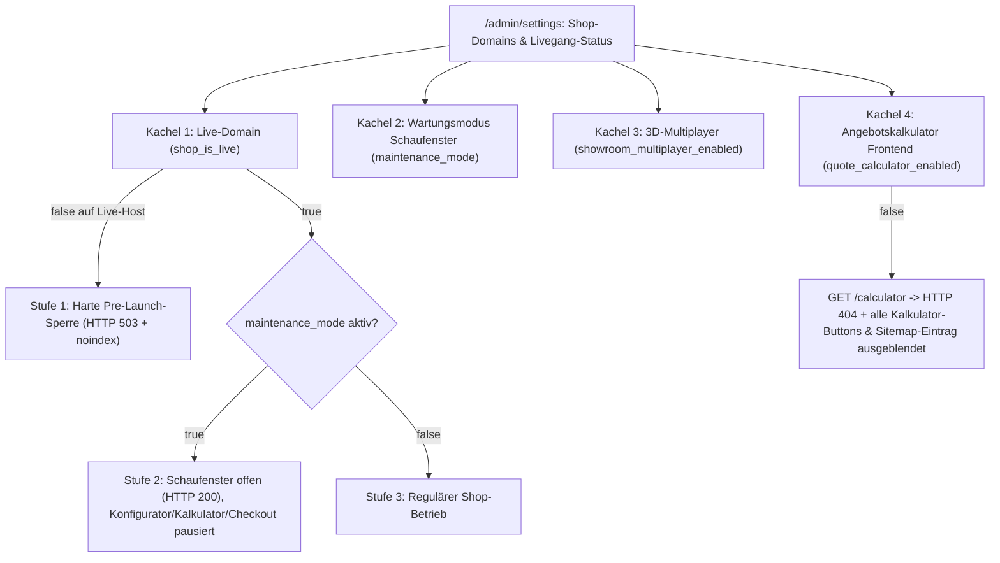

# System-Einstellungen, Livegang-Status & Schaufenster-Wartungsmodus

Das System-Einstellungsmodul bildet das zentrale Nervensystem für geschäftliche Parameter, Domain-/Livegang-Schalter, Steuereinstellungen, API-Integrationsdaten und Notfallvorsorge-Dokumente im Seelenfunke-Projekt.

## Zielsetzung
Das Modul dient der Speicherung und Bereitstellung globaler Konfigurationsvariablen. Es trennt Eingaben im Frontend (z. B. Euro-Preise) sauber von der internen Datenbank-Repräsentation (Cent-Integer), steuert über 4 übersichtliche Kacheln den Livegang-, Schaufenster-Wartungs- und Angebotskalkulator-Status und verwaltet ein generierbares Notfall-Handbuch zur Absicherung des operativen Betriebs.

---

## Beteiligte Komponenten & Klassen

### Datenbank-Modelle & Seeder
- [SystemSetting.php](file://wsl.localhost/Ubuntu/home/ubuntuxina/meine-projekte/seelenfunke/app/Models/System/SystemSetting.php) & [SystemSettingSeeder.php](file://wsl.localhost/Ubuntu/home/ubuntuxina/meine-projekte/seelenfunke/database/seeders/SystemSettingSeeder.php): Speichern globale Einstellungen persistent in `system_settings` (geschützte Live-/Wartungs-Flags via `$protectedFirstOrCreateKeys`).
- [AccountingGroup.php](file://wsl.localhost/Ubuntu/home/ubuntuxina/meine-projekte/seelenfunke/app/Models/Accounting/AccountingGroup.php): Wird bei der Generierung des Notfall-Handbuchs ausgelesen, um Finanzgruppen einzubinden.

### Middleware, Livewire-Controller & UI-Komponenten
- [EnforceShopMaintenanceMode.php](file://wsl.localhost/Ubuntu/home/ubuntuxina/meine-projekte/seelenfunke/app/Http/Middleware/EnforceShopMaintenanceMode.php): Steuert die zweistufige Livegang- und Schaufenster-Wartungslogik sowie `isQuoteCalculatorEnabled()`.
- [SystemShopConfig.php](file://wsl.localhost/Ubuntu/home/ubuntuxina/meine-projekte/seelenfunke/app/Livewire/Shop/System/SystemShopConfig.php) & [general_tab.blade.php](file://wsl.localhost/Ubuntu/home/ubuntuxina/meine-projekte/seelenfunke/resources/views/livewire/shop/system/system-config-partials/general_tab.blade.php): Administratives Einstellungs-Panel unter `/admin/settings` inklusive 4-Kachel-Grid im Clean-Design (Erklärungen ausschließlich im `!`-Hover-Tooltip).
- [shop-maintenance-notice.blade.php](file://wsl.localhost/Ubuntu/home/ubuntuxina/meine-projekte/seelenfunke/resources/views/components/alerts/shop-maintenance-notice.blade.php): Zentrale Light-Mode-Hinweiskomponente (`#FAF8F5`, matter Goldrahmen `#C5A059`) für pausierte Kauf-, Konfigurator- und Kalkulator-Bereiche während laufender Wartungen.

---

## 4-Kachel-Steuerung unter „Shop-Domains & Livegang-Status“ (`/admin/settings`)



1. **Stufe 1: Vor-Livegang-Sperre (`shop_is_live = false`):**
   - Auf `mein-seelenfunke.de` bleibt das öffentliche Frontend vor dem offiziellen Start am `01.11.2026` ausnahmslos mit `HTTP 503` (`Retry-After: 3600`, `X-Robots-Tag: noindex, noarchive`) geschützt (selbst für eingeloggte Admins im Frontend; `/login`, `/admin/*`, Technik-APIs und § 5 DDG Pflichtseiten bleiben auf `HTTP 200` erreichbar).
2. **Stufe 2: Schaufenster-Wartungsmodus (`shop_is_live = true` & `maintenance_mode = true`):**
   - Alle öffentlichen Seiten (`/`, `/shop`, `/produkt/{slug}`, `/magazin`, `/links`, Rechtsseiten, 3D-Showroom-Rundgang) liefern regulär **`HTTP 200`**, damit Besucher und Suchmaschinen sich jederzeit umschauen können.
   - Gleichzeitig werden Produktkonfigurator / Warenkorb-Ablage (`ProductConfigurator`, `ProductFrontendFilterArea`, `ShopShowroomController`), Gutschein-Kauf (`MarketingVoucherPurchasePage`), Angebotskalkulator (`ProductCalculator`), Warenkorb/Checkout (`Cart`, `OrderCheckout`, `HandlesOrderCreation`) und Angebotsannahme (`OrderQuoteAcceptance`) für Gäste/Kunden serverseitig gesperrt und zeigen den freundlichen Light-Mode-Wartungshinweis (`<x-alerts.shop-maintenance-notice />`).
3. **Kachel 4: Angebotskalkulator im Frontend sperren (`quote_calculator_enabled = false`):**
   - `GET /calculator` antwortet sofort mit `HTTP 404`; `ProductCalculator` blockiert Frontend-Aufrufe serverseitig.
   - Sämtliche Buttons und Verlinkungen in Desktop-/Mobil-Navigation, Footer, Startseite (`hero_section`, `work_section`, `process_section`), Support-Schnellbausteinen (`SupportContactFormComponent`), `sitemap.xml` und `llms.txt` werden automatisch ausgeblendet.
   - Bestehende individuelle Angebotslinks (`/angebot/{token}/annehmen`) sowie `/admin/quote-requests` bleiben für Bestandskunden und das Admin-Team erreichbar.

---

## Weitere Einstellungsbereiche & Datenschemata

### 1. Währungs- und Betragskonvertierung
Um Rundungsfehler bei Fließkommazahlen in der Datenbank zu vermeiden, werden alle Euro-Beträge (z. B. `shipping_cost`, `shipping_free_threshold`, `express_surcharge_min`) als Ganzzahlen (Cents) gespeichert:
- **Laden aus DB**: $\text{Cents} / 100$ (formatiert auf 2 Nachkommastellen)
- **Speichern in DB**: $\text{Euro-Eingabe} \times 100$ (Rundung auf Integer)

### 2. Notfall-Vorsorge & Notfall-PDF (`generateEmergencyPdf`)
Unter `/notfall` abrufbar:
- **`emergency_master_password`**: Wird über die Laravel-Hash-Facade verschlüsselt gespeichert und niemals an das Frontend zurückgesendet.
- **`generateEmergencyPdf()`**: Erzeugt über `dompdf` ein physisch ausdruckbares Notfall-Handbuch inkl. KeePass-Pfaden, Notar-/Familienkontakten sowie Fixkosten- und Bankverbindungsstrukturen (`AccountingGroup`).

### 3. Caching-Strategie
Änderungen an den Einstellungen invalidieren sofort die zugehörigen Cache-Schlüssel:
```php
Cache::forget('global_shop_settings');
Cache::forget('shop_setting_inventory_threshold');
```
