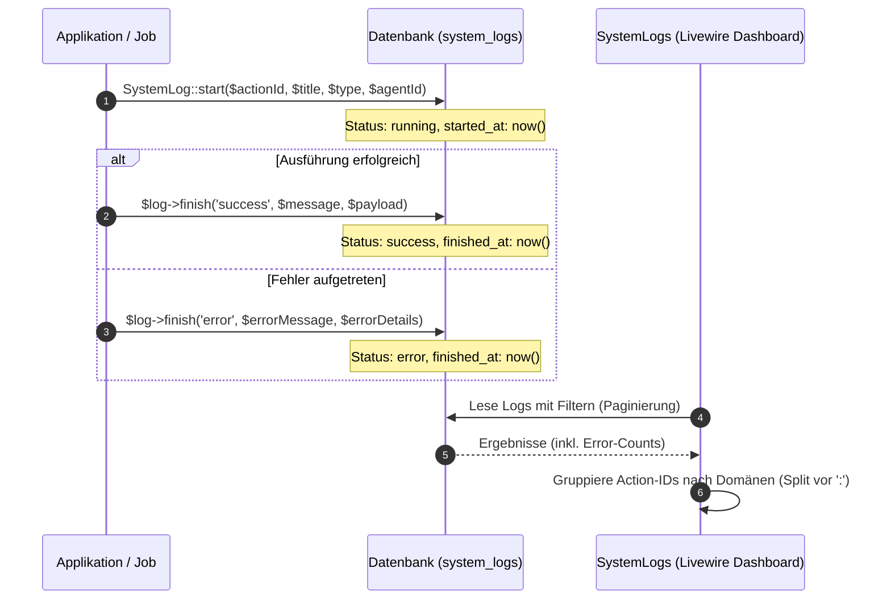

# System-Protokolle (Logs)

Das System-Protokollierungssystem (System-Logs) von Seelenfunke bietet eine konsolidierte und strukturierte Übersicht über alle im Hintergrund laufenden Systemaktivitäten, Fehlerzustände, KI-Agenten-Ausführungen und automatisierten System-Cronjobs.

## Zielsetzung
Ziel dieses Moduls ist es, Administratoren und Entwicklern eine zentrale Diagnoseplattform zur Verfügung zu stellen. Es überwacht fehlerhafte Ausführungsschritte, protokolliert Payload-Daten von externen Webhooks und API-Anfragen und ermöglicht es, Systemfehler interaktiv als gelöst zu markieren.

---

## Beteiligte Komponenten & Klassen

### Datenbank-Modelle
- [SystemLog](file://wsl.localhost/Ubuntu/home/ubuntuxina/meine-projekte/seelenfunke/app/Models/System/SystemLog.php): Das zentrale Modell für Log-Einträge. Speichert den ausführenden KI-Agenten (`ai_agent_id`), Log-Typ, die Action-ID zur Gruppierung nach Domänen, einen Titel, Detailnachrichten, Status (`success`, `warning`, `error`, `running`), JSON-Payloads sowie Start- und Endzeitpunkte.
- [SystemSchedulerLog](file://wsl.localhost/Ubuntu/home/ubuntuxina/meine-projekte/seelenfunke/app/Models/System/SystemSchedulerLog.php): Dediziertes Ausführungsprotokoll (`system_scheduler_logs`, Migration `2026_11_14_094500_create_system_scheduler_logs_table.php`) für alle geplanten Server-Cronjobs.

### Services & Livewire-Controller
- [SystemErrorLogger](file://wsl.localhost/Ubuntu/home/ubuntuxina/meine-projekte/seelenfunke/app/Services/System/SystemErrorLogger.php): Zentraler Diagnose-, Secret-Scrubbing- und 24h-Deduplizierungs-Service für unbehandelte Exceptions, `Log::warning`/`Log::error`-Ereignisse, fehlgeschlagene operative Cronjobs sowie den Cross-Platform Error-Sentinel.
- [SystemLogs](file://wsl.localhost/Ubuntu/home/ubuntuxina/meine-projekte/seelenfunke/app/Livewire/Shop/System/SystemLogs.php): Der Controller für das administrative Log-Cockpit (`/admin/logs`). Bietet Such- und Filtersysteme (nach Status, Log-Typ, Agent, Domain) und Funktionen zum Löschen von Einträgen, zum manuellen Umschalten des Lösungsstatus (`toggleStatus`) sowie zum gesammelten Abschließen offener Fehler/Warnungen (`markAllAsDone`).

---

## Logging-Lifecycle & Domänen-Parsing

Logs werden im System asynchron oder synchron bei der Ausführung von Hintergrund-Tasks oder Webhook-Empfängern gestartet. Dabei folgt das System folgendem Datenfluss:



### 1. Start- / Finish-Architektur
Um Laufzeiten von Automatisierungen genau zu tracken, nutzt das System zwei Hilfsmethoden:
- **`SystemLog::start(...)`**: Initiiert den Protokollsatz im Status `running` und setzt `started_at` auf den aktuellen Timestamp.
- **`$log->finish(...)`**: Setzt `finished_at` auf den aktuellen Timestamp und speichert den Ausgangsstatus sowie die Detailnachricht und Nutzdaten (`payload`).

### 2. Domänen-Parsing (`action_id`)
Log-Einträge verwenden strukturierte `action_id`-Werte im Format `domain:action` (z. B. `stripe:webhook`, `ebay:crawler`, `ai:workspace`). 
Der Controller parst diese IDs im Render-Prozess dynamisch vor dem Doppelpunkt (`:`), um eine Liste aller aktiven Log-Domänen zu generieren. Dadurch kann der Administrator das Log-Terminal nach spezifischen Integrationen filtern.

### 3. Fehler-Wiederholungs-Analyse (Error Grouping)
In der Log-Übersicht ermittelt der Controller über ein Sub-Select die Häufigkeit identischer Fehlermeldungen:
```sql
SELECT COUNT(*) FROM system_logs as l2 WHERE l2.message = system_logs.message AND l2.status = "error"
```
Dadurch sieht der Administrator sofort, ob ein bestimmter API-Fehler (z. B. Verbindungsabbruch zu Shopify oder Twilio) ein isolierter Einzelfall ist oder periodisch auftritt.

### 4. Interaktive Fehlerauflösung & Sammelaktion
Über die Methode `toggleStatus($logId)` können einzelne Fehler und Warnungen im Livewire-Dashboard als `success` (gelöst) markiert werden. Zusätzlich steht im Header neben „Filter zurücksetzen“ der Button **„Alle als erledigt markieren“** (`markAllAsDone()`) bereit, der sämtliche offenen Fehler- und Warnungs-Einträge (`status` in `['error', 'warning']`, unter Berücksichtigung aktiver Such-/Domänen-/Typ-/Agenten-Filter) in einem Schritt auf `success` setzt und den Titel mit `[GELÖST]` kennzeichnet.

---

### 5. Globaler Cross-Platform Error-Sentinel & Auto-Heal Hub
Über [`SystemErrorLogger::recordCrossPlatformEvent()`](file://wsl.localhost/Ubuntu/home/ubuntuxina/meine-projekte/seelenfunke/app/Services/System/SystemErrorLogger.php) und den API-Endpunkt `POST /api/system/error-ingest` in [`routes/api.php`](file://wsl.localhost/Ubuntu/home/ubuntuxina/meine-projekte/seelenfunke/routes/api.php) laufen Fehlerzustände und automatische Selbstheilungen aus allen vier Plattformen zentral in `system_logs` zusammen:
- **Plattform-Domänen (`action_id`):**
  - `portal:<subsystem>` (Laravel Web-Portal)
  - `android:<subsystem>` (Funkenwerk Android App via [`ErrorSentinelReporter.kt`](file://wsl.localhost/Ubuntu/home/ubuntuxina/meine-projekte/seelenfunke/android-app/app/src/main/java/de/meinseelenfunke/app/util/ErrorSentinelReporter.kt))
  - `minipc_linux:<subsystem>` (Werkstatt-Mini-PC `Funkenwerk OS Linux` via [`LinuxVaultAndApi.cs`](file://wsl.localhost/Ubuntu/home/ubuntuxina/meine-projekte/seelenfunke/funkenwerk-os-linux/LinuxVaultAndApi.cs))
  - `windows_desktop:<subsystem>` (Funkenwerk Windows Suite via [`App.xaml.cs`](file://wsl.localhost/Ubuntu/home/ubuntuxina/meine-projekte/seelenfunke/funkenwerk/App.xaml.cs))
- **24h SHA-256 Deduplizierung & Secret-Scrubbing:** Identische Fehler werden innerhalb von 24 Stunden per SHA-256-Fingerprint (`payload.fingerprint`) auf denselben `SystemLog`-Datensatz aufaddiert (`occurrences`), während API-Keys, Bearer-Tokens, Passwörter und `AIza`-Schlüssel vorab automatisch maskiert werden.
- **Auto-Heal Kennzeichnung (`[AUTO-GEHEILT]`):** Hat sich ein Dienst selbstständig geheilt (z. B. Neustart des lokalen Sense-Daemons `:17701`, LAN-zu-HTTPS-Fallback in Android oder nachgeholtes NAS-Delta-Backup), wird der Eintrag mit `status = 'warning'` und dem Präfix `[AUTO-GEHEILT]` verbucht, ohne roten Fehlalarm auszulösen.
- **Zentrale Sichtbarkeit & Funkira-Abfrage:** Offene Cross-Platform-Fehler erscheinen mit Klartext-Plattform-Badge im **Operativen Status** (`/admin/dashboard` -> Kachel `Log` via [`AnalyticsService.php`](file://wsl.localhost/Ubuntu/home/ubuntuxina/meine-projekte/seelenfunke/app/Services/AnalyticsService.php)), im Monitor-Pulse (`open_system_errors_count`) sowie im KI-Werkzeug `system_get_error_sentinel` ([`AiSystemFuncs.php`](file://wsl.localhost/Ubuntu/home/ubuntuxina/meine-projekte/seelenfunke/app/Services/AI/Functions/AiSystemFuncs.php)). Abgesichert durch [`CrossPlatformErrorSentinelTest.php`](file://wsl.localhost/Ubuntu/home/ubuntuxina/meine-projekte/seelenfunke/tests/Feature/Api/CrossPlatformErrorSentinelTest.php) und [`SystemLogHardeningTest.php`](file://wsl.localhost/Ubuntu/home/ubuntuxina/meine-projekte/seelenfunke/tests/Feature/System/SystemLogHardeningTest.php).

---

### 6. System-Härtung & Resilienz-Mechanismen (Stand 11/2026)
- **Durchgängige 24h-Fingerprint-Deduplizierung:** Sowohl `recordException()`, `recordLogEvent()` und `recordCommandFailure()` als auch `recordCrossPlatformEvent()` und `MasterAnalytics::logSystemFailure()` gruppieren identische Ereignisse innerhalb von 24 Stunden per SHA-256-Fingerprint (`occurrences_count`) statt redundante Einzelzeilen anzulegen.
- **Automatischer Caller-Trace bei Log-Events:** `SystemErrorLogger::recordLogEvent()` ermittelt über `extractCallerTraceExcerpt()` automatisch die auslösende Anwendungsdatei, Zeilennummer und `trace_excerpt` auch bei reinen `Log::warning`/`Log::error`-Aufrufen ohne übergebenes `Throwable` (inkl. Diagnose-Kategorie `php_deprecation_notice`).
- **Trennung zwischen echten Cronjobs und Entwickler-CLI:** Der `CommandFinished`-Listener in [`AppServiceProvider.php`](file://wsl.localhost/Ubuntu/home/ubuntuxina/meine-projekte/seelenfunke/app/Providers/AppServiceProvider.php) ignoriert Unit-Tests (`testing`) sowie interaktive Entwicklerbefehle (`test`, `tinker`, `db:seed`, `migrate:*`, Cache-Befehle) und protokolliert nur reale registrierte `SystemCronjob`- bzw. operative Hintergrundbefehle als `scheduler:cronjob_failed:*`.
- **Selbstheilung von Infrastruktur-Warnungen (`MasterAnalytics`):** Sobald `checkSystemHealth()` erkennt, dass ein zuvor ausgefallener Dienst (z. B. `backup`, `database`, `redis`, `smtp`) wieder den Status `connected` erreicht hat, schließt `resolveSystemFailure()` offene `system:health_fail`-Meldungen automatisch mit `[GELÖST]` (`status = 'success'`) ab.
- **Filterung harmloser UI-Lebenszyklus-Abbrüche:** Normale Coroutine-/Compose-Abbrüche beim Bildschirmwechsel (`LeftCompositionCancellationException`, `JobCancellationException`) werden sowohl clientseitig in [`AppLogger.kt`](file://wsl.localhost/Ubuntu/home/ubuntuxina/meine-projekte/seelenfunke/android-app/app/src/main/java/de/meinseelenfunke/app/util/AppLogger.kt) / [`ErrorSentinelReporter.kt`](file://wsl.localhost/Ubuntu/home/ubuntuxina/meine-projekte/seelenfunke/android-app/app/src/main/java/de/meinseelenfunke/app/util/ErrorSentinelReporter.kt) als auch serverseitig in `SystemErrorLogger::isBenignClientCancellation()` herausgefiltert.
- **Gemini-TTS Multi-Model & Quota-Circuit-Breaker:** [`GeminiTtsService.php`](file://wsl.localhost/Ubuntu/home/ubuntuxina/meine-projekte/seelenfunke/app/Services/AI/GeminiTtsService.php) nutzt aktive TTS-Modelle (`gemini-3.1-flash-tts-preview`, `gemini-3.8-flash-tts`, `gemini-3.8-flash-lite-tts`) mit 5-Minuten-Cooldown pro Modell bei HTTP `429`, sodass temporäre Kontingent-Spitzen sofort vom nächsten Modell oder dem lokalen Client-TTS abgefangen werden, ohne `SystemLog`-Warnungen zu fluten.
- **Live-AI Verbindungs-, DNS- (`EAI_AGAIN`) & Telefon-Sekretärinnen-Diagnose:** `SystemErrorLogger::diagnose()` sowie `diagnoseWsIssue()` in [`server-twilio.js`](file://wsl.localhost/Ubuntu/home/ubuntuxina/meine-projekte/seelenfunke/server-twilio.js) erkennen gezielt temporäre DNS-/Socket-Engpässe (`network_dns_or_socket_eagain`), abgelehnte WebSocket-Bridge-Verifizierungen (`gemini_bridge_token_verification_failed`, inkl. `POST /api/ai/client-error-log`) sowie Ereignisse der Funkira Smartphone-Sekretärin (`funkira_phone_secretary_error`). `server-twilio.js` erzwingt `dns.setDefaultResultOrder('ipv4first')`, unterstützt die volle Secret-Fallback-Kette (`GEMINI_BRIDGE_SECRET` -> `AI_PROXY_SECRET` -> `TWILIO_BRIDGE_SECRET` -> `BRIDGE_SECRET`), wiederholt transiente `EAI_AGAIN`-/`502-504`-Backend-Aufrufe automatisch (`fetchBackendWithRetry`) und maskiert `AIza...`-/Bearer-/Token-Geheimnisse in `bridge.log`. Im Web-Widget ([`ai-widget-part2.blade.php`](file://wsl.localhost/Ubuntu/home/ubuntuxina/meine-projekte/seelenfunke/resources/views/livewire/shop/ai/ai-widget-part2.blade.php)) schaltet jeder nicht-reguläre Bridge-Abbruch vor `setupComplete` (`code !== 1000`) sofort nahtlos auf `direct_ws_url` um. Sowohl Mini-PC (`sentinel_history.json`, `0600`) als auch Android (`error_sentinel_history.json`, AES-256-GCM) führen zusätzlich lokale Diagnose-Ringpuffer für Offline-Analysen ([`FunkiraConnectionResilienceTest.php`](file://wsl.localhost/Ubuntu/home/ubuntuxina/meine-projekte/seelenfunke/tests/Feature/Api/FunkiraConnectionResilienceTest.php)).
- **Direkte visuelle Kopplung mit dem „Projekt Gehirn“ (`SystemBrainDiagnosticsService`):** Jeder offene `error`- oder `warning`-Eintrag in `system_logs` wird live über [`SystemBrainDiagnosticsService.php`](file://wsl.localhost/Ubuntu/home/ubuntuxina/meine-projekte/seelenfunke/app/Services/System/SystemBrainDiagnosticsService.php) auf die verursachende Projektdatei aufgelöst (inkl. Rückauflösung kompilierter Blade-View-Hashes aus `storage/framework/views/*.php`) und sowohl unter `/admin/system/neural-analysis` ([`SystemNeuralAnalysisIndex.php`](file://wsl.localhost/Ubuntu/home/ubuntuxina/meine-projekte/seelenfunke/app/Livewire/Backend/System/SystemNeuralAnalysisIndex.php)) als auch im 3D-Graph des KI-Widgets in **Rot** als Fehlerkern samt ein- und ausgehenden Nachbardateien visualisiert ([`System_Projekt_Gehirn_und_Vollstaendige_Routen_Haertung.md`](file://wsl.localhost/Ubuntu/home/ubuntuxina/meine-projekte/seelenfunke/Abschlussberichte/System/System_Projekt_Gehirn_und_Vollstaendige_Routen_Haertung.md)).
- **Valides Livewire-3 Table-DOM:** In [`system-logs.blade.php`](file://wsl.localhost/Ubuntu/home/ubuntuxina/meine-projekte/seelenfunke/resources/views/livewire/shop/system/system-logs.blade.php) besitzt jeder Log-Eintrag ein eigenes valides `<tbody wire:key="sys-log-...">` direkt unter `<table>` (keine verschachtelten `<tbody>`-Elemente).
