# Mittwald mStudio Gesamtinfrastruktur: Vollständige Bestandsaufnahme (`p-g27wim`)

**Stand der Live-Prüfung:** 16.11.2026 (Basis-Bestandsaufnahme über Mittwald REST-API v2 & SSH; **aktualisiert am 16.11.2026** nach produktiver Live-Vorbereitung von `seelenfunke-live` / `a-bycqrf`)  
**Geprüftes Projekt:** `Alina` (Kurz-ID: **`p-g27wim`**, UUID: `a7a6fd9f-3844-4bdd-8fe0-c7d1c0827cc5`)  
**Cluster & Server:** Cluster `altgemeinde` (`project.host`), Server **`s-pis5pf`** (`3b1025d6-63fa-4ac5-9b9d-4070a2a21918`)  
**Öffentliche Ingress-IPs:** IPv4 **`185.215.158.114`** | IPv6 **`2a03:2a01:a330:a::2`**  
**Speicher-Kontingent:** `50 GiB` gebucht (`5,45 GiB` Webspace belegt, `3,27 GiB` System-Backups)

---

## 1. Gesamt-Topologie: Wie alle Bausteine zusammenhängen

Auf Mittwald mStudio läuft jede App und jeder Hintergrund-Worker in einem eigenen, isolierten Container auf dem Server `s-pis5pf`. Alle öffentlichen Domains landen zunächst auf dem zentralen Mittwald-Ingress-Loadbalancer (`185.215.158.114` / `2a03:2a01:a330:a::2`, automatisches Let's-Encrypt-TLS) und werden von dort anhand des Hostnamens an die jeweilige Ziel-App weitergeleitet.

```mermaid
flowchart TD
    Internet["Öffentliches Internet / Browser / Android-App"]
    Twilio["Twilio Cloud (+49 5371 7269023)"]

    subgraph Ingress["Mittwald Ingress & ACME-TLS (185.215.158.114)"]
        D_Stage["stage.mein-seelenfunke.de"]
        D_Ws["ws.mein-seelenfunke.de"]
        D_Node["api-live-bridge.mein-seelenfunke.de"]
        D_Live["mein-seelenfunke.de (Kanonische Hauptdomain)"]
        D_LiveWww["www.mein-seelenfunke.de (HTTP 301 -> mein-seelenfunke.de)"]
        D_Invest["steinhauer-invest.de"]
        D_Unused["twilio.mein-seelenfunke.de / openwebui.p-g27wim.project.space (Standardseite, ungenutzt)"]
    end

    subgraph Containers["Isolierte App- & Worker-Container in Projekt p-g27wim"]
        AppStage["a-lc6tkm · seelenfunke-stage (PHP 8.4.27, Apache + .htaccess, DocRoot /public)"]
        WorkerWs["a-iurgq8 · WORKER - Websocket Stage (PHP-Worker 8.5.12: Reverb + Twilio-Bridge Port 6001)"]
        WorkerJobs["a-mihbdu · WORKER - Jobs Stage (PHP-Worker 8.5.12: queue:work)"]
        AppNode["a-yeq7el · seelenfunke-nodejs (Node.js 25.9.0: server-twilio.js)"]
        AppLive["a-bycqrf · seelenfunke-live (PHP 8.4.27, DocRoot /public, 315 Shop-Assets, Live-Freigabe gesperrt)"]
        AppInvest["a-s4sdym · steinhauer-invest (PHP 8.5.12, DocRoot /public)"]
    end

    subgraph Data["Datenbanken, Cache & Scheduler"]
        DbStage["MySQL 8.4 · mysql_nkzzsf (Stage)"]
        RedisStage["Redis 8.6 · redis_t4tm3u (32 MiB, allkeys-lru)"]
        CronStage["Cronjob cron-x3mf9s (* * * * *: Stage schedule:run)"]
        DbLive["MySQL 8.4 · mysql_gv2avu (Live, 148 Tabellen, 28 Seeder)"]
        CronLive["Cronjob e41d0deb (* * * * *: Live schedule:run)"]
        DbInvest["MySQL 8.4 · mysql_fg9zlg (steinhauer-invest)"]
    end

    Internet --> D_Stage & D_Ws & D_Node & D_Live & D_LiveWww & D_Invest
    Twilio -->|"POST /api/twilio/inbound"| D_Stage
    Twilio -->|"WSS /twilio-stream"| D_Ws

    D_Stage --> AppStage
    D_Ws --> AppStage
    AppStage -->|".htaccess Proxy ws://a-iurgq8:6001"| WorkerWs
    D_Node --> AppNode
    D_LiveWww -->|"301"| D_Live
    D_Live --> AppLive
    D_Invest --> AppInvest

    CronStage --> AppStage
    CronLive --> AppLive
    AppStage --> DbStage & RedisStage
    WorkerWs --> DbStage & RedisStage
    WorkerJobs --> DbStage & RedisStage
    AppLive --> DbLive
    AppInvest --> DbInvest
```

---

## 2. Registrierte Hauptdomains & Alle 9 Ingress-Routings (Subdomains)

### 2.1 Registrierte DENIC-Domains im Projekt
Beide Hauptdomains liegen direkt bei Mittwald auf den Standard-Nameservern (`ns01.agenturserver.de`, `ns01.agenturserver.co`, `ns01.agenturserver.it`) und sind bei der DENIC verifiziert:

| Domain | Domain-UUID | DENIC-Handle | Hinterlegte Kontakt-E-Mail | Nameserver | Status |
| :--- | :--- | :--- | :--- | :--- | :--- |
| **`mein-seelenfunke.de`** | `d85517f0-01cb-48be-be07-d976e036962c` | `DENIC-22374-M7BSR694ZVN9VHMHNL8P` | `kontakt@mein-seelenfunke.de` | Mittwald Standard (`usesDefaultNameserver: true`) | Verbunden & aktiv |
| **`steinhauer-invest.de`** | `443ef383-18b5-4f03-bf2b-fe8c0610ebe0` | `DENIC-22374-9LVXQTK2DF7ZFF84SPXV` | `alina.stone@t-online.de` | Mittwald Standard (`usesDefaultNameserver: true`) | Verbunden & verifiziert |

### 2.2 Alle 9 konfigurierten Domains / Subdomains (Virtual-Host-Ingresses)
Für alle 9 Hostnamen ist automatisches ACME-SSL/TLS (`tls.acme = true`, `isCreated = true`, `0` DNS-Validierungsfehler) aktiv:

| # | Hostname (Domain / Subdomain) | Ingress-UUID | Pfad | Verknüpftes Ziel in mStudio | Produktive Rolle |
| :--- | :--- | :--- | :--- | :--- | :--- |
| 1 | **`stage.mein-seelenfunke.de`** | `805ceb89-8305-47fa-bc00-2c4c2a3b4009` | `/` | App **`a-lc6tkm`** (`seelenfunke-stage`) | Aktives Stage-Hauptportal, REST-API, Funkenwerk-Sync & Twilio-Inbound-Webhook (`/api/twilio/inbound`) |
| 2 | **`ws.mein-seelenfunke.de`** | `d98ad2db-b5da-45ec-857b-fe09ef981bbb` | `/` | App **`a-lc6tkm`** (`seelenfunke-stage`) -> `.htaccess`-Proxy auf **`a-iurgq8:6001`** | Öffentlicher WSS-Endpunkt für Laravel Reverb (`/app/*`) **und** die primäre Twilio-Telefonsekretärin (`/twilio-stream`, `/twilio-health`) |
| 3 | **`api-live-bridge.mein-seelenfunke.de`** | `cb79eeb6-44a3-42d9-9f32-c0fbb6b6296d` | `/` | App **`a-yeq7el`** (`seelenfunke-nodejs`) | Direkter öffentlicher HTTPS/WSS-Endpunkt auf den Node.js-Container (`/gemini-live` für Web- & Android-Live-Sprachchat, `/lobby-ws` als `30 Hz` `TCP_NODELAY` In-Memory-Multiplayer-Relay für die Halle der Helden, `/twilio-stream`, `/health`) |
| 4 | **`mein-seelenfunke.de`** | `713ea3f6-bf74-4176-82df-4b495e6d6952` | `/` | App **`a-bycqrf`** (`seelenfunke-live`) | Kanonische Live-Hauptdomain (`APP_URL=https://mein-seelenfunke.de`, aktiv initialisiert hinter `Shop Live-Freigabe = false` / `HTTP 503`; 4-fach Air-Gap zu Stage) |
| 5 | **`steinhauer-invest.de`** | `04a84168-d62e-4a84-ac4f-0e90284d0e8d` | `/` | App **`a-s4sdym`** (`steinhauer-invest`) | Eigenständige Web-App für Steinhauer Invest |
| 6 | **`twilio.mein-seelenfunke.de`** | `1dd7550c-6f1b-4794-b060-f6fee75086ac` | `/` | `useDefaultPage: true` *(keine App)* | Historische Test-Subdomain ohne App-Zuweisung (zeigt nur die Mittwald-Standardseite; produktiv nicht mehr in Verwendung) |
| 7 | **`openwebui.p-g27wim.project.space`** | `bd00c847-53fa-4d09-9261-bb8f30e6006b` | `/` | `useDefaultPage: true` *(keine App)* | Historische Test-Subdomain ohne aktiven Container (`stacks`, `services` und `volumes` im Projekt sind komplett leer) |
| 8 | **`p-g27wim.project.space`** | `7da368d9-c025-4d55-8dea-cecaa4cb8451` | `/` | `useDefaultPage: true` (`isDefault: true`) | Automatische interne Mittwald-Systemdomain des Projekts |
| 9 | **`www.mein-seelenfunke.de`** | `3cc5333c-5b83-46f8-8e6c-72ed843bee8a` | `/` | App **`a-bycqrf`** (`seelenfunke-live`) | Live-Subdomain-Ingress (`isCreated: true`, DNS-Zone `c24e2c43-db7b-4386-8811-d1df5b3042e5`), leitet Aufrufe per **`HTTP 301`** auf `https://mein-seelenfunke.de` weiter |
| 10 | **`game.mein-seelenfunke.de`** | `4f10ed85-634d-413e-9d30-34ab1568c3bd` | `/` | App **`a-xu1n7n`** (`funkenreich-game`) | Eigenständige MMORPG-Subdomain für „Das Funkenreich“ (`tls.isCreated: true`, DNS-Subzone `6adc6473-742a-499a-8961-8bacd2f4694a`, Closed-Alpha HMAC-SSO-Gate) |

---

## 3. DNS-Zonen-Konfiguration im Detail

In der Mittwald-DNS-Verwaltung sind **15 Zoneneinträge** konfiguriert:

1. **Web- & WebSocket-Routing (`mein-seelenfunke.de` & Subdomains):**
   * `mein-seelenfunke.de`, `www.mein-seelenfunke.de` (`c24e2c43-db7b-4386-8811-d1df5b3042e5`), `ws.mein-seelenfunke.de`, `api-live-bridge.mein-seelenfunke.de` und `twilio.mein-seelenfunke.de` stehen auf **`managedBy.ingressId`** (Mittwald setzt automatisch `A` auf `185.215.158.114` und `AAAA` auf `2a03:2a01:a330:a::2`).
   * **Besonderheit bei `stage.mein-seelenfunke.de` (`13107715-1a38-40ec-b28f-82df24666bf6`):** Hier ist ein expliziter `A`-Record auf `185.215.158.114` mit leerem `AAAA`-Array (`aaaa: []`, reines IPv4) hinterlegt.
   * **Subdomain `www.`:** Für `www.mein-seelenfunke.de` ist der Ingress + Dual-Stack-DNS-Eintrag aktiv (`HTTP 301` auf `mein-seelenfunke.de`); für `www.steinhauer-invest.de` ist aktuell kein eigener Ingress angelegt.
2. **E-Mail-Zustellung & Authentifizierung (`mein-seelenfunke.de` & `steinhauer-invest.de` identisch aufgebaut):**
   * **MX:** `managed: true` (automatischer Mittwald-Mailserver).
   * **SPF (`TXT` auf Hauptdomain):** `v=spf1 include:agenturserver.de ~all`.
   * **Dual-DKIM (`TXT`):** Jeweils 2 aktive RSA-DKIM-Schlüssel (`agenturserver._domainkey` mit 1024 Bit und `agenturserver2048._domainkey` mit 2048 Bit).
   * **Mail-Client-Autokonfiguration:** `CNAME` `autoconfig.*` -> `autoconfig.agenturserver.de` sowie `SRV` `_autodiscover._tcp.*` -> `autodiscover.agenturserver.de:443`.
   * **DMARC-Status:** Ein `_dmarc`-TXT-Record ist aktuell auf beiden Domains noch nicht gesetzt.

---

## 4. Alle 6 App- & Worker-Installationen (`app-installations`)

Im Projektverzeichnis `/home/p-g27wim/html` liegen exakt **6 physische App-Ordner**, die jeweils zu einer eigenen mStudio-App gehören (`phase: ready` bei allen 6 Installationen):

| Kurz-ID | mStudio-Bezeichnung | Typ | App-UUID | Server-Pfad (`/home/p-g27wim/html/...`) | Document-Root / Startbefehl (`entrypoint`) | Laufzeit-Versionen & Update-Richtlinie | Verknüpfte DB |
| :--- | :--- | :--- | :--- | :--- | :--- | :--- | :--- |
| **`a-lc6tkm`** | `seelenfunke-stage` | `PHP` | `c505b682-4bf2-4801-8b04-d3f525185daf` | `/seelenfunke-stage` | DocRoot: **`/public`** | PHP `8.4.27` (`none`), Node `22.23.5` (`none`), Composer `2.7.7` (`patchLevel`), MySQL-CLI `8.0.40`, Nano `8.2` | `mysql_nkzzsf` |
| **`a-iurgq8`** | `WORKER - Websocket Stage` | `PHP-Worker` | `c86beb79-f946-4419-8bc3-3fcaf095dcfd` | `/worker-stage-3` | `php artisan reverb:start --host=0.0.0.0 --port=6001` | PHP `8.5.12` (`patchLevel`), Composer `2.9.7` (`patchLevel`) | via `.env` (`mysql_nkzzsf` + `redis_t4tm3u`) |
| **`a-mihbdu`** | `WORKER - Jobs (Mails,PDF) Stage` | `PHP-Worker` | `cc7590dc-444c-403c-a653-c31e05af385d` | `/worker-stage` | `php /html/seelenfunke-stage/artisan queue:work --tries=3 --max-time=3600` | PHP `8.5.12` (`none`), Composer `2.9.7` (`none`) | via Stage-`.env` (`mysql_nkzzsf` + `redis_t4tm3u`) |
| **`a-yeq7el`** | `seelenfunke-nodejs` | `Node.js` | `740bd870-cd0d-4ee4-b601-991c6b8ec9ea` | `/twilio-bridge` | `node server-twilio.js` | Node.js `25.9.0` (`patchLevel`) | spricht per HTTPS/REST mit `stage.mein-seelenfunke.de` |
| **`a-bycqrf`** | `seelenfunke-live` | `PHP` | `93f33f15-d27c-4d15-9f85-155eb9adace8` | `/seelenfunke-live` | DocRoot: **`/public`** (`customDocumentRoot: "/public"`, 315 Shop-Assets, `Shop Live-Freigabe = false`) | PHP `8.4.27` (`patchLevel`), Composer `2.7.7` (`patchLevel`), MySQL-CLI `8.0.40` | `mysql_gv2avu` |
| **`a-s4sdym`** | `steinhauer-invest` | `PHP` | `2be54dff-9651-416e-8aba-79a5b63749ff` | `/steinhauer-invest` | DocRoot: **`/public`** | PHP `8.5.12` (`patchLevel`), Node `22.23.5` (`none`), Composer `2.7.7`, MySQL-CLI `8.4.5` | `mysql_fg9zlg` |
| **`a-xu1n7n`** | `funkenreich-game` | `PHP` | `dccfe59d-17b5-40e6-94e1-37750bc60b7d` | `/funkenreich-game` | DocRoot: **`/public`** (`customDocumentRoot: "/public"`, Closed-Alpha MMORPG „Das Funkenreich“) | PHP `8.4` (`patchLevel`) | SQLite WAL (`storage/database/funkenreich.sqlite`) + HMAC-SSO zu Shop |

> [!NOTE]
> **Native Docker-Container (`stacks` / `services` / `volumes`):** Obwohl im Tarif das Feature `container` freigeschaltet ist, sind aktuell `0` Docker-Stacks, `0` Container-Services und `0` Volumes angelegt. Die gesamte Architektur läuft schlank und wartungsarm über native mStudio Managed-Apps (`PHP`, `PHP-Worker`, `Node.js`).

---

## 5. Zusammenspiel von WebSocket-Server (Reverb), Twilio & Node.js Live-Bridge

### 5.1 Warum es zwei Echtzeit-Dienste gibt (`a-iurgq8` vs. `a-yeq7el`)

1. **Dienst 1: `a-iurgq8` (`WORKER - Websocket Stage` unter `/worker-stage-3`)**
   * **Technischer Grund für das `.htaccess`-Proxy-Routing:** Ein `PHP-Worker` in Mittwald mStudio akzeptiert keinen direkten öffentlichen Ingress-Traffic (Direktzuweisung einer Domain liefert `503`). Innerhalb des internen Server-Netzes von `s-pis5pf` ist der Container jedoch unter seinem Shortcode `a-iurgq8:6001` erreichbar.
   * **Exakter Pfad des Traffics:**
     1. Browser oder Twilio verbindet sich per TLS (`443`) mit `wss://ws.mein-seelenfunke.de/...`.
     2. Der Mittwald-Ingress terminiert SSL und übergibt den Request an die Web-App `a-lc6tkm` (`seelenfunke-stage`).
     3. Die [`public/.htaccess`](file://wsl.localhost/Ubuntu/home/ubuntuxina/meine-projekte/seelenfunke/public/.htaccess) (Zeilen 13 bis 19) erkennt `HTTP_HOST == ws.mein-seelenfunke.de` und proxyt WebSocket-Upgrades an `ws://a-iurgq8:6001/$1` sowie normale HTTP-Aufrufe an `http://a-iurgq8:6001/$1`.
   * **Doppelfunktion auf Port `6001`:** Unser erweiterter Reverb-Befehl ([`ReverbWithTwilioServerCommand.php`](file://wsl.localhost/Ubuntu/home/ubuntuxina/meine-projekte/seelenfunke/app/Console/Commands/ReverbWithTwilioServerCommand.php)) bedient im selben ReactPHP-Event-Loop sowohl alle Laravel-Echo/Pusher-Kanäle (`/app/*`) als auch den primären Twilio-Telefonie-Audio-Stream (`wss://ws.mein-seelenfunke.de/twilio-stream`) und den Health-Check (`https://ws.mein-seelenfunke.de/twilio-health`).
   * **Live-Messwert bei der Bestandsaufnahme:** `status: "ok"`, aktive Stage-Version `v2.0-reverb-live-secretary`, `69 MB` RAM, `total_errors: 0`.

2. **Dienst 2: `a-yeq7el` (`seelenfunke-nodejs` unter `/twilio-bridge`)**
   * **Direktes Ingress-Routing ohne Umweg:** Da `Node.js` in mStudio ein vollwertiger Web-App-Typ ist, zeigt die Subdomain `api-live-bridge.mein-seelenfunke.de` im Ingress direkt auf die App-UUID `740bd870-cd0d-4ee4-b601-991c6b8ec9ea` (`a-yeq7el`).
   * **Wichtige Port- & IP-Regel:** Mittwald übergibt den Zielport dynamisch per Umgebungsvariable `process.env.PORT` (intern exponiert mStudio `http: 8080`, `node: 3000`, `mw-agent: 8090`). [`server-twilio.js`](file://wsl.localhost/Ubuntu/home/ubuntuxina/meine-projekte/seelenfunke/server-twilio.js) lauscht zwingend auf `0.0.0.0` (IPv4), da der Mittwald-Loadbalancer keine reine IPv6-Bindung (`::`) erreicht.
   * **Aufgabe:** Stellt den bidirektionalen Echtzeit-Sprach- und Tool-Kanal `wss://api-live-bridge.mein-seelenfunke.de/gemini-live` für das „Live-AI“-Widget im Portal und für Funkira in der Android-App sowie das **`30 Hz` (`33 ms`) `TCP_NODELAY` In-Memory-Multiplayer-Relay `wss://api-live-bridge.mein-seelenfunke.de/lobby-ws`** für die Halle der Helden bereit (`perMessageDeflate: false`, HMAC-SHA256-Ticket, `0` DB-/NFS-Last, ergänzt um `/twilio-stream` als sekundären Telefonie-Fallback und `GET /health`).
   * **Live-Messwert bei der Bestandsaufnahme:** `status: "ok"`, auf Stage aktuell laufende Prozess-Version `v1.4-live-secretary` (`80 MB` RAM, `total_errors: 0`; im lokalen Git-Branch `main` liegt bereits `v1.5-vertex-live-secretary` für den nächsten regulären Stage-Rollout bereit).

### 5.2 Kompletter Ablauf eines Telefonanrufs (`+49 5371 7269023`)

1. **Anrufeingang:** Ein direkter Anruf auf die Gifhorner Twilio-Festnetznummer **`+49 5371 7269023`** (oder eine bedingte Rufumleitung `**004*` von Alinas Smartphone über den `FunkiraCallScreeningService`) ruft per Webhook `POST https://stage.mein-seelenfunke.de/api/twilio/inbound` auf App `a-lc6tkm` auf.
2. **Signatur- & Whitelist-Prüfung (`0,00 EUR` Schutz):** [`TwilioCallController::inbound`](file://wsl.localhost/Ubuntu/home/ubuntuxina/meine-projekte/seelenfunke/app/Http/Controllers/Api/TwilioCallController.php) prüft `X-Twilio-Signature` und gleicht die Nummer gegen freigegebene Kontakte (`funkira_call_whitelist = true`) ab. Unbekannte Anrufer erhalten vor Gesprächsaufbau `<Reject reason="busy"/>`.
3. **Echtzeit-Audio-Stream:** Freigegebene Anrufer werden ab Sekunde `0.0` mit einmaligem 256-Bit-Nonce per `<Connect><Stream url="wss://ws.mein-seelenfunke.de/twilio-stream">` über `a-lc6tkm` (`.htaccess`) an `a-iurgq8:6001` übergeben (`8 kHz G.711 mu-Law` <-> `16/24 kHz PCM`).
4. **Protokoll & Aufgaben-Erstellung:** Nach Gesprächsende (`mark: end_of_call`) postet der Worker das Transkript intern (authentifiziert über `GEMINI_BRIDGE_SECRET` bzw. `HMAC-SHA256`) an `POST /api/twilio/call-log` auf `a-lc6tkm`, speichert die Zusammenfassung in `support_telephony_calls`, legt ein To-Do auf `/admin/dashboard` an und sendet eine Push-Mitteilung an die Android-App.

### 5.3 Die zwei kritischen Betriebsregeln für Worker & Node.js auf Mittwald

* **Chroot-Isolation (keine Symlinks zwischen Apps):** Jeder App-Container sieht nur sein eigenes Wurzelverzeichnis (bzw. bei `a-mihbdu` den gemounteten `/html`-Pfad). Symlinks aus `/worker-stage-3` oder `/twilio-bridge` heraus auf `../seelenfunke-stage` sind im Container ungültig. Deshalb kopiert `./funki sync-worker` alle benötigten Dateien physisch in die Ordner `/home/p-g27wim/html/worker-stage-3` und `/home/p-g27wim/html/twilio-bridge`.
* **Container-spezifischer Prozess-Neustart (`mittnitectl`):** Der Prozess-Supervisor `mittnite` (`/var/run/mittnite.sock`) existiert ausschließlich innerhalb des jeweiligen Ziel-Containers. Ein Neustart muss daher gezielt per SSH als `kontakt@mein-seelenfunke.de@a-iurgq8` bzw. `kontakt@mein-seelenfunke.de@a-yeq7el` via `mittnitectl job restart` (oder über das Mittwald-API-Broker-Preset `restart_stage_app`) ausgelöst werden.

---

## 6. Datenbanken (MySQL 8.4 & Redis 8.6)

Alle Datenbanken laufen rein projekt-intern auf dem Cluster-DB-Host `*.pg-s-pis5pf.db.project.host` (`externalAccess: false` bei allen MySQL-Instanzen, also kein offener Datenbank-Port ins Internet):

| Typ & Version | DB-Name | Beschreibung | Interner Hostname & Port | Hauptbenutzer | Zeichensatz / Policy | Aktuelle Größe |
| :--- | :--- | :--- | :--- | :--- | :--- | :--- |
| **MySQL `8.4`** | **`mysql_nkzzsf`** | `seelenfunke-stage` | `mysql-nkzzsf.pg-s-pis5pf.db.project.host:3306` | `dbu_nkzzsf` | `utf8mb4_general_ci` | `11,39 MiB` |
| **MySQL `8.4`** | **`mysql_gv2avu`** | `seelenfunke-live` | `mysql-gv2avu.pg-s-pis5pf.db.project.host:3306` | `dbu_gv2avu` | `utf8mb4_general_ci` | Aktiv initialisiert (`148 Tabellen`, `28 Produktions-Seeder`, `0` Test-Bestellungen) |
| **MySQL `8.4`** | **`mysql_fg9zlg`** | `steinhauer-invest` | `mysql-fg9zlg.pg-s-pis5pf.db.project.host:3306` | `dbu_fg9zlg` | `utf8mb4_general_ci` | `1,55 MiB` |
| **Redis `8.6`** | **`redis_t4tm3u`** | `seelenfunke-stage-redis` | `redis-t4tm3u.pg-s-pis5pf.db.project.host:6379` | *(intern)* | `maxMemory: 32 MiB`, `allkeys-lru`, `persistent: true` | `13,41 MiB` |

---

## 7. E-Mail-Postfächer & SMTP-Versandbox (`delivery_boxes`)

| Typ | Adresse / Kennung | Postfach / Box-ID | Speicher & Status | Spam- & Versand-Einstellungen |
| :--- | :--- | :--- | :--- | :--- |
| **E-Mail-Postfach** | **`kontakt@mein-seelenfunke.de`** | Mailbox **`m123993`** (`b5d2d764-5ed5-4af0-aa3e-f8a2b33c1cdb`) | `222,0 MiB` von `2,00 GiB` belegt | Versand & Empfang aktiv, kein Catch-All, kein Autoresponder; Spam-Schutz aktiv (ab Score `1` in Ordner `spam`, kein Auto-Löschen) |
| **E-Mail-Postfach** | **`kontakt@steinhauer-invest.de`** | Mailbox **`m123997`** (`152b4969-3553-4607-b230-198af0faf89d`) | `31,0 MiB` von `2,00 GiB` belegt | Versand & Empfang aktiv, kein Catch-All, kein Autoresponder; Spam-Schutz aktiv (ab Score `1` in Ordner `spam`, kein Auto-Löschen) |
| **Dedizierte Versandbox** | **`d189339`** | `18fa260a-e1ef-4f68-9a46-ef2e21e58251` (`kontakt@mein-seelenfunke.de`) | Aktiv (`sendingEnabled: true`) | Eigene authentifizierte SMTP-Delivery-Box für den transaktionalen System-Mailversand |

---

## 8. Cronjobs, System-Backups & SSH-/SFTP-Zugänge

### 8.1 Konfigurierte mStudio-Cronjobs
Es existieren exakt **2 sauber entkoppelte System-Cronjobs** (jeweils 1 für Stage und 1 für Live, keine doppelten Scheduler-Worker):
1. **`cron-x3mf9s` (`Seelenfunke Stage - Scheduler`, UUID `86fc4aeb-5b65-4f08-88d2-1825ffb69b9e`):**
   * **Ziel-App:** `a-lc6tkm` (`seelenfunke-stage`)
   * **Befehl:** `/usr/bin/php /html/seelenfunke-stage/artisan schedule:run`
   * **Intervall & Zeitzone:** `* * * * *` (minütlich), `Europe/Berlin`, `concurrencyPolicy: forbid`, Timeout `3600 s`, Fehler-Alarm ab `1` Fehlschlag.
2. **`Seelenfunke Live - Scheduler` (UUID `e41d0deb-e8ba-4fda-825b-c1437f440b78`):**
   * **Ziel-App:** `a-bycqrf` (`seelenfunke-live`)
   * **Befehl:** `/usr/bin/php /html/seelenfunke-live/artisan schedule:run`
   * **Intervall & Zeitzone:** `* * * * *` (minütlich), `Europe/Berlin` (`crm:fetch-mails` in `system_cronjobs` während der Pre-Launch-Phase pausiert, damit Stage alleiniger IMAP-Poller bleibt).

### 8.2 Automatische Mittwald-System-Backups
* **Backup-Plan `2e2bb706-e4bd-4b4d-8025-f201105746ff`:** Läuft täglich um **`03:57 UTC`** (`57 3 * * *`) mit **`30 Tagen` Aufbewahrungsdauer** (`ttl: 30d`). Aktuell belegen die Projekt-Backups `3,27 GiB` (zusätzlich zu unseren lokalen Snapshot-Delta-Backups auf dem Synology NAS).

### 8.3 SSH-, SFTP- & API-Zugangsmatrix (Zero-Secret Übersicht)
Alle SSH- und SFTP-Verbindungen laufen über **`ssh.altgemeinde.project.host:22`** mit gepinntem Server-Host-Key:

| Zugangsart | Benutzername / Kennung | Ziel-Container / Berechtigung | Authentifizierung | Hinterlegt in |
| :--- | :--- | :--- | :--- | :--- |
| **Container-SSH Stage-Web** | `kontakt@mein-seelenfunke.de@a-lc6tkm` | Direkt in App `seelenfunke-stage` | `Ed25519` Private Key | Funkenwerk SSH/FTP (`Mittwald`) |
| **Container-SSH WebSocket** | `kontakt@mein-seelenfunke.de@a-iurgq8` | Direkt in Worker `worker-stage-3` (`mittnitectl`) | `Ed25519` Private Key | Funkenwerk SSH/FTP (`Mittwald Websocket`) |
| **Container-SSH Node.js** | `kontakt@mein-seelenfunke.de@a-yeq7el` | Direkt in App `twilio-bridge` (`mittnitectl`) | `Ed25519` Private Key | Funkenwerk SSH/FTP (`Mittwald Node.js App`) |
| **Projekt-SSH-Benutzer** | `ssh-cqa7h4` (`Seelenfunke-Stage`) | Allgemeiner Projekt-SSH-Zugang | Nur SSH-Key (`hasPassword: false`, Fingerprint `SHA256:1YEL2K42...`) | Funkenwerk SSH/FTP |
| **Projekt-SFTP-Benutzer** | `sftp-nvhbhb` (`mein-seelenfunke`) | SFTP-Vollzugriff auf `/` (`accessLevel: full`) | Passwort / Key | Mittwald mStudio |
| **mStudio REST-API v2** | Projekt-Token (`api.mittwald.de/v2`) | Scoped auf Projekt `p-g27wim` (Live-Apps durch `McpTresorBroker` hart gesperrt) | DPAPI + `AES-256-GCM` Zero-Secret Broker | Funkenwerk Tresor (`Mittwald - AI Agent Hosting`) |

---

## 9. Nachtrag 16.11.2026 (Live-Vorbereitung `seelenfunke-live`) & Offene Merkpunkte

### 9.1 Produktiv umgesetzt am 16.11.2026 (`seelenfunke-live` / `a-bycqrf`)
Aus den ursprünglichen Merkpunkten der Read-Only-Bestandsaufnahme wurden für die geschützte Live-Vorbereitung folgende Infrastruktur-Schritte vollzogen:
1. **`customDocumentRoot: "/public"` auf `a-bycqrf` (`seelenfunke-live`):** Aktiv umgestellt und mit Produktions-Code sowie **315 kuratierten Shop-Assets** (`0 Byte` Musik/Buchhaltung/Privatdaten) bestückt.
2. **Datenbank `mysql_gv2avu` aktiv initialisiert:** **148 Tabellen** migriert und **28 Produktions-Seeder** eingespielt; `Shop Live-Freigabe` (`shop_is_live`) standardmäßig gesperrt (`false` -> `HTTP 503` auf dem gesamten öffentlichen Frontend inkl. Produktkonfigurator).
3. **9. Ingress `www.mein-seelenfunke.de` (`3cc5333c-5b83-46f8-8e6c-72ed843bee8a`):** Inklusive ACME-TLS (`isCreated: true`) und DNS-Zone (`c24e2c43-db7b-4386-8811-d1df5b3042e5`) eingerichtet; leitet Aufrufe per **`HTTP 301`** auf die kanonische Hauptdomain `https://mein-seelenfunke.de` weiter.
4. **2. System-Cronjob `Seelenfunke Live - Scheduler` (`e41d0deb-e8ba-4fda-825b-c1437f440b78`):** Minütlicher Laravel-Scheduler (`* * * * *`) auf `a-bycqrf` aktiv.

### 9.2 Verbleibende optionale Merkpunkte
1. **Zwei ungenutzte Alt-Subdomains ohne Ziel-App:** `twilio.mein-seelenfunke.de` und `openwebui.p-g27wim.project.space` zeigen beide nur auf `useDefaultPage: true` (leere Mittwald-Standardseite) und können bei Gelegenheit im mStudio entfernt werden.
2. **`www.steinhauer-invest.de` & DMARC-Eintrag:** SPF und doppeltes RSA-DKIM (1024 + 2048 Bit) sind aktiv; ein optionaler `_dmarc`-TXT-Record sowie ein etwaiger `www.`-Ingress für `steinhauer-invest.de` können bei Bedarf ergänzt werden.
3. **IPv6 (`AAAA`) auf `stage.mein-seelenfunke.de`:** Nutzt weiterhin bewusst einen expliziten IPv4-`A`-Record (`185.215.158.114`), während `mein-seelenfunke.de` und `www.mein-seelenfunke.de` Dual-Stack fahren.

---

## 10. Weiterführende Detailberichte
* Live-Domain-Vorbereitung, 2-Switch-Architektur (`Shop Live-Freigabe` & `Wartungsmodus`) & Abnahmeprotokoll: [`Konzept_Mittwald_Live_Domain_Vorbereitung_Wartungsmodus.md`](file://wsl.localhost/Ubuntu/home/ubuntuxina/meine-projekte/seelenfunke/Abschlussberichte/Konzepte/Konzept_Mittwald_Live_Domain_Vorbereitung_Wartungsmodus.md)
* Historie & Herleitung des Reverb-Worker-Proxyings: [`System_Mittwald_Reverb_Architektur.md`](file://wsl.localhost/Ubuntu/home/ubuntuxina/meine-projekte/seelenfunke/Abschlussberichte/System/System_Mittwald_Reverb_Architektur.md)
* Detailprotokoll der Twilio- & Gemini-Live-Audio-Pipeline: [`Support_Twilio_Call_Dokumentation.md`](file://wsl.localhost/Ubuntu/home/ubuntuxina/meine-projekte/seelenfunke/Abschlussberichte/Support/Support_Twilio_Call_Dokumentation.md)
* Vollautomatische 4-Säulen-Selbstheilung & Zero-Log-Prinzip: [`System_Universum_Vollautomatische_Selbstheilung.md`](file://wsl.localhost/Ubuntu/home/ubuntuxina/meine-projekte/seelenfunke/Abschlussberichte/System/System_Universum_Vollautomatische_Selbstheilung.md)
