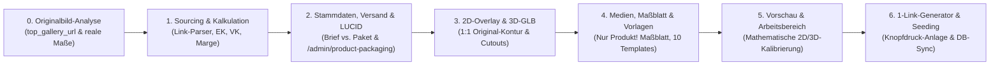

# Abschlussbericht & Standard-Betriebsablauf (SOP): KI-Automatisierte Produkterstellung & Sortimentssteuerung

**Status:** Aktiv / Verbindliche Standard-Operating-Procedure (SOP v3.2)  
**Projekt:** Mein-Seelenfunke (`/home/ubuntuxina/meine-projekte/seelenfunke`)  
**Abteilung:** Produkte / Konfigurator / 3D-Pipeline / Sourcing / Verpackung (LUCID)  
**Letzte Aktualisierung:** 27.10.2026  

**Trigger-Kommandos (Chat):**
- `Workflow "KI Produkterstellung" für [Kauflink / Originalbild] ausführen`
- `Produkt "[Name / SKU]" ins Sortiment aufnehmen`
- `Produkt "[Name / SKU]" aus dem Sortiment nehmen`

**Trigger im Admin-Backend (Per Knopfdruck):**
- `Produkte -> Produktübersicht` (`/admin/products` – „Deine Kollektion“):
  1. **1-Klick Sortiment-Schalter** direkt an jedem Produkt (`Im Sortiment` $\leftrightarrow$ `Pausiert`).
  2. **1-Klick Herkunfts-Umschalter** direkt an jedem physischen Produkt (`🇩🇪 Made in Germany` $\leftrightarrow$ `🇩🇪 Handveredelt in DE` $\leftrightarrow$ `Herkunft: Aus`).
  3. **Button „Neu (KI)“ oben rechts neben „Archiv öffnen“ und „+ Neu“:** Nur den **Kauflink zum Rohling-Produkt** angeben – sämtliche anderen Felder (inkl. fortlaufender Artikelnummer `SKU`, Startbestand `0`, Maße, EK/VK, Versandklasse und LUCID-Verpackung) werden bei Leerfeld logisch von der KI aus dem Link errechnet!
- **Artisan-CLI:**
  - `php artisan product:assortment` *(listet alle Produkte samt SKU, Bestand und Versandklasse tabellarisch auf)*
  - `php artisan product:assortment {slug|sku} {--enable|--disable}`

---

## 1. Zweck und oberste Grundregeln (Originalbild-, Produkt-Only-, SKU- & Verpackungs-Prinzip)

Die Geschäftsführung von **Mein-Seelenfunke** konzentriert sich ausschließlich auf **Einkauf (Bestellen), Veredelung (Lasern), Verpacken und Versenden**.

> [!IMPORTANT]
> **Die 6 verbindlichen Grundregeln für jedes Produkt (Bestand & Neu-Anlage):**
> 1. **100 % Originalbild-Basis & Logische Maßtreue:** Sämtliche **Produktbilder (`media_gallery`)**, **Feiertags-Vorlagenbilder (`product-templates`)**, **2D-Overlays (`overlay.png`)**, **technischen Maßblätter (`{slug}-dimensions.jpg`)** sowie die **3D-Animationen / `.glb`-Modelle** werden **stets und ausnahmslos auf Basis der realen Originalbilder und verifizierten Händler-Maße des Rohlings** erzeugt.
> 2. **Strikte „Product-Only“-Regel (KEINE Geschenkboxen / Samtetuis auf Bildern oder in Texten):** Auf Produkt- und Vorlagenbildern darf **ausschließlich das Produkt selbst** (ohne schwarze Schmuck-/Geschenkboxen, ohne Samtbeutel und ohne falsche Bänder) zu sehen sein! Da flache Artikel margenfreundlich im **Luftpolster-Umschlag (`Brief`)** bzw. Glasartikel im **Versandkarton** verschickt werden, sind `*-giftbox.jpg`-Bilder und Textversprechen wie *„inkl. Geschenkbox / Samtetui“* strikt untersagt.
> 3. **Keine automatischen KI-Produktvideos (`*-promo.mp4`):** In den Produkten werden **keine** KI-generierten Produktvideos hinterlegt; Produktvideos werden bei Bedarf später manuell vom Shopbetreiber gedreht und hochgeladen.
> 4. **Pflicht-Pflege der Verpackungsseite (`/admin/product-packaging` / LUCID):** Für jedes physische Produkt müssen sowohl die Versandklasse (`shipping_class`), die Netto-Verpackungskosten (`packaging_cost`) und das Tara-Gewicht (`packaging_weight`) als auch die **LUCID-Materialeinträge (`product_packagings`)** unter `/admin/product-packaging` vollständig hinterlegt werden.
> 5. **Initialer Lagerbestand bei Neuanlage ist immer `0` (`quantity = 0`):** Wenn ein neues Produkt im Shop angelegt wird (z. B. `Die Seelen-Pfote`, `Das Goldene Seelen-Herz` oder jedes weitere Produkt über `Neu (KI)` / `+ Neu`), steht der Lagerbestand initial **immer auf `0` (`quantity => 0`)**, da die physischen Rohlinge erst noch über den hinterlegten `reorder_url`-Kauflink bestellt und nach Wareneingang eingebucht werden. Die aus dem Link erkannte Gebindegröße (`packSize`, z. B. `set-mit-10`) dient ausschließlich zur Berechnung des Einzelstück-Einkaufspreises (`purchase_price`).
> 6. **Saubere, einheitliche & fortlaufende Artikelnummern (`SKU`-Standard `<MATERIAL>-<FORM>-<NNN>`):** Jedes Produkt im Katalog führt eine eindeutige, dreiteilige Artikelnummer in Großbuchstaben mit dreistelliger fortlaufender Nummerierung (`001`, `002`, `003`, ... – **keine** Zufallszahlen wie `rand(100, 999)`!). Sowohl im Seeder als auch bei Neuanlage über [`ProductCreate::generateNextCleanSku()`](file://wsl.localhost/Ubuntu/home/ubuntuxina/meine-projekte/seelenfunke/app/Livewire/Shop/Product/ProductCreate.php) und `normalizeCleanSku()` wird automatisch die nächste freie Nummer der jeweiligen Produktgruppe vergeben.

---

## 2. Gesamtübersicht: Der 7-Stufen-Prozess



---

## 3. Detaillierte Schritt-für-Schritt-Vorschrift

### Stufe 0: Optische & Geometrische Originalbild-Analyse (PFLICHT VOR JEDER ASSET-ERZEUGUNG)

> [!CAUTION]
> **Verbot generischer Fantasie-Designs & Geschenkboxen:** Es dürfen niemals Produktbilder, Vorlagenbilder, `overlay.png`-Dateien oder `.glb`-Modelle erzeugt werden, bevor das **reale Händler-Originalbild** (inkl. Maßbild des Lieferanten) geprüft und exakt vermessen wurde! Es darf niemals eine schwarze Geschenkbox oder ein Samtetui abgebildet werden.

1. **Extraktion & Visuelle Prüfung des Original-Rohlings:**
   - Aus dem Kauflink wird automatisch das Originalbild (`top_gallery_url`) sowie das Maßbild des Händlers geladen und inspiziert.
   - **Exakte Außenkontur & Durchbrüche (Cutouts):**
     - Besitzt der Rohling eine Tonnen-/Barrenform (`Der Seelen-Talisman`: Plakette `50 × 28 × 2,2 mm`, Schlüsselring `Ø 30 mm`, Gesamtlänge `78 mm`, `24 g`), eine Knochenform mit oben mittig angegossener Aufhänge-Öse und ausgestanztem Pfotenabdruck unten rechts (`Die Seelen-Pfote`: `40 × 22 × 1,8 mm` = `1,57 × 0,87 in`, `12 g` = `0,43 oz`), eine Herzform (`Der Seelenanhänger`: `45 × 40 × 2,3 mm`, `19 g`), einen Facetten-Kristallblock (`Der Seelen Kristall`: `180 × 200 × 40 mm`, `920 g`) oder eine Zylinderform (`Der Feierabend-Funke`: `Ø 74 × 218 mm`, `450 g`)?
     - **Durchbrüche / Stanzlöcher:** Ausgestanzte Motive im Metall (wie der ausgestanzte Pfotenabdruck unten rechts bei `Die Seelen-Pfote` oder die Aufhänge-Öse) müssen sowohl im 2D-Overlay (`alpha = 0` im PNG-Cutout) als auch im 3D-Modell (`.glb` mit `alphaTest: 0.35`, `DoubleSide` und extrudierten Innenwänden der Stanzlöcher) als echte, durchsichtige Aussparungen modelliert werden!
   - **Oberfläche & reale Laser-Farbphysik:**
     - **Massiv hochglanzpolierter Edelstahl in Silber oder Spiegelgold (`Die Seelen-Pfote`, `Der Seelen-Talisman`):** Ein Faserlaser erzeugt auf poliertem Edelstahl (Silber oder Gold) durch Anlassgravur (Annealing) eine **kontrastreiche, tief-anthrazitfarbene / dunkel-schwarze Gravur (`rgba(20, 18, 14, 0.93)`)**.
     - **Dunkel eloxiertes Metall (`Der Seelenanhänger`):** Der Laser trägt die schwarze Eloxalschicht ab; die Gravur erscheint in **hellem Silber-Weiß (`#F4F6F9`)**.
     - **Kristallglas / Hohlglas (`Der Seelen Kristall`, `Der Feierabend-Funke`):** Der Laser erzeugt ein **matt-weißes Mikro-Frosting (`rgba(255, 255, 255, 0.85)`)**.
2. **Maßstabsgetreue Pixel-Vermessung auf die `800×800` Standard-Bühne:**
   - Das Original-Produkt wird im exakten Seitenverhältnis seiner realen Millimeter-Maße (`Breite : Höhe`) in das `800×800` Koordinatensystem (Mittelpunkt `(400, 400)`) eingepasst.

---

### Stufe 1: Sourcing, Artikelnummern-Systematik (SKU), Link-Kalkulation & Händler-Zuordnung

1. **Verbindliche Artikelnummern-Systematik (`SKU`-Schema `<MATERIAL>-<FORM>-<NNN>`):**
   - Jedes Produkt erhält eine eindeutige, selbstsprechende Artikelnummer nach dem Schema **`<MATERIAL/KATEGORIE>-<FORM/TYP>-<NNN>`** (immer 3-stellig führend genullt: `001`, `002`, `003`...):
     - **`CRYSTAL-3D-NNN`** – Optische 3D-Kristallglasblöcke & Trophäen (z. B. `CRYSTAL-3D-001` = *Der Seelen Kristall*)
     - **`ALU-HEART-NNN`** – Eloxierte Aluminium-Herzanhänger (z. B. `ALU-HEART-001` = *Der Seelenanhänger*)
     - **`GLASS-WEIZEN-NNN`** – Kristall-Weizenbiergläser & Trinkgläser mit 360°-Gravur (z. B. `GLASS-WEIZEN-001` = *Der Feierabend-Funke*)
     - **`STEEL-BAR-NNN`** – Edelstahl-Schlüsselanhänger in Barren-/Tonnenform (z. B. `STEEL-BAR-001` = *Der Seelen-Talisman*)
     - **`STEEL-PAW-NNN`** – Edelstahl-Hundemarken mit Pfoten-Durchbruch (z. B. `STEEL-PAW-001` = *Die Seelen-Pfote*)
     - **`GOLD-HEART-NNN`** – 14k Ion-Plating vergoldete Edelstahl-Schmuckherzen mit Collierschlaufe (z. B. `GOLD-HEART-001` = *Das Goldene Seelen-Herz*)
     - **`ALU-OPENER-NNN`** – Eloxierte Alu-Schlüsselanhänger mit Flaschenöffner (z. B. `ALU-OPENER-001`)
     - **`BAMBOO-PEN-NNN`** – Natur-Bambus-Kugelschreiber mit Metallclip (z. B. `BAMBOO-PEN-001`)
     - **`GIFT-VOUCHER-NNN`** – Digitale / postalische Wert-Geschenkgutscheine (z. B. `GIFT-VOUCHER-001` = *Geschenkgutschein*)
     - **`MSF-UNIKAT-NNN`** – Standard-Präfix für manuell über `+ Neu` angelegte Entwürfe (`MSF-UNIKAT-001`, `MSF-UNIKAT-002`, ...)
   - Die Methode [`ProductCreate::generateNextCleanSku()`](file://wsl.localhost/Ubuntu/home/ubuntuxina/meine-projekte/seelenfunke/app/Livewire/Shop/Product/ProductCreate.php) prüft alle bestehenden (auch archivierten) Produkte in der Datenbank und vergibt kollisionsfrei die kleinste freie dreistellige Folgenummer (`-001`, `-002`, ...).

2. **Logische Ableitung aus dem Händler-Link (`inferFromQuickAiUrl`):**
   - **Gebindegröße (`packSize`):** Automatische Erkennung aus URL-Slugs und Parametern (z. B. `set-mit-10` = 10 Stück, `50-stueck` = 50 Stück, `_oak_goods_num`) zur Division des Gebindepreises auf den Einzelstück-EK.
   - **Initialer Lagerbestand (`quantity = 0`):** Jedes neu im Shop angelegte Produkt startet grundsätzlich mit **`quantity = 0` (`0 Stk.`)**, bis eine reale Nachbestellung über den `reorder_url`-Link physisch eingetroffen ist.
   - **Einkaufspreis pro Stück (`purchase_price`):** Automatische Dekodierung von Händler-Preiscodierungen (z. B. Base64-Parameter `_oak_rec_ext_1=Nzg4` $\rightarrow$ `788` Cent = `7,88 €` Packungspreis $\div 10\text{ Stk.} = \mathbf{0,79\text{ €}}$ Stück-EK bei `Die Seelen-Pfote`).
   - **Verkaufspreis (`price`) & Vergleichspreis (`compare_at_price`):** Logische Berechnung auf Basis von Stück-EK, Laserlaufzeit (`1 Min.`), Verpackung (`0,14 €` netto für Luftpolster-Versandtüte bzw. `0,60 €` netto für Versandkarton) und Marketing-Anteil (`10–15 %`) auf einen psychologischen `.90 €`-Preispunkt mit **88–92 % Bruttomarge**.
   - **Händler-Zuordnung (`ProductSupplier`):** Automatische Zuordnung anhand der Domain (`gluecksfieber.de` $\rightarrow$ *Glücksfieber (Lübeck)*, `printequipment.de` $\rightarrow$ *Print Equipment GmbH & Co. KG*, `temu.com` $\rightarrow$ *HaoYiZF (Fuhao) - Temu*, `heavytool-shop.de` $\rightarrow$ *Heavytool-Shop.de*, `metro.de` $\rightarrow$ *Mambocat*, `alibaba.com` $\rightarrow$ *Pujiang Wangzhe Crafts Co., Ltd.*, `amazon.de` $\rightarrow$ *Thal-Versand / Amazon Business DE*).

---

### Stufe 2: Produktstammdaten, Versandlogik (Brief vs. Paket) & Verpackungsseite (`/admin/product-packaging`)

In [`ProductSeeder.php`](file://wsl.localhost/Ubuntu/home/ubuntuxina/meine-projekte/seelenfunke/database/seeders/ProductSeeder.php) sowie automatisch bei jeder Produkterstellung in [`ProductCreate.php`](file://wsl.localhost/Ubuntu/home/ubuntuxina/meine-projekte/seelenfunke/app/Livewire/Shop/Product/ProductCreate.php) gelten zwei standardisierte Versand- und Verpackungsprofile:

1. **Profil A – Brief / Luftpolster-Umschlag (`weight <= 100 g`, z. B. `Der Seelenanhänger`, `Der Seelen-Talisman`, `Die Seelen-Pfote`):**
   - **`shipping_class => 'brief'`** (*„Brief / Großbrief (Günstiger)“* im Produkt-Editor Schritt 3).
   - **`packaging_cost => 14`** (`0,14 €` netto pro Stück = `57,16 € netto / 400 Stk.` Luftpolster-Versandtüten von *Karton.eu*).
   - **`packaging_weight => 15`** (`15 g` Tara für die Luftpolster-Versandtüte; triggert in `OrderOrder::getDhlWeightDetails()` automatisch `can_fit_in_envelope = true`).
   - **Pflicht-Einträge auf `/admin/product-packaging` (`product_packagings`-Tabelle für LUCID):**
     - `composite` (*Verbundmaterialien* – Luftpolsterversandtasche Papier/PE): **`12 g`**
     - `paper` (*Pappe, Papier & Karton* – Versandetikett / Beileger): **`3 g`**
     - *(Gesamtgewicht: `15 g` = exakt synchron zu `packaging_weight`)*

2. **Profil B – DHL Standard Paket / Versandkarton (`weight > 100 g`, z. B. `Der Seelen Kristall`, `Der Feierabend-Funke`):**
   - **`shipping_class => null`** (*„DHL Standard (Gewichtsbasiert)“*).
   - **`packaging_cost => 60`** (`0,60 €` netto pro Stück = `144,00 € netto / 240 Stk.` Versandkartons von *Karton.eu*).
   - **`packaging_weight => 150`** (`Der Seelen Kristall`) bzw. **`120`** (`Der Feierabend-Funke`).
   - **Pflicht-Einträge auf `/admin/product-packaging` (`product_packagings`-Tabelle für LUCID):**
     - `paper` (*Pappe, Papier & Karton* – Versandkarton, Papier-Packband & Lieferschein): **`130 g`** (bzw. **`100 g`** beim Weizenglas)
     - `plastic` (*Kunststoffe* – Luftpolsterfolie zum Bruchschutz): **`20 g`**
     - *(Gesamtgewicht: `150 g` bzw. `120 g` = exakt synchron zu `packaging_weight`)*

---

### Stufe 3: 1:1 Deckungsgleiche 2D-Overlay- (`overlay.png`) & 3D-Animation/Modell-Erzeugung (`.glb`)

Damit die **3D-Animation (`.glb`)** und das **2D-Overlay (`overlay.png`)** exakt dem Originalbild entsprechen und dieselben Maße besitzen, gilt die native PHP-Pipeline in [`database/seeders/ProductAssetSeeder.php`](file://wsl.localhost/Ubuntu/home/ubuntuxina/meine-projekte/seelenfunke/database/seeders/ProductAssetSeeder.php) (wird automatisch durch `ProductSeeder` ausgeführt):

1. **Gemeinsame Original-Kontur als Single-Source-of-Truth (`800×800`):**
   - Sowohl das `overlay.png` als auch das 3D-Mesh für `{slug}_3d.glb` verwenden exakt dieselben Pixel-Koordinaten `(px, py)` im `800×800`-Raster:
     $$X = \frac{\text{px} - 400}{360}, \qquad Y = \frac{400 - \text{py}}{360}, \qquad u = \frac{\text{px}}{800}, \qquad v = \frac{\text{py}}{800}$$
2. **Echte 3D-Durchbrüche (Cutout-Löcher) & Eingebettete Original-Textur:**
   - Das `.glb` wird mit `buildSingleTexturedGlb(meshData, pngBuffer)` inklusive eingebetteter PNG-Textur (`overlay.png` als `baseColorTexture`) erzeugt.
   - Für ausgestanzte Konturen (wie das Ösenloch und den ausgestanzten Pfotenabdruck bei `seelen_pfote_3d.glb`) werden dreidimensionale Innenwände generiert und im Three.js-Shader `alphaTest: 0.35` mit `THREE.DoubleSide` aktiviert.
3. **Bündige Z-Tiefe (`zHalf = 0.032`) ohne Parallaxe:**
   - Die Gravurplatte erhält `zHalf = 0.032` (`size.z = 0.064`), sodass die Lasergravur bei `baseZ = 0.033` exakt `0.001` Einheiten vor der Metalloberfläche liegt und bei jeder 3D-Drehung fest auf dem Produkt haftet.

---

### Stufe 4: Vollständige Medien-Pipeline (Nur Produkt + Technisches Maßblatt auf letzter Position, KEINE Geschenkboxen, KEINE Videos)

> [!IMPORTANT]
> **Pflicht-Bestandteile der Produkt-Medien (`media_gallery` & `product-templates`):**
> Jedes Produkt erhält auf Basis des Originalbildes:
> 1. **2 bis 3 reine Studio- & Lifestyle-Produktbilder (`1024×1024 px`, `.jpg`)** – **NUR das Produkt selbst** (ohne Geschenkbox, ohne Samtetui!).
> 2. **1 Technisches Maßblatt-Produktbild (`{slug}-dimensions.jpg`, `1024×1024 px`) auf der LETZTEN Bildposition der Galerie** mit unverdeckten Millimeter-Bemaßungspfeilen (`labelPos: 'above' | 'below'`) und exakten gestrichelten Kontur-Hilfslinien!
> 3. **KEINE KI-Produktvideos (`*-promo.mp4`)** – Videos werden ausschließlich manuell vom Shopbetreiber erstellt.
> 4. **Alle saisonalen Feiertags-Vorlagenbilder (`product-templates/{slug}-*.jpg`)** im exakt selben Original-Design (ebenfalls ohne Geschenkboxen!).

1. **Galeriebilder (`storage/app/public/produkte/products/{slug}/`):**
   - **Position 1 (`is_main => true`):** `{slug}-main.jpg` (bzw. `_b.jpg` / `_s.jpg`) – Studio-Hero-Aufnahme des Originalprodukts mit Lasergravur.
   - **Position 2:** `{slug}-back.jpg` / `{slug}-detail.jpg` – Detailaufnahme bzw. Rückseiten-Gravur des exakt selben Produkts (ohne Box).
   - **Position 3 (optional):** `{slug}-lifestyle.jpg` – Alltagsaufnahme des Produkts (z. B. am Schlüsselbund oder Hundehalsband, ohne Box).
   - **Letzte Bildposition (PFLICHT):** `{slug}-dimensions.jpg` – **Technisches Maßblatt-Produktbild**:
     - Maßpfeile und Maß-Badges dürfen **niemals** auf demselben `y`-Wert übereinanderliegen (`labelPos => 'above'` für obere Maßpfeile, `labelPos => 'below'` für untere Maßpfeile).
     - Gestrichelte Hilfslinien (`dashedYFrom1/2`, `dashedXFrom1/2`) müssen exakt an den realen Außenkanten des Produkt-Overlays im `1024×1024`-Canvas (`overlayTop = 185` bzw. `215`, `overlayLeft = 232`, `560×560 px`) starten.

---

### Stufe 5: Mathematische Kalibrierung von „Vorschau & Arbeitsbereich“ (`configurator_settings`)

1. **Freiform-Gravurzone (`area_shape => 'custom'`) ohne weißen Rechteck-Schatten:**
   - Alle Plaketten, Herzen und Hundemarken nutzen `area_shape => 'custom'` mit einem `custom_points`-Polygon, das exakt die gravierbare Fläche umschließt und Stanzlöcher/Aussparungen (wie die obere Öse oder den ausgestanzten Pfotenabdruck unten rechts bei `Die Seelen-Pfote`) sauber ausspart.
2. **1:1-Formel für `model_scale` und `engraving_scale`:**
   $$\text{model\_scale} = \text{round}\left(\frac{1.509 \times P_{\text{max}}}{800} \times 100\right), \qquad \text{engraving\_scale} = \text{round}\left(\frac{800}{1.5 \times P_{\text{max}}} \times 100\right)$$

### Kalibrierte Referenzwerte aller Katalog-Produkte (inkl. Artikelnummer/SKU, Bestand, Maßblatt, Versand & LUCID-Verpackung)

| Artikel-Nr. (`sku`) | Produkt (`slug` / Name) | Bestand (`quantity`) | Reale Maße (`B × H × T`, Gewicht) | Stück-EK / VK Brutto | Versandart & Verpackung (`packaging_cost` / `packaging_weight`) | LUCID `/admin/product-packaging` (`product_packagings`) | 3D-Modell (`.glb`) & `model_scale` | Maßblatt-Bild (Letzte Bildposition) |
| :--- | :--- | :---: | :--- | :--- | :--- | :--- | :--- | :--- |
| **`CRYSTAL-3D-001`** | **`seelen-kristall`** (*Der Seelen Kristall*) | `150 Stk.` | `180 × 200 × 40 mm`, `920 g` | `5,36 €` / `39,90 €` | DHL Standard (`null`), Karton (`0,60 €` / `150 g`) | `paper: 130 g`, `plastic: 20 g` | `t_seelenk.glb` (`100`) | `seelen-kristall-dimensions.jpg` |
| **`ALU-HEART-001`** | **`seelen-anhaenger`** (*Der Seelenanhänger*) | `150 Stk.` | `45 × 40 × 2,3 mm`, `19 g` | `1,36 €` / `16,99 €` | Brief / Luftpolster (`'brief'`), Tüte (`0,14 €` / `15 g`) | `composite: 12 g`, `paper: 3 g` | `seelenanhaenger_3d_.glb` (`100`) | `seelen-anhaenger-dimensions.jpg` |
| **`GLASS-WEIZEN-001`** | **`weizenglas-personalisiert`** (*Der Feierabend-Funke*) | `200 Stk.` | `74 × 218 × 74 mm`, `450 g` | `3,33 €` / `24,90 €` | DHL Standard (`null`), Karton (`0,60 €` / `120 g`) | `paper: 100 g`, `plastic: 20 g` | `beer_glas_3d.glb` (`100`) | `weizenglas-dimensions.jpg` |
| **`STEEL-BAR-001`** | **`seelen-talisman`** (*Der Seelen-Talisman*) | `16 Stk.` *(Beleg 15.10.)* | `28 × 50 × 2,2 mm`, `24 g` (Ring `Ø 30 mm`, Länge `78 mm`) | `1,16 €` / `19,90 €` | Brief / Luftpolster (`'brief'`), Tüte (`0,14 €` / `15 g`) | `composite: 12 g`, `paper: 3 g` | `seelen_talisman_3d.glb` (`136`) | `seelen-talisman-dimensions.jpg` |
| **`STEEL-PAW-001`** | **`seelen-pfote-hundemarke`** (*Die Seelen-Pfote*) | `0 Stk.` *(Neu)* | `40 × 22 × 1,8 mm`, `12 g` (`1,57 × 0,87 in`, `0,43 oz`) | `0,79 €` / `17,90 €` | Brief / Luftpolster (`'brief'`), Tüte (`0,14 €` / `15 g`) | `composite: 12 g`, `paper: 3 g` | `seelen_pfote_3d.glb` (`121`) | `seelen-pfote-dimensions.jpg` |
| **`GOLD-HEART-001`** | **`goldenes-seelen-herz`** (*Das Goldene Seelen-Herz*) | `0 Stk.` *(Neu)* | `22 × 25 × 4,0 mm`, `14 g` (Collierschlaufe `Öse 3 × 6 mm`, 14k IP) | `2,10 €` / `24,90 €` | Brief / Luftpolster (`'brief'`), Tüte (`0,14 €` / `15 g`) | `composite: 12 g`, `paper: 3 g` | `goldenes_seelen_herz_3d.glb` (`121`) | `goldenes-seelen-herz-dimensions.jpg` |
| **`GIFT-VOUCHER-001`** | **`geschenkgutschein`** (*Geschenkgutschein*) | Unbegrenzt (`digital`) | Digital / Klappkarte | `0,00 €` / Dynamisch | E-Mail / Post (`digital`) | – (`digital`) | – (`three_d_active: false`) | – |

---

### Stufe 6: „Neu (KI)“ & „+ Neu“ in der Produktübersicht (`ProductCreate.php` & `_list.blade.php`)

Unter **`Produkte -> Produktübersicht („Deine Kollektion“)`** ([`ProductCreate.php`](file://wsl.localhost/Ubuntu/home/ubuntuxina/meine-projekte/seelenfunke/app/Livewire/Shop/Product/ProductCreate.php) & [`_list.blade.php`](file://wsl.localhost/Ubuntu/home/ubuntuxina/meine-projekte/seelenfunke/resources/views/livewire/shop/product/partials/_list.blade.php)) gilt folgender Aufbau und Ablauf:

1. **Kompakte, einzeilige Kopfzeile („Deine Kollektion“):**
   - Die Gesamtanzahl der angezeigten Produkte ist direkt in den Platzhalter der Suchleiste integriert (**`{{ $productCount }} Produkte suchen...`**).
   - Rechts neben der Suchleiste befinden sich in einer Zeile die drei Aktions-Buttons **`Archiv öffnen`**, **`Neu (KI)`** und **`+ Neu`**.
   - In allen drei Ansichtsmodi (**Groß**, **Mittel**, **Liste**) wird die **Artikelnummer (`SKU`)** sichtbar am Produkt ausgewiesen.
2. **Einziges Pflichtfeld im Modal „Neu (KI)“ ist der Link zum Rohling (`quickAiReorderUrl`):**
   - Der Benutzer fügt lediglich die URL zum Händler-Rohling ein und klickt direkt auf **„Produkt sofort verkaufsfertig anlegen“**.
3. **Vollautomatische Berechnung inkl. fortlaufender SKU, Startbestand `0`, Versand & LUCID-Verpackungsanlage:**
   - `inferFromQuickAiUrl()` und `createQuickAiProduct()` berechnen automatisch:
     - Produkttyp, 3D-/2D-Geometrie, Gebindegröße (`packSize`) und Stück-EK,
     - **Saubere, fortlaufende Artikelnummer (`SKU`)** im Schema `<MATERIAL>-<FORM>-<NNN>` über `generateNextCleanSku()` und `normalizeCleanSku()`,
     - **Start-Lagerbestand `0 Stk.` (`quantity => 0`)**, sofern kein eigener Bestand eingetragen wird,
     - Verkaufspreis (`VK Brutto`), verifizierte Millimeter-Maße (`Breite`, `Höhe`, `Tiefe`) und Gewicht in Gramm,
     - **Versandart & Verpackungskosten:** Bei leichten Artikeln (`weight <= 100 g`) automatisch `shipping_class => 'brief'`, `packaging_cost => 14` (`0,14 €` Luftpolster-Versandtüte) und `packaging_weight => 15` (`15 g`); bei schweren/zerbrechlichen Artikeln automatisch `shipping_class => null` (DHL Standard), `packaging_cost => 60` (`0,60 €` Karton) und `packaging_weight => 150` (`150 g`),
     - **Automatische LUCID-Einträge auf `/admin/product-packaging` (`$created->packagings()->createMany(...)`):** Jedes neu angelegte Produkt erhält sofort die passenden Materialgewichte (`composite: 12 g` + `paper: 3 g` bei Briefversand bzw. `paper` + `plastic` bei Kartonversand),
     - **Bereinigte Mediengalerie:** Ohne Videos (`type !== 'video'`), ohne Geschenkbox-Bilder (`!str_contains(path, '-giftbox')`) und mit dem technischen Maßblatt (`{slug}-dimensions.jpg`) auf der letzten Position.
   - Auch beim manuellen Anlegen über **`+ Neu` (`createDraft()`)** wird sofort eine saubere Start-SKU (`MSF-UNIKAT-001`) sowie `quantity = 0` vergeben und beim Speichern über `ProductCreate::save()` normalisiert.

---

### Stufe 7: Pflicht-Befehle zur Synchronisation & Sortiments-Steuerung

```bash
# 1. Lieferanten, Produkte (inkl. LUCID-Verpackungen, 2D-Overlays, 3D-GLB-Modellen & Maßblättern) und Vorlagen seeden:
docker exec -w /var/www/html mein_php_server php artisan db:seed --class=ProductSupplierSeeder --force
docker exec -w /var/www/html mein_php_server php artisan db:seed --class=ProductSeeder --force
docker exec -w /var/www/html mein_php_server php artisan db:seed --class=ProductTemplateSeeder --force
docker exec -w /var/www/html mein_php_server php artisan db:seed --class=ProductLandingPageSeeder --force
docker exec -w /var/www/html mein_php_server php artisan optimize:clear

# 2. Produkt per Knopfdruck pausieren oder aktivieren (alternativ per 1-Klick-Button in /admin/products):
docker exec -w /var/www/html mein_php_server php artisan product:assortment seelen-pfote-hundemarke --enable
```
