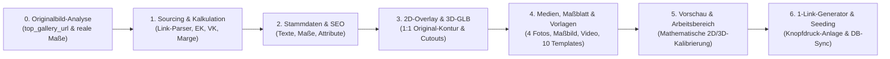

# Abschlussbericht & Standard-Betriebsablauf (SOP): KI-Automatisierte Produkterstellung & Sortimentssteuerung

**Status:** Aktiv / Verbindliche Standard-Operating-Procedure (SOP v3.0)  
**Projekt:** Mein-Seelenfunke (`/home/ubuntuxina/meine-projekte/seelenfunke`)  
**Abteilung:** Produkte / Konfigurator / 3D-Pipeline / Sourcing  
**Letzte Aktualisierung:** 26.10.2026  

**Trigger-Kommandos (Chat):**
- `Workflow "KI Produkterstellung" für [Kauflink / Originalbild] ausführen`
- `Produkt "[Name / SKU]" ins Sortiment aufnehmen`
- `Produkt "[Name / SKU]" aus dem Sortiment nehmen`

**Trigger im Admin-Backend (Per Knopfdruck):**
- `Produkte -> Produktübersicht` (`/admin/products`):
  1. **1-Klick Sortiment-Schalter** direkt an jedem Produkt (`Im Sortiment aktiv` $\leftrightarrow$ `Pausiert / Aus Sortiment`).
  2. **Button „Neues Produkt per Knopfdruck anlegen“ (1-Link-Modus):** Nur den **Kauflink zum Rohling-Produkt** angeben – sämtliche anderen Felder sind optional und werden bei Leerfeld logisch von der KI aus dem Link errechnet!
- **Artisan-CLI:** `php artisan product:assortment {slug} {--enable|--disable}`

---

## 1. Zweck und oberste Grundregel (Originalbild-Prinzip)

Die Geschäftsführung von **Mein-Seelenfunke** konzentriert sich ausschließlich auf **Einkauf (Bestellen), Veredelung (Lasern), Verpacken und Versenden**.

> [!IMPORTANT]
> **Oberste Grundregel – 100 % Originalbild-Basis & Logische Maßtreue:**
> Sämtliche **Produktbilder (`media_gallery`)**, **Feiertags-Vorlagenbilder (`product-templates`)**, **2D-Overlays (`overlay.png`)**, **technischen Maßblätter (`{slug}-dimensions.jpg`)** sowie die **3D-Animationen / `.glb`-Modelle** werden **stets und ausnahmslos auf Basis der realen Originalbilder des Händler-Rohlings** (z. B. `top_gallery_url` aus dem Temu-/Händler-Link oder Originalfoto) erzeugt! Alle Größen, Abmessungen (`Breite × Höhe × Tiefe in mm`), Gewichte, Gebindepreise, Stück-EKs, Verkaufspreise und Gravurzonen-Koordinaten werden logisch, maßstabsgetreu und physikalisch korrekt aus dem Originalprodukt abgeleitet.

---

## 2. Gesamtübersicht: Der 7-Stufen-Prozess



---

## 3. Detaillierte Schritt-für-Schritt-Vorschrift

### Stufe 0: Optische & Geometrische Originalbild-Analyse (PFLICHT VOR JEDER ASSET-ERZEUGUNG)

> [!CAUTION]
> **Verbot generischer Fantasie-Designs:** Es dürfen niemals Produktbilder, Vorlagenbilder, `overlay.png`-Dateien oder `.glb`-Modelle erzeugt werden, bevor das **reale Händler-Originalbild** (z. B. aus dem URL-Parameter `top_gallery_url` oder dem Händler-Produktfoto) heruntergeladen und exakt vermessen wurde!

1. **Extraktion & Visuelle Prüfung des Original-Rohlings:**
   - Aus dem Kauflink wird automatisch das Originalbild (`top_gallery_url`) geladen und inspiziert.
   - **Exakte Außenkontur & Durchbrüche (Cutouts):**
     - Besitzt der Rohling eine Tonnen-/Barrenform (`Der Seelen-Talisman`), eine Knochenform mit oben mittig angegossener Aufhänge-Öse und ausgestanztem Pfotenabdruck unten rechts (`Die Seelen-Pfote`), eine Herzform (`Der Seelenanhänger`), einen Facetten-Kristallblock (`Der Seelen Kristall`) oder eine Zylinderform (`Der Feierabend-Funke`)?
     - **Durchbrüche / Stanzlöcher:** Ausgestanzte Motive im Metall (wie der ausgestanzte Pfotenabdruck unten rechts bei `Die Seelen-Pfote` oder die Aufhänge-Öse) müssen sowohl im 2D-Overlay (`alpha = 0` im PNG-Cutout) als auch im 3D-Modell (`.glb` mit `alphaTest: 0.35`, `DoubleSide` und extrudierten Innenwänden der Stanzlöcher) als echte, durchsichtige Aussparungen modelliert werden!
   - **Oberfläche & reale Laser-Farbphysik:**
     - **Massiv hochglanzpolierter Edelstahl in Silber oder Spiegelgold (`Die Seelen-Pfote`, `Der Seelen-Talisman`):** Ein Faserlaser erzeugt auf poliertem Edelstahl (Silber oder Gold) durch Anlassgravur (Annealing) eine **kontrastreiche, tief-anthrazitfarbene / dunkel-schwarze Gravur (`rgba(20, 18, 14, 0.93)`)**.
     - **Dunkel eloxiertes Metall (`Der Seelenanhänger`):** Der Laser trägt die schwarze Eloxalschicht ab; die Gravur erscheint in **hellem Silber-Weiß (`#F4F6F9`)**.
     - **Kristallglas / Hohlglas (`Der Seelen Kristall`, `Der Feierabend-Funke`):** Der Laser erzeugt ein **matt-weißes Mikro-Frosting (`rgba(255, 255, 255, 0.85)`)**.
2. **Maßstabsgetreue Pixel-Vermessung auf die `800×800` Standard-Bühne:**
   - Das Original-Produkt wird im exakten Seitenverhältnis seiner realen Millimeter-Maße (`Breite : Höhe`) so in das `800×800` Koordinatensystem (Mittelpunkt `(400, 400)`) eingepasst, dass die längste Achse `90 %` (`720 px`) bei Hochformat-Anhängern bzw. `80 %` (`640 px`) bei Querformat-Marken einnimmt und der Bounding-Box-Mittelpunkt exakt bei `(400, 400)` liegt.

---

### Stufe 1: Sourcing, Automatische Link-Kalkulation & Händler-Zuordnung

1. **Logische Ableitung aus dem Händler-Link (`inferFromQuickAiUrl`):**
   - **Gebindegröße (`packSize`):** Automatische Erkennung aus URL-Slugs und Parametern (z. B. `set-mit-10` = 10 Stück, `50-stueck` = 50 Stück, `_oak_goods_num`).
   - **Einkaufspreis pro Stück (`purchase_price`):** Automatische Dekodierung von Händler-Preiscodierungen (z. B. Base64-Parameter `_oak_rec_ext_1=Nzg4` $\rightarrow$ `788` Cent = `7,88 €` Packungspreis $\div 10\text{ Stk.} = \mathbf{0,79\text{ €}}$ Stück-EK bei `Die Seelen-Pfote`).
   - **Verkaufspreis (`price`) & Vergleichspreis (`compare_at_price`):** Logische Berechnung auf Basis von Stück-EK, Laserlaufzeit (`1–3 Min.`), Verpackung (`0,17 €` bis `0,60 €`) und Marketing-Anteil (`10 %`) auf einen psychologischen `.90 €`-Preispunkt (`14,90 €`, `16,90 €`, `17,90 €`, `19,90 €`, `39,90 €`) mit **88–92 % Bruttomarge**.
   - **Händler-Zuordnung (`ProductSupplier`):** Automatische Zuordnung anhand der Domain (`temu.com` $\rightarrow$ *HaoYiZF / Temu Direct Sourcing*, `heavytool-shop.de` $\rightarrow$ *Heavytool*, `metro.de` $\rightarrow$ *METRO*, `alibaba.com` $\rightarrow$ *Pujiang Shining Crystal*, `amazon.de` $\rightarrow$ *Thal-Versand*).

---

### Stufe 2: Produktstammdaten, Logische Maße & SEO

In [`ProductSeeder.php`](file://wsl.localhost/Ubuntu/home/ubuntuxina/meine-projekte/seelenfunke/database/seeders/ProductSeeder.php) bzw. über den 1-Link-Generator in [`ProductCreate.php`](file://wsl.localhost/Ubuntu/home/ubuntuxina/meine-projekte/seelenfunke/app/Livewire/Shop/Product/ProductCreate.php) werden alle Stammdaten logisch und konsistent gesetzt:
- `name`, `slug`, `type => 'physical'`, `status => 'active'`, `is_personalizable => true`, `three_d_active => true`, `completion_step => 4`.
- **Exakte physikalische Maße:** `width` (Breite in mm), `height` (Höhe in mm), `length` (Materialstärke/Tiefe in mm), `weight` (Gewicht in g), `packaging_weight` (g), `shipping_class` (`'paket_s'` oder `'paket_m'`).
- **Konsistente Texte & Attribute:** `description`, `short_description` und `attributes` nennen exakt dieselben Millimeter-Maße und dasselbe Material wie das Originalbild und das technische Maßblatt.

---

### Stufe 3: 1:1 Deckungsgleiche 2D-Overlay- (`overlay.png`) & 3D-Animation/Modell-Erzeugung (`.glb`)

Damit die **3D-Animation (`.glb`)** und das **2D-Overlay (`overlay.png`)** exakt dem Originalbild entsprechen und dieselben Maße besitzen, gilt die Pipeline in [`scripts/generate-product-3d.mjs`](file://wsl.localhost/Ubuntu/home/ubuntuxina/meine-projekte/seelenfunke/scripts/generate-product-3d.mjs):

1. **Gemeinsame Original-Kontur als Single-Source-of-Truth (`800×800`):**
   - Sowohl das SVG für `overlay.png` als auch das 3D-Mesh für `{slug}_3d.glb` verwenden exakt dieselben Pixel-Koordinaten `(px, py)` im `800×800`-Raster:
     $$X = \frac{\text{px} - 400}{360}, \qquad Y = \frac{400 - \text{py}}{360}, \qquad u = \frac{\text{px}}{800}, \qquad v = \frac{\text{py}}{800}$$
2. **Echte 3D-Durchbrüche (Cutout-Löcher) & Eingebettete Original-Textur:**
   - Das `.glb` wird mit `buildSingleTexturedGlb(meshData, pngBuffer)` inklusive eingebetteter PNG-Textur (`overlay.png` als `baseColorTexture`) erzeugt.
   - Für ausgestanzte Konturen (wie das Ösenloch und den ausgestanzten Pfotenabdruck bei `seelen_pfote_3d.glb`) werden dreidimensionale Innenwände (`addHoleWallRing`) generiert und im Three.js-Shader (`scripts_frontend_2.blade.php` & `three_js_main.blade.php`) `alphaTest: 0.35` mit `THREE.DoubleSide` aktiviert. So sind Stanzlöcher in der 3D-Animation echt durchsichtig.
3. **Bündige Z-Tiefe (`zHalf = 0.032`) ohne Parallaxe:**
   - Die Gravurplatte erhält `zHalf = 0.032` (`size.z = 0.064`), sodass die Lasergravur bei `baseZ = 0.033` exakt `0.001` Einheiten vor der Metalloberfläche liegt und bei jeder 3D-Drehung fest auf dem Produkt haftet.

---

### Stufe 4: Vollständige Medien-Pipeline inkl. Technischem Maßblatt auf letzter Position

> [!IMPORTANT]
> **Pflicht-Bestandteile der Produkt-Medien (`media_gallery` & `product-templates`):**
> Jedes Produkt erhält auf Basis des Originalbildes:
> 1. **4 Studio- & Lifestyle-Produktbilder (`1024×1024 px`, `.jpg`)**
> 2. **1 Technisches Maßblatt-Produktbild (`{slug}-dimensions.jpg`, `1024×1024 px`) auf der LETZTEN Bildposition der Galerie** mit detaillierten Millimeter-Maßangaben direkt am Produkt!
> 3. **1 kurzes, knackiges Marketing-Video ohne Stimme (`{slug}-promo.mp4`, `-an`)**
> 4. **Alle 10 saisonalen Feiertags-Vorlagenbilder (`product-templates/{slug}-*.jpg`)** im exakt selben Original-Design!

1. **Galeriebilder (`storage/app/public/produkte/products/{slug}/`):**
   - **Position 1 (`is_main => true`):** `{slug}-main.jpg` – Studio-Hero-Aufnahme des Originalprodukts mit Lasergravur.
   - **Position 2:** `{slug}-back.jpg` – Detailaufnahme der Rückseiten-Gravur.
   - **Position 3:** `{slug}-lifestyle.jpg` – Emotionale Alltagsaufnahme (z. B. am Hundehalsband oder Schlüsselbund).
   - **Position 4:** `{slug}-giftbox.jpg` – Edle Geschenkbox-Aufnahme im schwarzen Samtetui.
   - **Letzte Bildposition (PFLICHT):** `{slug}-dimensions.jpg` – **Technisches Maßblatt-Produktbild**, das das Originalprodukt zusammen mit exakten Bemaßungspfeilen (`Breite in mm`, `Höhe in mm`), Spezifikations-Karten (`Materialstärke in mm`, `Gewicht in g`, `Laser-Gravurzone in mm`) und Maßstab-Badge zeigt. Wird automatisch durch `generateAllDimensionSheets()` in [`scripts/generate-product-3d.mjs`](file://wsl.localhost/Ubuntu/home/ubuntuxina/meine-projekte/seelenfunke/scripts/generate-product-3d.mjs) generiert.
   - **Video-Slot:** `{slug}-promo.mp4` – Stummes H.264-Produktvideo (`720×720 px`, `-an`).
2. **10 Saisonale Vorlagenbilder (`storage/app/public/produkte/product-templates/{slug}-*.jpg`):**
   - Da `Product::resolveSeasonalTemplate()` bei aktivem `auto_seasonal_main_image` das saisonale Vorlagenbild als Hauptbild im Shop einblendet, müssen alle 10 Vorlagen (`weihnachten`, `ostern`, `hochzeit`, `geburtstag`, `valentinstag`, `halloween`, `muttertag`, `vatertag`, `jahrestag`, `freundschaft`) zwingend das Originalprodukt zeigen.

---

### Stufe 5: Mathematische Kalibrierung von „Vorschau & Arbeitsbereich“ (`configurator_settings`)

1. **Freiform-Gravurzone (`area_shape => 'custom'`) ohne weißen Rechteck-Schatten:**
   - Alle Plaketten, Herzen und Hundemarken nutzen `area_shape => 'custom'` mit einem `custom_points`-Polygon, das exakt die gravierbare Fläche umschließt und Stanzlöcher/Aussparungen (wie die obere Öse oder den ausgestanzten Pfotenabdruck unten rechts bei `Die Seelen-Pfote`) sauber ausspart.
2. **1:1-Formel für `model_scale` und `engraving_scale`:**
   $$\text{model\_scale} = \text{round}\left(\frac{1.509 \times P_{\text{max}}}{800} \times 100\right), \qquad \text{engraving\_scale} = \text{round}\left(\frac{800}{1.5 \times P_{\text{max}}} \times 100\right)$$

### Kalibrierte Referenzwerte der 5 Start-Produkte (inkl. Maßblatt & Original-Geometrie)

| Produkt (`slug`) | Reale Maße (`B × H × T`, Gewicht) | Stück-EK / VK Brutto | 3D-Modell (`.glb`) & `model_scale` | 2D-Form & Bereich (`L / T / W / H`) | 3D-Gravur Vorn (`Scale / X / Y / Z / RotY`) | Maßblatt-Bild (Letzte Bildposition) |
| :--- | :--- | :--- | :--- | :--- | :--- | :--- |
| **`seelen-kristall`** | `60 × 80 × 60 mm`, `650 g` | `4,19 €` / `39,90 €` | `t_seelenk.glb` (`100`) | `circle` (`10 / 10 / 81 / 80`) | `68 / 0 / 0.30 / -0.64 / 180°` | `seelen-kristall-dimensions.jpg` |
| **`seelen-anhaenger`** | `38 × 33 × 2,0 mm`, `18 g` | `0,70 €` / `14,90 €` | `seelenanhaenger_3d_.glb` (`100`) | `custom` 31 Pkt. (`10 / 10 / 80 / 80`) | `71.3 / -0.43 / -0.22 / -4.86 / 90°` | `seelen-anhaenger-dimensions.jpg` |
| **`weizenglas-personalisiert`** | `80 × 240 × 80 mm`, `550 g` | `1,20 €` / `16,90 €` | `beer_glas_3d.glb` (`100`) | `rect` (`0 / 14.6 / 100 / 64.7`) | `100 / 0 / 0 / 0 / 0°` | `weizenglas-dimensions.jpg` |
| **`seelen-talisman`** | `28 × 50 × 2,2 mm`, `24 g` | `1,16 €` / `19,90 €` | `seelen_talisman_3d.glb` (`136`) | `custom` 12 Pkt. (`35.2 / 46.8 / 29.6 / 47.0`) | `74 / 0 / 0 / 0 / 180°` | `seelen-talisman-dimensions.jpg` |
| **`seelen-pfote-hundemarke`** | `40 × 26 × 1,8 mm`, `16 g` | `0,79 €` / `17,90 €` | `seelen_pfote_3d.glb` (`121`) | `custom` 22 Pkt. (`11.5 / 38.0 / 77.0 / 40.0`) | `83 / 0 / 0 / 0 / 180°` | `seelen-pfote-dimensions.jpg` |

---

### Stufe 6: „Neues Produkt per Knopfdruck anlegen“ (1-Link-Vollautomatik)

Unter **`Produkte -> Produktübersicht -> KI-Produkt anlegen`** ([`ProductCreate.php`](file://wsl.localhost/Ubuntu/home/ubuntuxina/meine-projekte/seelenfunke/app/Livewire/Shop/Product/ProductCreate.php) & [`_list.blade.php`](file://wsl.localhost/Ubuntu/home/ubuntuxina/meine-projekte/seelenfunke/resources/views/livewire/shop/product/partials/_list.blade.php)) gilt folgender Ablauf:

1. **Einziges Pflichtfeld ist der Link zum Rohling (`quickAiReorderUrl`):**
   - Der Benutzer fügt lediglich die URL zum Händler-Rohling ein (z. B. Temu-, Amazon- oder Großhandels-Link) und klickt direkt auf **„Produkt sofort verkaufsfertig anlegen“**.
2. **Optionale Felder mit KI-Fallback bei Leerfeld:**
   - Alle weiteren Eingabefelder (`Produktname`, `SKU`, `VK Brutto`, `Stück-EK`, `Bestand`, `Gewicht`, `Breite`, `Höhe`, `Tiefe`) sind **optional**.
   - Füllt der Benutzer einzelne Felder manuell aus, haben diese Vorrang.
   - Lässt der Benutzer die Felder leer, berechnet `inferFromQuickAiUrl()` vollautomatisch aus der URL:
     - den Produkttyp und die passende 3D-/2D-Geometrie,
     - die Gebindegröße (z. B. 10er-Set) und den exakten Stück-EK (inkl. Temu Base64-Preisdekodierung `_oak_rec_ext_1`),
     - den optimalen Verkaufspreis (`VK Brutto`) mit ~90 % Zielmarge,
     - die logischen Millimeter-Maße (`Breite`, `Höhe`, `Tiefe`) und das Gewicht in Gramm,
     - den passenden Lieferanten (`ProductSupplier`), SEO-Texte, Staffelpreise sowie die komplette Mediengalerie inklusive dem **technischen Maßblatt (`{slug}-dimensions.jpg`) auf der letzten Bildposition**.
   - Über den Button **„✨ Werte vorab in Felder laden“** (`wire:click="analyzeQuickAiUrl"`) können die von der KI errechneten Werte auf Wunsch auch vor dem Speichern in die Eingabefelder eingeblendet werden.

---

### Stufe 7: Pflicht-Befehle zur Synchronisation & Sortiments-Steuerung

```bash
# 1. 2D-Overlays, 3D-GLB-Modelle und Technische Maßblätter ({slug}-dimensions.jpg) erzeugen:
docker exec -w /var/www/html mein_php_server node scripts/generate-product-3d.mjs

# 2. Lieferanten, Produkte und Vorlagen in die Datenbank seeden & Cache leeren:
docker exec mein_php_server php artisan db:seed --class=ProductSupplierSeeder
docker exec mein_php_server php artisan db:seed --class=ProductSeeder
docker exec mein_php_server php artisan db:seed --class=ProductTemplateSeeder
docker exec mein_php_server php artisan optimize:clear

# 3. Produkt per Knopfdruck pausieren oder aktivieren (alternativ per 1-Klick-Button in /admin/products):
docker exec mein_php_server php artisan product:assortment seelen-pfote-hundemarke --enable
```
