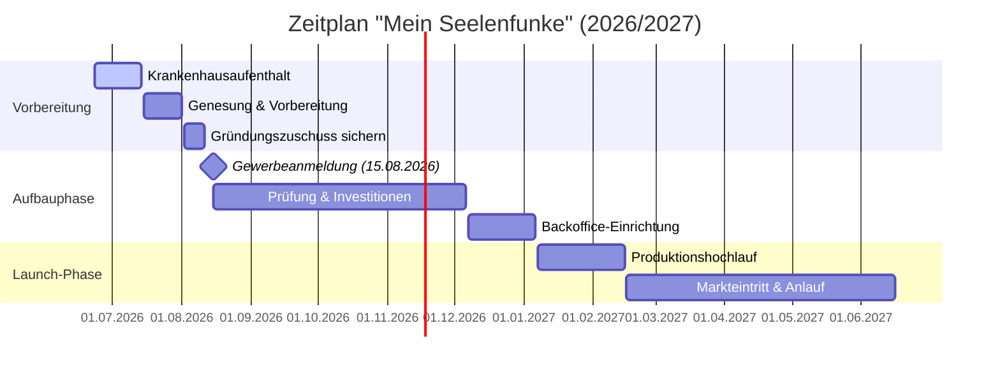

# Businessplan: Mein Seelenfunke
**Gründerin:** Alina Steinhauer  
**Stand des Businessplans:** Aktualisiert am 15.06.2026 (Anpassung des Zeitplans aufgrund von Krankenhausaufenthalt – Start am 15.08.2026)

---

## Inhalt
1. [Zusammenfassung](#1-zusammenfassung)
2. [Gründerprofil & Kompetenzen](#2-gründerprofil--kompetenzen)
3. [Geschäftsidee & Produkte](#3-geschäftsidee--produkte)
4. [Markt- & Wettbewerbsanalyse](#4-markt--wettbewerbsanalyse)
5. [Marketing & Vertriebsstrategie](#5-marketing--vertriebsstrategie)
6. [Organisation & Standort (Dachboden)](#6-organisation--standort-dachboden)
7. [Risikoanalyse](#7-risikoanalyse)
8. [Investitionsübersicht](#8-investitionsübersicht)
9. [Jahresplanung & Zeitlicher Ablauf (2026/2027)](#9-jahresplanung--zeitlicher-ablauf-20262027)
10. [Umsatzplanung (2028-2030)](#10-umsatzplanung-2028-2030)
11. [Detaillierte Finanzübersicht (Ziel-Szenario 2028)](#11-detaillierte-finanzübersicht-ziel-szenario-2028)
12. [Private Budgetplanung (2028)](#12-private-budgetplanung-2028)
13. [Produktkalkulationen (Starter-Kollektion)](#13-produktkalkulationen-starter-kollektion)

---

## 1. Zusammenfassung

Mein-Seelenfunke ist eine E-Commerce-Manufaktur für hoch-emotionale, personalisierte Geschenke. Unter dem Motto **"Ein Funke, der bleibt"** werden mittels modernster UV- und Galvo-Lasertechnologien Rohmaterialien wie Glas, Acryl, Metall und Schiefer personalisiert und veredelt. Auch die eigene Produktion von Schmuck (Halsketten), Glasbildern und Holzgeschenken wird angestrebt.

Im Gegensatz zu massenproduzierter Ware bietet Mein-Seelenfunke individuelle Unikate, die speziell für Anlässe wie Jahrestage, Hochzeiten oder Trauerbewältigung gefertigt werden. Der Vertrieb startet über den Marktplatz Etsy und wird später über den eigenen Onlineshop unter `mein-seelenfunke.de` ausgebaut. Ziel ist der direkte Übergang in die volle Selbstständigkeit bis **Ende 2027** mit einem angestrebten verfügbaren Nettoeinkommen zwischen 1.600 € und 2.000 €/Monat.

---

## 2. Gründerprofil & Kompetenzen

Die Gründerin Alina Steinhauer verfügt aufgrund ihrer 12-jährigen Erfahrung im Bereich Support, Softwareentwicklung, Vor-Ort-Service und einer Nebentätigkeit als Drohnenpilotin über ein ausgeprägtes technisches Verständnis und beste Voraussetzungen für die Umsetzung der neu geplanten Gewerbestruktur. Die Anlauf- und Vorbereitungsphase bis Ende 2027 wird intensiv zur Weiterbildung in den Bereichen E-Commerce, Digital Marketing und Lasertechnik genutzt (z. B. Zertifizierung zur Laserschutzbeauftragten nach OStrV & TROS).

---

## 3. Geschäftsidee & Produkte

Der Name "Seelenfunke" suggeriert tiefgehende Bedeutung. Wir verkaufen keine einfachen "Produkte", sondern "konservierte Emotionen". Das Ziel ist der Aufbau einer profitablen E-Commerce-Manufaktur für hoch-emotionale, personalisierte Geschenke.

### Das Kernprodukt: Der „Seelen-Kristall“ Glas-Trophäe
*   **Rolle:** Premium-Flaggschiff. Hoher Verkaufspreis, hoher absoluter Gewinn pro Stück (ca. 30 €).
*   **Risiko:** Höchste Bruchgefahr. Erfordert Investitionen in hochwertige Polsterung und Verpackung.

### Weitere Produktideen:
1.  **Der "Seelen-Song"** (Acryl-Aufsteller mit Holzsockel und LED)
2.  **Der "Liebesfunke"** (personalisierte Metallkarte) – Die "Cash Cow"
3.  **Der "Erinnerungsfunke"** (personalisierter Schmuck/Halsketten)
4.  **Der "Seelen Moment"** (hochwertige Naturschieferplatte mit Fotogravur)

---

## 4. Markt- & Wettbewerbsanalyse

*   **Zielgruppe:** Überwiegend weiblich (20–50 Jahre), emotional kaufend. Gesucht wird "das besondere Geschenk", das sich von klassischer Massenware abhebt.
*   **Wettbewerb:** Mein-Seelenfunke differenziert sich durch edlere Materialien (Metall, Acryl, Glas) und extrem schnelle Lieferzeiten von der Konkurrenz. Dies wird durch den Einsatz des High-End-Lasergravierers *xTool F2 Ultra UV* ermöglicht.
*   **Preisstrategie:** Premium-Personalisierung. Keine Preiskämpfe. Der Wert und die Marge entstehen durch die Personalisierung und ein erstklassiges Auspackerlebnis ("Unboxing Experience").

---

## 5. Marketing & Vertriebsstrategie

*   **Hauptvertriebskanal:** Etsy als Start-Booster für schnellen Traffic und erste Kundenbewertungen, gefolgt vom Aufbau eines eigenen Onlineshops (Shopify) unter `www.mein-seelenfunke.de`.
*   **Social-Media-Strategie (TikTok/Instagram):**
    *   *KI-Influencer:* Ein sympathischer, digitaler Markenbotschafter ("Das Gesicht von Mein Seelenfunke") präsentiert die Produkte emotional, ohne dass die Gründerin selbst vor die Kamera treten muss.
    *   *Viraler Content:* Videos aus der Produktion, dem Entstehungsprozess der personalisierten Geschenke und emotionale Reaction-Videos von Kunden.
*   **Kern-Elemente:** Deutsche Domain, Qualitätsversprechen "Made in Germany", schneller versicherter Versand.

---

## 6. Organisation & Standort (Dachboden)

Die Produktion erfolgt kosteneffizient im eigenen, komplett ausgebauten Dachboden, was die Fixkosten zu Beginn minimiert.
*   **Zustand:** Komplett ausgebaut, inklusive Dämmung, Beleuchtung und Heizung.
*   **Beleuchtung:** Ausreichend LED-Spots sind verbaut.
*   **Klimatisierung:** Eine Klimaanlage (Innen- und Außengerät) wird bei Bedarf installiert, ist jedoch vorerst nicht zwingend notwendig.
*   **Abluft:** Die Absaugung der Laserdämpfe erfolgt über die zwei Dachfenster mittels eines Rohradapters. Langfristig ist eine direkte Kernbohrung/Wandabluft geplant.
*   **Lager:** Schwerlastregale für Verpackungen und Rohlinge; dedizierte Arbeitstische für Verpackung und Laserstation.

---

## 7. Risikoanalyse

*   **Stärken:** Eigene Immobilie (Dachboden = mietfreie Nutzung, geringe Fixkosten), High-End-Equipment (schneller als Konkurrenz), einprägsamer deutscher Markenname.
*   **Schwächen:** Einzelunternehmerin (Herausforderung Zeitmanagement), Abhängigkeit von Lieferanten für Rohlinge.
*   **Chancen:** Hohe Skalierbarkeit durch Erweiterung des Sortiments auf neue Materialien (Holz, Leder etc.).
*   **Risiken & Gegenmaßnahmen:** 
    *   *Ausfall des Lasers:* Schnelle Kooperation mit lokalen Produktionspartnern oder Anschaffung eines Zweitgeräts.
    *   *Gesundheitsrisiken:* Minimierung durch professionelle Fensterabluft.
    *   *Ausfallzeiten:* Absicherung über spezielle Elektronik- und Betriebsunterbrechungsversicherungen.

---

## 8. Investitionsübersicht

Zur Gründung sind folgende Einmalkosten veranschlagt:

| Kategorie | Posten | Geschätzte Kosten (€) | Anmerkung |
| :--- | :--- | :---: | :--- |
| **Produktionstechnik** | xTool F2 Ultra UV | 4.550,00 | Kernstück der Produktion |
| **Sicherheit & Abluft** | xTool SafetyPro™ IF2/IF2 2.0 Rohrventilator | 200,00 | Absaugung über Dach/Fenster |
| | xTool Laser-Schutzbrille (Zertifiziert) | 65,00 | Pflicht für Wartung/Betrieb |
| **Schulung & Recht** | Laserschutzbeauftragter (LSB) Online-Kurs | 600,00 | Rechtliche Absicherung (OStrV) |
| **Infrastruktur** | Anpassung Dachboden (Elektro/Kleinteile) | 150,00 | Minimale Anpassung vorhanden |
| **Arbeitsplatz** | Profi-Arbeitsplatz (Tische, Beleuchtung, Stuhl) | 450,00 | Fokus auf Ergonomie (Dachboden) |
| **Zusatz-Hardware** | Professioneller Labeldrucker (z.B. Brother/Dymo) | 250,00 | Effizienz im Versand |
| **Material-Puffer** | Muster-Rohlinge & Erstbestand (Glas, Schiefer) | 1.000,00 | Sofortiger Start & Mustererstellung |
| **Reserve** | Unvorhergesehenes / Puffer | 550,00 | Sicherheit für den Start |
| **GESAMT** | **Summe der Einmalkosten** | **7.815,00 €** | |

---

## 9. Jahresplanung & Zeitlicher Ablauf (2026/2027)

Aufgrund eines Krankenhausaufenthalts wurde der Zeitplan angepasst. Der offizielle Start des Gewerbes ist nun der **15.08.2026**.

### Phase 1: Vorbereitungen & Krankheits-Unterbrechung (23.06.2026 – 14.08.2026)
*   **Bis 22.06.2026:** Bezug von normalem ALG 1.
*   **23.06.2026 – 14.07.2026:** Krankenhausaufenthalt (ca. 3 Wochen).
*   **15.07.2026 – 31.07.2026:** Genesungsphase & Vorbereitung der Gründung (Bezug von normalem ALG 1).
*   **02.08.2026 – 11.08.2026:** Sicherung des Gründungszuschusses bei der Agentur für Arbeit (Einreichung der Tragfähigkeitsstellungnahme). Vorbereitung der Gewerbeanmeldung zum **15.08.2026**.

### Phase 2: Gewerbestart & Technische Vorbereitung (15.08.2026 – 06.12.2026)
*   **15.08.2026:** Offizielle Anmeldung des Gewerbes „Mein-Seelenfunke“ (Start der Selbstständigkeit im Haupterwerb).
*   **1. Start des Bezugs:** Beginn von ALG 1 + Gründungszuschuss (Phase 1: 6 Monate Sicherung des Lebensunterhalts).
*   **2. Geschäftskonto:** Eröffnung eines geschäftlichen Bankkontos.
*   **3. Ausbildung:** Absolvierung der Schulung zur zertifizierten Laserschutzbeauftragten (LSB) nach OStrV.
*   **4. Rechtliches:** Anmeldung der Verpackungslizenz über das Verpackungsregister (LUCID).
*   **5. Investitionen:** Kauf der Produktionstechnik (xTool Laser, SafetyPro Abluft, Schutzbrille) und Einrichtung des Arbeitsplatzes. Marken- und Logoschutz über das DPMA beantragen.
*   **6. IT & Buchhaltung:** Einrichtung des Etsy-Shops sowie Anbindung von *Billbee* (Rechnungserstellung) und *Sevdesk* (Buchhaltung) zur automatisierten Erfassung aller Ein- und Ausgaben.

### Phase 3: Backoffice & Ablaufprozesse (07.12.2026 – 06.01.2027)
*   **1. Lagerorganisation:** Definition der Lagerlogistik (Mindestbestände Rohlinge, Nachbestellprozesse, Warenkontrolle).
*   **2. Ablaufdefinition:** Exakte zeitliche und finanzielle Kalkulation der Produktionsschritte pro Produkt (Rohmaterial, Gravurdauer, Verpackungszeit, Gebühren, Versand).
*   **3. Verpackung & Versand:** Testen von Kartonagen und Schutzfolien zur Minimierung von Transportschäden.
*   **4. Marketing-Vorbereitung:** Erstellung von erstem Bildmaterial, Social-Media-Kanäle aufbauen (TikTok, Instagram) und Produktion erster KI-gestützter Produktvideos.
*   **5. Testläufe:** Probelauf der gesamten Kette (Bestellung -> Billbee -> Sevdesk -> Produktion -> Versand).

### Phase 4: Produktionshochlauf & Logistik-Optimierung (07.01.2027 – 15.02.2027)
*   Fokus liegt auf der Skalierung des Warenbestands und der Ablaufoptimierung.
*   **1. Vorproduktion:** Fertigung der "Starter-Kollektion" (alle 5 Hauptprodukte) in höheren Stückzahlen zur Lagerbildung.
*   **2. Lieferantenverträge:** Finalisierung von Bulk-Lieferverträgen für Rohlinge zur Absicherung von Rabatten und Liefergarantien.
*   **3. Packstraße:** Optimierung der Arbeitsprozesse beim Verpacken für maximalen Durchsatz.

### Phase 5: Markteintritt & Saisonales Wachstum (16.02.2027 – 16.06.2027)
*   **März 2027 (Markteintritt & Anlaufphase):**
    *   *Fokus:* Technische Abläufe im Echtbetrieb testen, erste organische Bewertungen generieren, "Early-Bird"-Angebote schalten.
    *   *Prognose:* ca. 50–60 Verkäufe.
    *   *Umsatz-Ziel:* ca. 1.800 € – 2.100 € (deckt die laufenden Kosten).
*   **April 2027 (Wachstumsphase & Ostern):**
    *   *Fokus:* Schaltung erster bezahlter Werbeanzeigen (Etsy Ads, Meta Ads). Nutzung des Ostergeschäfts für den Verkauf von Frühlings-Deko und personalisierten Geschenken.
    *   *Prognose:* ca. 80–100 Verkäufe.
    *   *Umsatz-Ziel:* ca. 2.800 € – 3.500 €.
*   **Mai 2027 (Hauptsaison & Muttertag/Vatertag):**
    *   *Fokus:* Maximierung der Conversion-Rate für Geschenkartikel. Bewerbung des "Seelen-Kristalls" und der "Liebesfunken"-Metallkarten als ideales Muttertags- und Vatertagsgeschenk. Express-Optionen für Last-Minute-Käufer anbieten.
    *   *Prognose:* ca. 110–130 Verkäufe.
    *   *Umsatz-Ziel:* ca. 3.900 € – 4.500 € (gleicht die Anlaufverluste aus dem März aus).

---

## 10. Umsatzplanung (2028-2030)

Da das Gewerbe im August 2026 startet und die Anlaufphase bis Mitte 2027 andauert, ist das Jahr **2028** das erste vollumfänglich geplante Verkaufsjahr.

### Strategieübersicht der Folgejahre:
*   **Jahr 2028 (Etablierung & Kundenstamm):** Fokus auf die wichtigsten Geschenke-Feiertage (Valentinstag, Ostern, Muttertag, Weihnachten). Aufbau von Stammkunden und Generierung von 5-Sterne-Bewertungen. Ziel: 10–15 Bestellungen pro Tag.
*   **Jahr 2029 (Wachstum & Optimierung):** Nutzung von Top-Rankings (Google/Etsy SEO). Skalierung durch Effizienzsteigerung und erste B2B-Projekte (Firmenkunden). Anschaffung eines zweiten Lasers oder Einstellung einer Aushilfe auf 520-€-Basis für den Versand. Geplantes Wachstum: 15–20 %.
*   **Jahr 2030 (Festigung & Reifephase):** Steigerung des durchschnittlichen Warenkorbwerts durch Cross-Selling. Starker Fokus auf das B2B-Geschäft (Mitarbeitergeschenke, Firmenpräsente mit Logo) zum Ausgleich saisonaler Schwankungen. Strukturierung: Zwei Mitarbeiter für Produktion und Versand, die Gründerin konzentriert sich auf die strategische Leitung.

### Monatliche Umsatzprognose (Brutto)

| Monat | Jahr 2028 (Etablierung) | Jahr 2029 (Wachstum) | Jahr 2030 (Festigung) | Fokus & Begründung |
| :--- | :---: | :---: | :---: | :--- |
| **Januar** | 2.200 € | 2.800 € | 3.200 € | Saison-Tief ("Kaufkater" nach Weihnachten), Fokus auf Inventur |
| **Februar** | 3.800 € | 4.500 € | 4.900 € | **Peak 1 (Valentinstag):** Hochsaison für "Seelen-Song" & "Liebesfunke" |
| **März** | 2.800 € | 3.200 € | 3.600 € | Normalisierung. Ostervorbereitung (kleinere Geschenke) |
| **April** | 3.200 € | 3.800 € | 4.100 € | Anlauf Muttertag, Start von Werbekampagnen |
| **Mai** | 4.200 € | 5.000 € | 5.400 € | **Peak 2 (Muttertag/Vatertag):** Stärkster Monat im 1. Halbjahr |
| **Juni** | 2.500 € | 3.000 € | 3.500 € | Beginn Sommerzeit, Fokus auf Hochzeitsgeschenke |
| **Juli** | 2.400 € | 2.800 € | 3.100 € | Sommerloch (Ferienzeit), Zeit für Design-Entwicklung |
| **August** | 2.500 € | 3.000 € | 3.200 € | Sommerloch, Vorbereitung auf Q4 & B2B-Weihnachtsakquise |
| **September** | 3.000 € | 3.500 € | 3.900 € | Herbst-Beginn, "Cosy Season" startet (Deko-Artikel) |
| **Oktober** | 3.500 € | 4.200 € | 4.800 € | Start Weihnachtsgeschäft (Early Bird), B2B-Abschlüsse |
| **November** | 5.200 € | 6.000 € | 6.800 € | **Peak 3 (Black Week):** Höchste Bestellfrequenz des Jahres |
| **Dezember** | 5.800 € | 6.500 € | 7.100 € | **Peak 4 (Weihnachten):** Endspurt bis zum 20.12. |
| **GESAMT** | **ca. 41.100 €** | **ca. 48.300 €** | **ca. 53.600 €** | |
| **Monatsschnitt** | **ca. 3.425 €** | **ca. 4.025 €** | **ca. 4.460 €** | |
| **Reingewinn (Netto)**| **ca. 1.800 €** | **> 2.000 €** | **> 2.300 €** | *(Nach Steuern und Betriebskosten)* |

---

## 11. Detaillierte Finanzübersicht: Ziel-Szenario 2028

Die folgende Kalkulation stellt ein durchschnittliches Ziel-Szenario für ein stabiles Geschäftsjahr (Basis: 2028) dar.

| Position | Monatlich (Ø) | Jährlich (Gesamt 2028) |
| :--- | :---: | :---: |
| **I. Gewerbliche Einnahmen** | | |
| Umsatzerlöse (Brutto-Verkauf) | 4.250,00 € | 51.000,00 € |
| Material & Verpackung (15%) | - 637,50 € | - 7.650,00 € |
| Versandkosten (15%) | - 637,50 € | - 7.650,00 € |
| Gebühren (Etsy Shop 18%) | - 765,00 € | - 9.180,00 € |
| **= Rohertrag (Deckungsbeitrag)** | **2.210,00 €** | **26.520,00 €** |
| | | |
| **II. Betriebliche Fixkosten** | | |
| Marketing (Organisch + Ads) | - 50,00 € | - 600,00 € |
| Strom & Heizung | - 20,00 € | - 240,00 € |
| Instandhaltung | - 30,00 € | - 360,00 € |
| Software (Billbee, Sevdesk etc.) | - 45,00 € | - 540,00 € |
| Versicherungen (Gewerbe) | - 45,00 € | - 540,00 € |
| Steuerberater | - 120,00 € | - 1.440,00 € |
| **= Gewerblicher Gewinn (EÜR)** | **1.900,00 €** | **22.800,00 €** |

---

## 12. Private Budgetplanung (2028)

Berechnung des verfügbaren Reinkommens für die Gründerin im Jahr 2028.

| Position | Monatlich (Ø) | Jährlich (2028) |
| :--- | :---: | :---: |
| **Gewerblicher Gewinn (EÜR)** | **1.900,00 €** | **22.800,00 €** |
| + Mieteinnahmen (Hausanteil) | + 550,00 € | + 6.600,00 € |
| **= Gesamt-Einkommen (Brutto)** | **2.450,00 €** | **29.400,00 €** |
| - Krankenkasse & Pflege (GKV) | - 470,00 € | - 5.640,00 € |
| **= NETTO (Auszahlungsbetrag)** | **1.980,00 €** | **23.760,00 €** |
| - Steuer-Rücklage | - 380,00 € | - 4.560,00 € |
| **= VERFÜGBARES NETTO** | **1.600,00 €** | **19.200,00 €** |

*   **Absatzrechnung:** Bei einem gewünschten Monatsumsatz von 4.250,00 € und einem durchschnittlichen Verkaufspreis von 39,90 € entspricht dies **ca. 106,5 verkauften Produkten pro Monat**.
*   Bei 30 Tagen im Monat entspricht dies einem täglichen Absatz von **3 bis 4 Verkäufen**.

---

## 13. Produktkalkulationen (Starter-Kollektion)

### A. Produkt-Kalkulation: „Seelen-Kristall“ (Premium-Glas)
*   **Verkaufspreis (Brutto):** 39,90 €
*   **Umsatzsteuer (19%):** 6,37 €
*   **Verkaufspreis (Netto):** 33,53 €

| Kalkulationsschritt | Kosten pro Stück | Fakten / Erläuterung |
| :--- | :---: | :--- |
| 1. Einstandspreis (Rohling) | 3,69 € | K9 Glasblock (Importpreis) |
| 2. Veredelung (Produktion) | 1,50 € | Strom, Laserabnutzung, Hilfsmittel |
| 3. Verpackung | 0,71 € | Standard Buchverpackung (kein Premium) |
| 4. Logistik (Versand) | 5,90 € | Versicherter Versand (DHL) |
| **Einstandskosten (COGS)** | **11,80 €** | Direkte Herstellkosten inkl. Versand |
| 5. Marktplatz-Gebühren (18%) | 7,18 € | Provision auf 39,90 € Verkaufspreis |
| 6. Marketing-Anteil | 3,00 € | Werbebudget (Ads) pro Verkauf |
| **Selbstkosten Gesamt** | **21,98 €** | Gesamtkosten bis zum Verkauf |
| **7. DEIN GEWINN (Netto)** | **11,55 €** | Reingewinn pro Trophäe |

---

### B. Produkt-Kalkulation: „Seelen-Moment“ (Schieferplatte 20x20 cm)
*   **Verkaufspreis (Brutto, Shop):** 41,53 €
*   **Umsatzsteuer (19%):** 6,63 €
*   **Verkaufspreis (Netto):** 34,90 €

| Kalkulationsschritt | Kosten pro Stück | Erläuterung |
| :--- | :---: | :--- |
| 1. Einstandspreis (Rohling) | 2,20 € | Einzelne Naturschieferplatte (ca. 200x200 mm) |
| 2. Veredelung (Produktion) | 1,50 € | Vollflächige Gravur (220x220 mm Limit), Strom via PV |
| 3. Spezial-Verpackung | 2,80 € | Stabiler flacher Karton + Luftpolster/Eckenschutz |
| 4. Logistik (Versand) | 6,90 € | Paketversand (wegen Gewicht & Bruchschutz) |
| **Einstandskosten (COGS)** | **13,40 €** | Direkte Kosten inkl. sicherem Versand |
| 5. Marktplatz-Gebühren (ca. 18%) | 6,28 € | Gebühren auf den Brutto-Verkaufspreis |
| 6. Marketing-Anteil (pro Stück) | 1,50 € | Geringerer Anteil, da oft über Suchbegriffe gefunden |
| **Selbstkosten Gesamt** | **21,18 €** | Gesamte Selbstkosten |
| **7. Wunsch-Gewinn (Netto)** | **13,72 €** | Dein Reingewinn pro verkaufte Platte |

---

### C. Produkt-Kalkulation: „Seelen-Song“ (Acryl-Aufsteller mit Holzsockel)
*   Format: ca. 150 x 210 mm (passend für den 220 x 220 mm Arbeitsbereich des Lasers)
*   **Verkaufspreis (Brutto, Shop):** 41,53 €
*   **Umsatzsteuer (19%):** 6,63 €
*   **Verkaufspreis (Netto):** 34,90 €

| Kalkulationsschritt | Kosten pro Stück | Erläuterung |
| :--- | :---: | :--- |
| 1. Einstandspreis (Material) | 4,50 € | Hochwertiges GS-Acryl (5mm) + LED-Holzsockel (USB) |
| 2. Veredelung (Produktion) | 1,20 € | Gravur & Zuschnitt; Schutzfolie bleibt währenddessen drauf |
| 3. Kratzschutz-Verpackung | 1,80 € | Mikrofaser-Beutel oder weiches Seidenpapier + Luftpolsterfolie |
| 4. Logistik (Versand) | 4,50 € | Günstigerer Versand (z. B. DHL 1kg oder Maxibrief Prio) |
| **Einstandskosten (COGS)** | **12,00 €** | Deine Basis-Kosten für ein versandfertiges Produkt |
| 5. Marktplatz-Gebühren (ca. 18%) | 6,28 € | Gebühren auf den Brutto-Verkaufspreis |
| 6. Marketing-Anteil (Social Media) | 3,50 € | Höheres Werbebudget da TikTok/Insta Trend-Produkt |
| **Selbstkosten Gesamt** | **21,78 €** | Kosten inklusive Werbung und Gebühren |
| **7. Wunsch-Gewinn (Netto)** | **13,12 €** | Dein Reingewinn pro "Song" |
